# Run gemini-1: 20260731_032044_1aa85267

> Lift the clapper stick, then let go so it snaps shut with a clap. Note that the context (top) cam is on the opposite sides of the arms.

| | |
|---|---|
| Created (UTC) | 2026-07-31 03:20:44 |
| Model | gemini-robotics-er-2-preview |
| Effort | high |
| Embodiment | yam_arms |
| Status | success |
| Outcome | fail |
| Termination | operator_end |
| Operator judgement | n |
| Duration | 02:04 |
| Steps | 81 |
| LLM turns | 13 |
| Seed | 0 |
| inspect-robots | 0.34.0 |
| Git commit | n/a |

Files: [raw EvalLog](../adhoc_b933500d.json) · [top video](../videos/20260731_032044_1aa85267/scene-0-e0_top_cam.mp4) · [left video](../videos/20260731_032044_1aa85267/scene-0-e0_left_cam.mp4) · [right video](../videos/20260731_032044_1aa85267/scene-0-e0_right_cam.mp4) · [transcript jsonl](../transcripts/20260731_032044_1aa85267) · [wire capture](../wire/20260731_032044_1aa85267)

## Transcript

<details>
<summary>System prompt</summary>

````text
You are controlling a real robot embodiment named 'yam_arms' through tool calls. Each observation message gives you the current proprioceptive state and camera images. Work toward the user's goal in small, deliberate motions; re-check the observation after every motion. Every move tool call must include a `note`: in one or two sentences, say what you observe in the current observation and why you chose this motion. The user is watching these notes to see what you see and what you decide, so write them for a human reader. Safety approvers clamp out-of-bounds and too-fast actions below you. Respond with exactly one tool call per turn. When the goal is achieved call done; if it cannot be achieved call give_up. You have a budget of 200 LLM calls for the whole trial.

Embodiment notes:
Two identical 6-DoF arms, prefixed left_ and right_, each with a parallel-jaw
gripper. Each arm has its own base frame: +x points forward out of the base
(the direction the folded gripper points at all-zero joints), +y left, +z up;
how the two bases are mounted relative to each other depends on the rig.
Joint guide (positive direction, identical for both arms):
- left_j0 / right_j0: base yaw about the vertical axis; positive swings the
  arm counterclockwise seen from above (a forward-pointing gripper moves
  toward +y).
- left_j1 / right_j1: shoulder pitch; 0 points the upper arm horizontally
  backward and is the lower hard stop (it cannot go negative), positive
  raises it (about 1.57 is straight up, about 3.14 is horizontal forward).
- left_j2 / right_j2: elbow; 0 is fully folded with the forearm doubled back
  against the upper arm and is the lower hard stop, positive opens it.
- left_j3 / right_j3: wrist pitch, axis parallel to the elbow; positive tilts
  the gripper up.
- left_j4 / right_j4: wrist yaw; positive swings the gripper toward the arm's
  right seen from above (opposite sign sense of j0).
- left_j5 / right_j5: wrist roll about the gripper's pointing axis; positive
  turns clockwise when viewed from behind the gripper looking out along the
  fingers.
- left_gripper / right_gripper: 0 is fully closed, 1 is fully open (about
  9.5 cm between the jaws).
Proportions: upper arm 0.26 m, forearm 0.25 m, wrist to grasp point 0.25 m
when straight; reach from the shoulder about 0.76 m.
At all-zero joints the arm rests folded low with the gripper pointing
forward. While the arm is folded, a single joint's effect on the gripper
position can be counterintuitive; move deliberately and re-check the
observation after each motion. The joint values above are positions as shown
in the observation; when actions are per-step changes (delta mode), the same
sign conventions apply to each change.
````

</details>

> Goal: Lift the clapper stick, then let go so it snaps shut with a clap. Note that the context (top) cam is on the opposite sides of the arms.

<details open>
<summary>Observation 1</summary>

````text
Current observation.
Instruction: Lift the clapper stick, then let go so it snaps shut with a clap. Note that the context (top) cam is on the opposite sides of the arms.
state[joint_pos]: left_j0=0.0032 left_j1=0.0063 left_j2=0.0063 left_j3=-0.0246 left_j4=-0.0082 left_j5=-0.0158 left_gripper=0.9988 right_j0=-0.0013 right_j1=0.0025 right_j2=0.0063 right_j3=-0.0406 right_j4=-0.0082 right_j5=-0.0246 right_gripper=0.9995

camera 'top_cam' (step 0):

[image omitted: streamed camera frame]

camera 'left_cam' (step 0):

[image omitted: streamed camera frame]

camera 'right_cam' (step 0):

[image omitted: streamed camera frame]
````

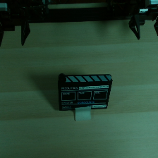 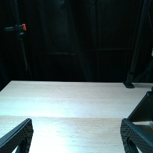 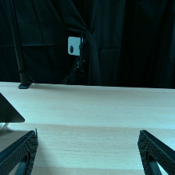

</details>

**Turn 1**

I will raise both arms and extend them forward so they are visible and positioned above the table.

`move_joints`
````json
{
  "targets": {
    "right_j1": 1.8,
    "left_j3": 0,
    "left_j1": 1.8,
    "left_j0": 0.2,
    "left_j2": 1.5,
    "right_j2": 1.5,
    "right_j0": -0.2,
    "right_j3": 0
  }
}
````

*executing move_joints over 29 steps (2.9s)*

<details open>
<summary>Observation 2</summary>

````text
Current observation.
Instruction: Lift the clapper stick, then let go so it snaps shut with a clap. Note that the context (top) cam is on the opposite sides of the arms.
state[joint_pos]: left_j0=0.1921 left_j1=1.7939 left_j2=1.4704 left_j3=-0.017 left_j4=-0.0113 left_j5=-0.0204 left_gripper=0.9987 right_j0=-0.1947 right_j1=1.7893 right_j2=1.4708 right_j3=-0.0223 right_j4=-0.0158 right_j5=-0.0372 right_gripper=0.9995

camera 'top_cam' (step 29):

[image omitted: streamed camera frame]

camera 'left_cam' (step 29):

[image omitted: streamed camera frame]

camera 'right_cam' (step 29):

[image omitted: streamed camera frame]
````

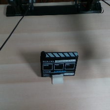 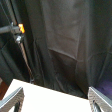 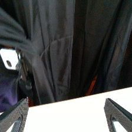

</details>

**Turn 2**

I will move the robot's left arm closer to the center and lower it towards the clapper board to prepare for lifting the clapper stick.

`move_joints`
````json
{
  "targets": {
    "left_j1": 2.4,
    "left_j3": -0.5,
    "left_j0": 0,
    "left_j2": 1.8
  }
}
````

*executing move_joints over 10 steps (1.0s)*

<details open>
<summary>Observation 3</summary>

````text
Current observation.
Instruction: Lift the clapper stick, then let go so it snaps shut with a clap. Note that the context (top) cam is on the opposite sides of the arms.
state[joint_pos]: left_j0=0.0021 left_j1=2.3695 left_j2=1.7916 left_j3=-0.4564 left_j4=-0.0196 left_j5=-0.0238 left_gripper=0.9982 right_j0=-0.1967 right_j1=1.7992 right_j2=1.4723 right_j3=-0.0345 right_j4=-0.0158 right_j5=-0.0376 right_gripper=0.9995

camera 'top_cam' (step 39):

[image omitted: streamed camera frame]

camera 'left_cam' (step 39):

[image omitted: streamed camera frame]

camera 'right_cam' (step 39):

[image omitted: streamed camera frame]
````

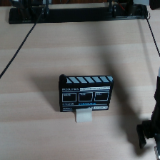 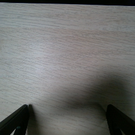 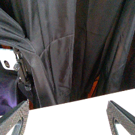

</details>

**Turn 3**

I will swing the left arm more towards the center and extend it forward so that the gripper is positioned directly above the right side of the clapper stick.

`move_joints`
````json
{
  "targets": {
    "left_j3": -0.5,
    "left_j1": 2.6,
    "left_j2": 2.1,
    "left_j0": -0.15
  }
}
````

*executing move_joints over 5 steps (0.5s)*

<details open>
<summary>Observation 4</summary>

````text
Current observation.
Instruction: Lift the clapper stick, then let go so it snaps shut with a clap. Note that the context (top) cam is on the opposite sides of the arms.
state[joint_pos]: left_j0=-0.1425 left_j1=2.5622 left_j2=2.0914 left_j3=-0.4576 left_j4=-0.0296 left_j5=-0.0319 left_gripper=0.9981 right_j0=-0.1967 right_j1=1.7992 right_j2=1.4723 right_j3=-0.0494 right_j4=-0.0158 right_j5=-0.0376 right_gripper=0.9995

camera 'top_cam' (step 44):

[image omitted: streamed camera frame]

camera 'left_cam' (step 44):

[image omitted: streamed camera frame]

camera 'right_cam' (step 44):

[image omitted: streamed camera frame]
````

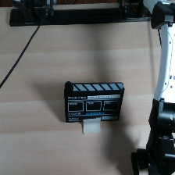 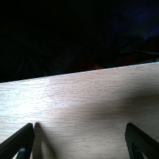 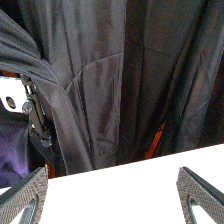

</details>

**Turn 4**

I will swing the left arm further to the robot's right (towards the center of the image) to align it with the openable side of the clapper board.

`move_joints`
````json
{
  "targets": {
    "left_j0": -0.38,
    "left_j1": 2.56,
    "left_j3": -0.5,
    "left_j2": 2.1
  }
}
````

*executing move_joints over 4 steps (0.4s)*

<details open>
<summary>Observation 5</summary>

````text
Current observation.
Instruction: Lift the clapper stick, then let go so it snaps shut with a clap. Note that the context (top) cam is on the opposite sides of the arms.
state[joint_pos]: left_j0=-0.3874 left_j1=2.5622 left_j2=2.0926 left_j3=-0.4641 left_j4=-0.0368 left_j5=-0.046 left_gripper=0.9981 right_j0=-0.1967 right_j1=1.7992 right_j2=1.4723 right_j3=-0.0544 right_j4=-0.0154 right_j5=-0.0376 right_gripper=0.9995

camera 'top_cam' (step 48):

[image omitted: streamed camera frame]

camera 'left_cam' (step 48):

[image omitted: streamed camera frame]

camera 'right_cam' (step 48):

[image omitted: streamed camera frame]
````

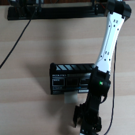 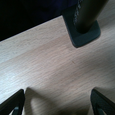 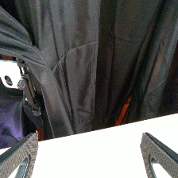

</details>

**Turn 5**

I see that the gripper has extended past the clapper board (since the board is closer to the robot's base than the gripper is). I will pull the arm back closer to the robot.

`move_joints`
````json
{
  "targets": {
    "left_j1": 2.15,
    "left_j2": 1.6,
    "left_j3": -0.4,
    "left_j0": -0.38
  }
}
````

*executing move_joints over 8 steps (0.8s)*

<details open>
<summary>Observation 6</summary>

````text
Current observation.
Instruction: Lift the clapper stick, then let go so it snaps shut with a clap. Note that the context (top) cam is on the opposite sides of the arms.
state[joint_pos]: left_j0=-0.3859 left_j1=2.186 left_j2=1.6009 left_j3=-0.4191 left_j4=-0.0372 left_j5=-0.0502 left_gripper=0.9981 right_j0=-0.1967 right_j1=1.7992 right_j2=1.4723 right_j3=-0.0719 right_j4=-0.0154 right_j5=-0.0376 right_gripper=0.9995

camera 'top_cam' (step 56):

[image omitted: streamed camera frame]

camera 'left_cam' (step 56):

[image omitted: streamed camera frame]

camera 'right_cam' (step 56):

[image omitted: streamed camera frame]
````

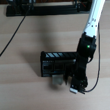 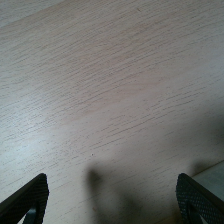 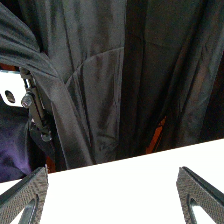

</details>

**Turn 6**

I will pull the arm slightly more towards the robot to align it perfectly with the right end of the clapper stick.

`move_joints`
````json
{
  "targets": {
    "left_j1": 2.05,
    "left_j3": -0.4,
    "left_j0": -0.385,
    "left_j2": 1.45
  }
}
````

*executing move_joints over 3 steps (0.3s)*

<details open>
<summary>Observation 7</summary>

````text
Current observation.
Instruction: Lift the clapper stick, then let go so it snaps shut with a clap. Note that the context (top) cam is on the opposite sides of the arms.
state[joint_pos]: left_j0=-0.384 left_j1=2.0796 left_j2=1.4639 left_j3=-0.3775 left_j4=-0.0452 left_j5=-0.0608 left_gripper=0.9981 right_j0=-0.1967 right_j1=1.7992 right_j2=1.4723 right_j3=-0.0834 right_j4=-0.0158 right_j5=-0.0376 right_gripper=0.9995

camera 'top_cam' (step 59):

[image omitted: streamed camera frame]

camera 'left_cam' (step 59):

[image omitted: streamed camera frame]

camera 'right_cam' (step 59):

[image omitted: streamed camera frame]
````

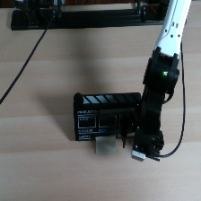 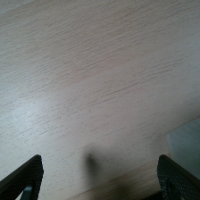 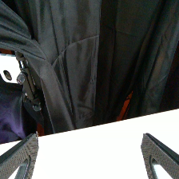

</details>

**Turn 7**

I will swing the gripper further to the left in the top_cam image (towards the clapper stick) and pull it slightly closer to the robot's base.

`move_joints`
````json
{
  "targets": {
    "left_j0": -0.45,
    "left_j3": -0.4,
    "left_j1": 2.05,
    "left_j2": 1.4
  }
}
````

*executing move_joints over 2 steps (0.2s)*

<details open>
<summary>Observation 8</summary>

````text
Current observation.
Instruction: Lift the clapper stick, then let go so it snaps shut with a clap. Note that the context (top) cam is on the opposite sides of the arms.
state[joint_pos]: left_j0=-0.4194 left_j1=2.0624 left_j2=1.4265 left_j3=-0.3248 left_j4=-0.0746 left_j5=-0.0803 left_gripper=0.9981 right_j0=-0.1967 right_j1=1.7992 right_j2=1.4723 right_j3=-0.0952 right_j4=-0.0158 right_j5=-0.0376 right_gripper=0.9995

camera 'top_cam' (step 61):

[image omitted: streamed camera frame]

camera 'left_cam' (step 61):

[image omitted: streamed camera frame]

camera 'right_cam' (step 61):

[image omitted: streamed camera frame]
````

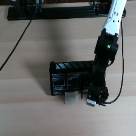 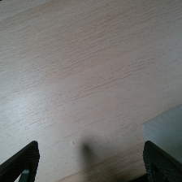 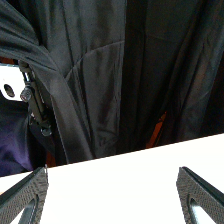

</details>

**Turn 8**

I will swing the left arm further to the left (towards the clapper stick) and lower it slightly.

`move_joints`
````json
{
  "targets": {
    "left_j0": -0.55,
    "left_j2": 1.45,
    "left_j1": 2.15,
    "left_j3": -0.3
  }
}
````

*executing move_joints over 3 steps (0.3s)*

<details open>
<summary>Observation 9</summary>

````text
Current observation.
Instruction: Lift the clapper stick, then let go so it snaps shut with a clap. Note that the context (top) cam is on the opposite sides of the arms.
state[joint_pos]: left_j0=-0.4839 left_j1=2.1036 left_j2=1.4494 left_j3=-0.2699 left_j4=-0.1207 left_j5=-0.0956 left_gripper=0.9981 right_j0=-0.1967 right_j1=1.7992 right_j2=1.4723 right_j3=-0.1032 right_j4=-0.0158 right_j5=-0.0376 right_gripper=0.9995

camera 'top_cam' (step 64):

[image omitted: streamed camera frame]

camera 'left_cam' (step 64):

[image omitted: streamed camera frame]

camera 'right_cam' (step 64):

[image omitted: streamed camera frame]
````

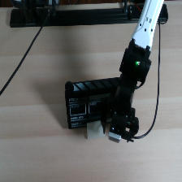 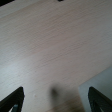 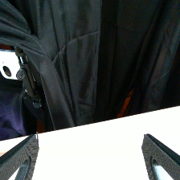

</details>

**Turn 9**

I will swing the arm further left to `-0.58` and pull it slightly closer to the robot by reducing left_j1 and left_j2 to align the gripper jaws with the clapper stick.

`move_joints`
````json
{
  "targets": {
    "left_j3": -0.3,
    "left_j2": 1.35,
    "left_j0": -0.58,
    "left_j1": 2
  }
}
````

*executing move_joints over 2 steps (0.2s)*

<details open>
<summary>Observation 10</summary>

````text
Current observation.
Instruction: Lift the clapper stick, then let go so it snaps shut with a clap. Note that the context (top) cam is on the opposite sides of the arms.
state[joint_pos]: left_j0=-0.5476 left_j1=2.0758 left_j2=1.3865 left_j3=-0.2504 left_j4=-0.1127 left_j5=-0.1047 left_gripper=0.9981 right_j0=-0.1967 right_j1=1.7992 right_j2=1.4723 right_j3=-0.1055 right_j4=-0.0154 right_j5=-0.0376 right_gripper=0.9995

camera 'top_cam' (step 66):

[image omitted: streamed camera frame]

camera 'left_cam' (step 66):

[image omitted: streamed camera frame]

camera 'right_cam' (step 66):

[image omitted: streamed camera frame]
````

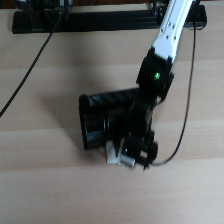 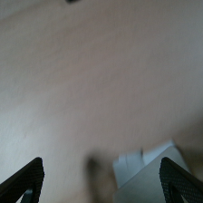 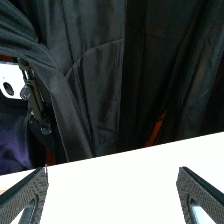

</details>

**Turn 10**

I will swing the gripper further left to align it with the stick's end, and keep it lowered and ready to pinch the stick.

`move_joints`
````json
{
  "targets": {
    "left_j1": 2.15,
    "left_j0": -0.65,
    "left_j2": 1.4,
    "left_j3": -0.3
  }
}
````

*executing move_joints over 2 steps (0.2s)*

<details open>
<summary>Observation 11</summary>

````text
Current observation.
Instruction: Lift the clapper stick, then let go so it snaps shut with a clap. Note that the context (top) cam is on the opposite sides of the arms.
state[joint_pos]: left_j0=-0.6041 left_j1=2.0834 left_j2=1.3907 left_j3=-0.2901 left_j4=-0.123 left_j5=-0.1062 left_gripper=0.9981 right_j0=-0.1967 right_j1=1.7992 right_j2=1.4723 right_j3=-0.1127 right_j4=-0.0154 right_j5=-0.0376 right_gripper=0.9995

camera 'top_cam' (step 68):

[image omitted: streamed camera frame]

camera 'left_cam' (step 68):

[image omitted: streamed camera frame]

camera 'right_cam' (step 68):

[image omitted: streamed camera frame]
````

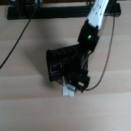 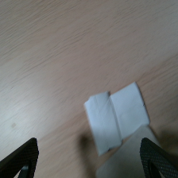 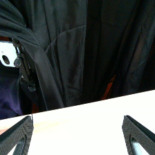

</details>

**Turn 11**

The clapper stick is perfectly positioned between the gripper's jaws in the left eye-in-hand camera. I will lower the arm slightly to ensure a secure grip.

`move_joints`
````json
{
  "targets": {
    "left_j1": 2.15,
    "left_j0": -0.6,
    "left_j2": 1.35,
    "left_j3": -0.3
  }
}
````

*executing move_joints over 2 steps (0.2s)*

<details open>
<summary>Observation 12</summary>

````text
Current observation.
Instruction: Lift the clapper stick, then let go so it snaps shut with a clap. Note that the context (top) cam is on the opposite sides of the arms.
state[joint_pos]: left_j0=-0.6365 left_j1=2.1448 left_j2=1.383 left_j3=-0.2626 left_j4=-0.0998 left_j5=-0.1143 left_gripper=0.998 right_j0=-0.1967 right_j1=1.7992 right_j2=1.4719 right_j3=-0.1226 right_j4=-0.0154 right_j5=-0.0376 right_gripper=0.9995

camera 'top_cam' (step 70):

[image omitted: streamed camera frame]

camera 'left_cam' (step 70):

[image omitted: streamed camera frame]

camera 'right_cam' (step 70):

[image omitted: streamed camera frame]
````

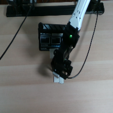 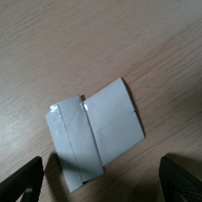 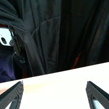

</details>

**Turn 12**

The clapper stick is perfectly aligned between the gripper jaws. I will now close the left gripper to grasp it.

`move_joints`
````json
{
  "targets": {
    "left_gripper": 0
  }
}
````

*executing move_joints over 10 steps (1.0s)*

<details open>
<summary>Observation 13</summary>

````text
Current observation.
Instruction: Lift the clapper stick, then let go so it snaps shut with a clap. Note that the context (top) cam is on the opposite sides of the arms.
state[joint_pos]: left_j0=-0.6399 left_j1=2.1448 left_j2=1.3785 left_j3=-0.2424 left_j4=-0.1043 left_j5=-0.1207 left_gripper=0.0129 right_j0=-0.1967 right_j1=1.7992 right_j2=1.4719 right_j3=-0.1329 right_j4=-0.0154 right_j5=-0.0376 right_gripper=0.9995

camera 'top_cam' (step 80):

[image omitted: streamed camera frame]

camera 'left_cam' (step 80):

[image omitted: streamed camera frame]

camera 'right_cam' (step 80):

[image omitted: streamed camera frame]
````

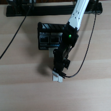 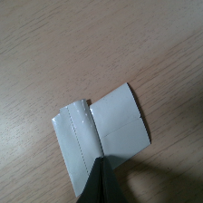 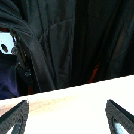

</details>

**Turn 13**

The gripper has firmly grasped the clapper stick. I will now lift the stick by raising the robot's arm.

`move_joints`
````json
{
  "targets": {
    "left_j1": 1.9,
    "left_j0": -0.64,
    "left_j2": 1.25,
    "left_j3": -0.3
  }
}
````

*executing move_joints over 4 steps (0.4s)*

[Back to index](README.md)
