# Run gemini-4: 20260731_033158_b6701524

> Lift the clapper stick, then let go so it snaps shut with a clap. Note that the context (top) cam is on the opposite sides of the arms.

| | |
|---|---|
| Created (UTC) | 2026-07-31 03:31:58 |
| Model | gemini-robotics-er-2-preview |
| Effort | high |
| Embodiment | yam_arms |
| Status | error |
| Outcome | error |
| Termination | n/a |
| Operator judgement | n/a |
| Duration | 04:30 |
| Steps | 136 |
| LLM turns | 34 |
| Seed | 0 |
| inspect-robots | 0.34.0 |
| Git commit | n/a |

Files: [raw EvalLog](../adhoc_f9fbd43b.json) · [top video](../videos/20260731_033158_b6701524/scene-0-e0_top_cam.mp4) · [left video](../videos/20260731_033158_b6701524/scene-0-e0_left_cam.mp4) · [right video](../videos/20260731_033158_b6701524/scene-0-e0_right_cam.mp4) · [transcript jsonl](../transcripts/20260731_033158_b6701524) · [wire capture](../wire/20260731_033158_b6701524)

## Error

````text
EmbodimentFault: frame read failed for top_cam (/dev/v4l/by-id/usb-Intel_R__RealSense_TM__Depth_Camera_435_Intel_R__RealSense_TM__Depth_Camera_435_310323023943-video-index0)
````

## Transcript

<details>
<summary>System prompt</summary>

````text
You are controlling a real robot embodiment named 'yam_arms' through tool calls. Each observation message gives you the current proprioceptive state and camera images. Work toward the user's goal in small, deliberate motions; re-check the observation after every motion. Every move tool call must include a `note`: in one or two sentences, say what you observe in the current observation and why you chose this motion. The user is watching these notes to see what you see and what you decide, so write them for a human reader. Safety approvers clamp out-of-bounds and too-fast actions below you. Respond with exactly one tool call per turn. When the goal is achieved call done; if it cannot be achieved call give_up. You have a budget of 200 LLM calls for the whole trial.

Embodiment notes:
Two identical 6-DoF arms, prefixed left_ and right_, each with a parallel-jaw
gripper. Each arm has its own base frame: +x points forward out of the base
(the direction the folded gripper points at all-zero joints), +y left, +z up;
how the two bases are mounted relative to each other depends on the rig.
Joint guide (positive direction, identical for both arms):
- left_j0 / right_j0: base yaw about the vertical axis; positive swings the
  arm counterclockwise seen from above (a forward-pointing gripper moves
  toward +y).
- left_j1 / right_j1: shoulder pitch; 0 points the upper arm horizontally
  backward and is the lower hard stop (it cannot go negative), positive
  raises it (about 1.57 is straight up, about 3.14 is horizontal forward).
- left_j2 / right_j2: elbow; 0 is fully folded with the forearm doubled back
  against the upper arm and is the lower hard stop, positive opens it.
- left_j3 / right_j3: wrist pitch, axis parallel to the elbow; positive tilts
  the gripper up.
- left_j4 / right_j4: wrist yaw; positive swings the gripper toward the arm's
  right seen from above (opposite sign sense of j0).
- left_j5 / right_j5: wrist roll about the gripper's pointing axis; positive
  turns clockwise when viewed from behind the gripper looking out along the
  fingers.
- left_gripper / right_gripper: 0 is fully closed, 1 is fully open (about
  9.5 cm between the jaws).
Proportions: upper arm 0.26 m, forearm 0.25 m, wrist to grasp point 0.25 m
when straight; reach from the shoulder about 0.76 m.
At all-zero joints the arm rests folded low with the gripper pointing
forward. While the arm is folded, a single joint's effect on the gripper
position can be counterintuitive; move deliberately and re-check the
observation after each motion. The joint values above are positions as shown
in the observation; when actions are per-step changes (delta mode), the same
sign conventions apply to each change.
````

</details>

> Goal: Lift the clapper stick, then let go so it snaps shut with a clap. Note that the context (top) cam is on the opposite sides of the arms.

<details open>
<summary>Observation 1</summary>

````text
Current observation.
Instruction: Lift the clapper stick, then let go so it snaps shut with a clap. Note that the context (top) cam is on the opposite sides of the arms.
state[joint_pos]: left_j0=-0.0059 left_j1=0.0063 left_j2=0.0067 left_j3=-0.025 left_j4=-0.0097 left_j5=-0.0151 left_gripper=0.9993 right_j0=-0.0002 right_j1=0.0025 right_j2=0.0063 right_j3=-0.0299 right_j4=-0.004 right_j5=-0.0147 right_gripper=0.9994

camera 'top_cam' (step 0):

[image omitted: streamed camera frame]

camera 'left_cam' (step 0):

[image omitted: streamed camera frame]

camera 'right_cam' (step 0):

[image omitted: streamed camera frame]
````

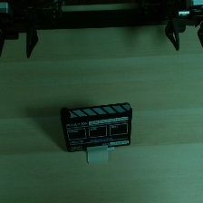 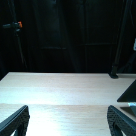 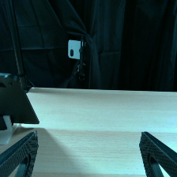

</details>

**Turn 1**

I am unfolding both arms to bring them into a working position above the table so I can see them and the clapper board clearly.

`move_joints`
````json
{
  "targets": {
    "left_j3": -0.5,
    "right_j1": 1.2,
    "left_j2": 1.2,
    "right_j2": 1.2,
    "right_j3": -0.5,
    "left_j1": 1.2
  }
}
````

*executing move_joints over 20 steps (2.0s)*

<details open>
<summary>Observation 2</summary>

````text
Current observation.
Instruction: Lift the clapper stick, then let go so it snaps shut with a clap. Note that the context (top) cam is on the opposite sides of the arms.
state[joint_pos]: left_j0=-0.0067 left_j1=1.203 left_j2=1.1709 left_j3=-0.5041 left_j4=-0.0105 left_j5=-0.0196 left_gripper=0.9992 right_j0=-0.0002 right_j1=1.2015 right_j2=1.1736 right_j3=-0.5125 right_j4=-0.0078 right_j5=-0.0185 right_gripper=0.9994

camera 'top_cam' (step 20):

[image omitted: streamed camera frame]

camera 'left_cam' (step 20):

[image omitted: streamed camera frame]

camera 'right_cam' (step 20):

[image omitted: streamed camera frame]
````

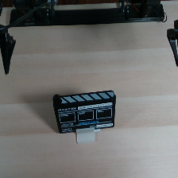 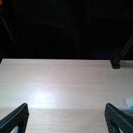 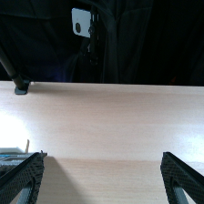

</details>

**Turn 2**

I am moving both arms closer to the clapper board by rotating them inward and extending them further forward.

`move_joints`
````json
{
  "targets": {
    "right_j1": 1.5,
    "right_j3": -0.8,
    "left_j3": -0.8,
    "left_j0": 0.3,
    "left_j1": 1.5,
    "left_j2": 1.5,
    "right_j0": -0.3,
    "right_j2": 1.5
  }
}
````

*executing move_joints over 6 steps (0.6s)*

<details open>
<summary>Observation 3</summary>

````text
Current observation.
Instruction: Lift the clapper stick, then let go so it snaps shut with a clap. Note that the context (top) cam is on the opposite sides of the arms.
state[joint_pos]: left_j0=0.2886 left_j1=1.4982 left_j2=1.4708 left_j3=-0.786 left_j4=-0.009 left_j5=-0.0238 left_gripper=0.9991 right_j0=-0.292 right_j1=1.4944 right_j2=1.4715 right_j3=-0.794 right_j4=-0.0143 right_j5=-0.0261 right_gripper=0.9994

camera 'top_cam' (step 26):

[image omitted: streamed camera frame]

camera 'left_cam' (step 26):

[image omitted: streamed camera frame]

camera 'right_cam' (step 26):

[image omitted: streamed camera frame]
````

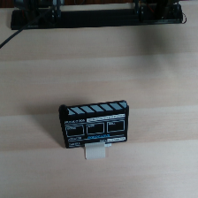 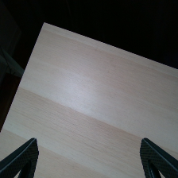 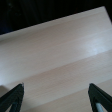

</details>

**Turn 3**

I am raising the shoulder pitch to extend the arms further forward towards the clapper board.

`move_joints`
````json
{
  "targets": {
    "right_j3": -0.5,
    "right_j1": 2.2,
    "left_j3": -0.5,
    "left_j1": 2.2,
    "left_j2": 1.8,
    "right_j2": 1.8
  }
}
````

*executing move_joints over 12 steps (1.2s)*

<details open>
<summary>Observation 4</summary>

````text
Current observation.
Instruction: Lift the clapper stick, then let go so it snaps shut with a clap. Note that the context (top) cam is on the opposite sides of the arms.
state[joint_pos]: left_j0=0.2913 left_j1=2.2047 left_j2=1.7752 left_j3=-0.5266 left_j4=-0.0101 left_j5=-0.0265 left_gripper=0.9988 right_j0=-0.2955 right_j1=2.2032 right_j2=1.7756 right_j3=-0.5297 right_j4=-0.0158 right_j5=-0.0372 right_gripper=0.9994

camera 'top_cam' (step 38):

[image omitted: streamed camera frame]

camera 'left_cam' (step 38):

[image omitted: streamed camera frame]

camera 'right_cam' (step 38):

[image omitted: streamed camera frame]
````

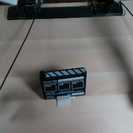 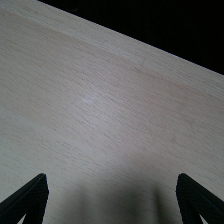 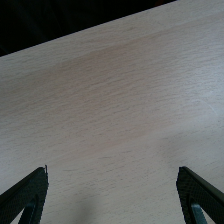

</details>

**Turn 4**

I am continuing to extend the arms further forward and downward by adjusting the shoulder and elbow joints.

`move_joints`
````json
{
  "targets": {
    "right_j1": 2.6,
    "left_j2": 2.1,
    "left_j3": -0.8,
    "right_j2": 2.1,
    "right_j3": -0.8,
    "left_j1": 2.6
  }
}
````

*executing move_joints over 7 steps (0.7s)*

<details open>
<summary>Observation 5</summary>

````text
Current observation.
Instruction: Lift the clapper stick, then let go so it snaps shut with a clap. Note that the context (top) cam is on the opposite sides of the arms.
state[joint_pos]: left_j0=0.2913 left_j1=2.5229 left_j2=2.1204 left_j3=-0.7414 left_j4=-0.0185 left_j5=-0.0273 left_gripper=0.9987 right_j0=-0.2958 right_j1=2.5229 right_j2=2.1174 right_j3=-0.7643 right_j4=-0.0193 right_j5=-0.0456 right_gripper=0.9994

camera 'top_cam' (step 45):

[image omitted: streamed camera frame]

camera 'left_cam' (step 45):

[image omitted: streamed camera frame]

camera 'right_cam' (step 45):

[image omitted: streamed camera frame]
````

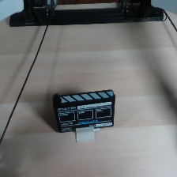 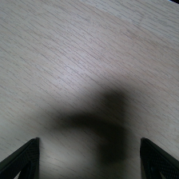 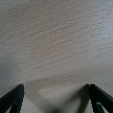

</details>

**Turn 5**

I am swinging both arms inward and extending them further forward and down to bring the grippers closer to the clapper board.

`move_joints`
````json
{
  "targets": {
    "left_j2": 2,
    "right_j3": -0.8,
    "left_j1": 2.8,
    "right_j1": 2.8,
    "left_j3": -0.8,
    "right_j2": 2,
    "left_j0": -0.1,
    "right_j0": 0.1
  }
}
````

*executing move_joints over 7 steps (0.7s)*

<details open>
<summary>Observation 6</summary>

````text
Current observation.
Instruction: Lift the clapper stick, then let go so it snaps shut with a clap. Note that the context (top) cam is on the opposite sides of the arms.
state[joint_pos]: left_j0=-0.036 left_j1=2.5992 left_j2=2.1181 left_j3=-0.5217 left_j4=-0.0483 left_j5=-0.0608 left_gripper=0.9986 right_j0=0.0349 right_j1=2.5969 right_j2=2.1166 right_j3=-0.535 right_j4=-0.0196 right_j5=-0.025 right_gripper=0.9994

camera 'top_cam' (step 52):

[image omitted: streamed camera frame]

camera 'left_cam' (step 52):

[image omitted: streamed camera frame]

camera 'right_cam' (step 52):

[image omitted: streamed camera frame]
````

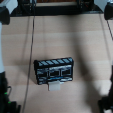 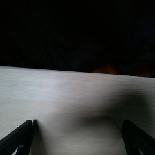 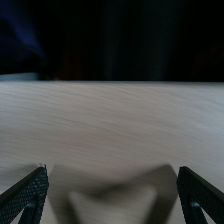

</details>

**Turn 6**

I am moving the hands inward and further forward/downward to bring them closer to the sides of the clapper board.

`move_joints`
````json
{
  "targets": {
    "right_j3": -0.7,
    "left_j2": 2.2,
    "left_j1": 2.8,
    "left_j3": -0.7,
    "left_j0": -0.12,
    "right_j0": 0.12,
    "right_j1": 2.8,
    "right_j2": 2.2
  }
}
````

*executing move_joints over 4 steps (0.4s)*

<details open>
<summary>Observation 7</summary>

````text
Current observation.
Instruction: Lift the clapper stick, then let go so it snaps shut with a clap. Note that the context (top) cam is on the opposite sides of the arms.
state[joint_pos]: left_j0=-0.1036 left_j1=2.6633 left_j2=2.2524 left_j3=-0.5083 left_j4=-0.0551 left_j5=-0.065 left_gripper=0.9987 right_j0=0.104 right_j1=2.6595 right_j2=2.2501 right_j3=-0.5282 right_j4=-0.0349 right_j5=-0.036 right_gripper=0.9994

camera 'top_cam' (step 56):

[image omitted: streamed camera frame]

camera 'left_cam' (step 56):

[image omitted: streamed camera frame]

camera 'right_cam' (step 56):

[image omitted: streamed camera frame]
````

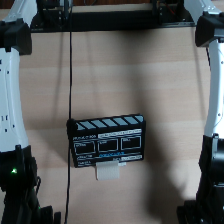 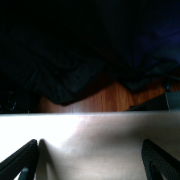 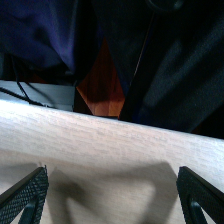

</details>

**Turn 7**

I am moving the right arm further inward (left) and forward/downward to bring it closer to the right side of the clapper stick.

`move_joints`
````json
{
  "targets": {
    "right_j2": 2.35,
    "right_j1": 2.75,
    "right_j0": 0.18,
    "right_j3": -0.6
  }
}
````

*executing move_joints over 2 steps (0.2s)*

<details open>
<summary>Observation 8</summary>

````text
Current observation.
Instruction: Lift the clapper stick, then let go so it snaps shut with a clap. Note that the context (top) cam is on the opposite sides of the arms.
state[joint_pos]: left_j0=-0.1051 left_j1=2.6621 left_j2=2.2665 left_j3=-0.4919 left_j4=-0.0628 left_j5=-0.0723 left_gripper=0.9987 right_j0=0.1238 right_j1=2.6953 right_j2=2.331 right_j3=-0.5377 right_j4=-0.0341 right_j5=-0.0357 right_gripper=0.9994

camera 'top_cam' (step 58):

[image omitted: streamed camera frame]

camera 'left_cam' (step 58):

[image omitted: streamed camera frame]

camera 'right_cam' (step 58):

[image omitted: streamed camera frame]
````

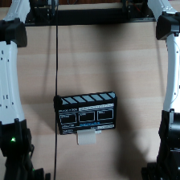 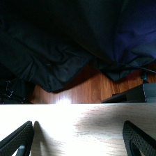 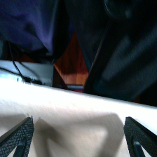

</details>

**Turn 8**

I am continuing the movement of the right arm to get closer to the clapper stick.

`move_joints`
````json
{
  "targets": {
    "right_j3": -0.6,
    "right_j0": 0.2,
    "right_j1": 2.85,
    "right_j2": 2.45
  }
}
````

*executing move_joints over 3 steps (0.3s)*

<details open>
<summary>Observation 9</summary>

````text
Current observation.
Instruction: Lift the clapper stick, then let go so it snaps shut with a clap. Note that the context (top) cam is on the opposite sides of the arms.
state[joint_pos]: left_j0=-0.1055 left_j1=2.6621 left_j2=2.2665 left_j3=-0.4854 left_j4=-0.0639 left_j5=-0.0753 left_gripper=0.9987 right_j0=0.1864 right_j1=2.7743 right_j2=2.4542 right_j3=-0.5369 right_j4=-0.0494 right_j5=-0.041 right_gripper=0.9994

camera 'top_cam' (step 61):

[image omitted: streamed camera frame]

camera 'left_cam' (step 61):

[image omitted: streamed camera frame]

camera 'right_cam' (step 61):

[image omitted: streamed camera frame]
````

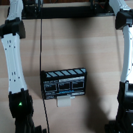  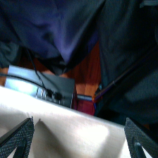

</details>

**Turn 9**

I am centering the right gripper over the right end of the clapper stick so we can grasp it.

`move_joints`
````json
{
  "targets": {
    "right_j2": 2.5,
    "right_j3": -0.6,
    "right_j1": 2.8,
    "right_j0": 0.23
  }
}
````

*executing move_joints over 2 steps (0.2s)*

<details open>
<summary>Observation 10</summary>

````text
Current observation.
Instruction: Lift the clapper stick, then let go so it snaps shut with a clap. Note that the context (top) cam is on the opposite sides of the arms.
state[joint_pos]: left_j0=-0.1051 left_j1=2.6621 left_j2=2.2665 left_j3=-0.4831 left_j4=-0.0669 left_j5=-0.0765 left_gripper=0.9987 right_j0=0.1959 right_j1=2.7846 right_j2=2.484 right_j3=-0.5453 right_j4=-0.057 right_j5=-0.0429 right_gripper=0.9994

camera 'top_cam' (step 63):

[image omitted: streamed camera frame]

camera 'left_cam' (step 63):

[image omitted: streamed camera frame]

camera 'right_cam' (step 63):

[image omitted: streamed camera frame]
````

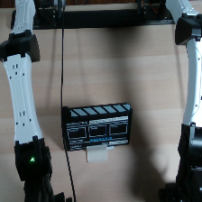  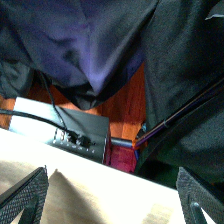

</details>

**Turn 10**

I am continuing to move the right gripper closer to the clapper stick, aiming for the right side of it.

`move_joints`
````json
{
  "targets": {
    "right_j3": -0.5,
    "right_j2": 2.6,
    "right_j0": 0.28,
    "right_j1": 2.9
  }
}
````

*executing move_joints over 2 steps (0.2s)*

<details open>
<summary>Observation 11</summary>

````text
Current observation.
Instruction: Lift the clapper stick, then let go so it snaps shut with a clap. Note that the context (top) cam is on the opposite sides of the arms.
state[joint_pos]: left_j0=-0.1055 left_j1=2.6621 left_j2=2.2665 left_j3=-0.482 left_j4=-0.0673 left_j5=-0.0769 left_gripper=0.9987 right_j0=0.2405 right_j1=2.8403 right_j2=2.571 right_j3=-0.5396 right_j4=-0.0578 right_j5=-0.0444 right_gripper=0.9994

camera 'top_cam' (step 65):

[image omitted: streamed camera frame]

camera 'left_cam' (step 65):

[image omitted: streamed camera frame]

camera 'right_cam' (step 65):

[image omitted: streamed camera frame]
````

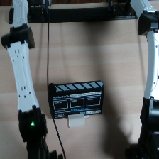  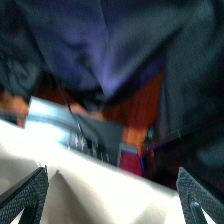

</details>

**Turn 11**

I am bringing the right hand down and slightly more left to align it with the stick of the clapper board.

`move_joints`
````json
{
  "targets": {
    "right_j0": 0.28,
    "right_j3": -0.5,
    "right_j1": 2.95,
    "right_j2": 2.7
  }
}
````

*executing move_joints over 3 steps (0.3s)*

<details open>
<summary>Observation 12</summary>

````text
Current observation.
Instruction: Lift the clapper stick, then let go so it snaps shut with a clap. Note that the context (top) cam is on the opposite sides of the arms.
state[joint_pos]: left_j0=-0.1055 left_j1=2.6621 left_j2=2.2665 left_j3=-0.4812 left_j4=-0.0677 left_j5=-0.0772 left_gripper=0.9987 right_j0=0.2722 right_j1=2.9116 right_j2=2.674 right_j3=-0.503 right_j4=-0.0692 right_j5=-0.0486 right_gripper=0.9994

camera 'top_cam' (step 68):

[image omitted: streamed camera frame]

camera 'left_cam' (step 68):

[image omitted: streamed camera frame]

camera 'right_cam' (step 68):

[image omitted: streamed camera frame]
````

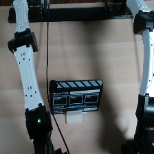  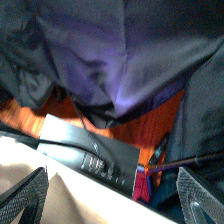

</details>

**Turn 12**

I am moving the right gripper closer to the clapper stick, positioning it directly above the right-hand end of the stick.

`move_joints`
````json
{
  "targets": {
    "right_j1": 2.95,
    "right_j3": -0.6,
    "right_j2": 2.7,
    "right_j0": 0.33
  }
}
````

*executing move_joints over 2 steps (0.2s)*

<details open>
<summary>Observation 13</summary>

````text
Current observation.
Instruction: Lift the clapper stick, then let go so it snaps shut with a clap. Note that the context (top) cam is on the opposite sides of the arms.
state[joint_pos]: left_j0=-0.1055 left_j1=2.6621 left_j2=2.2665 left_j3=-0.4812 left_j4=-0.0677 left_j5=-0.0784 left_gripper=0.9987 right_j0=0.284 right_j1=2.9215 right_j2=2.6919 right_j3=-0.5175 right_j4=-0.0681 right_j5=-0.0486 right_gripper=0.9994

camera 'top_cam' (step 70):

[image omitted: streamed camera frame]

camera 'left_cam' (step 70):

[image omitted: streamed camera frame]

camera 'right_cam' (step 70):

[image omitted: streamed camera frame]
````

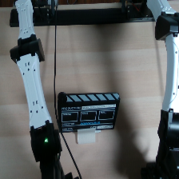  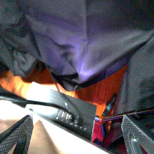

</details>

**Turn 13**

I am lowering the right gripper further to bring it right beside or on top of the clapper stick.

`move_joints`
````json
{
  "targets": {
    "right_j0": 0.34,
    "right_j2": 2.75,
    "right_j3": -0.5,
    "right_j1": 3
  }
}
````

*executing move_joints over 2 steps (0.2s)*

<details open>
<summary>Observation 14</summary>

````text
Current observation.
Instruction: Lift the clapper stick, then let go so it snaps shut with a clap. Note that the context (top) cam is on the opposite sides of the arms.
state[joint_pos]: left_j0=-0.1055 left_j1=2.6621 left_j2=2.2665 left_j3=-0.4812 left_j4=-0.0677 left_j5=-0.0784 left_gripper=0.9987 right_j0=0.3256 right_j1=2.9471 right_j2=2.7342 right_j3=-0.5194 right_j4=-0.0853 right_j5=-0.0517 right_gripper=0.9994

camera 'top_cam' (step 72):

[image omitted: streamed camera frame]

camera 'left_cam' (step 72):

[image omitted: streamed camera frame]

camera 'right_cam' (step 72):

[image omitted: streamed camera frame]
````

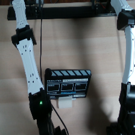  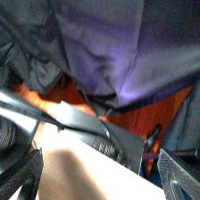

</details>

**Turn 14**

I am lowering the right hand and shifting it further left to get it directly on top of the stick.

`move_joints`
````json
{
  "targets": {
    "right_j3": -0.5,
    "right_j2": 2.8,
    "right_j0": 0.36,
    "right_j1": 3.1
  }
}
````

*executing move_joints over 3 steps (0.3s)*

<details open>
<summary>Observation 15</summary>

````text
Current observation.
Instruction: Lift the clapper stick, then let go so it snaps shut with a clap. Note that the context (top) cam is on the opposite sides of the arms.
state[joint_pos]: left_j0=-0.1055 left_j1=2.6621 left_j2=2.2665 left_j3=-0.4816 left_j4=-0.0681 left_j5=-0.0788 left_gripper=0.9987 right_j0=0.3313 right_j1=3.02 right_j2=2.8128 right_j3=-0.45 right_j4=-0.0986 right_j5=-0.0517 right_gripper=0.9994

camera 'top_cam' (step 75):

[image omitted: streamed camera frame]

camera 'left_cam' (step 75):

[image omitted: streamed camera frame]

camera 'right_cam' (step 75):

[image omitted: streamed camera frame]
````

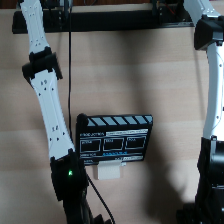 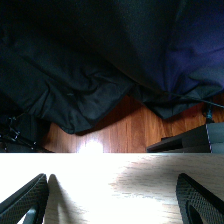 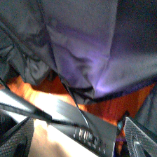

</details>

**Turn 15**

I am continuing to move the right gripper closer to the clapper stick by extending it more.

`move_joints`
````json
{
  "targets": {
    "right_j3": -0.4,
    "right_j1": 3.1,
    "right_j0": 0.38,
    "right_j2": 2.85
  }
}
````

*executing move_joints over 2 steps (0.2s)*

<details open>
<summary>Observation 16</summary>

````text
Current observation.
Instruction: Lift the clapper stick, then let go so it snaps shut with a clap. Note that the context (top) cam is on the opposite sides of the arms.
state[joint_pos]: left_j0=-0.1055 left_j1=2.6621 left_j2=2.2665 left_j3=-0.4816 left_j4=-0.0681 left_j5=-0.0792 left_gripper=0.9987 right_j0=0.3321 right_j1=3.039 right_j2=2.8384 right_j3=-0.4236 right_j4=-0.0948 right_j5=-0.0528 right_gripper=0.9994

camera 'top_cam' (step 77):

[image omitted: streamed camera frame]

camera 'left_cam' (step 77):

[image omitted: streamed camera frame]

camera 'right_cam' (step 77):

[image omitted: streamed camera frame]
````

  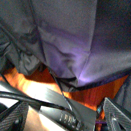

</details>

**Turn 16**

I am continuing to move the right gripper closer to the clapper stick to align for the grasp.

`move_joints`
````json
{
  "targets": {
    "right_j1": 3.1,
    "right_j3": -0.4,
    "right_j2": 2.85,
    "right_j0": 0.38
  }
}
````

*executing move_joints over 1 steps (0.1s)*

<details open>
<summary>Observation 17</summary>

````text
Current observation.
Instruction: Lift the clapper stick, then let go so it snaps shut with a clap. Note that the context (top) cam is on the opposite sides of the arms.
state[joint_pos]: left_j0=-0.1055 left_j1=2.6621 left_j2=2.2665 left_j3=-0.4812 left_j4=-0.0681 left_j5=-0.0788 left_gripper=0.9987 right_j0=0.3321 right_j1=3.0543 right_j2=2.8491 right_j3=-0.3916 right_j4=-0.0868 right_j5=-0.0528 right_gripper=0.9993

camera 'top_cam' (step 78):

[image omitted: streamed camera frame]

camera 'left_cam' (step 78):

[image omitted: streamed camera frame]

camera 'right_cam' (step 78):

[image omitted: streamed camera frame]
````

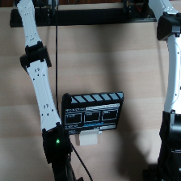  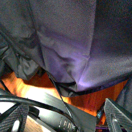

</details>

**Turn 17**

I am swinging the right arm further left (inward) to get it over the clapper stick.

`move_joints`
````json
{
  "targets": {
    "right_j0": 0.45,
    "right_j2": 2.85,
    "right_j1": 3.1,
    "right_j3": -0.4
  }
}
````

*executing move_joints over 2 steps (0.2s)*

<details open>
<summary>Observation 18</summary>

````text
Current observation.
Instruction: Lift the clapper stick, then let go so it snaps shut with a clap. Note that the context (top) cam is on the opposite sides of the arms.
state[joint_pos]: left_j0=-0.1055 left_j1=2.6621 left_j2=2.2665 left_j3=-0.4816 left_j4=-0.0681 left_j5=-0.0792 left_gripper=0.9987 right_j0=0.3435 right_j1=3.0543 right_j2=2.8491 right_j3=-0.3912 right_j4=-0.0544 right_j5=-0.0532 right_gripper=0.9991

camera 'top_cam' (step 80):

[image omitted: streamed camera frame]

camera 'left_cam' (step 80):

[image omitted: streamed camera frame]

camera 'right_cam' (step 80):

[image omitted: streamed camera frame]
````

  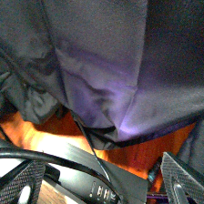

</details>

**Turn 18**

I am swinging the right arm further left (inward) to get it over the clapper stick.

`move_joints`
````json
{
  "targets": {
    "right_j1": 3.1,
    "right_j3": -0.4,
    "right_j2": 2.85,
    "right_j0": 0.55
  }
}
````

*executing move_joints over 4 steps (0.4s)*

<details open>
<summary>Observation 19</summary>

````text
Current observation.
Instruction: Lift the clapper stick, then let go so it snaps shut with a clap. Note that the context (top) cam is on the opposite sides of the arms.
state[joint_pos]: left_j0=-0.1051 left_j1=2.6621 left_j2=2.2665 left_j3=-0.4816 left_j4=-0.0681 left_j5=-0.0792 left_gripper=0.9987 right_j0=0.3565 right_j1=3.0543 right_j2=2.8491 right_j3=-0.395 right_j4=-0.012 right_j5=-0.0479 right_gripper=0.9987

camera 'top_cam' (step 84):

[image omitted: streamed camera frame]

camera 'left_cam' (step 84):

[image omitted: streamed camera frame]

camera 'right_cam' (step 84):

[image omitted: streamed camera frame]
````

  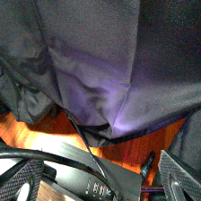

</details>

**Turn 19**

I am continuing to move the right arm closer to the clapper stick by swinging it further left and keeping it extended.

`move_joints`
````json
{
  "targets": {
    "right_j2": 2.85,
    "right_j0": 0.55,
    "right_j1": 3.1,
    "right_j3": -0.4
  }
}
````

*executing move_joints over 4 steps (0.4s)*

<details open>
<summary>Observation 20</summary>

````text
Current observation.
Instruction: Lift the clapper stick, then let go so it snaps shut with a clap. Note that the context (top) cam is on the opposite sides of the arms.
state[joint_pos]: left_j0=-0.1055 left_j1=2.6621 left_j2=2.2665 left_j3=-0.4816 left_j4=-0.0681 left_j5=-0.0792 left_gripper=0.9987 right_j0=0.3618 right_j1=3.0543 right_j2=2.8563 right_j3=-0.4129 right_j4=0.0196 right_j5=-0.0418 right_gripper=0.9987

camera 'top_cam' (step 88):

[image omitted: streamed camera frame]

camera 'left_cam' (step 88):

[image omitted: streamed camera frame]

camera 'right_cam' (step 88):

[image omitted: streamed camera frame]
````

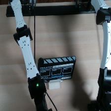  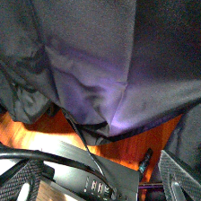

</details>

**Turn 20**

I am swinging the right arm further to the left with a larger target to ensure it moves closer to the clapper stick.

`move_joints`
````json
{
  "targets": {
    "right_j2": 2.85,
    "right_j0": 0.7,
    "right_j1": 3.1,
    "right_j3": -0.4
  }
}
````

*executing move_joints over 6 steps (0.6s)*

<details open>
<summary>Observation 21</summary>

````text
Current observation.
Instruction: Lift the clapper stick, then let go so it snaps shut with a clap. Note that the context (top) cam is on the opposite sides of the arms.
state[joint_pos]: left_j0=-0.1055 left_j1=2.6621 left_j2=2.2665 left_j3=-0.4816 left_j4=-0.0681 left_j5=-0.0792 left_gripper=0.9987 right_j0=0.3828 right_j1=3.0497 right_j2=2.8635 right_j3=-0.4473 right_j4=0.1059 right_j5=-0.0223 right_gripper=0.9973

camera 'top_cam' (step 94):

[image omitted: streamed camera frame]

camera 'left_cam' (step 94):

[image omitted: streamed camera frame]

camera 'right_cam' (step 94):

[image omitted: streamed camera frame]
````

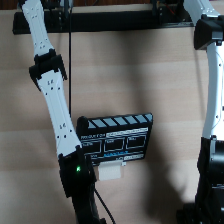  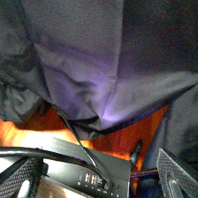

</details>

**Turn 21**

I am continuing to move the right arm towards the center-left to get it to reach the right side of the clapper board.

`move_joints`
````json
{
  "targets": {
    "right_j1": 3.1,
    "right_j0": 0.8,
    "right_j2": 2.85,
    "right_j3": -0.4
  }
}
````

*executing move_joints over 7 steps (0.7s)*

<details open>
<summary>Observation 22</summary>

````text
Current observation.
Instruction: Lift the clapper stick, then let go so it snaps shut with a clap. Note that the context (top) cam is on the opposite sides of the arms.
state[joint_pos]: left_j0=-0.1055 left_j1=2.6625 left_j2=2.2665 left_j3=-0.4816 left_j4=-0.0681 left_j5=-0.0792 left_gripper=0.9987 right_j0=0.4145 right_j1=3.0425 right_j2=2.8639 right_j3=-0.4862 right_j4=0.271 right_j5=0.0448 right_gripper=0.9964

camera 'top_cam' (step 101):

[image omitted: streamed camera frame]

camera 'left_cam' (step 101):

[image omitted: streamed camera frame]

camera 'right_cam' (step 101):

[image omitted: streamed camera frame]
````

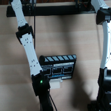  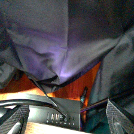

</details>

**Turn 22**

I am continuing to move the right arm further left towards the clapper board to align with the clapper stick.

`move_joints`
````json
{
  "targets": {
    "right_j1": 3.1,
    "right_j0": 0.9,
    "right_j2": 2.85,
    "right_j3": -0.4
  }
}
````

*executing move_joints over 8 steps (0.8s)*

<details open>
<summary>Observation 23</summary>

````text
Current observation.
Instruction: Lift the clapper stick, then let go so it snaps shut with a clap. Note that the context (top) cam is on the opposite sides of the arms.
state[joint_pos]: left_j0=-0.1055 left_j1=2.6625 left_j2=2.2665 left_j3=-0.4816 left_j4=-0.0685 left_j5=-0.0792 left_gripper=0.9987 right_j0=0.4637 right_j1=3.0379 right_j2=2.8635 right_j3=-0.5289 right_j4=0.5102 right_j5=0.1848 right_gripper=0.9955

camera 'top_cam' (step 109):

[image omitted: streamed camera frame]

camera 'left_cam' (step 109):

[image omitted: streamed camera frame]

camera 'right_cam' (step 109):

[image omitted: streamed camera frame]
````

  

</details>

**Turn 23**

I am continuing to move the right gripper leftward to align it with the clapper stick of the clapper board.

`move_joints`
````json
{
  "targets": {
    "right_j1": 3.1,
    "right_j0": 0.65,
    "right_j2": 2.85,
    "right_j3": -0.4
  }
}
````

*executing move_joints over 3 steps (0.3s)*

<details open>
<summary>Observation 24</summary>

````text
Current observation.
Instruction: Lift the clapper stick, then let go so it snaps shut with a clap. Note that the context (top) cam is on the opposite sides of the arms.
state[joint_pos]: left_j0=-0.1055 left_j1=2.6625 left_j2=2.2665 left_j3=-0.4816 left_j4=-0.0685 left_j5=-0.0792 left_gripper=0.9987 right_j0=0.4706 right_j1=3.039 right_j2=2.8635 right_j3=-0.5423 right_j4=0.5892 right_j5=0.2401 right_gripper=0.9951

camera 'top_cam' (step 112):

[image omitted: streamed camera frame]

camera 'left_cam' (step 112):

[image omitted: streamed camera frame]

camera 'right_cam' (step 112):

[image omitted: streamed camera frame]
````

  

</details>

**Turn 24**

I am moving the left arm further forward and slightly to the right to bring it closer to the clapper board.

`move_joints`
````json
{
  "targets": {
    "left_j1": 2.9,
    "left_j3": -0.5,
    "left_j0": -0.2,
    "left_j2": 2.5
  }
}
````

*executing move_joints over 4 steps (0.4s)*

<details open>
<summary>Observation 25</summary>

````text
Current observation.
Instruction: Lift the clapper stick, then let go so it snaps shut with a clap. Note that the context (top) cam is on the opposite sides of the arms.
state[joint_pos]: left_j0=-0.1719 left_j1=2.8376 left_j2=2.4962 left_j3=-0.4198 left_j4=-0.0822 left_j5=-0.099 left_gripper=0.9987 right_j0=0.4614 right_j1=3.0386 right_j2=2.8632 right_j3=-0.5491 right_j4=0.5941 right_j5=0.2623 right_gripper=0.9951

camera 'top_cam' (step 116):

[image omitted: streamed camera frame]

camera 'left_cam' (step 116):

[image omitted: streamed camera frame]

camera 'right_cam' (step 116):

[image omitted: streamed camera frame]
````

  

</details>

**Turn 25**

I am continuing to move the left arm towards the clapper board to get it into position.

`move_joints`
````json
{
  "targets": {
    "left_j3": -0.5,
    "left_j1": 2.95,
    "left_j2": 2.6,
    "left_j0": -0.3
  }
}
````

*executing move_joints over 3 steps (0.3s)*

<details open>
<summary>Observation 26</summary>

````text
Current observation.
Instruction: Lift the clapper stick, then let go so it snaps shut with a clap. Note that the context (top) cam is on the opposite sides of the arms.
state[joint_pos]: left_j0=-0.247 left_j1=2.9002 left_j2=2.5935 left_j3=-0.4099 left_j4=-0.0933 left_j5=-0.1173 left_gripper=0.9987 right_j0=0.4587 right_j1=3.0386 right_j2=2.8632 right_j3=-0.5484 right_j4=0.5884 right_j5=0.2634 right_gripper=0.9951

camera 'top_cam' (step 119):

[image omitted: streamed camera frame]

camera 'left_cam' (step 119):

[image omitted: streamed camera frame]

camera 'right_cam' (step 119):

[image omitted: streamed camera frame]
````

  

</details>

**Turn 26**

I am moving the left arm further right (inward) and down to position its gripper directly above the clapper stick.

`move_joints`
````json
{
  "targets": {
    "left_j3": -0.4,
    "left_j2": 2.7,
    "left_j0": -0.38,
    "left_j1": 3.05
  }
}
````

*executing move_joints over 3 steps (0.3s)*

<details open>
<summary>Observation 27</summary>

````text
Current observation.
Instruction: Lift the clapper stick, then let go so it snaps shut with a clap. Note that the context (top) cam is on the opposite sides of the arms.
state[joint_pos]: left_j0=-0.3309 left_j1=2.9868 left_j2=2.6953 left_j3=-0.3347 left_j4=-0.1062 left_j5=-0.1364 left_gripper=0.9986 right_j0=0.458 right_j1=3.0386 right_j2=2.8632 right_j3=-0.5472 right_j4=0.585 right_j5=0.2634 right_gripper=0.9952

camera 'top_cam' (step 122):

[image omitted: streamed camera frame]

camera 'left_cam' (step 122):

[image omitted: streamed camera frame]

camera 'right_cam' (step 122):

[image omitted: streamed camera frame]
````

  

</details>

**Turn 27**

I am extending the left arm further forward and closer to the clapper board.

`move_joints`
````json
{
  "targets": {
    "left_j3": -0.4,
    "left_j0": -0.5,
    "left_j1": 3.1,
    "left_j2": 2.8
  }
}
````

*executing move_joints over 3 steps (0.3s)*

<details open>
<summary>Observation 28</summary>

````text
Current observation.
Instruction: Lift the clapper stick, then let go so it snaps shut with a clap. Note that the context (top) cam is on the opposite sides of the arms.
state[joint_pos]: left_j0=-0.3531 left_j1=3.0413 left_j2=2.7892 left_j3=-0.3508 left_j4=-0.1833 left_j5=-0.1646 left_gripper=0.998 right_j0=0.4561 right_j1=3.0386 right_j2=2.8632 right_j3=-0.5457 right_j4=0.5789 right_j5=0.2646 right_gripper=0.9952

camera 'top_cam' (step 125):

[image omitted: streamed camera frame]

camera 'left_cam' (step 125):

[image omitted: streamed camera frame]

camera 'right_cam' (step 125):

[image omitted: streamed camera frame]
````

  

</details>

**Turn 28**

I am continuing to move the left arm closer to the clapper board.

`move_joints`
````json
{
  "targets": {
    "left_j0": -0.55,
    "left_j3": -0.4,
    "left_j1": 3.1,
    "left_j2": 2.85
  }
}
````

*executing move_joints over 4 steps (0.4s)*

<details open>
<summary>Observation 29</summary>

````text
Current observation.
Instruction: Lift the clapper stick, then let go so it snaps shut with a clap. Note that the context (top) cam is on the opposite sides of the arms.
state[joint_pos]: left_j0=-0.3759 left_j1=3.0566 left_j2=2.8281 left_j3=-0.3847 left_j4=-0.2985 left_j5=-0.1894 left_gripper=0.9978 right_j0=0.4541 right_j1=3.0386 right_j2=2.8632 right_j3=-0.5438 right_j4=0.5713 right_j5=0.2634 right_gripper=0.9952

camera 'top_cam' (step 129):

[image omitted: streamed camera frame]

camera 'left_cam' (step 129):

[image omitted: streamed camera frame]

camera 'right_cam' (step 129):

[image omitted: streamed camera frame]
````

  

</details>

**Turn 29**

I am moving the right arm further inward and down to bring the gripper directly over the clapper stick on the right side.

`move_joints`
````json
{
  "targets": {
    "right_j1": 3.15,
    "right_j2": 2.9,
    "right_j3": -0.5,
    "right_j0": 0.55
  }
}
````

*target for right_j1 is outside [-3.141592653589793, 3.141592653589793]*

**Turn 30**

(no response)

> Respond with exactly one tool call.

**Turn 31**

I am correcting the shoulder pitch and extending the elbow to bring the right gripper closer to the clapper stick within valid joint limits.

`move_joints`
````json
{
  "targets": {
    "right_j0": 0.55,
    "right_j3": -0.5,
    "right_j1": 3.1,
    "right_j2": 2.9
  }
}
````

*executing move_joints over 2 steps (0.2s)*

<details open>
<summary>Observation 30</summary>

````text
Current observation.
Instruction: Lift the clapper stick, then let go so it snaps shut with a clap. Note that the context (top) cam is on the opposite sides of the arms.
state[joint_pos]: left_j0=-0.3725 left_j1=3.0566 left_j2=2.8349 left_j3=-0.3908 left_j4=-0.3363 left_j5=-0.1921 left_gripper=0.9979 right_j0=0.4641 right_j1=3.0493 right_j2=2.8822 right_j3=-0.5518 right_j4=0.59 right_j5=0.2783 right_gripper=0.9951

camera 'top_cam' (step 131):

[image omitted: streamed camera frame]

camera 'left_cam' (step 131):

[image omitted: streamed camera frame]

camera 'right_cam' (step 131):

[image omitted: streamed camera frame]
````

  

</details>

**Turn 32**

I am continuing to move the right gripper further inward and down to bring it directly above the right-hand end of the clapper stick.

`move_joints`
````json
{
  "targets": {
    "right_j2": 2.95,
    "right_j0": 0.55,
    "right_j3": -0.5,
    "right_j1": 3.1
  }
}
````

*executing move_joints over 2 steps (0.2s)*

<details open>
<summary>Observation 31</summary>

````text
Current observation.
Instruction: Lift the clapper stick, then let go so it snaps shut with a clap. Note that the context (top) cam is on the opposite sides of the arms.
state[joint_pos]: left_j0=-0.3706 left_j1=3.0566 left_j2=2.8338 left_j3=-0.3889 left_j4=-0.3305 left_j5=-0.1921 left_gripper=0.9979 right_j0=0.4709 right_j1=3.0676 right_j2=2.9173 right_j3=-0.5713 right_j4=0.6186 right_j5=0.3077 right_gripper=0.9951

camera 'top_cam' (step 133):

[image omitted: streamed camera frame]

camera 'left_cam' (step 133):

[image omitted: streamed camera frame]

camera 'right_cam' (step 133):

[image omitted: streamed camera frame]
````

  

</details>

**Turn 33**

I am continuing to move the right gripper further inward and down to bring it directly above the right-hand end of the clapper stick.

`move_joints`
````json
{
  "targets": {
    "right_j2": 2.95,
    "right_j3": -0.5,
    "right_j0": 0.65,
    "right_j1": 3.1
  }
}
````

*executing move_joints over 3 steps (0.3s)*

<details open>
<summary>Observation 32</summary>

````text
Current observation.
Instruction: Lift the clapper stick, then let go so it snaps shut with a clap. Note that the context (top) cam is on the opposite sides of the arms.
state[joint_pos]: left_j0=-0.371 left_j1=3.0566 left_j2=2.8338 left_j3=-0.3889 left_j4=-0.3363 left_j5=-0.1921 left_gripper=0.9979 right_j0=0.4889 right_j1=3.073 right_j2=2.9292 right_j3=-0.5907 right_j4=0.6792 right_j5=0.3492 right_gripper=0.9951

camera 'top_cam' (step 136):

[image omitted: streamed camera frame]

camera 'left_cam' (step 136):

[image omitted: streamed camera frame]

camera 'right_cam' (step 136):

[image omitted: streamed camera frame]
````

  

</details>

**Turn 34**

I am lowering the right gripper closer to the clapper stick of the clapper board.

`move_joints`
````json
{
  "targets": {
    "right_j1": 3.1,
    "right_j0": 0.6,
    "right_j2": 3,
    "right_j3": -0.5
  }
}
````

*executing move_joints over 2 steps (0.2s)*

[Back to index](README.md)
