# Run gemini-5: 20260731_033801_60509b7b

> Lift the clapper stick, then let go so it snaps shut with a clap. Note that the context (top) cam is on the opposite sides of the arms.

| | |
|---|---|
| Created (UTC) | 2026-07-31 03:38:01 |
| Model | gemini-robotics-er-2-preview |
| Effort | high |
| Embodiment | yam_arms |
| Status | success |
| Outcome | fail |
| Termination | operator_end |
| Operator judgement | n |
| Duration | 00:48 |
| Steps | 55 |
| LLM turns | 5 |
| Seed | 0 |
| inspect-robots | 0.34.0 |
| Git commit | n/a |

Files: [raw EvalLog](../adhoc_ab9d2a7d.json) · [top video](../videos/20260731_033801_60509b7b/scene-0-e0_top_cam.mp4) · [left video](../videos/20260731_033801_60509b7b/scene-0-e0_left_cam.mp4) · [right video](../videos/20260731_033801_60509b7b/scene-0-e0_right_cam.mp4) · [transcript jsonl](../transcripts/20260731_033801_60509b7b) · [wire capture](../wire/20260731_033801_60509b7b)

## Transcript

<details>
<summary>System prompt</summary>

````text
You are controlling a real robot embodiment named 'yam_arms' through tool calls. Each observation message gives you the current proprioceptive state and camera images. Work toward the user's goal in small, deliberate motions; re-check the observation after every motion. Every move tool call must include a `note`: in one or two sentences, say what you observe in the current observation and why you chose this motion. The user is watching these notes to see what you see and what you decide, so write them for a human reader. Safety approvers clamp out-of-bounds and too-fast actions below you. Respond with exactly one tool call per turn. When the goal is achieved call done; if it cannot be achieved call give_up. You have a budget of 200 LLM calls for the whole trial.

Embodiment notes:
Two identical 6-DoF arms, prefixed left_ and right_, each with a parallel-jaw
gripper. Each arm has its own base frame: +x points forward out of the base
(the direction the folded gripper points at all-zero joints), +y left, +z up;
how the two bases are mounted relative to each other depends on the rig.
Joint guide (positive direction, identical for both arms):
- left_j0 / right_j0: base yaw about the vertical axis; positive swings the
  arm counterclockwise seen from above (a forward-pointing gripper moves
  toward +y).
- left_j1 / right_j1: shoulder pitch; 0 points the upper arm horizontally
  backward and is the lower hard stop (it cannot go negative), positive
  raises it (about 1.57 is straight up, about 3.14 is horizontal forward).
- left_j2 / right_j2: elbow; 0 is fully folded with the forearm doubled back
  against the upper arm and is the lower hard stop, positive opens it.
- left_j3 / right_j3: wrist pitch, axis parallel to the elbow; positive tilts
  the gripper up.
- left_j4 / right_j4: wrist yaw; positive swings the gripper toward the arm's
  right seen from above (opposite sign sense of j0).
- left_j5 / right_j5: wrist roll about the gripper's pointing axis; positive
  turns clockwise when viewed from behind the gripper looking out along the
  fingers.
- left_gripper / right_gripper: 0 is fully closed, 1 is fully open (about
  9.5 cm between the jaws).
Proportions: upper arm 0.26 m, forearm 0.25 m, wrist to grasp point 0.25 m
when straight; reach from the shoulder about 0.76 m.
At all-zero joints the arm rests folded low with the gripper pointing
forward. While the arm is folded, a single joint's effect on the gripper
position can be counterintuitive; move deliberately and re-check the
observation after each motion. The joint values above are positions as shown
in the observation; when actions are per-step changes (delta mode), the same
sign conventions apply to each change.
````

</details>

> Goal: Lift the clapper stick, then let go so it snaps shut with a clap. Note that the context (top) cam is on the opposite sides of the arms.

<details open>
<summary>Observation 1</summary>

````text
Current observation.
Instruction: Lift the clapper stick, then let go so it snaps shut with a clap. Note that the context (top) cam is on the opposite sides of the arms.
state[joint_pos]: left_j0=-0.0021 left_j1=0.0067 left_j2=0.0067 left_j3=-0.0296 left_j4=-0.0093 left_j5=-0.0216 left_gripper=0.9988 right_j0=-0.0002 right_j1=0.0025 right_j2=0.0063 right_j3=-0.0261 right_j4=-0.0013 right_j5=-0.0086 right_gripper=0.9994

camera 'top_cam' (step 0):

[image omitted: streamed camera frame]

camera 'left_cam' (step 0):

[image omitted: streamed camera frame]

camera 'right_cam' (step 0):

[image omitted: streamed camera frame]
````

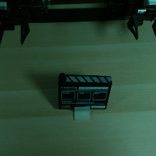 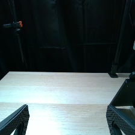 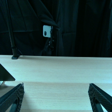

</details>

**Turn 1**

I'll raise both arms up and forward so they are visible and positioned to approach the clapperboard.

`move_joints`
````json
{
  "targets": {
    "right_j1": 1.8,
    "right_j4": 0,
    "left_j5": 0,
    "left_j0": 0,
    "right_j3": 0,
    "right_j2": 1.5,
    "right_j0": 0,
    "left_j2": 1.5,
    "left_j4": 0,
    "left_j1": 1.8,
    "right_j5": 0,
    "left_j3": 0
  }
}
````

*executing move_joints over 29 steps (2.9s)*

<details open>
<summary>Observation 2</summary>

````text
Current observation.
Instruction: Lift the clapper stick, then let go so it snaps shut with a clap. Note that the context (top) cam is on the opposite sides of the arms.
state[joint_pos]: left_j0=-0.0021 left_j1=1.7847 left_j2=1.4719 left_j3=-0.0151 left_j4=-0.0093 left_j5=-0.0219 left_gripper=0.9987 right_j0=-0.0002 right_j1=1.7821 right_j2=1.47 right_j3=-0.0216 right_j4=-0.0051 right_j5=-0.0116 right_gripper=0.9994

camera 'top_cam' (step 29):

[image omitted: streamed camera frame]

camera 'left_cam' (step 29):

[image omitted: streamed camera frame]

camera 'right_cam' (step 29):

[image omitted: streamed camera frame]
````

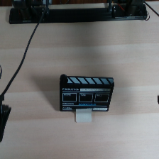 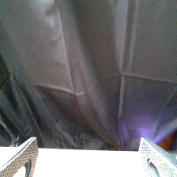 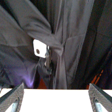

</details>

**Turn 2**

I will lower the arms and move them forward closer to the clapperboard to see them better in the cameras.

`move_joints`
````json
{
  "targets": {
    "right_j1": 1.4,
    "right_j3": 0,
    "left_j4": 0,
    "left_j3": 0,
    "right_j4": 0,
    "right_j5": 0,
    "left_j5": 0,
    "left_j0": 0,
    "left_j1": 1.4,
    "right_j0": 0,
    "right_j2": 2,
    "left_j2": 2
  }
}
````

*executing move_joints over 9 steps (0.9s)*

<details open>
<summary>Observation 3</summary>

````text
Current observation.
Instruction: Lift the clapper stick, then let go so it snaps shut with a clap. Note that the context (top) cam is on the opposite sides of the arms.
state[joint_pos]: left_j0=-0.0021 left_j1=1.4193 left_j2=1.9739 left_j3=-0.0196 left_j4=-0.0097 left_j5=-0.0216 left_gripper=0.9987 right_j0=-0.0006 right_j1=1.4189 right_j2=1.9774 right_j3=-0.0223 right_j4=-0.0055 right_j5=-0.0116 right_gripper=0.9994

camera 'top_cam' (step 38):

[image omitted: streamed camera frame]

camera 'left_cam' (step 38):

[image omitted: streamed camera frame]

camera 'right_cam' (step 38):

[image omitted: streamed camera frame]
````

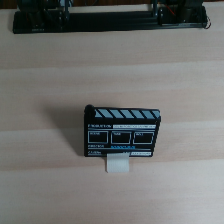 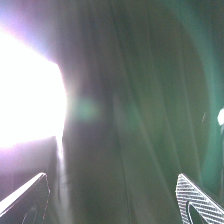 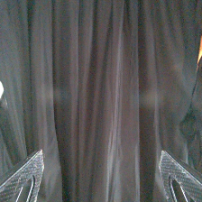

</details>

**Turn 3**

I'll continue lowering the arms and bringing them forward.

`move_joints`
````json
{
  "targets": {
    "left_j2": 2.4,
    "right_j0": 0,
    "right_j5": 0,
    "right_j2": 2.4,
    "right_j4": 0,
    "right_j1": 1,
    "left_j4": 0,
    "left_j3": 0,
    "left_j0": 0,
    "right_j3": 0,
    "left_j1": 1,
    "left_j5": 0
  }
}
````

*executing move_joints over 7 steps (0.7s)*

<details open>
<summary>Observation 4</summary>

````text
Current observation.
Instruction: Lift the clapper stick, then let go so it snaps shut with a clap. Note that the context (top) cam is on the opposite sides of the arms.
state[joint_pos]: left_j0=-0.0021 left_j1=1.0248 left_j2=2.3772 left_j3=-0.0143 left_j4=-0.0097 left_j5=-0.0143 left_gripper=0.9987 right_j0=-0.0006 right_j1=1.0245 right_j2=2.3779 right_j3=-0.0185 right_j4=-0.0055 right_j5=-0.0109 right_gripper=0.9994

camera 'top_cam' (step 45):

[image omitted: streamed camera frame]

camera 'left_cam' (step 45):

[image omitted: streamed camera frame]

camera 'right_cam' (step 45):

[image omitted: streamed camera frame]
````

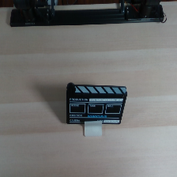 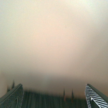 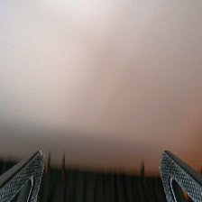

</details>

**Turn 4**

I'll bring both arms further down and forward, closer to the clapperboard on the table.

`move_joints`
````json
{
  "targets": {
    "left_j0": 0,
    "left_j3": 0,
    "right_j4": 0,
    "right_j5": 0,
    "right_j2": 2.5,
    "left_j2": 2.5,
    "left_j4": 0,
    "right_j1": 0.5,
    "left_j1": 0.5,
    "right_j3": 0,
    "left_j5": 0,
    "right_j0": 0
  }
}
````

*executing move_joints over 9 steps (0.9s)*

<details open>
<summary>Observation 5</summary>

````text
Current observation.
Instruction: Lift the clapper stick, then let go so it snaps shut with a clap. Note that the context (top) cam is on the opposite sides of the arms.
state[joint_pos]: left_j0=-0.0021 left_j1=0.4816 left_j2=2.5103 left_j3=0.028 left_j4=-0.0093 left_j5=-0.004 left_gripper=0.9986 right_j0=-0.0021 right_j1=0.4778 right_j2=2.5103 right_j3=0.0261 right_j4=-0.0055 right_j5=-0.0082 right_gripper=0.9994

camera 'top_cam' (step 54):

[image omitted: streamed camera frame]

camera 'left_cam' (step 54):

[image omitted: streamed camera frame]

camera 'right_cam' (step 54):

[image omitted: streamed camera frame]
````

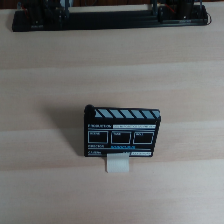 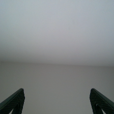 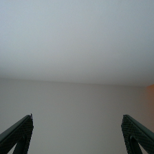

</details>

**Turn 5**

I will swing both arms inwards and raise the shoulders further forward (higher j1) to position them over the table and the clapperboard.

`move_joints`
````json
{
  "targets": {
    "left_j2": 1.5,
    "left_j0": 0.2,
    "right_j1": 2.5,
    "left_j1": 2.5,
    "right_j2": 1.5,
    "right_j0": -0.2,
    "right_j5": 0,
    "right_j3": -0.5,
    "left_j3": -0.5,
    "left_j5": 0,
    "right_j4": 0,
    "left_j4": 0
  }
}
````

*executing move_joints over 33 steps (3.3s)*

[Back to index](README.md)
