# Run opus-1: 20260731_021816_12f6942f

> Lift the clapper stick, then let go so it snaps shut with a clap. Note that the context (top) cam is on the opposite sides of the arms.

| | |
|---|---|
| Created (UTC) | 2026-07-31 02:18:16 |
| Model | claude-opus-5 |
| Effort | high |
| Embodiment | yam_arms |
| Status | success |
| Outcome | pass |
| Termination | operator_end |
| Operator judgement | y |
| Duration | 04:48 |
| Steps | 143 |
| LLM turns | 16 |
| Seed | 0 |
| inspect-robots | 0.33.0 |
| Git commit | n/a |

Files: [raw EvalLog](../adhoc_8ba42f7e.json) · [top video](../videos/20260731_021816_12f6942f/scene-0-e0_top_cam.mp4) · [left video](../videos/20260731_021816_12f6942f/scene-0-e0_left_cam.mp4) · [right video](../videos/20260731_021816_12f6942f/scene-0-e0_right_cam.mp4) · [transcript jsonl](../transcripts/20260731_021816_12f6942f) · [wire capture](../wire/20260731_021816_12f6942f)

## Transcript

<details>
<summary>System prompt</summary>

````text
You are controlling a real robot embodiment named 'yam_arms' through tool calls. Each observation message gives you the current proprioceptive state and camera images. Work toward the user's goal in small, deliberate motions; re-check the observation after every motion. Every move tool call must include a `note`: in one or two sentences, say what you observe in the current observation and why you chose this motion. The user is watching these notes to see what you see and what you decide, so write them for a human reader. Safety approvers clamp out-of-bounds and too-fast actions below you. Respond with exactly one tool call per turn. When the goal is achieved call done; if it cannot be achieved call give_up. You have a budget of 200 LLM calls for the whole trial.

Embodiment notes:
Two identical 6-DoF arms, prefixed left_ and right_, each with a parallel-jaw
gripper. Each arm has its own base frame: +x points forward out of the base
(the direction the folded gripper points at all-zero joints), +y left, +z up;
how the two bases are mounted relative to each other depends on the rig.
Joint guide (positive direction, identical for both arms):
- left_j0 / right_j0: base yaw about the vertical axis; positive swings the
  arm counterclockwise seen from above (a forward-pointing gripper moves
  toward +y).
- left_j1 / right_j1: shoulder pitch; 0 points the upper arm horizontally
  backward and is the lower hard stop (it cannot go negative), positive
  raises it (about 1.57 is straight up, about 3.14 is horizontal forward).
- left_j2 / right_j2: elbow; 0 is fully folded with the forearm doubled back
  against the upper arm and is the lower hard stop, positive opens it.
- left_j3 / right_j3: wrist pitch, axis parallel to the elbow; positive tilts
  the gripper up.
- left_j4 / right_j4: wrist yaw; positive swings the gripper toward the arm's
  right seen from above (opposite sign sense of j0).
- left_j5 / right_j5: wrist roll about the gripper's pointing axis; positive
  turns clockwise when viewed from behind the gripper looking out along the
  fingers.
- left_gripper / right_gripper: 0 is fully closed, 1 is fully open (about
  9.5 cm between the jaws).
Proportions: upper arm 0.26 m, forearm 0.25 m, wrist to grasp point 0.25 m
when straight; reach from the shoulder about 0.76 m.
At all-zero joints the arm rests folded low with the gripper pointing
forward. While the arm is folded, a single joint's effect on the gripper
position can be counterintuitive; move deliberately and re-check the
observation after each motion. The joint values above are positions as shown
in the observation; when actions are per-step changes (delta mode), the same
sign conventions apply to each change.
````

</details>

> Goal: Lift the clapper stick, then let go so it snaps shut with a clap. Note that the context (top) cam is on the opposite sides of the arms.

<details open>
<summary>Observation 1</summary>

````text
Current observation.
Instruction: Lift the clapper stick, then let go so it snaps shut with a clap. Note that the context (top) cam is on the opposite sides of the arms.
state[joint_pos]: left_j0=-0.004 left_j1=0.0063 left_j2=0.0067 left_j3=-0.0319 left_j4=-0.0071 left_j5=-0.0158 left_gripper=0.9993 right_j0=-0.0006 right_j1=0.0025 right_j2=0.0063 right_j3=-0.0265 right_j4=-0.0044 right_j5=-0.0166 right_gripper=0.9995

camera 'top_cam' (step 0):

[image omitted: streamed camera frame]

camera 'left_cam' (step 0):

[image omitted: streamed camera frame]

camera 'right_cam' (step 0):

[image omitted: streamed camera frame]
````

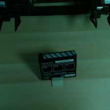 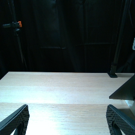 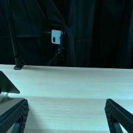

</details>

**Turn 1**

The clapperboard sits on the table roughly between the two arms, propped facing away from us (top cam is on the far side). I'm raising the right arm's shoulder and opening the elbow a little to see where the gripper goes and to get the wrist camera looking down toward the board.

`move_joints`
````json
{
  "targets": {
    "right_j1": 1.2,
    "right_j2": 0.8,
    "right_gripper": 1.0
  }
}
````

*executing move_joints over 20 steps (2.0s)*

<details open>
<summary>Observation 2</summary>

````text
Current observation.
Instruction: Lift the clapper stick, then let go so it snaps shut with a clap. Note that the context (top) cam is on the opposite sides of the arms.
state[joint_pos]: left_j0=-0.004 left_j1=0.0071 left_j2=0.0067 left_j3=-0.041 left_j4=-0.0074 left_j5=-0.0166 left_gripper=0.9992 right_j0=-0.0006 right_j1=1.2011 right_j2=0.7708 right_j3=-0.0528 right_j4=-0.0082 right_j5=-0.0189 right_gripper=0.9994

camera 'top_cam' (step 20):

[image omitted: streamed camera frame]

camera 'left_cam' (step 20):

[image omitted: streamed camera frame]

camera 'right_cam' (step 20):

[image omitted: streamed camera frame]
````

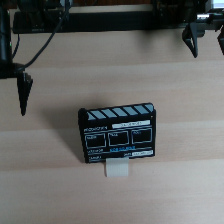 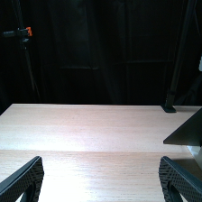 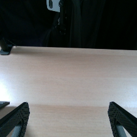

</details>

**Turn 2**

The right wrist camera now looks down at the empty table, so the arm is reaching forward-down as expected. I'm extending the shoulder/elbow to hover the gripper roughly 35 cm in front of the right shoulder, tilted down-forward, to bring the clapperboard into the wrist camera view.

`move_joints`
````json
{
  "targets": {
    "right_j1": 2.1,
    "right_j2": 1.59,
    "right_j3": -0.7
  }
}
````

*executing move_joints over 15 steps (1.5s)*

<details open>
<summary>Observation 3</summary>

````text
Current observation.
Instruction: Lift the clapper stick, then let go so it snaps shut with a clap. Note that the context (top) cam is on the opposite sides of the arms.
state[joint_pos]: left_j0=-0.004 left_j1=0.0071 left_j2=0.0067 left_j3=-0.0479 left_j4=-0.0074 left_j5=-0.0166 left_gripper=0.9991 right_j0=-0.0006 right_j1=2.1098 right_j2=1.5604 right_j3=-0.7063 right_j4=-0.0151 right_j5=-0.0296 right_gripper=0.9994

camera 'top_cam' (step 35):

[image omitted: streamed camera frame]

camera 'left_cam' (step 35):

[image omitted: streamed camera frame]

camera 'right_cam' (step 35):

[image omitted: streamed camera frame]
````

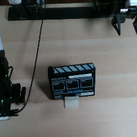 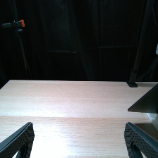 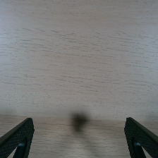

</details>

**Turn 3**

The right wrist camera only sees bare table, and in the top view (mirrored) my right arm is at the far left while the clapperboard sits toward the middle, i.e. to the arm's left. I'm yawing the right arm 0.5 rad toward the board and tilting the wrist up slightly to bring the board into view.

`move_joints`
````json
{
  "targets": {
    "right_j0": 0.5,
    "right_j3": -0.4
  }
}
````

*executing move_joints over 8 steps (0.8s)*

<details open>
<summary>Observation 4</summary>

````text
Current observation.
Instruction: Lift the clapper stick, then let go so it snaps shut with a clap. Note that the context (top) cam is on the opposite sides of the arms.
state[joint_pos]: left_j0=-0.004 left_j1=0.0071 left_j2=0.0067 left_j3=-0.0483 left_j4=-0.0074 left_j5=-0.017 left_gripper=0.9991 right_j0=0.4725 right_j1=2.1094 right_j2=1.5604 right_j3=-0.3901 right_j4=0.0006 right_j5=-0.0288 right_gripper=0.9994

camera 'top_cam' (step 43):

[image omitted: streamed camera frame]

camera 'left_cam' (step 43):

[image omitted: streamed camera frame]

camera 'right_cam' (step 43):

[image omitted: streamed camera frame]
````

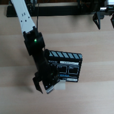 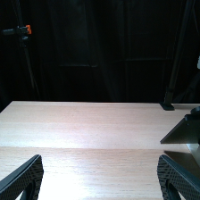 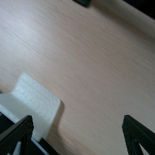

</details>

**Turn 4**

The top view shows my gripper has reached slightly past the near edge of the clapperboard, and the wrist cam mostly sees the white support block. I'm pulling the arm back and up ~10 cm so the wrist camera can look down on the whole board and I can spot the striped clapper stick.

`move_joints`
````json
{
  "targets": {
    "right_j1": 1.51,
    "right_j2": 1.25,
    "right_j3": -0.64
  }
}
````

*executing move_joints over 10 steps (1.0s)*

<details open>
<summary>Observation 5</summary>

````text
Current observation.
Instruction: Lift the clapper stick, then let go so it snaps shut with a clap. Note that the context (top) cam is on the opposite sides of the arms.
state[joint_pos]: left_j0=-0.004 left_j1=0.0071 left_j2=0.0067 left_j3=-0.0479 left_j4=-0.0074 left_j5=-0.0166 left_gripper=0.9991 right_j0=0.469 right_j1=1.5379 right_j2=1.2575 right_j3=-0.6266 right_j4=0.0143 right_j5=-0.0299 right_gripper=0.9993

camera 'top_cam' (step 53):

[image omitted: streamed camera frame]

camera 'left_cam' (step 53):

[image omitted: streamed camera frame]

camera 'right_cam' (step 53):

[image omitted: streamed camera frame]
````

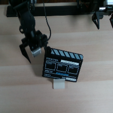 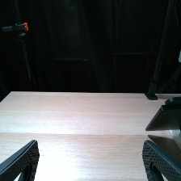 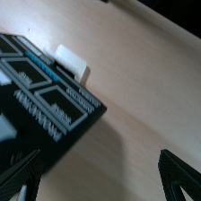

</details>

**Turn 5**

The wrist camera now sees the clapperboard with its striped clapper stick, but off to the left of frame; the top view confirms the board is to the arm's left. I'm yawing the right arm another 0.33 rad toward the board to center it.

`move_joints`
````json
{
  "targets": {
    "right_j0": 0.8
  }
}
````

*executing move_joints over 6 steps (0.6s)*

<details open>
<summary>Observation 6</summary>

````text
Current observation.
Instruction: Lift the clapper stick, then let go so it snaps shut with a clap. Note that the context (top) cam is on the opposite sides of the arms.
state[joint_pos]: left_j0=-0.004 left_j1=0.0071 left_j2=0.0067 left_j3=-0.0486 left_j4=-0.0074 left_j5=-0.017 left_gripper=0.9991 right_j0=0.783 right_j1=1.5333 right_j2=1.2552 right_j3=-0.6514 right_j4=0.0185 right_j5=-0.0296 right_gripper=0.9993

camera 'top_cam' (step 59):

[image omitted: streamed camera frame]

camera 'left_cam' (step 59):

[image omitted: streamed camera frame]

camera 'right_cam' (step 59):

[image omitted: streamed camera frame]
````

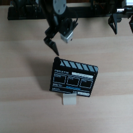 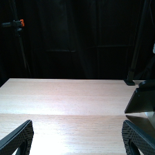 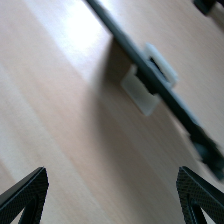

</details>

**Turn 6**

The wrist camera sees the board's near edge (dark bar with the white support clip) high in the frame, meaning the board is still farther forward than my gripper. I'm extending the arm ~12 cm forward at the same height to approach the clapper stick.

`move_joints`
````json
{
  "targets": {
    "right_j1": 1.98,
    "right_j2": 1.8,
    "right_j3": -0.74
  }
}
````

*executing move_joints over 9 steps (0.9s)*

<details open>
<summary>Observation 7</summary>

````text
Current observation.
Instruction: Lift the clapper stick, then let go so it snaps shut with a clap. Note that the context (top) cam is on the opposite sides of the arms.
state[joint_pos]: left_j0=-0.004 left_j1=0.0071 left_j2=0.0067 left_j3=-0.0486 left_j4=-0.0074 left_j5=-0.0166 left_gripper=0.9991 right_j0=0.7853 right_j1=1.9751 right_j2=1.7706 right_j3=-0.7567 right_j4=0.0143 right_j5=-0.0372 right_gripper=0.9993

camera 'top_cam' (step 68):

[image omitted: streamed camera frame]

camera 'left_cam' (step 68):

[image omitted: streamed camera frame]

camera 'right_cam' (step 68):

[image omitted: streamed camera frame]
````

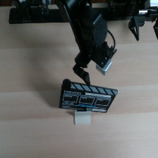 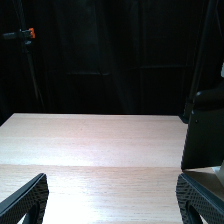 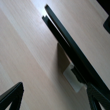

</details>

**Turn 7**

The gripper is now hovering just above the board's near edge according to the top view. I'm pitching the wrist down to look straight at the board so I can see exactly where the clapper stick is and how it is oriented.

`move_joints`
````json
{
  "targets": {
    "right_j3": -1.3
  }
}
````

*executing move_joints over 9 steps (0.9s)*

<details open>
<summary>Observation 8</summary>

````text
Current observation.
Instruction: Lift the clapper stick, then let go so it snaps shut with a clap. Note that the context (top) cam is on the opposite sides of the arms.
state[joint_pos]: left_j0=-0.004 left_j1=0.0071 left_j2=0.0067 left_j3=-0.0486 left_j4=-0.0074 left_j5=-0.0166 left_gripper=0.9991 right_j0=0.7853 right_j1=1.9789 right_j2=1.7714 right_j3=-1.2732 right_j4=0.0143 right_j5=-0.0372 right_gripper=0.9993

camera 'top_cam' (step 77):

[image omitted: streamed camera frame]

camera 'left_cam' (step 77):

[image omitted: streamed camera frame]

camera 'right_cam' (step 77):

[image omitted: streamed camera frame]
````

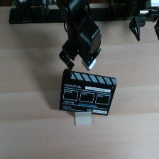 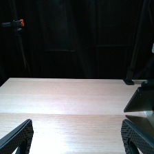 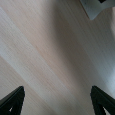

</details>

**Turn 8**

Looking straight down, the wrist camera sees mostly bare table with the board only in the top-right corner, so I'm slightly over-rotated; I'm reducing the base yaw by 0.1 rad to bring the board back toward the center of view.

`move_joints`
````json
{
  "targets": {
    "right_j0": 0.68
  }
}
````

*executing move_joints over 2 steps (0.2s)*

<details open>
<summary>Observation 9</summary>

````text
Current observation.
Instruction: Lift the clapper stick, then let go so it snaps shut with a clap. Note that the context (top) cam is on the opposite sides of the arms.
state[joint_pos]: left_j0=-0.004 left_j1=0.0071 left_j2=0.0067 left_j3=-0.0486 left_j4=-0.0074 left_j5=-0.0166 left_gripper=0.9991 right_j0=0.7094 right_j1=1.9789 right_j2=1.7714 right_j3=-1.2915 right_j4=0.0071 right_j5=-0.0376 right_gripper=0.9993

camera 'top_cam' (step 79):

[image omitted: streamed camera frame]

camera 'left_cam' (step 79):

[image omitted: streamed camera frame]

camera 'right_cam' (step 79):

[image omitted: streamed camera frame]
````

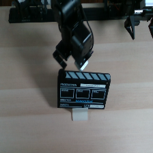 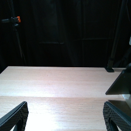 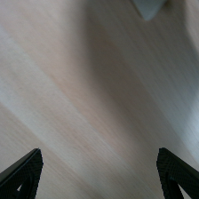

</details>

**Turn 9**

Straight-down views are hard to interpret, so I'm returning the wrist to a ~55° down-forward angle (where the fingers frame the bottom of the image) and dropping the hand about 5 cm, so I can see the clapper stick relative to my fingertips.

`move_joints`
````json
{
  "targets": {
    "right_j1": 2.035,
    "right_j2": 1.634,
    "right_j3": -0.559
  }
}
````

*executing move_joints over 12 steps (1.2s)*

<details open>
<summary>Observation 10</summary>

````text
Current observation.
Instruction: Lift the clapper stick, then let go so it snaps shut with a clap. Note that the context (top) cam is on the opposite sides of the arms.
state[joint_pos]: left_j0=-0.004 left_j1=0.0071 left_j2=0.0067 left_j3=-0.0483 left_j4=-0.0074 left_j5=-0.0166 left_gripper=0.9991 right_j0=0.7162 right_j1=2.0258 right_j2=1.6367 right_j3=-0.6033 right_j4=0.0029 right_j5=-0.0448 right_gripper=0.9993

camera 'top_cam' (step 91):

[image omitted: streamed camera frame]

camera 'left_cam' (step 91):

[image omitted: streamed camera frame]

camera 'right_cam' (step 91):

[image omitted: streamed camera frame]
````

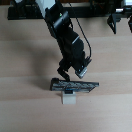  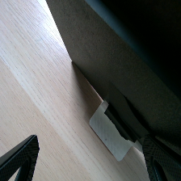

</details>

**Turn 10**

The top view now shows the striped clapper stick along the board's far edge (camera side), with the white support block beyond it, so I must reach over the board. I'm extending the hand ~5 cm further forward while keeping it above the board to look down on the stick.

`move_joints`
````json
{
  "targets": {
    "right_j1": 2.228,
    "right_j2": 2.047,
    "right_j3": -0.819
  }
}
````

*executing move_joints over 7 steps (0.7s)*

<details open>
<summary>Observation 11</summary>

````text
Current observation.
Instruction: Lift the clapper stick, then let go so it snaps shut with a clap. Note that the context (top) cam is on the opposite sides of the arms.
state[joint_pos]: left_j0=-0.004 left_j1=0.0071 left_j2=0.0067 left_j3=-0.0483 left_j4=-0.0074 left_j5=-0.0166 left_gripper=0.9991 right_j0=0.725 right_j1=2.2147 right_j2=1.9949 right_j3=-0.8738 right_j4=-0.0231 right_j5=-0.0444 right_gripper=0.9993

camera 'top_cam' (step 98):

[image omitted: streamed camera frame]

camera 'left_cam' (step 98):

[image omitted: streamed camera frame]

camera 'right_cam' (step 98):

[image omitted: streamed camera frame]
````

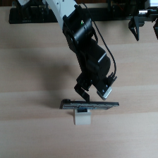 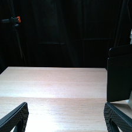 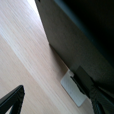

</details>

**Turn 11**

The hand is hovering over the flat, face-up clapperboard; the wrist cam is filled by the dark slate face. I'm lowering the gripper about 8 cm, keeping the same forward reach, to get down near board level before locating the stick precisely.

`move_joints`
````json
{
  "targets": {
    "right_j1": 2.332,
    "right_j2": 1.886,
    "right_j3": -0.554
  }
}
````

*executing move_joints over 6 steps (0.6s)*

<details open>
<summary>Observation 12</summary>

````text
Current observation.
Instruction: Lift the clapper stick, then let go so it snaps shut with a clap. Note that the context (top) cam is on the opposite sides of the arms.
state[joint_pos]: left_j0=-0.004 left_j1=0.0074 left_j2=0.0067 left_j3=-0.0483 left_j4=-0.0074 left_j5=-0.0166 left_gripper=0.9991 right_j0=0.7483 right_j1=2.2997 right_j2=1.8946 right_j3=-0.6907 right_j4=-0.0593 right_j5=-0.0444 right_gripper=0.9993

camera 'top_cam' (step 104):

[image omitted: streamed camera frame]

camera 'left_cam' (step 104):

[image omitted: streamed camera frame]

camera 'right_cam' (step 104):

[image omitted: streamed camera frame]
````

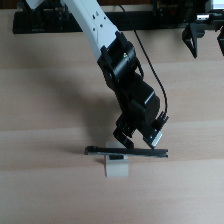 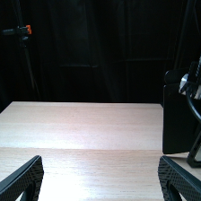 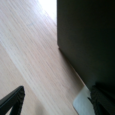

</details>

**Turn 12**

My arm is blocking the overhead view and I still can't tell which edge of the board carries the clapper stick. I'm swinging the right arm back and up out of the way to get one clean, unobstructed overhead picture of the clapperboard.

`move_joints`
````json
{
  "targets": {
    "right_j0": 0.0,
    "right_j1": 1.4,
    "right_j2": 1.0,
    "right_j3": -0.6
  }
}
````

*executing move_joints over 15 steps (1.5s)*

<details open>
<summary>Observation 13</summary>

````text
Current observation.
Instruction: Lift the clapper stick, then let go so it snaps shut with a clap. Note that the context (top) cam is on the opposite sides of the arms.
state[joint_pos]: left_j0=-0.004 left_j1=0.0074 left_j2=0.0067 left_j3=-0.0643 left_j4=-0.0074 left_j5=-0.0166 left_gripper=0.9991 right_j0=0.0162 right_j1=1.4326 right_j2=1.0157 right_j3=-0.6254 right_j4=-0.0639 right_j5=-0.0597 right_gripper=0.9988

camera 'top_cam' (step 119):

[image omitted: streamed camera frame]

camera 'left_cam' (step 119):

[image omitted: streamed camera frame]

camera 'right_cam' (step 119):

[image omitted: streamed camera frame]
````

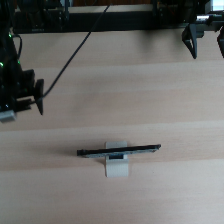 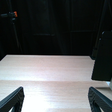 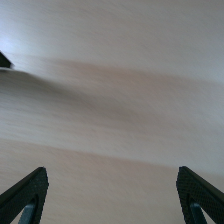

</details>

**Turn 13**

With the arm out of the way the overhead view shows the clapper lying flat: a thin black bar with a white support block under its middle. I'm bringing the right hand back toward it at a 45° down-forward approach so the wrist camera can inspect the bar from close range.

`move_joints`
````json
{
  "targets": {
    "right_j0": 0.75,
    "right_j1": 2.132,
    "right_j2": 1.521,
    "right_j3": -0.174
  }
}
````

*executing move_joints over 12 steps (1.2s)*

<details open>
<summary>Observation 14</summary>

````text
Current observation.
Instruction: Lift the clapper stick, then let go so it snaps shut with a clap. Note that the context (top) cam is on the opposite sides of the arms.
state[joint_pos]: left_j0=-0.004 left_j1=0.0082 left_j2=0.0067 left_j3=-0.0711 left_j4=-0.0078 left_j5=-0.0166 left_gripper=0.9991 right_j0=0.6067 right_j1=2.0521 right_j2=1.499 right_j3=-0.2913 right_j4=0.2008 right_j5=-0.0605 right_gripper=0.9988

camera 'top_cam' (step 131):

[image omitted: streamed camera frame]

camera 'left_cam' (step 131):

[image omitted: streamed camera frame]

camera 'right_cam' (step 131):

[image omitted: streamed camera frame]
````

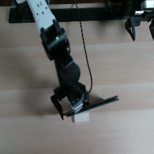 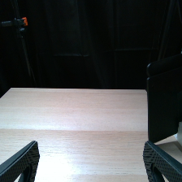 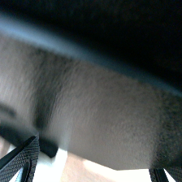

</details>

**Turn 14**

The joints stalled short of their targets and the wrist camera went dark, so I think the hand bumped into the clapper/stand. I'm retracting up and back about 10 cm to clear it and get a proper look.

`move_joints`
````json
{
  "targets": {
    "right_j1": 1.712,
    "right_j2": 1.384,
    "right_j3": -0.457
  }
}
````

*executing move_joints over 6 steps (0.6s)*

<details open>
<summary>Observation 15</summary>

````text
Current observation.
Instruction: Lift the clapper stick, then let go so it snaps shut with a clap. Note that the context (top) cam is on the opposite sides of the arms.
state[joint_pos]: left_j0=-0.004 left_j1=0.009 left_j2=0.0067 left_j3=-0.0719 left_j4=-0.0082 left_j5=-0.017 left_gripper=0.9991 right_j0=0.6086 right_j1=1.7348 right_j2=1.4029 right_j3=-0.4194 right_j4=0.1864 right_j5=-0.0708 right_gripper=0.9988

camera 'top_cam' (step 137):

[image omitted: streamed camera frame]

camera 'left_cam' (step 137):

[image omitted: streamed camera frame]

camera 'right_cam' (step 137):

[image omitted: streamed camera frame]
````

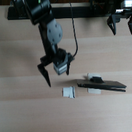 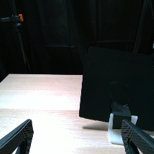 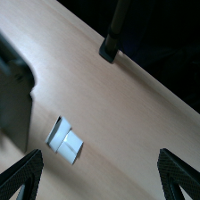

</details>

**Turn 15**

Now I can see the setup: a black clapper (two hinged sticks) lying on small white supports on the table. I'm moving the open gripper to hover roughly 8 cm above the clapper, angled 45° down, to line up on it before descending.

`move_joints`
````json
{
  "targets": {
    "right_j0": 0.62,
    "right_j1": 1.956,
    "right_j2": 1.696,
    "right_j3": -0.525
  }
}
````

*executing move_joints over 5 steps (0.5s)*

<details open>
<summary>Observation 16</summary>

````text
Current observation.
Instruction: Lift the clapper stick, then let go so it snaps shut with a clap. Note that the context (top) cam is on the opposite sides of the arms.
state[joint_pos]: left_j0=-0.004 left_j1=0.0097 left_j2=0.0067 left_j3=-0.0746 left_j4=-0.0093 left_j5=-0.0166 left_gripper=0.9991 right_j0=0.6209 right_j1=1.9461 right_j2=1.6505 right_j3=-0.5278 right_j4=0.1791 right_j5=-0.0792 right_gripper=0.9988

camera 'top_cam' (step 142):

[image omitted: streamed camera frame]

camera 'left_cam' (step 142):

[image omitted: streamed camera frame]

camera 'right_cam' (step 142):

[image omitted: streamed camera frame]
````

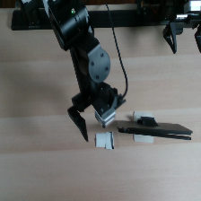 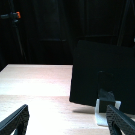 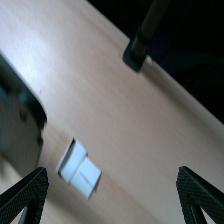

</details>

**Turn 16**

The overhead view shows my gripper is still to the robot's right of the clapper and slightly behind it. I'm yawing the base 0.16 rad further left, which should also tell me clearly how the wrist-camera image maps to motion.

`move_joints`
````json
{
  "targets": {
    "right_j0": 0.78
  }
}
````

*executing move_joints over 3 steps (0.3s)*

[Back to index](README.md)
