# Run opus-2: 20260731_022331_512a92a8

> Lift the clapper stick, then let go so it snaps shut with a clap. Note that the context (top) cam is on the opposite sides of the arms.

| | |
|---|---|
| Created (UTC) | 2026-07-31 02:23:31 |
| Model | claude-opus-5 |
| Effort | high |
| Embodiment | yam_arms |
| Status | success |
| Outcome | fail |
| Termination | operator_end |
| Operator judgement | n |
| Duration | 04:39 |
| Steps | 188 |
| LLM turns | 19 |
| Seed | 0 |
| inspect-robots | 0.33.0 |
| Git commit | n/a |

Files: [raw EvalLog](../adhoc_1852de3c.json) · [top video](../videos/20260731_022331_512a92a8/scene-0-e0_top_cam.mp4) · [left video](../videos/20260731_022331_512a92a8/scene-0-e0_left_cam.mp4) · [right video](../videos/20260731_022331_512a92a8/scene-0-e0_right_cam.mp4) · [transcript jsonl](../transcripts/20260731_022331_512a92a8) · [wire capture](../wire/20260731_022331_512a92a8)

## Transcript

<details>
<summary>System prompt</summary>

````text
You are controlling a real robot embodiment named 'yam_arms' through tool calls. Each observation message gives you the current proprioceptive state and camera images. Work toward the user's goal in small, deliberate motions; re-check the observation after every motion. Every move tool call must include a `note`: in one or two sentences, say what you observe in the current observation and why you chose this motion. The user is watching these notes to see what you see and what you decide, so write them for a human reader. Safety approvers clamp out-of-bounds and too-fast actions below you. Respond with exactly one tool call per turn. When the goal is achieved call done; if it cannot be achieved call give_up. You have a budget of 200 LLM calls for the whole trial.

Embodiment notes:
Two identical 6-DoF arms, prefixed left_ and right_, each with a parallel-jaw
gripper. Each arm has its own base frame: +x points forward out of the base
(the direction the folded gripper points at all-zero joints), +y left, +z up;
how the two bases are mounted relative to each other depends on the rig.
Joint guide (positive direction, identical for both arms):
- left_j0 / right_j0: base yaw about the vertical axis; positive swings the
  arm counterclockwise seen from above (a forward-pointing gripper moves
  toward +y).
- left_j1 / right_j1: shoulder pitch; 0 points the upper arm horizontally
  backward and is the lower hard stop (it cannot go negative), positive
  raises it (about 1.57 is straight up, about 3.14 is horizontal forward).
- left_j2 / right_j2: elbow; 0 is fully folded with the forearm doubled back
  against the upper arm and is the lower hard stop, positive opens it.
- left_j3 / right_j3: wrist pitch, axis parallel to the elbow; positive tilts
  the gripper up.
- left_j4 / right_j4: wrist yaw; positive swings the gripper toward the arm's
  right seen from above (opposite sign sense of j0).
- left_j5 / right_j5: wrist roll about the gripper's pointing axis; positive
  turns clockwise when viewed from behind the gripper looking out along the
  fingers.
- left_gripper / right_gripper: 0 is fully closed, 1 is fully open (about
  9.5 cm between the jaws).
Proportions: upper arm 0.26 m, forearm 0.25 m, wrist to grasp point 0.25 m
when straight; reach from the shoulder about 0.76 m.
At all-zero joints the arm rests folded low with the gripper pointing
forward. While the arm is folded, a single joint's effect on the gripper
position can be counterintuitive; move deliberately and re-check the
observation after each motion. The joint values above are positions as shown
in the observation; when actions are per-step changes (delta mode), the same
sign conventions apply to each change.
````

</details>

> Goal: Lift the clapper stick, then let go so it snaps shut with a clap. Note that the context (top) cam is on the opposite sides of the arms.

<details open>
<summary>Observation 1</summary>

````text
Current observation.
Instruction: Lift the clapper stick, then let go so it snaps shut with a clap. Note that the context (top) cam is on the opposite sides of the arms.
state[joint_pos]: left_j0=-0.004 left_j1=0.0063 left_j2=0.0067 left_j3=-0.0303 left_j4=-0.0071 left_j5=-0.0193 left_gripper=0.9988 right_j0=-0.0002 right_j1=0.0025 right_j2=0.0063 right_j3=-0.0261 right_j4=-0.0021 right_j5=-0.0147 right_gripper=0.9993

camera 'top_cam' (step 0):

[image omitted: streamed camera frame]

camera 'left_cam' (step 0):

[image omitted: streamed camera frame]

camera 'right_cam' (step 0):

[image omitted: streamed camera frame]
````

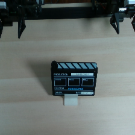 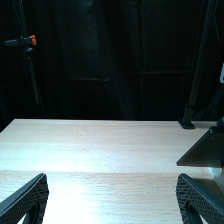 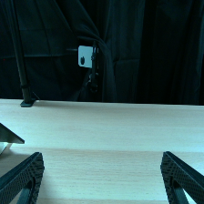

</details>

**Turn 1**

The clapperboard stands in the middle of the table facing the top camera, so our arms see its back side. I'm raising the right arm's shoulder and elbow to unfold it and get a wrist-camera view of the board.

`move_joints`
````json
{
  "targets": {
    "right_j1": 1.2,
    "right_j2": 1.2
  }
}
````

*executing move_joints over 20 steps (2.0s)*

<details open>
<summary>Observation 2</summary>

````text
Current observation.
Instruction: Lift the clapper stick, then let go so it snaps shut with a clap. Note that the context (top) cam is on the opposite sides of the arms.
state[joint_pos]: left_j0=-0.004 left_j1=0.0082 left_j2=0.0067 left_j3=-0.041 left_j4=-0.0074 left_j5=-0.02 left_gripper=0.9988 right_j0=-0.0002 right_j1=1.2041 right_j2=1.1709 right_j3=-0.0483 right_j4=-0.0055 right_j5=-0.0185 right_gripper=0.9992

camera 'top_cam' (step 20):

[image omitted: streamed camera frame]

camera 'left_cam' (step 20):

[image omitted: streamed camera frame]

camera 'right_cam' (step 20):

[image omitted: streamed camera frame]
````

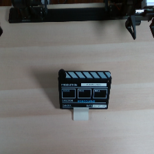  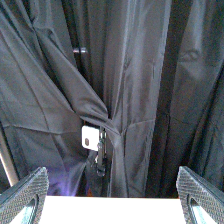

</details>

**Turn 2**

The right wrist camera is looking forward at the back curtain, above the board. I'm pitching the wrist down 0.9 rad so the camera looks down toward the table and the clapperboard.

`move_joints`
````json
{
  "targets": {
    "right_j3": -0.9
  }
}
````

*executing move_joints over 14 steps (1.4s)*

<details open>
<summary>Observation 3</summary>

````text
Current observation.
Instruction: Lift the clapper stick, then let go so it snaps shut with a clap. Note that the context (top) cam is on the opposite sides of the arms.
state[joint_pos]: left_j0=-0.004 left_j1=0.0082 left_j2=0.0067 left_j3=-0.0479 left_j4=-0.0074 left_j5=-0.02 left_gripper=0.9987 right_j0=-0.0006 right_j1=1.2083 right_j2=1.1721 right_j3=-0.8703 right_j4=-0.0055 right_j5=-0.0185 right_gripper=0.9992

camera 'top_cam' (step 34):

[image omitted: streamed camera frame]

camera 'left_cam' (step 34):

[image omitted: streamed camera frame]

camera 'right_cam' (step 34):

[image omitted: streamed camera frame]
````

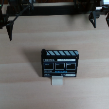 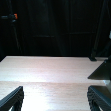 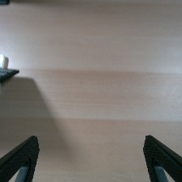

</details>

**Turn 3**

The right wrist camera now sees only bare table — the clapperboard sits slightly to the arms' left of centre. I'm yawing the right arm base 0.45 rad toward the left to bring the board into view.

`move_joints`
````json
{
  "targets": {
    "right_j0": 0.45
  }
}
````

*executing move_joints over 8 steps (0.8s)*

<details open>
<summary>Observation 4</summary>

````text
Current observation.
Instruction: Lift the clapper stick, then let go so it snaps shut with a clap. Note that the context (top) cam is on the opposite sides of the arms.
state[joint_pos]: left_j0=-0.004 left_j1=0.0082 left_j2=0.0067 left_j3=-0.0483 left_j4=-0.0074 left_j5=-0.02 left_gripper=0.9987 right_j0=0.4305 right_j1=1.2083 right_j2=1.1721 right_j3=-0.8871 right_j4=-0.0055 right_j5=-0.0185 right_gripper=0.9992

camera 'top_cam' (step 42):

[image omitted: streamed camera frame]

camera 'left_cam' (step 42):

[image omitted: streamed camera frame]

camera 'right_cam' (step 42):

[image omitted: streamed camera frame]
````

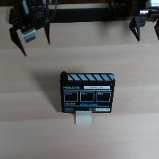 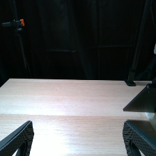 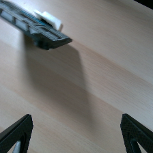

</details>

**Turn 4**

Right camera sees table plus what looks like the other gripper at the edge; the board must be further forward. I'm extending the right arm forward and pointing the gripper straight down to look over the area where the clapperboard sits.

`move_joints`
````json
{
  "targets": {
    "right_j1": 1.8,
    "right_j2": 1.4,
    "right_j3": -1.25
  }
}
````

*executing move_joints over 10 steps (1.0s)*

<details open>
<summary>Observation 5</summary>

````text
Current observation.
Instruction: Lift the clapper stick, then let go so it snaps shut with a clap. Note that the context (top) cam is on the opposite sides of the arms.
state[joint_pos]: left_j0=-0.004 left_j1=0.0082 left_j2=0.0067 left_j3=-0.0483 left_j4=-0.0071 left_j5=-0.02 left_gripper=0.9987 right_j0=0.4301 right_j1=1.7992 right_j2=1.3781 right_j3=-1.2209 right_j4=-0.0086 right_j5=-0.0181 right_gripper=0.9992

camera 'top_cam' (step 52):

[image omitted: streamed camera frame]

camera 'left_cam' (step 52):

[image omitted: streamed camera frame]

camera 'right_cam' (step 52):

[image omitted: streamed camera frame]
````

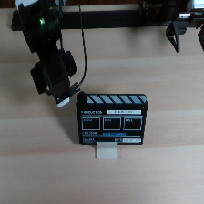 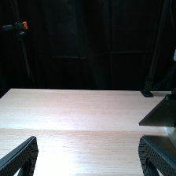 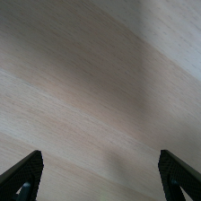

</details>

**Turn 5**

Top view shows my right gripper hovering above the table but off to the board's side (too far to the arms' right). Yawing the base further left to line the gripper up with the clapperboard.

`move_joints`
````json
{
  "targets": {
    "right_j0": 0.75
  }
}
````

*executing move_joints over 6 steps (0.6s)*

<details open>
<summary>Observation 6</summary>

````text
Current observation.
Instruction: Lift the clapper stick, then let go so it snaps shut with a clap. Note that the context (top) cam is on the opposite sides of the arms.
state[joint_pos]: left_j0=-0.004 left_j1=0.0082 left_j2=0.0067 left_j3=-0.0486 left_j4=-0.0074 left_j5=-0.02 left_gripper=0.9987 right_j0=0.7326 right_j1=1.8069 right_j2=1.3781 right_j3=-1.2308 right_j4=-0.0093 right_j5=-0.0181 right_gripper=0.9992

camera 'top_cam' (step 58):

[image omitted: streamed camera frame]

camera 'left_cam' (step 58):

[image omitted: streamed camera frame]

camera 'right_cam' (step 58):

[image omitted: streamed camera frame]
````

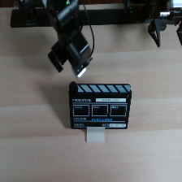  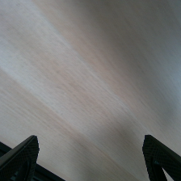

</details>

**Turn 6**

Gripper is now roughly over the board's near-left region in the top view but still behind it; extending the arm ~8 cm further forward while keeping the gripper pointing down to bring the clapper stick into the wrist camera.

`move_joints`
````json
{
  "targets": {
    "right_j1": 2.0,
    "right_j2": 1.45,
    "right_j3": -1.3
  }
}
````

*executing move_joints over 4 steps (0.4s)*

<details open>
<summary>Observation 7</summary>

````text
Current observation.
Instruction: Lift the clapper stick, then let go so it snaps shut with a clap. Note that the context (top) cam is on the opposite sides of the arms.
state[joint_pos]: left_j0=-0.004 left_j1=0.0082 left_j2=0.0067 left_j3=-0.0483 left_j4=-0.0071 left_j5=-0.02 left_gripper=0.9987 right_j0=0.733 right_j1=1.9896 right_j2=1.4239 right_j3=-1.2762 right_j4=-0.0128 right_j5=-0.0181 right_gripper=0.9992

camera 'top_cam' (step 62):

[image omitted: streamed camera frame]

camera 'left_cam' (step 62):

[image omitted: streamed camera frame]

camera 'right_cam' (step 62):

[image omitted: streamed camera frame]
````

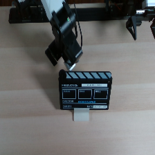  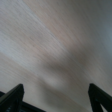

</details>

**Turn 7**

The wrist camera pointing straight down only shows bare table, so I'm raising the wrist and tilting the gripper to a 45° down-forward angle to survey the clapperboard from behind and above.

`move_joints`
````json
{
  "targets": {
    "right_j1": 1.9,
    "right_j2": 1.3,
    "right_j3": -0.25
  }
}
````

*executing move_joints over 17 steps (1.7s)*

<details open>
<summary>Observation 8</summary>

````text
Current observation.
Instruction: Lift the clapper stick, then let go so it snaps shut with a clap. Note that the context (top) cam is on the opposite sides of the arms.
state[joint_pos]: left_j0=-0.004 left_j1=0.0082 left_j2=0.0067 left_j3=-0.0483 left_j4=-0.0074 left_j5=-0.02 left_gripper=0.9987 right_j0=0.7357 right_j1=1.9388 right_j2=1.3018 right_j3=-0.2882 right_j4=-0.017 right_j5=-0.0261 right_gripper=0.9992

camera 'top_cam' (step 79):

[image omitted: streamed camera frame]

camera 'left_cam' (step 79):

[image omitted: streamed camera frame]

camera 'right_cam' (step 79):

[image omitted: streamed camera frame]
````

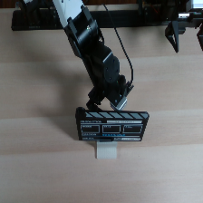 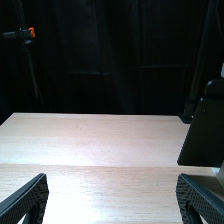 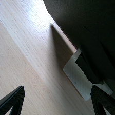

</details>

**Turn 8**

The wrist camera just caught the edge of the dark board at the upper right, but I still can't tell if the board is flat or tilted. Tilting the wrist up to a near-horizontal view to see the board's profile.

`move_joints`
````json
{
  "targets": {
    "right_j3": 0.4
  }
}
````

*executing move_joints over 11 steps (1.1s)*

<details open>
<summary>Observation 9</summary>

````text
Current observation.
Instruction: Lift the clapper stick, then let go so it snaps shut with a clap. Note that the context (top) cam is on the opposite sides of the arms.
state[joint_pos]: left_j0=-0.004 left_j1=0.0082 left_j2=0.0067 left_j3=-0.049 left_j4=-0.0074 left_j5=-0.02 left_gripper=0.9987 right_j0=0.7376 right_j1=1.9396 right_j2=1.2964 right_j3=0.2893 right_j4=-0.0315 right_j5=-0.0372 right_gripper=0.9992

camera 'top_cam' (step 90):

[image omitted: streamed camera frame]

camera 'left_cam' (step 90):

[image omitted: streamed camera frame]

camera 'right_cam' (step 90):

[image omitted: streamed camera frame]
````

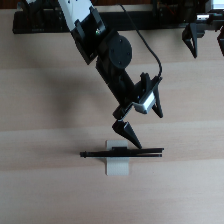 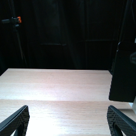 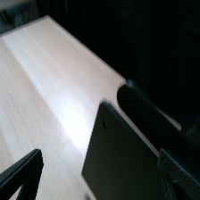

</details>

**Turn 9**

The board appears at the right edge of my wrist view; yawing the base further left to see which way the image shifts and to centre the board in the wrist camera.

`move_joints`
````json
{
  "targets": {
    "right_j0": 0.95
  }
}
````

*executing move_joints over 4 steps (0.4s)*

<details open>
<summary>Observation 10</summary>

````text
Current observation.
Instruction: Lift the clapper stick, then let go so it snaps shut with a clap. Note that the context (top) cam is on the opposite sides of the arms.
state[joint_pos]: left_j0=-0.004 left_j1=0.0082 left_j2=0.0067 left_j3=-0.0486 left_j4=-0.0074 left_j5=-0.02 left_gripper=0.9987 right_j0=0.9382 right_j1=1.9404 right_j2=1.2964 right_j3=0.2935 right_j4=-0.028 right_j5=-0.0376 right_gripper=0.9992

camera 'top_cam' (step 94):

[image omitted: streamed camera frame]

camera 'left_cam' (step 94):

[image omitted: streamed camera frame]

camera 'right_cam' (step 94):

[image omitted: streamed camera frame]
````

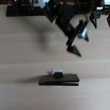 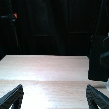 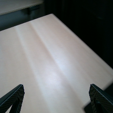

</details>

**Turn 10**

With the arm clear, the top view shows the clapperboard lying low and flat on the table with a white block on it. Moving the gripper back right and forward, tilted down, to hover over the board and inspect it closely.

`move_joints`
````json
{
  "targets": {
    "right_j0": 0.78,
    "right_j1": 2.1,
    "right_j2": 1.35,
    "right_j3": -0.5
  }
}
````

*executing move_joints over 13 steps (1.3s)*

<details open>
<summary>Observation 11</summary>

````text
Current observation.
Instruction: Lift the clapper stick, then let go so it snaps shut with a clap. Note that the context (top) cam is on the opposite sides of the arms.
state[joint_pos]: left_j0=-0.004 left_j1=0.0082 left_j2=0.0067 left_j3=-0.0486 left_j4=-0.0074 left_j5=-0.02 left_gripper=0.9987 right_j0=0.7895 right_j1=2.0739 right_j2=1.3327 right_j3=-0.4129 right_j4=-0.0349 right_j5=-0.0441 right_gripper=0.9991

camera 'top_cam' (step 107):

[image omitted: streamed camera frame]

camera 'left_cam' (step 107):

[image omitted: streamed camera frame]

camera 'right_cam' (step 107):

[image omitted: streamed camera frame]
````

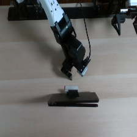 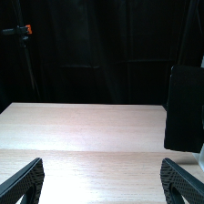 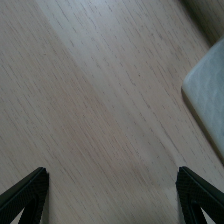

</details>

**Turn 11**

The gripper is hovering just short of and above the board; leaning the shoulder further forward (and tilting the wrist to a 45° down-forward approach) to bring the gripper out over the clapper stick and get a close wrist-cam view of it.

`move_joints`
````json
{
  "targets": {
    "right_j1": 2.35,
    "right_j3": 0.2
  }
}
````

*executing move_joints over 10 steps (1.0s)*

<details open>
<summary>Observation 12</summary>

````text
Current observation.
Instruction: Lift the clapper stick, then let go so it snaps shut with a clap. Note that the context (top) cam is on the opposite sides of the arms.
state[joint_pos]: left_j0=-0.004 left_j1=0.009 left_j2=0.0067 left_j3=-0.0486 left_j4=-0.0074 left_j5=-0.02 left_gripper=0.9987 right_j0=0.7971 right_j1=2.2753 right_j2=1.351 right_j3=0.239 right_j4=-0.0769 right_j5=-0.0486 right_gripper=0.9991

camera 'top_cam' (step 117):

[image omitted: streamed camera frame]

camera 'left_cam' (step 117):

[image omitted: streamed camera frame]

camera 'right_cam' (step 117):

[image omitted: streamed camera frame]
````

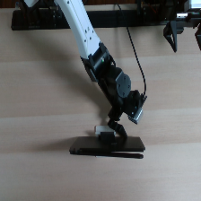 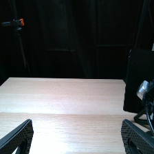 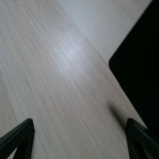

</details>

**Turn 12**

My right wrist camera keeps missing the board, so I'm raising the idle left arm into a high 'observer' pose aimed at the board to get a second, wider view of the clapperboard and my gripper.

`move_joints`
````json
{
  "targets": {
    "left_j0": -0.45,
    "left_j1": 1.5,
    "left_j2": 1.5,
    "left_j3": -0.6
  }
}
````

*executing move_joints over 24 steps (2.4s)*

<details open>
<summary>Observation 13</summary>

````text
Current observation.
Instruction: Lift the clapper stick, then let go so it snaps shut with a clap. Note that the context (top) cam is on the opposite sides of the arms.
state[joint_pos]: left_j0=-0.44 left_j1=1.4868 left_j2=1.4551 left_j3=-0.588 left_j4=-0.0097 left_j5=-0.0273 left_gripper=0.9987 right_j0=0.7986 right_j1=2.2871 right_j2=1.351 right_j3=0.2844 right_j4=-0.0879 right_j5=-0.0521 right_gripper=0.9991

camera 'top_cam' (step 141):

[image omitted: streamed camera frame]

camera 'left_cam' (step 141):

[image omitted: streamed camera frame]

camera 'right_cam' (step 141):

[image omitted: streamed camera frame]
````

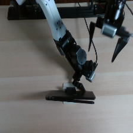 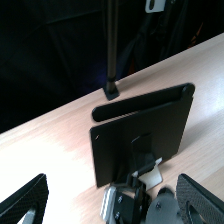 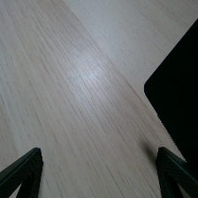

</details>

**Turn 13**

The left-arm view shows the tall dark panel is just the context camera on its stand, so the clapperboard is the low black object on the table right under my gripper. Lowering the right gripper ~8 cm toward it while watching the top view.

`move_joints`
````json
{
  "targets": {
    "right_j1": 2.45,
    "right_j3": 0.3
  }
}
````

*executing move_joints over 3 steps (0.3s)*

<details open>
<summary>Observation 14</summary>

````text
Current observation.
Instruction: Lift the clapper stick, then let go so it snaps shut with a clap. Note that the context (top) cam is on the opposite sides of the arms.
state[joint_pos]: left_j0=-0.4446 left_j1=1.5124 left_j2=1.4616 left_j3=-0.606 left_j4=-0.0101 left_j5=-0.0273 left_gripper=0.9987 right_j0=0.8013 right_j1=2.3566 right_j2=1.3792 right_j3=0.4084 right_j4=-0.1101 right_j5=-0.0521 right_gripper=0.9991

camera 'top_cam' (step 144):

[image omitted: streamed camera frame]

camera 'left_cam' (step 144):

[image omitted: streamed camera frame]

camera 'right_cam' (step 144):

[image omitted: streamed camera frame]
````

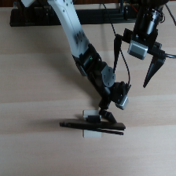 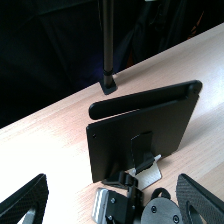 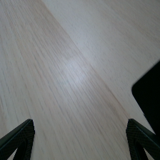

</details>

**Turn 14**

In the wrist view the board is the dark mass to the right of my fingers, which are aimed at bare table; yawing the base slightly back to the arm's right to centre the fingers over the clapperboard.

`move_joints`
````json
{
  "targets": {
    "right_j0": 0.68
  }
}
````

*executing move_joints over 2 steps (0.2s)*

<details open>
<summary>Observation 15</summary>

````text
Current observation.
Instruction: Lift the clapper stick, then let go so it snaps shut with a clap. Note that the context (top) cam is on the opposite sides of the arms.
state[joint_pos]: left_j0=-0.4458 left_j1=1.5127 left_j2=1.4593 left_j3=-0.6075 left_j4=-0.0097 left_j5=-0.0273 left_gripper=0.9987 right_j0=0.7723 right_j1=2.3703 right_j2=1.3819 right_j3=0.4599 right_j4=-0.1623 right_j5=-0.0536 right_gripper=0.9979

camera 'top_cam' (step 146):

[image omitted: streamed camera frame]

camera 'left_cam' (step 146):

[image omitted: streamed camera frame]

camera 'right_cam' (step 146):

[image omitted: streamed camera frame]
````

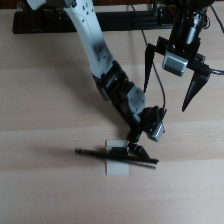 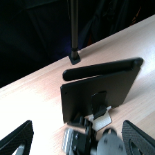 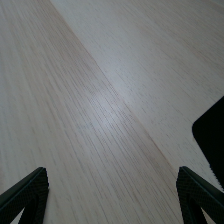

</details>

**Turn 15**

My fingers appear to have reached past the board's near edge and the wrist camera only sees bare table ahead, so I'm pitching the wrist down ~0.5 rad to pull the fingertips back and down toward the board and look more steeply at it.

`move_joints`
````json
{
  "targets": {
    "right_j3": -0.05
  }
}
````

*executing move_joints over 9 steps (0.9s)*

<details open>
<summary>Observation 16</summary>

````text
Current observation.
Instruction: Lift the clapper stick, then let go so it snaps shut with a clap. Note that the context (top) cam is on the opposite sides of the arms.
state[joint_pos]: left_j0=-0.4458 left_j1=1.5127 left_j2=1.4593 left_j3=-0.6109 left_j4=-0.0101 left_j5=-0.0273 left_gripper=0.9987 right_j0=0.7765 right_j1=2.3245 right_j2=1.4239 right_j3=0.223 right_j4=-0.1783 right_j5=-0.0956 right_gripper=0.9979

camera 'top_cam' (step 155):

[image omitted: streamed camera frame]

camera 'left_cam' (step 155):

[image omitted: streamed camera frame]

camera 'right_cam' (step 155):

[image omitted: streamed camera frame]
````

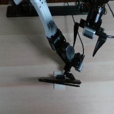 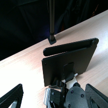 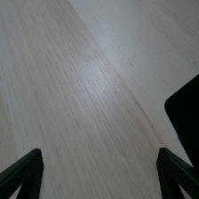

</details>

**Turn 16**

A dark object is just entering the right edge of the wrist view — that should be the clapperboard, so I'm yawing the base further to the arm's right to bring it between the fingers.

`move_joints`
````json
{
  "targets": {
    "right_j0": 0.55
  }
}
````

*executing move_joints over 4 steps (0.4s)*

<details open>
<summary>Observation 17</summary>

````text
Current observation.
Instruction: Lift the clapper stick, then let go so it snaps shut with a clap. Note that the context (top) cam is on the opposite sides of the arms.
state[joint_pos]: left_j0=-0.4458 left_j1=1.5131 left_j2=1.4593 left_j3=-0.6178 left_j4=-0.0101 left_j5=-0.0269 left_gripper=0.9987 right_j0=0.7288 right_j1=2.3161 right_j2=1.4277 right_j3=0.2146 right_j4=-0.3294 right_j5=-0.1017 right_gripper=0.997

camera 'top_cam' (step 159):

[image omitted: streamed camera frame]

camera 'left_cam' (step 159):

[image omitted: streamed camera frame]

camera 'right_cam' (step 159):

[image omitted: streamed camera frame]
````

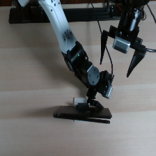 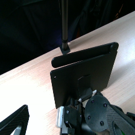 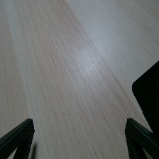

</details>

**Turn 17**

The arm seems to be meeting resistance and the wrist view still shows only table, so I'm opening the elbow to lift the hand about 10 cm and pointing the camera straight down for a clean overhead look at the clapperboard.

`move_joints`
````json
{
  "targets": {
    "right_j1": 2.36,
    "right_j2": 2.02,
    "right_j3": -1.23,
    "right_j4": 0.0
  }
}
````

*executing move_joints over 23 steps (2.3s)*

<details open>
<summary>Observation 18</summary>

````text
Current observation.
Instruction: Lift the clapper stick, then let go so it snaps shut with a clap. Note that the context (top) cam is on the opposite sides of the arms.
state[joint_pos]: left_j0=-0.4458 left_j1=1.5127 left_j2=1.4593 left_j3=-0.6254 left_j4=-0.0101 left_j5=-0.0273 left_gripper=0.9987 right_j0=0.73 right_j1=2.3474 right_j2=1.993 right_j3=-1.1534 right_j4=-0.0208 right_j5=-0.1127 right_gripper=0.9971

camera 'top_cam' (step 182):

[image omitted: streamed camera frame]

camera 'left_cam' (step 182):

[image omitted: streamed camera frame]

camera 'right_cam' (step 182):

[image omitted: streamed camera frame]
````

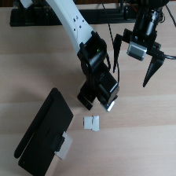 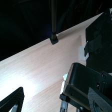 

</details>

**Turn 18**

Looking straight down, I can now see a small white object (the clapper) at the top-right of the wrist view, forward and to the arm's right of my fingers; yawing the base right to line up over it.

`move_joints`
````json
{
  "targets": {
    "right_j0": 0.45
  }
}
````

*executing move_joints over 5 steps (0.5s)*

<details open>
<summary>Observation 19</summary>

````text
Current observation.
Instruction: Lift the clapper stick, then let go so it snaps shut with a clap. Note that the context (top) cam is on the opposite sides of the arms.
state[joint_pos]: left_j0=-0.4458 left_j1=1.5131 left_j2=1.4593 left_j3=-0.6327 left_j4=-0.0097 left_j5=-0.0269 left_gripper=0.9987 right_j0=0.4606 right_j1=2.3478 right_j2=1.9972 right_j3=-1.1793 right_j4=-0.0299 right_j5=-0.1177 right_gripper=0.9971

camera 'top_cam' (step 187):

[image omitted: streamed camera frame]

camera 'left_cam' (step 187):

[image omitted: streamed camera frame]

camera 'right_cam' (step 187):

[image omitted: streamed camera frame]
````

  

</details>

**Turn 19**

The wrist camera now clearly shows the small white clapperboard lying on the table, about 5 cm forward and 5 cm to the arm's left of my fingers; adjusting yaw and extending the arm to centre the gripper directly over it.

`move_joints`
````json
{
  "targets": {
    "right_j0": 0.57,
    "right_j1": 2.6,
    "right_j2": 2.46,
    "right_j3": -1.43
  }
}
````

*executing move_joints over 8 steps (0.8s)*

[Back to index](README.md)
