# Run opus-3: 20260731_022834_cf776563

> Lift the clapper stick, then let go so it snaps shut with a clap. Note that the context (top) cam is on the opposite sides of the arms.

| | |
|---|---|
| Created (UTC) | 2026-07-31 02:28:34 |
| Model | claude-opus-5 |
| Effort | high |
| Embodiment | yam_arms |
| Status | success |
| Outcome | fail |
| Termination | operator_end |
| Operator judgement | n |
| Duration | 29:03 |
| Steps | 1235 |
| LLM turns | 99 |
| Seed | 0 |
| inspect-robots | 0.33.0 |
| Git commit | n/a |

Files: [raw EvalLog](../adhoc_f01e3de3.json) · [top video](../videos/20260731_022834_cf776563/scene-0-e0_top_cam.mp4) · [left video](../videos/20260731_022834_cf776563/scene-0-e0_left_cam.mp4) · [right video](../videos/20260731_022834_cf776563/scene-0-e0_right_cam.mp4) · [transcript jsonl](../transcripts/20260731_022834_cf776563) · [wire capture](../wire/20260731_022834_cf776563)

## Transcript

<details>
<summary>System prompt</summary>

````text
You are controlling a real robot embodiment named 'yam_arms' through tool calls. Each observation message gives you the current proprioceptive state and camera images. Work toward the user's goal in small, deliberate motions; re-check the observation after every motion. Every move tool call must include a `note`: in one or two sentences, say what you observe in the current observation and why you chose this motion. The user is watching these notes to see what you see and what you decide, so write them for a human reader. Safety approvers clamp out-of-bounds and too-fast actions below you. Respond with exactly one tool call per turn. When the goal is achieved call done; if it cannot be achieved call give_up. You have a budget of 200 LLM calls for the whole trial.

Embodiment notes:
Two identical 6-DoF arms, prefixed left_ and right_, each with a parallel-jaw
gripper. Each arm has its own base frame: +x points forward out of the base
(the direction the folded gripper points at all-zero joints), +y left, +z up;
how the two bases are mounted relative to each other depends on the rig.
Joint guide (positive direction, identical for both arms):
- left_j0 / right_j0: base yaw about the vertical axis; positive swings the
  arm counterclockwise seen from above (a forward-pointing gripper moves
  toward +y).
- left_j1 / right_j1: shoulder pitch; 0 points the upper arm horizontally
  backward and is the lower hard stop (it cannot go negative), positive
  raises it (about 1.57 is straight up, about 3.14 is horizontal forward).
- left_j2 / right_j2: elbow; 0 is fully folded with the forearm doubled back
  against the upper arm and is the lower hard stop, positive opens it.
- left_j3 / right_j3: wrist pitch, axis parallel to the elbow; positive tilts
  the gripper up.
- left_j4 / right_j4: wrist yaw; positive swings the gripper toward the arm's
  right seen from above (opposite sign sense of j0).
- left_j5 / right_j5: wrist roll about the gripper's pointing axis; positive
  turns clockwise when viewed from behind the gripper looking out along the
  fingers.
- left_gripper / right_gripper: 0 is fully closed, 1 is fully open (about
  9.5 cm between the jaws).
Proportions: upper arm 0.26 m, forearm 0.25 m, wrist to grasp point 0.25 m
when straight; reach from the shoulder about 0.76 m.
At all-zero joints the arm rests folded low with the gripper pointing
forward. While the arm is folded, a single joint's effect on the gripper
position can be counterintuitive; move deliberately and re-check the
observation after each motion. The joint values above are positions as shown
in the observation; when actions are per-step changes (delta mode), the same
sign conventions apply to each change.
````

</details>

> Goal: Lift the clapper stick, then let go so it snaps shut with a clap. Note that the context (top) cam is on the opposite sides of the arms.

<details open>
<summary>Observation 1</summary>

````text
Current observation.
Instruction: Lift the clapper stick, then let go so it snaps shut with a clap. Note that the context (top) cam is on the opposite sides of the arms.
state[joint_pos]: left_j0=-0.004 left_j1=0.0051 left_j2=0.0067 left_j3=-0.0319 left_j4=-0.0071 left_j5=-0.0158 left_gripper=0.9988 right_j0=-0.0002 right_j1=0.0025 right_j2=0.0063 right_j3=-0.0265 right_j4=-0.0078 right_j5=-0.0143 right_gripper=0.9993

camera 'top_cam' (step 0):

[image omitted: streamed camera frame]

camera 'left_cam' (step 0):

[image omitted: streamed camera frame]

camera 'right_cam' (step 0):

[image omitted: streamed camera frame]
````

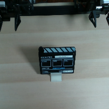 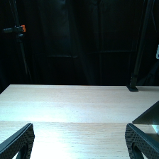 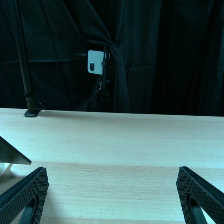

</details>

**Turn 1**

Both arms are folded flat and the clapperboard sits in the middle of the table with its striped clapper stick on the side facing the arms. I'm raising the right arm into an upright ready pose so its wrist camera can look down at the board.

`move_joints`
````json
{
  "targets": {
    "right_j1": 1.4,
    "right_j2": 1.4,
    "right_j3": 0.0
  }
}
````

*executing move_joints over 23 steps (2.3s)*

<details open>
<summary>Observation 2</summary>

````text
Current observation.
Instruction: Lift the clapper stick, then let go so it snaps shut with a clap. Note that the context (top) cam is on the opposite sides of the arms.
state[joint_pos]: left_j0=-0.004 left_j1=0.0071 left_j2=0.0067 left_j3=-0.041 left_j4=-0.0078 left_j5=-0.0166 left_gripper=0.9988 right_j0=-0.0002 right_j1=1.4017 right_j2=1.3701 right_j3=-0.0246 right_j4=-0.0154 right_j5=-0.0185 right_gripper=0.9992

camera 'top_cam' (step 23):

[image omitted: streamed camera frame]

camera 'left_cam' (step 23):

[image omitted: streamed camera frame]

camera 'right_cam' (step 23):

[image omitted: streamed camera frame]
````

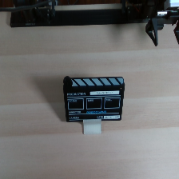 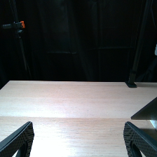 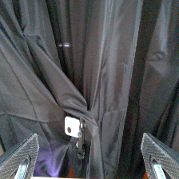

</details>

**Turn 2**

The right wrist camera is aimed at the dark backdrop, meaning the gripper points horizontally forward well above the table. I'm pitching the wrist down to bring the tabletop and the clapperboard into view.

`move_joints`
````json
{
  "targets": {
    "right_j3": -1.0
  }
}
````

*executing move_joints over 16 steps (1.6s)*

<details open>
<summary>Observation 3</summary>

````text
Current observation.
Instruction: Lift the clapper stick, then let go so it snaps shut with a clap. Note that the context (top) cam is on the opposite sides of the arms.
state[joint_pos]: left_j0=-0.004 left_j1=0.0071 left_j2=0.0067 left_j3=-0.0479 left_j4=-0.0074 left_j5=-0.0162 left_gripper=0.9987 right_j0=-0.0002 right_j1=1.4055 right_j2=1.3685 right_j3=-0.9733 right_j4=-0.0154 right_j5=-0.0185 right_gripper=0.9992

camera 'top_cam' (step 39):

[image omitted: streamed camera frame]

camera 'left_cam' (step 39):

[image omitted: streamed camera frame]

camera 'right_cam' (step 39):

[image omitted: streamed camera frame]
````

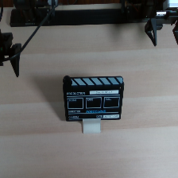 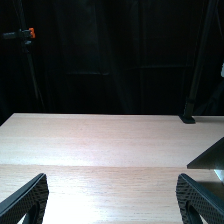 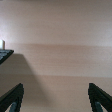

</details>

**Turn 3**

The right wrist camera now sees bare tabletop but the clapperboard is not yet in frame, so it must be farther forward. I'm extending the arm forward and downward to bring the board into the wrist view.

`move_joints`
````json
{
  "targets": {
    "right_j1": 2.0,
    "right_j2": 1.8,
    "right_j3": -1.0
  }
}
````

*executing move_joints over 10 steps (1.0s)*

<details open>
<summary>Observation 4</summary>

````text
Current observation.
Instruction: Lift the clapper stick, then let go so it snaps shut with a clap. Note that the context (top) cam is on the opposite sides of the arms.
state[joint_pos]: left_j0=-0.004 left_j1=0.0071 left_j2=0.0067 left_j3=-0.0483 left_j4=-0.0074 left_j5=-0.0166 left_gripper=0.9987 right_j0=-0.0002 right_j1=1.9854 right_j2=1.7702 right_j3=-1.0222 right_j4=-0.0154 right_j5=-0.0261 right_gripper=0.9992

camera 'top_cam' (step 49):

[image omitted: streamed camera frame]

camera 'left_cam' (step 49):

[image omitted: streamed camera frame]

camera 'right_cam' (step 49):

[image omitted: streamed camera frame]
````

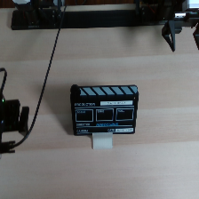 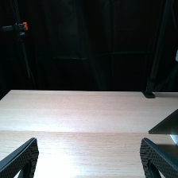 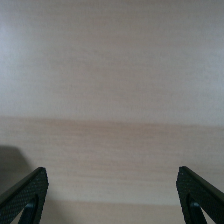

</details>

**Turn 4**

In the top view the right arm's gripper is at the far left while the clapperboard sits well to its side (toward the arm's left), so I'm yawing the right base joint toward the board and lifting the wrist slightly to avoid scraping the table.

`move_joints`
````json
{
  "targets": {
    "right_j0": 0.5,
    "right_j3": -0.7
  }
}
````

*executing move_joints over 8 steps (0.8s)*

<details open>
<summary>Observation 5</summary>

````text
Current observation.
Instruction: Lift the clapper stick, then let go so it snaps shut with a clap. Note that the context (top) cam is on the opposite sides of the arms.
state[joint_pos]: left_j0=-0.004 left_j1=0.0071 left_j2=0.0067 left_j3=-0.0486 left_j4=-0.0074 left_j5=-0.0166 left_gripper=0.9987 right_j0=0.5072 right_j1=1.9938 right_j2=1.7725 right_j3=-0.7296 right_j4=-0.0193 right_j5=-0.0265 right_gripper=0.9992

camera 'top_cam' (step 57):

[image omitted: streamed camera frame]

camera 'left_cam' (step 57):

[image omitted: streamed camera frame]

camera 'right_cam' (step 57):

[image omitted: streamed camera frame]
````

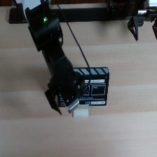 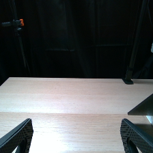 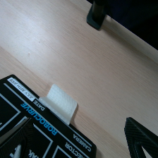

</details>

**Turn 5**

The gripper is now over the clapperboard but blocking the top view; I'm pulling the arm back and up while tilting the wrist camera down so I can see the whole board and work out where the clapper stick's hinge and free end are.

`move_joints`
````json
{
  "targets": {
    "right_j1": 1.55,
    "right_j2": 1.6,
    "right_j3": -1.25
  }
}
````

*executing move_joints over 9 steps (0.9s)*

<details open>
<summary>Observation 6</summary>

````text
Current observation.
Instruction: Lift the clapper stick, then let go so it snaps shut with a clap. Note that the context (top) cam is on the opposite sides of the arms.
state[joint_pos]: left_j0=-0.004 left_j1=0.0071 left_j2=0.0067 left_j3=-0.0486 left_j4=-0.0074 left_j5=-0.0166 left_gripper=0.9987 right_j0=0.5049 right_j1=1.5673 right_j2=1.6054 right_j3=-1.2232 right_j4=-0.0189 right_j5=-0.0296 right_gripper=0.9992

camera 'top_cam' (step 66):

[image omitted: streamed camera frame]

camera 'left_cam' (step 66):

[image omitted: streamed camera frame]

camera 'right_cam' (step 66):

[image omitted: streamed camera frame]
````

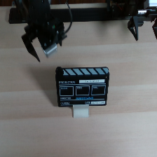 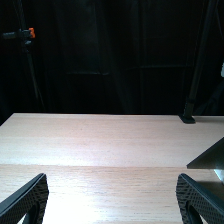 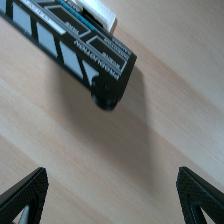

</details>

**Turn 6**

Now I can see the slate clearly: it lies tilted on the table with the striped clapper stick along its far edge, hinged at the end nearer the right arm and with its free end toward the left arm. I'm parking the right arm upright out of the way and raising the left arm into a look-down pose since it is closer to the stick's free end.

`move_joints`
````json
{
  "targets": {
    "right_j0": 0.0,
    "right_j1": 1.3,
    "right_j2": 1.2,
    "right_j3": 0.0,
    "left_j1": 1.55,
    "left_j2": 1.6,
    "left_j3": -1.25
  }
}
````

*executing move_joints over 26 steps (2.6s)*

<details open>
<summary>Observation 7</summary>

````text
Current observation.
Instruction: Lift the clapper stick, then let go so it snaps shut with a clap. Note that the context (top) cam is on the opposite sides of the arms.
state[joint_pos]: left_j0=-0.004 left_j1=1.5375 left_j2=1.5551 left_j3=-1.2102 left_j4=-0.0071 left_j5=-0.0242 left_gripper=0.9987 right_j0=0.0086 right_j1=1.3254 right_j2=1.2049 right_j3=-0.0948 right_j4=-0.0227 right_j5=-0.0376 right_gripper=0.9992

camera 'top_cam' (step 92):

[image omitted: streamed camera frame]

camera 'left_cam' (step 92):

[image omitted: streamed camera frame]

camera 'right_cam' (step 92):

[image omitted: streamed camera frame]
````

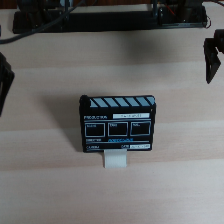 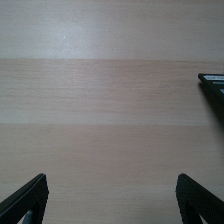 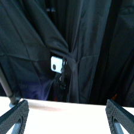

</details>

**Turn 7**

The left wrist camera sees the tabletop with just the edge of the clapperboard at the far right of frame, so the board lies to that arm's right; I'm yawing the left base joint negative to bring the board to the centre of its view.

`move_joints`
````json
{
  "targets": {
    "left_j0": -0.45
  }
}
````

*executing move_joints over 8 steps (0.8s)*

<details open>
<summary>Observation 8</summary>

````text
Current observation.
Instruction: Lift the clapper stick, then let go so it snaps shut with a clap. Note that the context (top) cam is on the opposite sides of the arms.
state[joint_pos]: left_j0=-0.4259 left_j1=1.5578 left_j2=1.5555 left_j3=-1.2404 left_j4=-0.0071 left_j5=-0.0277 left_gripper=0.9986 right_j0=0.0048 right_j1=1.3239 right_j2=1.1999 right_j3=-0.1032 right_j4=-0.0231 right_j5=-0.0376 right_gripper=0.9992

camera 'top_cam' (step 100):

[image omitted: streamed camera frame]

camera 'left_cam' (step 100):

[image omitted: streamed camera frame]

camera 'right_cam' (step 100):

[image omitted: streamed camera frame]
````

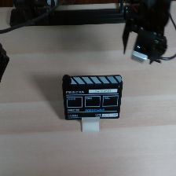 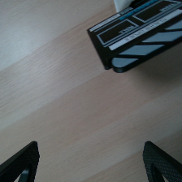 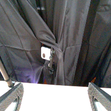

</details>

**Turn 8**

The left wrist camera now shows the slate in its upper right with the white-striped clapper stick clearly visible along the near edge. I'm yawing a bit further and extending the arm forward to centre the stick in view and get closer to it.

`move_joints`
````json
{
  "targets": {
    "left_j0": -0.62,
    "left_j1": 1.8,
    "left_j2": 1.7
  }
}
````

*executing move_joints over 4 steps (0.4s)*

<details open>
<summary>Observation 9</summary>

````text
Current observation.
Instruction: Lift the clapper stick, then let go so it snaps shut with a clap. Note that the context (top) cam is on the opposite sides of the arms.
state[joint_pos]: left_j0=-0.6025 left_j1=1.8015 left_j2=1.6592 left_j3=-1.2499 left_j4=-0.0059 left_j5=-0.0319 left_gripper=0.9986 right_j0=0.0044 right_j1=1.3239 right_j2=1.1999 right_j3=-0.1116 right_j4=-0.0231 right_j5=-0.0376 right_gripper=0.9992

camera 'top_cam' (step 104):

[image omitted: streamed camera frame]

camera 'left_cam' (step 104):

[image omitted: streamed camera frame]

camera 'right_cam' (step 104):

[image omitted: streamed camera frame]
````

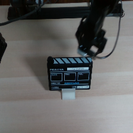 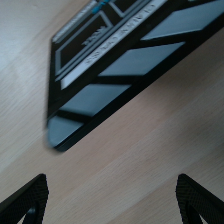 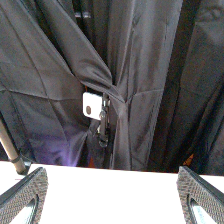

</details>

**Turn 9**

The slate now fills the left wrist view with the striped clapper stick running diagonally across it; the stick's free end is the one nearer this arm. I'm lowering and extending the left arm so the open gripper descends toward that free end for a closer look.

`move_joints`
````json
{
  "targets": {
    "left_j1": 2.0,
    "left_j2": 1.85,
    "left_j3": -1.3
  }
}
````

*executing move_joints over 4 steps (0.4s)*

<details open>
<summary>Observation 10</summary>

````text
Current observation.
Instruction: Lift the clapper stick, then let go so it snaps shut with a clap. Note that the context (top) cam is on the opposite sides of the arms.
state[joint_pos]: left_j0=-0.6014 left_j1=1.9839 left_j2=1.8122 left_j3=-1.3254 left_j4=-0.0181 left_j5=-0.0467 left_gripper=0.9986 right_j0=0.0044 right_j1=1.3239 right_j2=1.1999 right_j3=-0.128 right_j4=-0.0227 right_j5=-0.0376 right_gripper=0.9992

camera 'top_cam' (step 108):

[image omitted: streamed camera frame]

camera 'left_cam' (step 108):

[image omitted: streamed camera frame]

camera 'right_cam' (step 108):

[image omitted: streamed camera frame]
````

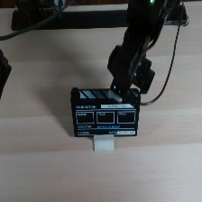 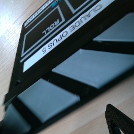 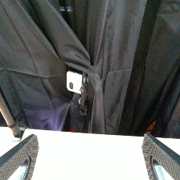

</details>

**Turn 10**

Close-up of the slate face is good but I still can't tell how the clapper stick is hinged. I'm pitching the left wrist up so the camera looks at the stick more edge-on from the arm side to see its profile and hinge.

`move_joints`
````json
{
  "targets": {
    "left_j3": -0.75
  }
}
````

*executing move_joints over 10 steps (1.0s)*

<details open>
<summary>Observation 11</summary>

````text
Current observation.
Instruction: Lift the clapper stick, then let go so it snaps shut with a clap. Note that the context (top) cam is on the opposite sides of the arms.
state[joint_pos]: left_j0=-0.6048 left_j1=2.0026 left_j2=1.8118 left_j3=-0.8951 left_j4=-0.0128 left_j5=-0.0578 left_gripper=0.9983 right_j0=0.0044 right_j1=1.3239 right_j2=1.1999 right_j3=-0.1398 right_j4=-0.0227 right_j5=-0.0376 right_gripper=0.9992

camera 'top_cam' (step 118):

[image omitted: streamed camera frame]

camera 'left_cam' (step 118):

[image omitted: streamed camera frame]

camera 'right_cam' (step 118):

[image omitted: streamed camera frame]
````

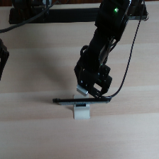 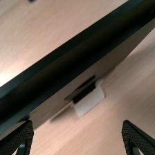 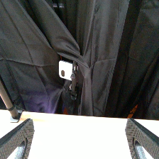

</details>

**Turn 11**

From the edge-on look the slate sits low and nearly flat with its striped clapper stick along the near edge and a white support under it. I'm pointing the left gripper straight down and rolling the wrist 90° so the jaws will close across the stick (front-to-back) rather than along it.

`move_joints`
````json
{
  "targets": {
    "left_j3": -1.38,
    "left_j5": 1.57
  }
}
````

*executing move_joints over 26 steps (2.6s)*

<details open>
<summary>Observation 12</summary>

````text
Current observation.
Instruction: Lift the clapper stick, then let go so it snaps shut with a clap. Note that the context (top) cam is on the opposite sides of the arms.
state[joint_pos]: left_j0=-0.6048 left_j1=2.0029 left_j2=1.8118 left_j3=-1.356 left_j4=-0.0109 left_j5=1.4864 left_gripper=0.9982 right_j0=0.0044 right_j1=1.3239 right_j2=1.1999 right_j3=-0.1555 right_j4=-0.0227 right_j5=-0.0376 right_gripper=0.9992

camera 'top_cam' (step 144):

[image omitted: streamed camera frame]

camera 'left_cam' (step 144):

[image omitted: streamed camera frame]

camera 'right_cam' (step 144):

[image omitted: streamed camera frame]
````

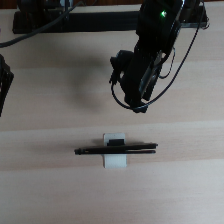 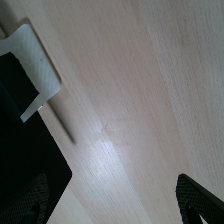 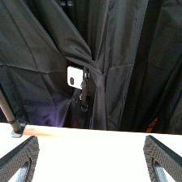

</details>

**Turn 12**

The top view now shows only a thin dark bar and the white stand where the slate face used to be, so I may have disturbed the board or I am misreading its pose. I'm retracting the left arm well clear to get an unobstructed top-camera view before doing anything else.

`move_joints`
````json
{
  "targets": {
    "left_j1": 1.3,
    "left_j2": 1.1,
    "left_j3": -0.4
  }
}
````

*executing move_joints over 16 steps (1.6s)*

<details open>
<summary>Observation 13</summary>

````text
Current observation.
Instruction: Lift the clapper stick, then let go so it snaps shut with a clap. Note that the context (top) cam is on the opposite sides of the arms.
state[joint_pos]: left_j0=-0.6052 left_j1=1.3296 left_j2=1.1164 left_j3=-0.4938 left_j4=-0.0139 left_j5=1.4921 left_gripper=0.9982 right_j0=0.0044 right_j1=1.3239 right_j2=1.1999 right_j3=-0.1627 right_j4=-0.0227 right_j5=-0.0376 right_gripper=0.9992

camera 'top_cam' (step 160):

[image omitted: streamed camera frame]

camera 'left_cam' (step 160):

[image omitted: streamed camera frame]

camera 'right_cam' (step 160):

[image omitted: streamed camera frame]
````

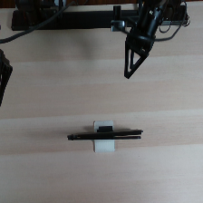 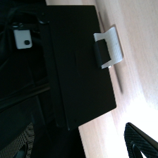 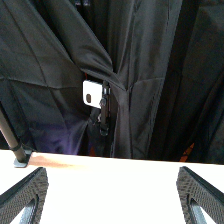

</details>

**Turn 13**

The left wrist camera shows a large plain black panel — the back of the slate — meaning the board is standing up with its face toward the top camera. I'm lifting the left arm to a high vantage point looking down so I can see the top edge of the board and the clapper stick.

`move_joints`
````json
{
  "targets": {
    "left_j1": 1.5,
    "left_j2": 1.9,
    "left_j3": -1.5,
    "left_j5": 0.0
  }
}
````

*executing move_joints over 24 steps (2.4s)*

<details open>
<summary>Observation 14</summary>

````text
Current observation.
Instruction: Lift the clapper stick, then let go so it snaps shut with a clap. Note that the context (top) cam is on the opposite sides of the arms.
state[joint_pos]: left_j0=-0.6048 left_j1=1.4906 left_j2=1.8641 left_j3=-1.4521 left_j4=-0.0139 left_j5=0.0757 left_gripper=0.9982 right_j0=0.0044 right_j1=1.3239 right_j2=1.1999 right_j3=-0.1787 right_j4=-0.0227 right_j5=-0.0376 right_gripper=0.9992

camera 'top_cam' (step 184):

[image omitted: streamed camera frame]

camera 'left_cam' (step 184):

[image omitted: streamed camera frame]

camera 'right_cam' (step 184):

[image omitted: streamed camera frame]
````

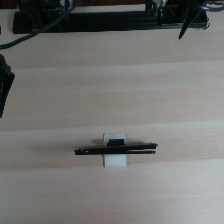 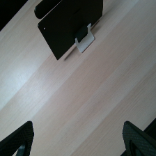 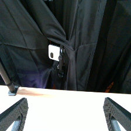

</details>

**Turn 14**

From overhead the slate now appears as a narrow bar, so it is standing upright in its white stand with the back facing the arms — good for the clap. I'm re-aiming the left arm slightly and rolling the wrist so the jaws will close front-to-back across the clapper stick.

`move_joints`
````json
{
  "targets": {
    "left_j0": -0.45,
    "left_j5": 1.57
  }
}
````

*executing move_joints over 24 steps (2.4s)*

<details open>
<summary>Observation 15</summary>

````text
Current observation.
Instruction: Lift the clapper stick, then let go so it snaps shut with a clap. Note that the context (top) cam is on the opposite sides of the arms.
state[joint_pos]: left_j0=-0.4576 left_j1=1.5005 left_j2=1.8687 left_j3=-1.4921 left_j4=-0.0139 left_j5=1.4818 left_gripper=0.9982 right_j0=0.0044 right_j1=1.3239 right_j2=1.1999 right_j3=-0.1867 right_j4=-0.0227 right_j5=-0.0376 right_gripper=0.9992

camera 'top_cam' (step 208):

[image omitted: streamed camera frame]

camera 'left_cam' (step 208):

[image omitted: streamed camera frame]

camera 'right_cam' (step 208):

[image omitted: streamed camera frame]
````

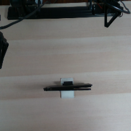 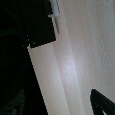 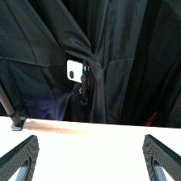

</details>

**Turn 15**

The slate is still off in the far corner of the left wrist view, so I'm extending the arm about 9 cm further forward and splitting the difference on the base yaw to bring the board's top edge into the centre of the view.

`move_joints`
````json
{
  "targets": {
    "left_j0": -0.53,
    "left_j1": 1.856,
    "left_j2": 2.267,
    "left_j3": -1.49
  }
}
````

*executing move_joints over 7 steps (0.7s)*

<details open>
<summary>Observation 16</summary>

````text
Current observation.
Instruction: Lift the clapper stick, then let go so it snaps shut with a clap. Note that the context (top) cam is on the opposite sides of the arms.
state[joint_pos]: left_j0=-0.5236 left_j1=1.8431 left_j2=2.2292 left_j3=-1.5108 left_j4=-0.0139 left_j5=1.4837 left_gripper=0.9982 right_j0=0.0044 right_j1=1.3239 right_j2=1.1999 right_j3=-0.2066 right_j4=-0.0227 right_j5=-0.0376 right_gripper=0.9992

camera 'top_cam' (step 215):

[image omitted: streamed camera frame]

camera 'left_cam' (step 215):

[image omitted: streamed camera frame]

camera 'right_cam' (step 215):

[image omitted: streamed camera frame]
````

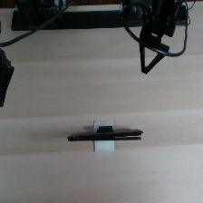 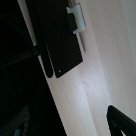 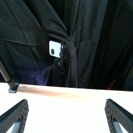

</details>

**Turn 16**

The rolled wrist camera makes the view hard to interpret, so I'm rolling the wrist back to zero to get an upright image while I line the gripper up with the board's top edge.

`move_joints`
````json
{
  "targets": {
    "left_j5": 0.0
  }
}
````

*executing move_joints over 24 steps (2.4s)*

<details open>
<summary>Observation 17</summary>

````text
Current observation.
Instruction: Lift the clapper stick, then let go so it snaps shut with a clap. Note that the context (top) cam is on the opposite sides of the arms.
state[joint_pos]: left_j0=-0.5278 left_j1=1.8576 left_j2=2.2337 left_j3=-1.5154 left_j4=-0.0139 left_j5=0.0761 left_gripper=0.9982 right_j0=0.0044 right_j1=1.3239 right_j2=1.1999 right_j3=-0.215 right_j4=-0.0227 right_j5=-0.0376 right_gripper=0.9992

camera 'top_cam' (step 239):

[image omitted: streamed camera frame]

camera 'left_cam' (step 239):

[image omitted: streamed camera frame]

camera 'right_cam' (step 239):

[image omitted: streamed camera frame]
````

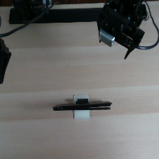 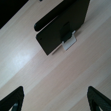 

</details>

**Turn 17**

The left wrist camera now clearly shows the slate standing upright in its white stand, back toward us, with its top edge near the top of frame. I'm reaching further forward and flattening the wrist angle so the gripper approaches the top edge from behind and above.

`move_joints`
````json
{
  "targets": {
    "left_j1": 1.822,
    "left_j2": 2.126,
    "left_j3": -1.089
  }
}
````

*executing move_joints over 7 steps (0.7s)*

<details open>
<summary>Observation 18</summary>

````text
Current observation.
Instruction: Lift the clapper stick, then let go so it snaps shut with a clap. Note that the context (top) cam is on the opposite sides of the arms.
state[joint_pos]: left_j0=-0.5278 left_j1=1.8545 left_j2=2.1349 left_j3=-1.1938 left_j4=-0.0139 left_j5=0.0555 left_gripper=0.9982 right_j0=0.0044 right_j1=1.3239 right_j2=1.1999 right_j3=-0.2161 right_j4=-0.0227 right_j5=-0.0376 right_gripper=0.9992

camera 'top_cam' (step 246):

[image omitted: streamed camera frame]

camera 'left_cam' (step 246):

[image omitted: streamed camera frame]

camera 'right_cam' (step 246):

[image omitted: streamed camera frame]
````

  

</details>

**Turn 18**

The slate's top edge with the clapper stick sits above the centre of my wrist view; I'm pitching the wrist up slightly and nudging the yaw so the stick is centred, to inspect how it is hinged before grasping.

`move_joints`
````json
{
  "targets": {
    "left_j3": -0.95,
    "left_j0": -0.56
  }
}
````

*executing move_joints over 4 steps (0.4s)*

<details open>
<summary>Observation 19</summary>

````text
Current observation.
Instruction: Lift the clapper stick, then let go so it snaps shut with a clap. Note that the context (top) cam is on the opposite sides of the arms.
state[joint_pos]: left_j0=-0.5545 left_j1=1.8549 left_j2=2.1269 left_j3=-1.0454 left_j4=-0.0139 left_j5=0.0517 left_gripper=0.9982 right_j0=0.0044 right_j1=1.3239 right_j2=1.1999 right_j3=-0.2165 right_j4=-0.0227 right_j5=-0.0376 right_gripper=0.9992

camera 'top_cam' (step 250):

[image omitted: streamed camera frame]

camera 'left_cam' (step 250):

[image omitted: streamed camera frame]

camera 'right_cam' (step 250):

[image omitted: streamed camera frame]
````

  

</details>

**Turn 19**

I want a second viewpoint on the standing slate to understand the clapper stick, so I'm swinging the parked right arm toward the board and aiming its wrist camera at it from the other side.

`move_joints`
````json
{
  "targets": {
    "right_j0": 0.55,
    "right_j1": 1.6,
    "right_j2": 1.75,
    "right_j3": -0.95
  }
}
````

*executing move_joints over 12 steps (1.2s)*

<details open>
<summary>Observation 20</summary>

````text
Current observation.
Instruction: Lift the clapper stick, then let go so it snaps shut with a clap. Note that the context (top) cam is on the opposite sides of the arms.
state[joint_pos]: left_j0=-0.5587 left_j1=1.8553 left_j2=2.1265 left_j3=-1.0584 left_j4=-0.0139 left_j5=0.0517 left_gripper=0.9982 right_j0=0.5343 right_j1=1.5921 right_j2=1.713 right_j3=-0.886 right_j4=-0.0223 right_j5=-0.0372 right_gripper=0.9992

camera 'top_cam' (step 262):

[image omitted: streamed camera frame]

camera 'left_cam' (step 262):

[image omitted: streamed camera frame]

camera 'right_cam' (step 262):

[image omitted: streamed camera frame]
````

  

</details>

**Turn 20**

Both wrist cameras confirm the slate is standing upright in a white stand with a bar (the clapper stick) across its top, whose end appears to stick out past the board's edge on the left arm's side. Reaching the top edge needs a nearly horizontal approach, so I'm re-posing the left arm to point its gripper forward at the height of the stick.

`move_joints`
````json
{
  "targets": {
    "left_j1": 1.397,
    "left_j2": 1.436,
    "left_j3": -0.389
  }
}
````

*executing move_joints over 11 steps (1.1s)*

<details open>
<summary>Observation 21</summary>

````text
Current observation.
Instruction: Lift the clapper stick, then let go so it snaps shut with a clap. Note that the context (top) cam is on the opposite sides of the arms.
state[joint_pos]: left_j0=-0.5587 left_j1=1.4296 left_j2=1.4509 left_j3=-0.49 left_j4=-0.0139 left_j5=0.0517 left_gripper=0.9982 right_j0=0.5365 right_j1=1.5993 right_j2=1.7153 right_j3=-0.9173 right_j4=-0.0227 right_j5=-0.0376 right_gripper=0.9992

camera 'top_cam' (step 273):

[image omitted: streamed camera frame]

camera 'left_cam' (step 273):

[image omitted: streamed camera frame]

camera 'right_cam' (step 273):

[image omitted: streamed camera frame]
````

  

</details>

**Turn 21**

The right gripper is intruding into the left camera's view, so I'm swinging it aside while advancing the left gripper about 4 cm closer to the standing board's top edge to see the clapper stick clearly.

`move_joints`
````json
{
  "targets": {
    "left_j1": 1.598,
    "left_j2": 1.611,
    "left_j3": -0.481,
    "right_j0": 0.25
  }
}
````

*executing move_joints over 5 steps (0.5s)*

<details open>
<summary>Observation 22</summary>

````text
Current observation.
Instruction: Lift the clapper stick, then let go so it snaps shut with a clap. Note that the context (top) cam is on the opposite sides of the arms.
state[joint_pos]: left_j0=-0.5587 left_j1=1.5978 left_j2=1.5608 left_j3=-0.5011 left_j4=-0.0139 left_j5=0.0513 left_gripper=0.9982 right_j0=0.2649 right_j1=1.6009 right_j2=1.7153 right_j3=-0.9371 right_j4=-0.0219 right_j5=-0.0448 right_gripper=0.9992

camera 'top_cam' (step 278):

[image omitted: streamed camera frame]

camera 'left_cam' (step 278):

[image omitted: streamed camera frame]

camera 'right_cam' (step 278):

[image omitted: streamed camera frame]
````

  

</details>

**Turn 22**

I need an unobstructed overhead picture to settle what this object actually is, so I'm folding both arms back and out of the top camera's field of view.

`move_joints`
````json
{
  "targets": {
    "left_j1": 0.9,
    "left_j2": 0.8,
    "left_j3": 0.0,
    "right_j1": 0.9,
    "right_j2": 0.8,
    "right_j3": 0.0
  }
}
````

*executing move_joints over 15 steps (1.5s)*

<details open>
<summary>Observation 23</summary>

````text
Current observation.
Instruction: Lift the clapper stick, then let go so it snaps shut with a clap. Note that the context (top) cam is on the opposite sides of the arms.
state[joint_pos]: left_j0=-0.5594 left_j1=0.9222 left_j2=0.8158 left_j3=-0.0673 left_j4=-0.0139 left_j5=0.0517 left_gripper=0.9982 right_j0=0.2665 right_j1=0.9226 right_j2=0.8173 right_j3=-0.1043 right_j4=-0.0223 right_j5=-0.0452 right_gripper=0.9992

camera 'top_cam' (step 293):

[image omitted: streamed camera frame]

camera 'left_cam' (step 293):

[image omitted: streamed camera frame]

camera 'right_cam' (step 293):

[image omitted: streamed camera frame]
````

  

</details>

**Turn 23**

The clean overhead frame shows the clapperboard standing upright in its white stand, appearing as a dark bar about 10 cm in front of where my gripper tips were. I'm driving the left gripper forward about 6 cm toward the right-hand end of that bar to close in on the clapper stick.

`move_joints`
````json
{
  "targets": {
    "left_j1": 1.825,
    "left_j2": 1.821,
    "left_j3": -0.534
  }
}
````

*executing move_joints over 16 steps (1.6s)*

<details open>
<summary>Observation 24</summary>

````text
Current observation.
Instruction: Lift the clapper stick, then let go so it snaps shut with a clap. Note that the context (top) cam is on the opposite sides of the arms.
state[joint_pos]: left_j0=-0.5598 left_j1=1.8133 left_j2=1.776 left_j3=-0.5156 left_j4=-0.0139 left_j5=0.0513 left_gripper=0.9982 right_j0=0.2665 right_j1=0.9276 right_j2=0.8001 right_j3=-0.1265 right_j4=-0.0227 right_j5=-0.0452 right_gripper=0.9992

camera 'top_cam' (step 309):

[image omitted: streamed camera frame]

camera 'left_cam' (step 309):

[image omitted: streamed camera frame]

camera 'right_cam' (step 309):

[image omitted: streamed camera frame]
````

  

</details>

**Turn 24**

The board's top edge is a horizontal bar and I can't pinch it front-to-back with a forward-pointing gripper, so I'm reconfiguring the left arm to point its gripper sideways along the bar's axis (jaws then open front-to-back), staged about 12 cm clear of the near end of the clapper stick.

`move_joints`
````json
{
  "targets": {
    "left_j0": 0.223,
    "left_j1": 2.476,
    "left_j2": 2.313,
    "left_j3": 0.164,
    "left_j4": 1.794,
    "left_j5": 0.0
  }
}
````

*executing move_joints over 29 steps (2.9s)*

<details open>
<summary>Observation 25</summary>

````text
Current observation.
Instruction: Lift the clapper stick, then let go so it snaps shut with a clap. Note that the context (top) cam is on the opposite sides of the arms.
state[joint_pos]: left_j0=0.2077 left_j1=2.4653 left_j2=2.278 left_j3=0.1028 left_j4=1.5757 left_j5=-0.0013 left_gripper=0.9982 right_j0=0.2665 right_j1=0.9287 right_j2=0.799 right_j3=-0.1467 right_j4=-0.0227 right_j5=-0.0452 right_gripper=0.9992

camera 'top_cam' (step 338):

[image omitted: streamed camera frame]

camera 'left_cam' (step 338):

[image omitted: streamed camera frame]

camera 'right_cam' (step 338):

[image omitted: streamed camera frame]
````

  

</details>

**Turn 25**

I still can't tell whether the dark object is standing upright or lying flat, so I'm raising the right arm to hover its camera about 25 cm from the object and look down on it for a clear close-up.

`move_joints`
````json
{
  "targets": {
    "right_j1": 1.393,
    "right_j2": 1.57,
    "right_j3": -0.878
  }
}
````

*executing move_joints over 13 steps (1.3s)*

<details open>
<summary>Observation 26</summary>

````text
Current observation.
Instruction: Lift the clapper stick, then let go so it snaps shut with a clap. Note that the context (top) cam is on the opposite sides of the arms.
state[joint_pos]: left_j0=0.2089 left_j1=2.4687 left_j2=2.2814 left_j3=0.0906 left_j4=1.5681 left_j5=-0.0017 left_gripper=0.9982 right_j0=0.2665 right_j1=1.3861 right_j2=1.5284 right_j3=-0.8352 right_j4=-0.0227 right_j5=-0.0525 right_gripper=0.9992

camera 'top_cam' (step 351):

[image omitted: streamed camera frame]

camera 'left_cam' (step 351):

[image omitted: streamed camera frame]

camera 'right_cam' (step 351):

[image omitted: streamed camera frame]
````

  

</details>

**Turn 26**

From the right camera I can now measure the object: an upright black board about 27 cm tall standing in a white stand, top edge roughly level with the shoulders. I'm moving the left gripper to a safe staging spot just off the near end of that board, jaws open front-to-back and level with its top edge.

`move_joints`
````json
{
  "targets": {
    "left_j0": 0.484,
    "left_j1": 2.164,
    "left_j2": 1.7,
    "left_j3": 0.464,
    "left_j4": 1.571,
    "left_j5": 0.0
  }
}
````

*executing move_joints over 10 steps (1.0s)*

<details open>
<summary>Observation 27</summary>

````text
Current observation.
Instruction: Lift the clapper stick, then let go so it snaps shut with a clap. Note that the context (top) cam is on the opposite sides of the arms.
state[joint_pos]: left_j0=0.4683 left_j1=2.2032 left_j2=1.7184 left_j3=0.4011 left_j4=1.5646 left_j5=-0.0013 left_gripper=0.9982 right_j0=0.2665 right_j1=1.3933 right_j2=1.5311 right_j3=-0.865 right_j4=-0.0227 right_j5=-0.0528 right_gripper=0.9992

camera 'top_cam' (step 361):

[image omitted: streamed camera frame]

camera 'left_cam' (step 361):

[image omitted: streamed camera frame]

camera 'right_cam' (step 361):

[image omitted: streamed camera frame]
````

  

</details>

**Turn 27**

Calibrating from the top view, the board spans about 30 cm with its near end roughly 27 cm to the right of the left shoulder. I'm swinging the left gripper to a staging point about 7 cm off that near end, still level with the top edge and with jaws open front-to-back.

`move_joints`
````json
{
  "targets": {
    "left_j0": 0.1405,
    "left_j1": 2.3214,
    "left_j2": 1.9679,
    "left_j3": 0.3535,
    "left_j4": 1.7115,
    "left_j5": 0.0
  }
}
````

*executing move_joints over 6 steps (0.6s)*

<details open>
<summary>Observation 28</summary>

````text
Current observation.
Instruction: Lift the clapper stick, then let go so it snaps shut with a clap. Note that the context (top) cam is on the opposite sides of the arms.
state[joint_pos]: left_j0=0.1513 left_j1=2.3142 left_j2=1.9232 left_j3=0.3527 left_j4=1.5757 left_j5=-0.0013 left_gripper=0.9982 right_j0=0.2665 right_j1=1.3937 right_j2=1.5311 right_j3=-0.8818 right_j4=-0.0223 right_j5=-0.0528 right_gripper=0.9992

camera 'top_cam' (step 367):

[image omitted: streamed camera frame]

camera 'left_cam' (step 367):

[image omitted: streamed camera frame]

camera 'right_cam' (step 367):

[image omitted: streamed camera frame]
````

  

</details>

**Turn 28**

My two viewpoints disagree about where the left gripper sits relative to the board's top edge, so I'm panning the right arm's camera to look at the near (left-arm) end of the board — it will act as a witness camera while the left gripper closes in.

`move_joints`
````json
{
  "targets": {
    "right_j0": 0.56
  }
}
````

*executing move_joints over 5 steps (0.5s)*

<details open>
<summary>Observation 29</summary>

````text
Current observation.
Instruction: Lift the clapper stick, then let go so it snaps shut with a clap. Note that the context (top) cam is on the opposite sides of the arms.
state[joint_pos]: left_j0=0.1474 left_j1=2.3169 left_j2=1.9278 left_j3=0.3367 left_j4=1.5715 left_j5=-0.0017 left_gripper=0.9982 right_j0=0.5423 right_j1=1.3941 right_j2=1.5311 right_j3=-0.8879 right_j4=-0.0223 right_j5=-0.0528 right_gripper=0.9992

camera 'top_cam' (step 372):

[image omitted: streamed camera frame]

camera 'left_cam' (step 372):

[image omitted: streamed camera frame]

camera 'right_cam' (step 372):

[image omitted: streamed camera frame]
````

  

</details>

**Turn 29**

The right camera now gives a clean view of the board standing back-toward-us in its white stand. I'm sliding the left gripper about 6 cm further along toward the board's near end so it enters the right camera's view and I can judge the alignment directly.

`move_joints`
````json
{
  "targets": {
    "left_j0": 0.0067,
    "left_j1": 2.4594,
    "left_j2": 2.1291,
    "left_j3": 0.3303,
    "left_j4": 1.578,
    "left_j5": 0.0
  }
}
````

*executing move_joints over 4 steps (0.4s)*

<details open>
<summary>Observation 30</summary>

````text
Current observation.
Instruction: Lift the clapper stick, then let go so it snaps shut with a clap. Note that the context (top) cam is on the opposite sides of the arms.
state[joint_pos]: left_j0=0.0265 left_j1=2.4489 left_j2=2.088 left_j3=0.3248 left_j4=1.5669 left_j5=-0.0013 left_gripper=0.9982 right_j0=0.5457 right_j1=1.3949 right_j2=1.5303 right_j3=-0.9031 right_j4=-0.0223 right_j5=-0.0528 right_gripper=0.9992

camera 'top_cam' (step 376):

[image omitted: streamed camera frame]

camera 'left_cam' (step 376):

[image omitted: streamed camera frame]

camera 'right_cam' (step 376):

[image omitted: streamed camera frame]
````

  

</details>

**Turn 30**

The overhead frame now clearly shows my open left jaws about 9 cm to the right of the board's near end and a few cm too far forward. I'm sliding the gripper 10 cm sideways toward the board and 3 cm back so the jaws come up alongside its top corner.

`move_joints`
````json
{
  "targets": {
    "left_j0": -0.2,
    "left_j1": 2.6279,
    "left_j2": 2.3946,
    "left_j3": 0.2333,
    "left_j4": 1.371,
    "left_j5": 0.0
  }
}
````

*executing move_joints over 5 steps (0.5s)*

<details open>
<summary>Observation 31</summary>

````text
Current observation.
Instruction: Lift the clapper stick, then let go so it snaps shut with a clap. Note that the context (top) cam is on the opposite sides of the arms.
state[joint_pos]: left_j0=-0.1818 left_j1=2.616 left_j2=2.3474 left_j3=0.2447 left_j4=1.417 left_j5=-0.0017 left_gripper=0.9982 right_j0=0.5461 right_j1=1.3952 right_j2=1.5303 right_j3=-0.9154 right_j4=-0.0223 right_j5=-0.0528 right_gripper=0.9992

camera 'top_cam' (step 381):

[image omitted: streamed camera frame]

camera 'left_cam' (step 381):

[image omitted: streamed camera frame]

camera 'right_cam' (step 381):

[image omitted: streamed camera frame]
````

  

</details>

**Turn 31**

In the right camera I can now make out a separate darker bar lying along the very top of the board — that is the clapper stick. My jaws are straddling the board a few cm too low, so I'm raising the gripper about 4 cm to bring them level with that stick.

`move_joints`
````json
{
  "targets": {
    "left_j0": -0.1848,
    "left_j1": 2.5313,
    "left_j2": 2.3273,
    "left_j3": 0.204,
    "left_j4": 1.386
  }
}
````

*executing move_joints over 2 steps (0.2s)*

<details open>
<summary>Observation 32</summary>

````text
Current observation.
Instruction: Lift the clapper stick, then let go so it snaps shut with a clap. Note that the context (top) cam is on the opposite sides of the arms.
state[joint_pos]: left_j0=-0.1963 left_j1=2.6144 left_j2=2.3405 left_j3=0.2119 left_j4=1.3788 left_j5=-0.0013 left_gripper=0.9982 right_j0=0.5461 right_j1=1.3952 right_j2=1.5303 right_j3=-0.9184 right_j4=-0.0223 right_j5=-0.0528 right_gripper=0.9992

camera 'top_cam' (step 383):

[image omitted: streamed camera frame]

camera 'left_cam' (step 383):

[image omitted: streamed camera frame]

camera 'right_cam' (step 383):

[image omitted: streamed camera frame]
````

  

</details>

**Turn 32**

The overhead view suggests my open jaws are now straddling the board's top a few cm in from its near end, so I'm closing the gripper to see whether it catches the clapper stick — if it stalls part-open, it has something.

`move_joints`
````json
{
  "targets": {
    "left_gripper": 0.0
  }
}
````

*executing move_joints over 10 steps (1.0s)*

<details open>
<summary>Observation 33</summary>

````text
Current observation.
Instruction: Lift the clapper stick, then let go so it snaps shut with a clap. Note that the context (top) cam is on the opposite sides of the arms.
state[joint_pos]: left_j0=-0.1947 left_j1=2.6011 left_j2=2.3333 left_j3=0.1978 left_j4=1.3796 left_j5=-0.0055 left_gripper=0.0118 right_j0=0.5461 right_j1=1.3952 right_j2=1.5303 right_j3=-0.9245 right_j4=-0.0223 right_j5=-0.0528 right_gripper=0.9992

camera 'top_cam' (step 393):

[image omitted: streamed camera frame]

camera 'left_cam' (step 393):

[image omitted: streamed camera frame]

camera 'right_cam' (step 393):

[image omitted: streamed camera frame]
````

  

</details>

**Turn 33**

The jaws closed on nothing, and the overhead view shows they are sitting a few cm on the far side of the board's top edge (which is why the right camera can't see them). I'm re-opening the jaws and pulling back about 3.5 cm so they straddle the clapper stick.

`move_joints`
````json
{
  "targets": {
    "left_gripper": 1.0,
    "left_j0": -0.2114,
    "left_j1": 2.4494,
    "left_j2": 2.0324,
    "left_j3": 0.417,
    "left_j4": 1.36
  }
}
````

*executing move_joints over 10 steps (1.0s)*

<details open>
<summary>Observation 34</summary>

````text
Current observation.
Instruction: Lift the clapper stick, then let go so it snaps shut with a clap. Note that the context (top) cam is on the opposite sides of the arms.
state[joint_pos]: left_j0=-0.2073 left_j1=2.5092 left_j2=2.043 left_j3=0.3676 left_j4=1.3582 left_j5=-0.0082 left_gripper=0.9956 right_j0=0.5461 right_j1=1.3952 right_j2=1.5303 right_j3=-0.9344 right_j4=-0.0223 right_j5=-0.0528 right_gripper=0.9992

camera 'top_cam' (step 403):

[image omitted: streamed camera frame]

camera 'left_cam' (step 403):

[image omitted: streamed camera frame]

camera 'right_cam' (step 403):

[image omitted: streamed camera frame]
````

  

</details>

**Turn 34**

In the overhead view my open jaws now line up with the board's top edge, straddling it a few cm in from the near end. I'm closing them to grip the clapper stick.

`move_joints`
````json
{
  "targets": {
    "left_gripper": 0.05
  }
}
````

*executing move_joints over 10 steps (1.0s)*

<details open>
<summary>Observation 35</summary>

````text
Current observation.
Instruction: Lift the clapper stick, then let go so it snaps shut with a clap. Note that the context (top) cam is on the opposite sides of the arms.
state[joint_pos]: left_j0=-0.2081 left_j1=2.5019 left_j2=2.0369 left_j3=0.3557 left_j4=1.3571 left_j5=-0.0086 left_gripper=0.0544 right_j0=0.5461 right_j1=1.3952 right_j2=1.5303 right_j3=-0.9436 right_j4=-0.0227 right_j5=-0.0528 right_gripper=0.9992

camera 'top_cam' (step 413):

[image omitted: streamed camera frame]

camera 'left_cam' (step 413):

[image omitted: streamed camera frame]

camera 'right_cam' (step 413):

[image omitted: streamed camera frame]
````

  

</details>

**Turn 35**

The jaws closed almost fully, so they may have caught only a thin edge or nothing; I'm raising the gripper 4 cm to see whether anything comes up with it.

`move_joints`
````json
{
  "targets": {
    "left_j1": 2.4322,
    "left_j2": 2.0808,
    "left_j3": 0.2421
  }
}
````

*executing move_joints over 2 steps (0.2s)*

<details open>
<summary>Observation 36</summary>

````text
Current observation.
Instruction: Lift the clapper stick, then let go so it snaps shut with a clap. Note that the context (top) cam is on the opposite sides of the arms.
state[joint_pos]: left_j0=-0.2073 left_j1=2.5 left_j2=2.0476 left_j3=0.3004 left_j4=1.3571 left_j5=-0.0086 left_gripper=0.0538 right_j0=0.5461 right_j1=1.3952 right_j2=1.5303 right_j3=-0.9451 right_j4=-0.0223 right_j5=-0.0528 right_gripper=0.9992

camera 'top_cam' (step 415):

[image omitted: streamed camera frame]

camera 'left_cam' (step 415):

[image omitted: streamed camera frame]

camera 'right_cam' (step 415):

[image omitted: streamed camera frame]
````

  

</details>

**Turn 36**

Nothing lifted, so I still don't know exactly where the clapper stick is. I'm bringing the right camera in closer and steeper to look down onto the board's top edge from behind and see the stick and any gap under it.

`move_joints`
````json
{
  "targets": {
    "right_j1": 1.5603,
    "right_j2": 1.8028,
    "right_j3": -1.2425
  }
}
````

*executing move_joints over 5 steps (0.5s)*

<details open>
<summary>Observation 37</summary>

````text
Current observation.
Instruction: Lift the clapper stick, then let go so it snaps shut with a clap. Note that the context (top) cam is on the opposite sides of the arms.
state[joint_pos]: left_j0=-0.207 left_j1=2.4889 left_j2=2.0521 left_j3=0.2737 left_j4=1.3567 left_j5=-0.0086 left_gripper=0.0537 right_j0=0.5461 right_j1=1.5566 right_j2=1.7641 right_j3=-1.1851 right_j4=-0.0223 right_j5=-0.0532 right_gripper=0.9992

camera 'top_cam' (step 420):

[image omitted: streamed camera frame]

camera 'left_cam' (step 420):

[image omitted: streamed camera frame]

camera 'right_cam' (step 420):

[image omitted: streamed camera frame]
````

  

</details>

**Turn 37**

The board's top edge is just above the right camera's frame; I'm tilting that camera up so I can see the top edge, the clapper stick and my left gripper together.

`move_joints`
````json
{
  "targets": {
    "right_j3": -0.9
  }
}
````

*executing move_joints over 5 steps (0.5s)*

<details open>
<summary>Observation 38</summary>

````text
Current observation.
Instruction: Lift the clapper stick, then let go so it snaps shut with a clap. Note that the context (top) cam is on the opposite sides of the arms.
state[joint_pos]: left_j0=-0.2073 left_j1=2.4889 left_j2=2.0521 left_j3=0.2684 left_j4=1.3567 left_j5=-0.0086 left_gripper=0.0537 right_j0=0.5461 right_j1=1.5627 right_j2=1.7676 right_j3=-1.0019 right_j4=-0.0227 right_j5=-0.0532 right_gripper=0.9992

camera 'top_cam' (step 425):

[image omitted: streamed camera frame]

camera 'left_cam' (step 425):

[image omitted: streamed camera frame]

camera 'right_cam' (step 425):

[image omitted: streamed camera frame]
````

  

</details>

**Turn 38**

I need to see the board's front face to find the clapper stick, so I'm first retracting the left arm straight back and up, away from the board, before repositioning it as an overhead observer.

`move_joints`
````json
{
  "targets": {
    "left_j1": 1.8,
    "left_j2": 1.5,
    "left_j3": -0.5,
    "left_j4": 0.0,
    "left_gripper": 1.0
  }
}
````

*executing move_joints over 22 steps (2.2s)*

<details open>
<summary>Observation 39</summary>

````text
Current observation.
Instruction: Lift the clapper stick, then let go so it snaps shut with a clap. Note that the context (top) cam is on the opposite sides of the arms.
state[joint_pos]: left_j0=-0.2073 left_j1=1.8469 left_j2=1.5101 left_j3=-0.4641 left_j4=0.078 left_j5=-0.0082 left_gripper=0.9975 right_j0=0.5461 right_j1=1.5627 right_j2=1.7676 right_j3=-1.0149 right_j4=-0.0223 right_j5=-0.0601 right_gripper=0.9992

camera 'top_cam' (step 447):

[image omitted: streamed camera frame]

camera 'left_cam' (step 447):

[image omitted: streamed camera frame]

camera 'right_cam' (step 447):

[image omitted: streamed camera frame]
````

  

</details>

**Turn 39**

Using the clean overhead frame I re-measured the board's top edge relative to my gripper. I'm bringing the open jaws back in sideways at a height a few cm below the top edge and slightly closer to the arms, to find where the board's plane actually is.

`move_joints`
````json
{
  "targets": {
    "left_j0": -0.2213,
    "left_j1": 2.3794,
    "left_j2": 1.9046,
    "left_j3": 0.5748,
    "left_j4": 1.3497,
    "left_gripper": 1.0
  }
}
````

*executing move_joints over 21 steps (2.1s)*

<details open>
<summary>Observation 40</summary>

````text
Current observation.
Instruction: Lift the clapper stick, then let go so it snaps shut with a clap. Note that the context (top) cam is on the opposite sides of the arms.
state[joint_pos]: left_j0=-0.2165 left_j1=2.3669 left_j2=1.8664 left_j3=0.4908 left_j4=1.2663 left_j5=-0.009 left_gripper=0.9982 right_j0=0.5461 right_j1=1.5627 right_j2=1.7676 right_j3=-1.0218 right_j4=-0.0227 right_j5=-0.0612 right_gripper=0.9992

camera 'top_cam' (step 468):

[image omitted: streamed camera frame]

camera 'left_cam' (step 468):

[image omitted: streamed camera frame]

camera 'right_cam' (step 468):

[image omitted: streamed camera frame]
````

  

</details>

**Turn 40**

The overhead frame shows my open jaws now overlapping the board's top edge; I'm closing them and will read how far they stall to tell whether they have the board or the clapper stick between them.

`move_joints`
````json
{
  "targets": {
    "left_gripper": 0.0
  }
}
````

*executing move_joints over 10 steps (1.0s)*

<details open>
<summary>Observation 41</summary>

````text
Current observation.
Instruction: Lift the clapper stick, then let go so it snaps shut with a clap. Note that the context (top) cam is on the opposite sides of the arms.
state[joint_pos]: left_j0=-0.2176 left_j1=2.3768 left_j2=1.8652 left_j3=0.4751 left_j4=1.2716 left_j5=-0.009 left_gripper=0.0112 right_j0=0.5461 right_j1=1.5627 right_j2=1.7676 right_j3=-1.0222 right_j4=-0.0223 right_j5=-0.0635 right_gripper=0.9992

camera 'top_cam' (step 478):

[image omitted: streamed camera frame]

camera 'left_cam' (step 478):

[image omitted: streamed camera frame]

camera 'right_cam' (step 478):

[image omitted: streamed camera frame]
````

  

</details>

**Turn 41**

Three closes at different depths all came up empty, which means my jaws are passing above the board's top edge rather than missing it fore-and-aft. I'm reopening and dropping the gripper about 5 cm lower before trying again.

`move_joints`
````json
{
  "targets": {
    "left_gripper": 1.0,
    "left_j0": -0.2062,
    "left_j1": 2.6667,
    "left_j2": 2.079,
    "left_j3": 0.5877,
    "left_j4": 1.365
  }
}
````

*executing move_joints over 10 steps (1.0s)*

<details open>
<summary>Observation 42</summary>

````text
Current observation.
Instruction: Lift the clapper stick, then let go so it snaps shut with a clap. Note that the context (top) cam is on the opposite sides of the arms.
state[joint_pos]: left_j0=-0.2092 left_j1=2.6591 left_j2=2.043 left_j3=0.5476 left_j4=1.343 left_j5=-0.0166 left_gripper=0.9957 right_j0=0.5461 right_j1=1.5627 right_j2=1.7676 right_j3=-1.026 right_j4=-0.0227 right_j5=-0.0635 right_gripper=0.9992

camera 'top_cam' (step 488):

[image omitted: streamed camera frame]

camera 'left_cam' (step 488):

[image omitted: streamed camera frame]

camera 'right_cam' (step 488):

[image omitted: streamed camera frame]
````

  

</details>

**Turn 42**

The right camera shows my open jaws hovering a few centimetres above the board's top edge. I'm lowering the gripper another 6 cm so the jaws straddle the top edge where the clapper stick sits.

`move_joints`
````json
{
  "targets": {
    "left_j1": 2.829,
    "left_j2": 2.1327,
    "left_j3": 0.6964
  }
}
````

*executing move_joints over 3 steps (0.3s)*

<details open>
<summary>Observation 43</summary>

````text
Current observation.
Instruction: Lift the clapper stick, then let go so it snaps shut with a clap. Note that the context (top) cam is on the opposite sides of the arms.
state[joint_pos]: left_j0=-0.21 left_j1=2.7815 left_j2=2.1128 left_j3=0.6434 left_j4=1.3434 left_j5=-0.02 left_gripper=0.9967 right_j0=0.5461 right_j1=1.5627 right_j2=1.7676 right_j3=-1.0317 right_j4=-0.0227 right_j5=-0.0635 right_gripper=0.9992

camera 'top_cam' (step 491):

[image omitted: streamed camera frame]

camera 'left_cam' (step 491):

[image omitted: streamed camera frame]

camera 'right_cam' (step 491):

[image omitted: streamed camera frame]
````

  

</details>

**Turn 43**

The jaws are now straddling the board's top edge in the right camera's view; closing them to grip the clapper stick.

`move_joints`
````json
{
  "targets": {
    "left_gripper": 0.0
  }
}
````

*executing move_joints over 10 steps (1.0s)*

<details open>
<summary>Observation 44</summary>

````text
Current observation.
Instruction: Lift the clapper stick, then let go so it snaps shut with a clap. Note that the context (top) cam is on the opposite sides of the arms.
state[joint_pos]: left_j0=-0.21 left_j1=2.8532 left_j2=2.1147 left_j3=0.6331 left_j4=1.3426 left_j5=-0.0242 left_gripper=0.0108 right_j0=0.5461 right_j1=1.5627 right_j2=1.7676 right_j3=-1.0378 right_j4=-0.0227 right_j5=-0.0635 right_gripper=0.9992

camera 'top_cam' (step 501):

[image omitted: streamed camera frame]

camera 'left_cam' (step 501):

[image omitted: streamed camera frame]

camera 'right_cam' (step 501):

[image omitted: streamed camera frame]
````

  

</details>

**Turn 44**

Re-measuring from the right camera, the board's top edge is much higher than I assumed — about 36 cm above the table — so all my earlier grips were far too low. I'm reopening the jaws and moving up to straddle the true top edge.

`move_joints`
````json
{
  "targets": {
    "left_gripper": 1.0,
    "left_j0": -0.1107,
    "left_j1": 2.4695,
    "left_j2": 2.4023,
    "left_j3": 0.0672,
    "left_j4": 1.46
  }
}
````

*executing move_joints over 10 steps (1.0s)*

<details open>
<summary>Observation 45</summary>

````text
Current observation.
Instruction: Lift the clapper stick, then let go so it snaps shut with a clap. Note that the context (top) cam is on the opposite sides of the arms.
state[joint_pos]: left_j0=-0.1207 left_j1=2.5294 left_j2=2.3684 left_j3=0.1295 left_j4=1.4349 left_j5=-0.0273 left_gripper=0.9952 right_j0=0.5461 right_j1=1.5627 right_j2=1.7676 right_j3=-1.0458 right_j4=-0.0227 right_j5=-0.0635 right_gripper=0.9992

camera 'top_cam' (step 511):

[image omitted: streamed camera frame]

camera 'left_cam' (step 511):

[image omitted: streamed camera frame]

camera 'right_cam' (step 511):

[image omitted: streamed camera frame]
````

  

</details>

**Turn 45**

The right camera shows a jaw reaching down past the board's top edge; closing the gripper to see if it now catches the clapper stick.

`move_joints`
````json
{
  "targets": {
    "left_gripper": 0.0
  }
}
````

*executing move_joints over 10 steps (1.0s)*

<details open>
<summary>Observation 46</summary>

````text
Current observation.
Instruction: Lift the clapper stick, then let go so it snaps shut with a clap. Note that the context (top) cam is on the opposite sides of the arms.
state[joint_pos]: left_j0=-0.1135 left_j1=2.5004 left_j2=2.3798 left_j3=0.0551 left_j4=1.449 left_j5=-0.0273 left_gripper=0.9977 right_j0=0.5461 right_j1=1.5635 right_j2=1.7676 right_j3=-1.0569 right_j4=-0.0223 right_j5=-0.0635 right_gripper=0.9992

camera 'top_cam' (step 521):

[image omitted: streamed camera frame]

camera 'left_cam' (step 521):

[image omitted: streamed camera frame]

camera 'right_cam' (step 521):

[image omitted: streamed camera frame]
````

  

</details>

**Turn 46**

In the right camera I can now clearly see a separate rounded bar — the clapper stick — lying along the board's top edge and poking out past the board's far end, which is on the right arm's side. I'm pulling the left arm back and swinging the right arm out so its open jaws come in sideways onto that protruding stick end.

`move_joints`
````json
{
  "targets": {
    "left_j1": 1.5,
    "left_j2": 1.2,
    "left_j3": -0.3,
    "left_j4": 0.0,
    "right_j0": -0.1478,
    "right_j1": 2.6307,
    "right_j2": 2.7368,
    "right_j3": -0.1061,
    "right_j4": -1.719,
    "right_gripper": 1.0
  }
}
````

*executing move_joints over 28 steps (2.8s)*

<details open>
<summary>Observation 47</summary>

````text
Current observation.
Instruction: Lift the clapper stick, then let go so it snaps shut with a clap. Note that the context (top) cam is on the opposite sides of the arms.
state[joint_pos]: left_j0=-0.1135 left_j1=2.5004 left_j2=2.3798 left_j3=0.0551 left_j4=1.449 left_j5=-0.0273 left_gripper=0.9977 right_j0=-0.1345 right_j1=2.6148 right_j2=2.706 right_j3=-0.165 right_j4=-1.5749 right_j5=-0.0711 right_gripper=0.9992

camera 'top_cam' (step 549):

[image omitted: streamed camera frame]

camera 'left_cam' (step 549):

[image omitted: streamed camera frame]

camera 'right_cam' (step 549):

[image omitted: streamed camera frame]
````

  

</details>

**Turn 47**

Both wrist cameras are jammed up against dark surfaces and the left arm stopped responding to commands, so I'm returning both arms to a neutral raised pose to clear any collision and get a clean look at the scene.

`move_joints`
````json
{
  "targets": {
    "left_j0": 0.0,
    "left_j1": 1.2,
    "left_j2": 1.0,
    "left_j3": -0.3,
    "left_j4": 0.0,
    "left_j5": 0.0,
    "left_gripper": 1.0,
    "right_j0": 0.0,
    "right_j1": 1.2,
    "right_j2": 1.0,
    "right_j3": -0.3,
    "right_j4": 0.0,
    "right_j5": 0.0,
    "right_gripper": 1.0
  }
}
````

*executing move_joints over 28 steps (2.8s)*

<details open>
<summary>Observation 48</summary>

````text
Current observation.
Instruction: Lift the clapper stick, then let go so it snaps shut with a clap. Note that the context (top) cam is on the opposite sides of the arms.
state[joint_pos]: left_j0=-0.1135 left_j1=2.5004 left_j2=2.3798 left_j3=0.0551 left_j4=1.449 left_j5=-0.0273 left_gripper=0.9977 right_j0=-0.0029 right_j1=1.2289 right_j2=1.0176 right_j3=-0.3115 right_j4=-0.0708 right_j5=-0.0166 right_gripper=0.9992

camera 'top_cam' (step 577):

[image omitted: streamed camera frame]

camera 'left_cam' (step 577):

[image omitted: streamed camera frame]

camera 'right_cam' (step 577):

[image omitted: streamed camera frame]
````

  

</details>

**Turn 48**

The left arm has stopped responding, so I'll finish with the right arm alone. First a calibration move: swinging the right base joint to +0.7 so I can see which way its gripper travels in the overhead image and fix my left/right mapping for good.

`move_joints`
````json
{
  "targets": {
    "right_j0": 0.7
  }
}
````

*executing move_joints over 12 steps (1.2s)*

<details open>
<summary>Observation 49</summary>

````text
Current observation.
Instruction: Lift the clapper stick, then let go so it snaps shut with a clap. Note that the context (top) cam is on the opposite sides of the arms.
state[joint_pos]: left_j0=-0.1135 left_j1=2.5004 left_j2=2.3798 left_j3=0.0551 left_j4=1.449 left_j5=-0.0273 left_gripper=0.9977 right_j0=0.6804 right_j1=1.2304 right_j2=1.0019 right_j3=-0.3222 right_j4=-0.0677 right_j5=-0.0181 right_gripper=0.9992

camera 'top_cam' (step 589):

[image omitted: streamed camera frame]

camera 'left_cam' (step 589):

[image omitted: streamed camera frame]

camera 'right_cam' (step 589):

[image omitted: streamed camera frame]
````

  

</details>

**Turn 49**

Calibration confirmed: in the overhead image, right is +y, so the clapper stick's protruding end is the one nearest the right arm. I'm swinging the right gripper round to point along the stick's axis, staged about 8 cm short of that end at the height of the board's top edge.

`move_joints`
````json
{
  "targets": {
    "right_j0": -0.398,
    "right_j1": 2.1623,
    "right_j2": 1.9165,
    "right_j3": 0.2458,
    "right_j4": -1.62,
    "right_gripper": 1.0
  }
}
````

*executing move_joints over 25 steps (2.5s)*

<details open>
<summary>Observation 50</summary>

````text
Current observation.
Instruction: Lift the clapper stick, then let go so it snaps shut with a clap. Note that the context (top) cam is on the opposite sides of the arms.
state[joint_pos]: left_j0=-0.1135 left_j1=2.5004 left_j2=2.3798 left_j3=0.0551 left_j4=1.449 left_j5=-0.0273 left_gripper=0.9977 right_j0=-0.382 right_j1=2.1487 right_j2=1.8832 right_j3=0.2016 right_j4=-1.5497 right_j5=-0.0257 right_gripper=0.9992

camera 'top_cam' (step 614):

[image omitted: streamed camera frame]

camera 'left_cam' (step 614):

[image omitted: streamed camera frame]

camera 'right_cam' (step 614):

[image omitted: streamed camera frame]
````

  

</details>

**Turn 50**

I built a proper overhead calibration from two known gripper positions: the board is a 32 cm slate whose near end sits about 55 cm out and 12 cm to the left of the right shoulder, top edge near shoulder height. I'm extending the right arm to a staging point 8 cm short of that near end.

`move_joints`
````json
{
  "targets": {
    "right_j0": -0.3736,
    "right_j1": 2.5504,
    "right_j2": 2.6017,
    "right_j3": -0.0513,
    "right_j4": -1.595
  }
}
````

*executing move_joints over 12 steps (1.2s)*

<details open>
<summary>Observation 51</summary>

````text
Current observation.
Instruction: Lift the clapper stick, then let go so it snaps shut with a clap. Note that the context (top) cam is on the opposite sides of the arms.
state[joint_pos]: left_j0=-0.1135 left_j1=2.5004 left_j2=2.3798 left_j3=0.0551 left_j4=1.449 left_j5=-0.0273 left_gripper=0.9977 right_j0=-0.3759 right_j1=2.5355 right_j2=2.5649 right_j3=-0.0254 right_j4=-1.5753 right_j5=-0.0372 right_gripper=0.9992

camera 'top_cam' (step 626):

[image omitted: streamed camera frame]

camera 'left_cam' (step 626):

[image omitted: streamed camera frame]

camera 'right_cam' (step 626):

[image omitted: streamed camera frame]
````

  

</details>

**Turn 51**

Blind sideways approaches keep missing, so I'm switching to a hook strategy I can watch: I've aimed the right arm's camera at the near end of the board with the gripper pointing straight ahead, so the fingers can slide under the protruding end of the clapper stick while I see them.

`move_joints`
````json
{
  "targets": {
    "right_j0": 0.28,
    "right_j1": 1.5708,
    "right_j2": 1.5316,
    "right_j3": -0.2108,
    "right_j4": 0.0,
    "right_j5": 0.0
  }
}
````

*executing move_joints over 26 steps (2.6s)*

<details open>
<summary>Observation 52</summary>

````text
Current observation.
Instruction: Lift the clapper stick, then let go so it snaps shut with a clap. Note that the context (top) cam is on the opposite sides of the arms.
state[joint_pos]: left_j0=-0.1135 left_j1=2.5004 left_j2=2.3798 left_j3=0.0551 left_j4=1.449 left_j5=-0.0273 left_gripper=0.9977 right_j0=0.2722 right_j1=1.6062 right_j2=1.5417 right_j3=-0.2176 right_j4=-0.0784 right_j5=-0.0212 right_gripper=0.9992

camera 'top_cam' (step 652):

[image omitted: streamed camera frame]

camera 'left_cam' (step 652):

[image omitted: streamed camera frame]

camera 'right_cam' (step 652):

[image omitted: streamed camera frame]
````

  

</details>

**Turn 52**

The right camera is looking over the top of everything at the backdrop, so I'm tilting the wrist down about 30° to bring the table and the near end of the clapperboard into view.

`move_joints`
````json
{
  "targets": {
    "right_j3": -0.75
  }
}
````

*executing move_joints over 9 steps (0.9s)*

<details open>
<summary>Observation 53</summary>

````text
Current observation.
Instruction: Lift the clapper stick, then let go so it snaps shut with a clap. Note that the context (top) cam is on the opposite sides of the arms.
state[joint_pos]: left_j0=-0.1135 left_j1=2.5004 left_j2=2.3798 left_j3=0.0551 left_j4=1.449 left_j5=-0.0273 left_gripper=0.9977 right_j0=0.2729 right_j1=1.6016 right_j2=1.5375 right_j3=-0.6918 right_j4=-0.0685 right_j5=-0.0189 right_gripper=0.9992

camera 'top_cam' (step 661):

[image omitted: streamed camera frame]

camera 'left_cam' (step 661):

[image omitted: streamed camera frame]

camera 'right_cam' (step 661):

[image omitted: streamed camera frame]
````

  

</details>

**Turn 53**

The right camera now sees the clapperboard at the left of frame with its support. I'm turning and tilting the wrist so the gripper points directly at the board's near end, which also brings it to the centre of the camera view.

`move_joints`
````json
{
  "targets": {
    "right_j0": 0.427,
    "right_j3": -0.812
  }
}
````

*executing move_joints over 3 steps (0.3s)*

<details open>
<summary>Observation 54</summary>

````text
Current observation.
Instruction: Lift the clapper stick, then let go so it snaps shut with a clap. Note that the context (top) cam is on the opposite sides of the arms.
state[joint_pos]: left_j0=-0.1135 left_j1=2.5004 left_j2=2.3798 left_j3=0.0551 left_j4=1.449 left_j5=-0.0273 left_gripper=0.9977 right_j0=0.4019 right_j1=1.6016 right_j2=1.5375 right_j3=-0.7853 right_j4=-0.0612 right_j5=-0.0185 right_gripper=0.9992

camera 'top_cam' (step 664):

[image omitted: streamed camera frame]

camera 'left_cam' (step 664):

[image omitted: streamed camera frame]

camera 'right_cam' (step 664):

[image omitted: streamed camera frame]
````

  

</details>

**Turn 54**

The board is centred in the right camera. I'm extending the arm about 10 cm along that line of sight so the open fingers close in on the near end of the clapper, watching them approach in the wrist view.

`move_joints`
````json
{
  "targets": {
    "right_j1": 1.9684,
    "right_j2": 1.8899,
    "right_j3": -0.7715
  }
}
````

*executing move_joints over 6 steps (0.6s)*

<details open>
<summary>Observation 55</summary>

````text
Current observation.
Instruction: Lift the clapper stick, then let go so it snaps shut with a clap. Note that the context (top) cam is on the opposite sides of the arms.
state[joint_pos]: left_j0=-0.1135 left_j1=2.5004 left_j2=2.3798 left_j3=0.0551 left_j4=1.449 left_j5=-0.0273 left_gripper=0.9977 right_j0=0.4053 right_j1=1.9587 right_j2=1.8439 right_j3=-0.8066 right_j4=-0.0647 right_j5=-0.0265 right_gripper=0.9992

camera 'top_cam' (step 670):

[image omitted: streamed camera frame]

camera 'left_cam' (step 670):

[image omitted: streamed camera frame]

camera 'right_cam' (step 670):

[image omitted: streamed camera frame]
````

  

</details>

**Turn 55**

The wrist camera shows the clapper bar just below my aim point; I'm advancing about 5 cm along the line of sight and rolling the wrist 90° so the jaws will close across the bar rather than along it.

`move_joints`
````json
{
  "targets": {
    "right_j1": 2.105,
    "right_j2": 1.8971,
    "right_j3": -0.7135,
    "right_j5": 1.57
  }
}
````

*executing move_joints over 26 steps (2.6s)*

<details open>
<summary>Observation 56</summary>

````text
Current observation.
Instruction: Lift the clapper stick, then let go so it snaps shut with a clap. Note that the context (top) cam is on the opposite sides of the arms.
state[joint_pos]: left_j0=-0.1135 left_j1=2.5004 left_j2=2.3798 left_j3=0.0551 left_j4=1.449 left_j5=-0.0273 left_gripper=0.9977 right_j0=0.4095 right_j1=2.0918 right_j2=1.8542 right_j3=-0.7689 right_j4=-0.0685 right_j5=1.4811 right_gripper=0.9992

camera 'top_cam' (step 696):

[image omitted: streamed camera frame]

camera 'left_cam' (step 696):

[image omitted: streamed camera frame]

camera 'right_cam' (step 696):

[image omitted: streamed camera frame]
````

  

</details>

**Turn 56**

The gripper is right at the near end of the clapper bar but a touch to its side and low. I'm shifting about 4 cm toward the bar and lifting 2-3 cm so the open jaws sit just above it.

`move_joints`
````json
{
  "targets": {
    "right_j0": 0.485,
    "right_j1": 2.0131,
    "right_j2": 1.8694,
    "right_j3": -0.7763
  }
}
````

*executing move_joints over 2 steps (0.2s)*

<details open>
<summary>Observation 57</summary>

````text
Current observation.
Instruction: Lift the clapper stick, then let go so it snaps shut with a clap. Note that the context (top) cam is on the opposite sides of the arms.
state[joint_pos]: left_j0=-0.1135 left_j1=2.5004 left_j2=2.3798 left_j3=0.0551 left_j4=1.449 left_j5=-0.0273 left_gripper=0.9977 right_j0=0.44 right_j1=2.083 right_j2=1.8648 right_j3=-0.7738 right_j4=-0.0647 right_j5=1.5177 right_gripper=0.9992

camera 'top_cam' (step 698):

[image omitted: streamed camera frame]

camera 'left_cam' (step 698):

[image omitted: streamed camera frame]

camera 'right_cam' (step 698):

[image omitted: streamed camera frame]
````

  

</details>

**Turn 57**

The overhead view finally reads clearly: a small black clapperboard lies on the table just past my fingertips. I'm swinging about 8 cm further toward it and lifting slightly so the open jaws hover over the board rather than bumping its edge.

`move_joints`
````json
{
  "targets": {
    "right_j0": 0.59,
    "right_j1": 2.0026,
    "right_j2": 1.9752,
    "right_j3": -0.8926
  }
}
````

*executing move_joints over 3 steps (0.3s)*

<details open>
<summary>Observation 58</summary>

````text
Current observation.
Instruction: Lift the clapper stick, then let go so it snaps shut with a clap. Note that the context (top) cam is on the opposite sides of the arms.
state[joint_pos]: left_j0=-0.1135 left_j1=2.5004 left_j2=2.3798 left_j3=0.0551 left_j4=1.449 left_j5=-0.0273 left_gripper=0.9977 right_j0=0.5518 right_j1=2.0457 right_j2=1.9358 right_j3=-0.8597 right_j4=-0.0715 right_j5=1.5036 right_gripper=0.9992

camera 'top_cam' (step 701):

[image omitted: streamed camera frame]

camera 'left_cam' (step 701):

[image omitted: streamed camera frame]

camera 'right_cam' (step 701):

[image omitted: streamed camera frame]
````

  

</details>

**Turn 58**

I'm too close to make sense of the board's structure, so I'm pulling the right arm back and up to look down on the clapperboard from about 25 cm and identify the hinged clapper stick and its free edge.

`move_joints`
````json
{
  "targets": {
    "right_j1": 1.9989,
    "right_j2": 2.2591,
    "right_j3": -1.3602,
    "right_j5": 0.0
  }
}
````

*executing move_joints over 24 steps (2.4s)*

<details open>
<summary>Observation 59</summary>

````text
Current observation.
Instruction: Lift the clapper stick, then let go so it snaps shut with a clap. Note that the context (top) cam is on the opposite sides of the arms.
state[joint_pos]: left_j0=-0.1135 left_j1=2.5004 left_j2=2.3798 left_j3=0.0551 left_j4=1.449 left_j5=-0.0273 left_gripper=0.9977 right_j0=0.5533 right_j1=2.0323 right_j2=2.2284 right_j3=-1.3384 right_j4=-0.0792 right_j5=0.0746 right_gripper=0.9992

camera 'top_cam' (step 725):

[image omitted: streamed camera frame]

camera 'left_cam' (step 725):

[image omitted: streamed camera frame]

camera 'right_cam' (step 725):

[image omitted: streamed camera frame]
````

  

</details>

**Turn 59**

Now I can see clearly: the clapperboard is a black slate leaning back on a small kickstand, facing away from the arms, with its clapper edge at the top. I'm re-aiming the wrist at that top edge so it sits in the centre of the camera view before I move in.

`move_joints`
````json
{
  "targets": {
    "right_j3": -0.65,
    "right_j4": 0.267
  }
}
````

*executing move_joints over 11 steps (1.1s)*

<details open>
<summary>Observation 60</summary>

````text
Current observation.
Instruction: Lift the clapper stick, then let go so it snaps shut with a clap. Note that the context (top) cam is on the opposite sides of the arms.
state[joint_pos]: left_j0=-0.1135 left_j1=2.5004 left_j2=2.3798 left_j3=0.0551 left_j4=1.449 left_j5=-0.0273 left_gripper=0.9977 right_j0=0.5533 right_j1=2.0315 right_j2=2.228 right_j3=-0.7662 right_j4=0.2153 right_j5=0.0444 right_gripper=0.9992

camera 'top_cam' (step 736):

[image omitted: streamed camera frame]

camera 'left_cam' (step 736):

[image omitted: streamed camera frame]

camera 'right_cam' (step 736):

[image omitted: streamed camera frame]
````

  

</details>

**Turn 60**

Plan change: rather than pinch, I'll hook. I'm closing the fingers into a single hook and reaching out over the far top edge of the leaning slate, where the clapper stick lies, so I can catch it and lift.

`move_joints`
````json
{
  "targets": {
    "right_gripper": 0.0,
    "right_j0": 0.479,
    "right_j1": 2.4902,
    "right_j2": 2.8998,
    "right_j3": -1.195,
    "right_j4": 0.079
  }
}
````

*executing move_joints over 11 steps (1.1s)*

<details open>
<summary>Observation 61</summary>

````text
Current observation.
Instruction: Lift the clapper stick, then let go so it snaps shut with a clap. Note that the context (top) cam is on the opposite sides of the arms.
state[joint_pos]: left_j0=-0.1135 left_j1=2.5004 left_j2=2.3798 left_j3=0.0551 left_j4=1.449 left_j5=-0.0273 left_gripper=0.9977 right_j0=0.4873 right_j1=2.4741 right_j2=2.8647 right_j3=-1.1652 right_j4=0.0883 right_j5=0.0338 right_gripper=0.0097

camera 'top_cam' (step 747):

[image omitted: streamed camera frame]

camera 'left_cam' (step 747):

[image omitted: streamed camera frame]

camera 'right_cam' (step 747):

[image omitted: streamed camera frame]
````

  

</details>

**Turn 61**

The overhead view shows my closed hook directly above the dark clapperboard; I'm lowering it about 5 cm so the fingertip comes down beside the clapper stick, ready to sweep it upward.

`move_joints`
````json
{
  "targets": {
    "right_j0": 0.4867,
    "right_j1": 2.3738,
    "right_j2": 2.4744,
    "right_j3": -0.8752,
    "right_j4": 0.0877
  }
}
````

*executing move_joints over 7 steps (0.7s)*

<details open>
<summary>Observation 62</summary>

````text
Current observation.
Instruction: Lift the clapper stick, then let go so it snaps shut with a clap. Note that the context (top) cam is on the opposite sides of the arms.
state[joint_pos]: left_j0=-0.1135 left_j1=2.5004 left_j2=2.3798 left_j3=0.0551 left_j4=1.449 left_j5=-0.0273 left_gripper=0.9977 right_j0=0.4843 right_j1=2.442 right_j2=2.4882 right_j3=-0.9489 right_j4=0.0742 right_j5=0.0334 right_gripper=0.0116

camera 'top_cam' (step 754):

[image omitted: streamed camera frame]

camera 'left_cam' (step 754):

[image omitted: streamed camera frame]

camera 'right_cam' (step 754):

[image omitted: streamed camera frame]
````

  

</details>

**Turn 62**

The wrist view shows I am poking at a camera-stand pole, not the clapperboard, so I'm pulling the right arm back and up to survey the table and find where the slate actually is.

`move_joints`
````json
{
  "targets": {
    "right_j0": 0.0,
    "right_j1": 1.4,
    "right_j2": 1.2,
    "right_j3": -0.9,
    "right_j4": 0.0,
    "right_gripper": 1.0
  }
}
````

*executing move_joints over 21 steps (2.1s)*

<details open>
<summary>Observation 63</summary>

````text
Current observation.
Instruction: Lift the clapper stick, then let go so it snaps shut with a clap. Note that the context (top) cam is on the opposite sides of the arms.
state[joint_pos]: left_j0=-0.1135 left_j1=2.5004 left_j2=2.3798 left_j3=0.0551 left_j4=1.449 left_j5=-0.0273 left_gripper=0.9977 right_j0=0.0071 right_j1=1.4292 right_j2=1.2167 right_j3=-0.9138 right_j4=0.0124 right_j5=0.0257 right_gripper=0.9975

camera 'top_cam' (step 775):

[image omitted: streamed camera frame]

camera 'left_cam' (step 775):

[image omitted: streamed camera frame]

camera 'right_cam' (step 775):

[image omitted: streamed camera frame]
````

  

</details>

**Turn 63**

Clean overhead shot: the slate stands near-vertical about 55 cm out and 28 cm to the left of the right shoulder, with its small stand behind it. I'm bringing the open jaws in at 45° with the wrist rolled so they straddle the very top edge, where the clapper stick sits.

`move_joints`
````json
{
  "targets": {
    "right_j0": 0.4711,
    "right_j1": 2.4537,
    "right_j2": 2.7443,
    "right_j3": -1.076,
    "right_j4": 0.0,
    "right_j5": 1.57,
    "right_gripper": 1.0
  }
}
````

*executing move_joints over 25 steps (2.5s)*

<details open>
<summary>Observation 64</summary>

````text
Current observation.
Instruction: Lift the clapper stick, then let go so it snaps shut with a clap. Note that the context (top) cam is on the opposite sides of the arms.
state[joint_pos]: left_j0=-0.1135 left_j1=2.5004 left_j2=2.3798 left_j3=0.0551 left_j4=1.449 left_j5=-0.0273 left_gripper=0.9977 right_j0=0.4679 right_j1=2.439 right_j2=2.706 right_j3=-1.1004 right_j4=-0.0059 right_j5=1.4811 right_gripper=0.9986

camera 'top_cam' (step 800):

[image omitted: streamed camera frame]

camera 'left_cam' (step 800):

[image omitted: streamed camera frame]

camera 'right_cam' (step 800):

[image omitted: streamed camera frame]
````

  

</details>

**Turn 64**

The jaws are open around the slate's top edge in the wrist view; closing them now to take hold of the clapper stick.

`move_joints`
````json
{
  "targets": {
    "right_gripper": 0.0
  }
}
````

*executing move_joints over 10 steps (1.0s)*

<details open>
<summary>Observation 65</summary>

````text
Current observation.
Instruction: Lift the clapper stick, then let go so it snaps shut with a clap. Note that the context (top) cam is on the opposite sides of the arms.
state[joint_pos]: left_j0=-0.1135 left_j1=2.5004 left_j2=2.3798 left_j3=0.0551 left_j4=1.449 left_j5=-0.0273 left_gripper=0.9977 right_j0=0.4728 right_j1=2.4538 right_j2=2.7083 right_j3=-1.1061 right_j4=-0.0166 right_j5=1.4769 right_gripper=0.0096

camera 'top_cam' (step 810):

[image omitted: streamed camera frame]

camera 'left_cam' (step 810):

[image omitted: streamed camera frame]

camera 'right_cam' (step 810):

[image omitted: streamed camera frame]
````

  

</details>

**Turn 65**

Another empty close — I may be grabbing at the table edge rather than the slate. I'm pulling the right arm right back to its base so its camera gives a wide view of the whole table and I can locate the clapperboard properly.

`move_joints`
````json
{
  "targets": {
    "right_j0": 0.35,
    "right_j1": 1.0,
    "right_j2": 0.9,
    "right_j3": -0.55,
    "right_j4": 0.0,
    "right_j5": 0.0
  }
}
````

*executing move_joints over 29 steps (2.9s)*

<details open>
<summary>Observation 66</summary>

````text
Current observation.
Instruction: Lift the clapper stick, then let go so it snaps shut with a clap. Note that the context (top) cam is on the opposite sides of the arms.
state[joint_pos]: left_j0=-0.1135 left_j1=2.5004 left_j2=2.3798 left_j3=0.0551 left_j4=1.449 left_j5=-0.0273 left_gripper=0.9977 right_j0=0.3531 right_j1=1.0248 right_j2=0.9184 right_j3=-0.5915 right_j4=-0.0124 right_j5=0.062 right_gripper=0.011

camera 'top_cam' (step 839):

[image omitted: streamed camera frame]

camera 'left_cam' (step 839):

[image omitted: streamed camera frame]

camera 'right_cam' (step 839):

[image omitted: streamed camera frame]
````

  

</details>

**Turn 66**

Good wide view: the clapperboard is a black slate standing upright in a small white stand, facing away from the arms. Its top is cut off, so I'm tilting the camera up to see the whole slate and its clapper stick.

`move_joints`
````json
{
  "targets": {
    "right_j3": -0.28
  }
}
````

*executing move_joints over 5 steps (0.5s)*

<details open>
<summary>Observation 67</summary>

````text
Current observation.
Instruction: Lift the clapper stick, then let go so it snaps shut with a clap. Note that the context (top) cam is on the opposite sides of the arms.
state[joint_pos]: left_j0=-0.1135 left_j1=2.5004 left_j2=2.3798 left_j3=0.0551 left_j4=1.449 left_j5=-0.0273 left_gripper=0.9977 right_j0=0.3511 right_j1=1.0286 right_j2=0.9016 right_j3=-0.3836 right_j4=-0.0166 right_j5=0.0376 right_gripper=0.0126

camera 'top_cam' (step 844):

[image omitted: streamed camera frame]

camera 'left_cam' (step 844):

[image omitted: streamed camera frame]

camera 'right_cam' (step 844):

[image omitted: streamed camera frame]
````

  

</details>

**Turn 67**

From this wide view I could finally measure the slate properly: its top edge is about 35 cm forward, 25 cm left of the right shoulder and 27 cm above the table — much closer than I had assumed. I'm bringing the half-open jaws down at 50° to straddle that top edge where the clapper stick is.

`move_joints`
````json
{
  "targets": {
    "right_j0": 0.6202,
    "right_j1": 1.8663,
    "right_j2": 2.5487,
    "right_j3": -1.5551,
    "right_j4": 0.0,
    "right_j5": 1.57,
    "right_gripper": 0.6
  }
}
````

*executing move_joints over 27 steps (2.7s)*

<details open>
<summary>Observation 68</summary>

````text
Current observation.
Instruction: Lift the clapper stick, then let go so it snaps shut with a clap. Note that the context (top) cam is on the opposite sides of the arms.
state[joint_pos]: left_j0=-0.1135 left_j1=2.5004 left_j2=2.3798 left_j3=0.0551 left_j4=1.449 left_j5=-0.0273 left_gripper=0.9977 right_j0=0.6167 right_j1=1.8572 right_j2=2.5122 right_j3=-1.5208 right_j4=-0.0158 right_j5=1.4895 right_gripper=0.599

camera 'top_cam' (step 871):

[image omitted: streamed camera frame]

camera 'left_cam' (step 871):

[image omitted: streamed camera frame]

camera 'right_cam' (step 871):

[image omitted: streamed camera frame]
````

  

</details>

**Turn 68**

The wrist camera shows the jaws right down at the slate's top edge and stand; closing them to try to take the clapper stick.

`move_joints`
````json
{
  "targets": {
    "right_gripper": 0.0
  }
}
````

*executing move_joints over 6 steps (0.6s)*

<details open>
<summary>Observation 69</summary>

````text
Current observation.
Instruction: Lift the clapper stick, then let go so it snaps shut with a clap. Note that the context (top) cam is on the opposite sides of the arms.
state[joint_pos]: left_j0=-0.1135 left_j1=2.5004 left_j2=2.3798 left_j3=0.0551 left_j4=1.449 left_j5=-0.0273 left_gripper=0.9977 right_j0=0.6186 right_j1=1.8637 right_j2=2.5137 right_j3=-1.5459 right_j4=-0.0208 right_j5=1.496 right_gripper=0.0097

camera 'top_cam' (step 877):

[image omitted: streamed camera frame]

camera 'left_cam' (step 877):

[image omitted: streamed camera frame]

camera 'right_cam' (step 877):

[image omitted: streamed camera frame]
````

  

</details>

**Turn 69**

The overhead frame shows my gripper is past the slate, off to its far right; I'm shifting roughly 10 cm back toward the arms and 10 cm sideways so the open jaws come down over the middle of the slate's top edge.

`move_joints`
````json
{
  "targets": {
    "right_j0": 0.4636,
    "right_j1": 1.4652,
    "right_j2": 2.1005,
    "right_j3": -1.508,
    "right_gripper": 0.6
  }
}
````

*executing move_joints over 7 steps (0.7s)*

<details open>
<summary>Observation 70</summary>

````text
Current observation.
Instruction: Lift the clapper stick, then let go so it snaps shut with a clap. Note that the context (top) cam is on the opposite sides of the arms.
state[joint_pos]: left_j0=-0.1135 left_j1=2.5004 left_j2=2.3798 left_j3=0.0551 left_j4=1.449 left_j5=-0.0273 left_gripper=0.9977 right_j0=0.4721 right_j1=1.4872 right_j2=2.117 right_j3=-1.5387 right_j4=-0.0238 right_j5=1.4925 right_gripper=0.596

camera 'top_cam' (step 884):

[image omitted: streamed camera frame]

camera 'left_cam' (step 884):

[image omitted: streamed camera frame]

camera 'right_cam' (step 884):

[image omitted: streamed camera frame]
````

  

</details>

**Turn 70**

Cross-checking the two views tells me the wrist camera image is mirrored, so the slate is actually almost straight ahead of the right shoulder, not off to the left. I'm swinging the open jaws back to that position, over the slate's top edge.

`move_joints`
````json
{
  "targets": {
    "right_j0": 0.0745,
    "right_j1": 1.7273,
    "right_j2": 2.3673,
    "right_j3": -1.5127,
    "right_j4": 0.0
  }
}
````

*executing move_joints over 7 steps (0.7s)*

<details open>
<summary>Observation 71</summary>

````text
Current observation.
Instruction: Lift the clapper stick, then let go so it snaps shut with a clap. Note that the context (top) cam is on the opposite sides of the arms.
state[joint_pos]: left_j0=-0.1135 left_j1=2.5004 left_j2=2.3798 left_j3=0.0551 left_j4=1.449 left_j5=-0.0273 left_gripper=0.9977 right_j0=0.094 right_j1=1.7157 right_j2=2.3379 right_j3=-1.5459 right_j4=-0.0196 right_j5=1.4918 right_gripper=0.5973

camera 'top_cam' (step 891):

[image omitted: streamed camera frame]

camera 'left_cam' (step 891):

[image omitted: streamed camera frame]

camera 'right_cam' (step 891):

[image omitted: streamed camera frame]
````

  

</details>

**Turn 71**

Rolling the wrist back to level so the camera image is upright and I can judge where the slate is relative to the jaws without the 90° twist confusing me.

`move_joints`
````json
{
  "targets": {
    "right_j5": 0.0
  }
}
````

*executing move_joints over 24 steps (2.4s)*

<details open>
<summary>Observation 72</summary>

````text
Current observation.
Instruction: Lift the clapper stick, then let go so it snaps shut with a clap. Note that the context (top) cam is on the opposite sides of the arms.
state[joint_pos]: left_j0=-0.1135 left_j1=2.5004 left_j2=2.3798 left_j3=0.0551 left_j4=1.449 left_j5=-0.0273 left_gripper=0.9977 right_j0=0.0944 right_j1=1.7279 right_j2=2.3436 right_j3=-1.5536 right_j4=-0.0231 right_j5=0.0723 right_gripper=0.5975

camera 'top_cam' (step 915):

[image omitted: streamed camera frame]

camera 'left_cam' (step 915):

[image omitted: streamed camera frame]

camera 'right_cam' (step 915):

[image omitted: streamed camera frame]
````

  

</details>

**Turn 72**

With an upright camera image I can see the slate standing at the left of frame and estimate its top edge is about 56 cm out and 17 cm to the left. I'm bringing the closed gripper to hover just behind and above that top edge, ready to hook the clapper stick forward and up.

`move_joints`
````json
{
  "targets": {
    "right_gripper": 0.0,
    "right_j0": 0.3496,
    "right_j1": 1.8999,
    "right_j2": 2.2765,
    "right_j3": -0.9002,
    "right_j4": 0.0558,
    "right_j5": 0.0
  }
}
````

*executing move_joints over 11 steps (1.1s)*

<details open>
<summary>Observation 73</summary>

````text
Current observation.
Instruction: Lift the clapper stick, then let go so it snaps shut with a clap. Note that the context (top) cam is on the opposite sides of the arms.
state[joint_pos]: left_j0=-0.1135 left_j1=2.5004 left_j2=2.3798 left_j3=0.0551 left_j4=1.449 left_j5=-0.0273 left_gripper=0.9977 right_j0=0.3424 right_j1=1.8935 right_j2=2.2814 right_j3=-1.0092 right_j4=0.0334 right_j5=-0.0013 right_gripper=0.0094

camera 'top_cam' (step 926):

[image omitted: streamed camera frame]

camera 'left_cam' (step 926):

[image omitted: streamed camera frame]

camera 'right_cam' (step 926):

[image omitted: streamed camera frame]
````

  

</details>

**Turn 73**

I'm still not sure which object in the wrist view is the slate, so I'm lifting the right arm and pointing its camera almost straight down over the middle of the table to get a plan view that includes both the slate and my own fingers.

`move_joints`
````json
{
  "targets": {
    "right_j0": 0.25,
    "right_j1": 1.7475,
    "right_j2": 2.3608,
    "right_j3": -1.8133,
    "right_j4": 0.0,
    "right_j5": 0.0
  }
}
````

*executing move_joints over 13 steps (1.3s)*

<details open>
<summary>Observation 74</summary>

````text
Current observation.
Instruction: Lift the clapper stick, then let go so it snaps shut with a clap. Note that the context (top) cam is on the opposite sides of the arms.
state[joint_pos]: left_j0=-0.1135 left_j1=2.5004 left_j2=2.3798 left_j3=0.0551 left_j4=1.449 left_j5=-0.0273 left_gripper=0.9977 right_j0=0.2531 right_j1=1.776 right_j2=2.3405 right_j3=-1.6958 right_j4=0.0166 right_j5=-0.0086 right_gripper=0.0116

camera 'top_cam' (step 939):

[image omitted: streamed camera frame]

camera 'left_cam' (step 939):

[image omitted: streamed camera frame]

camera 'right_cam' (step 939):

[image omitted: streamed camera frame]
````

  

</details>

**Turn 74**

The near-overhead wrist view shows the slate standing in its small stand about 50 cm out and 22 cm to the left, with its top edge roughly 13 cm above the shoulder line. I'm bringing the open jaws in at 40° to sit around that top edge.

`move_joints`
````json
{
  "targets": {
    "right_j0": 0.4076,
    "right_j1": 2.0572,
    "right_j2": 2.3005,
    "right_j3": -0.9414,
    "right_j4": 0.0,
    "right_j5": 1.57,
    "right_gripper": 0.7
  }
}
````

*executing move_joints over 26 steps (2.6s)*

<details open>
<summary>Observation 75</summary>

````text
Current observation.
Instruction: Lift the clapper stick, then let go so it snaps shut with a clap. Note that the context (top) cam is on the opposite sides of the arms.
state[joint_pos]: left_j0=-0.1135 left_j1=2.5004 left_j2=2.3798 left_j3=0.0551 left_j4=1.449 left_j5=-0.0273 left_gripper=0.9977 right_j0=0.4061 right_j1=2.0487 right_j2=2.3089 right_j3=-1.0199 right_j4=-0.0051 right_j5=1.4876 right_gripper=0.6986

camera 'top_cam' (step 965):

[image omitted: streamed camera frame]

camera 'left_cam' (step 965):

[image omitted: streamed camera frame]

camera 'right_cam' (step 965):

[image omitted: streamed camera frame]
````

  

</details>

**Turn 75**

The overhead frame now shows my open jaws and the slate together: the jaws are about 8 cm short and to the near side of the slate's top edge. I'm nudging the gripper that distance forward and across so the top edge sits between the jaws.

`move_joints`
````json
{
  "targets": {
    "right_j0": 0.5107,
    "right_j1": 2.3186,
    "right_j2": 2.7126,
    "right_j3": -1.0921,
    "right_j4": 0.0
  }
}
````

*executing move_joints over 7 steps (0.7s)*

<details open>
<summary>Observation 76</summary>

````text
Current observation.
Instruction: Lift the clapper stick, then let go so it snaps shut with a clap. Note that the context (top) cam is on the opposite sides of the arms.
state[joint_pos]: left_j0=-0.1135 left_j1=2.5004 left_j2=2.3798 left_j3=0.0551 left_j4=1.449 left_j5=-0.0273 left_gripper=0.9977 right_j0=0.5083 right_j1=2.3058 right_j2=2.672 right_j3=-1.1015 right_j4=-0.0055 right_j5=1.4982 right_gripper=0.6986

camera 'top_cam' (step 972):

[image omitted: streamed camera frame]

camera 'left_cam' (step 972):

[image omitted: streamed camera frame]

camera 'right_cam' (step 972):

[image omitted: streamed camera frame]
````

  

</details>

**Turn 76**

Overhead, the open jaws now sit right on the slate's top edge; closing them to take hold of the clapper stick.

`move_joints`
````json
{
  "targets": {
    "right_gripper": 0.0
  }
}
````

*executing move_joints over 7 steps (0.7s)*

<details open>
<summary>Observation 77</summary>

````text
Current observation.
Instruction: Lift the clapper stick, then let go so it snaps shut with a clap. Note that the context (top) cam is on the opposite sides of the arms.
state[joint_pos]: left_j0=-0.1135 left_j1=2.5004 left_j2=2.3798 left_j3=0.0551 left_j4=1.449 left_j5=-0.0273 left_gripper=0.9977 right_j0=0.514 right_j1=2.3161 right_j2=2.6747 right_j3=-1.1244 right_j4=-0.0162 right_j5=1.4921 right_gripper=0.0099

camera 'top_cam' (step 979):

[image omitted: streamed camera frame]

camera 'left_cam' (step 979):

[image omitted: streamed camera frame]

camera 'right_cam' (step 979):

[image omitted: streamed camera frame]
````

  

</details>

**Turn 77**

Still closing on air, so I'm probing 6 cm straight down with the closed gripper to find the actual height of the slate's top edge by contact.

`move_joints`
````json
{
  "targets": {
    "right_j1": 2.2391,
    "right_j2": 2.2946,
    "right_j3": -0.8213
  }
}
````

*executing move_joints over 7 steps (0.7s)*

<details open>
<summary>Observation 78</summary>

````text
Current observation.
Instruction: Lift the clapper stick, then let go so it snaps shut with a clap. Note that the context (top) cam is on the opposite sides of the arms.
state[joint_pos]: left_j0=-0.1135 left_j1=2.5004 left_j2=2.3798 left_j3=0.0551 left_j4=1.449 left_j5=-0.0273 left_gripper=0.9977 right_j0=0.5144 right_j1=2.2929 right_j2=2.3089 right_j3=-0.8928 right_j4=-0.0208 right_j5=1.4921 right_gripper=0.011

camera 'top_cam' (step 986):

[image omitted: streamed camera frame]

camera 'left_cam' (step 986):

[image omitted: streamed camera frame]

camera 'right_cam' (step 986):

[image omitted: streamed camera frame]
````

  

</details>

**Turn 78**

The overhead frame shows my jaws sitting about 9 cm to the near side of the black slate; I'm opening them and shifting that distance sideways so the slate's top edge lands between the fingers.

`move_joints`
````json
{
  "targets": {
    "right_gripper": 0.7,
    "right_j0": 0.6414,
    "right_j1": 2.4631,
    "right_j2": 2.6427,
    "right_j3": -0.8777,
    "right_j4": 0.0
  }
}
````

*executing move_joints over 7 steps (0.7s)*

<details open>
<summary>Observation 79</summary>

````text
Current observation.
Instruction: Lift the clapper stick, then let go so it snaps shut with a clap. Note that the context (top) cam is on the opposite sides of the arms.
state[joint_pos]: left_j0=-0.1135 left_j1=2.5004 left_j2=2.3798 left_j3=0.0551 left_j4=1.449 left_j5=-0.0273 left_gripper=0.9977 right_j0=0.6392 right_j1=2.45 right_j2=2.6049 right_j3=-0.8948 right_j4=-0.017 right_j5=1.4918 right_gripper=0.6952

camera 'top_cam' (step 993):

[image omitted: streamed camera frame]

camera 'left_cam' (step 993):

[image omitted: streamed camera frame]

camera 'right_cam' (step 993):

[image omitted: streamed camera frame]
````

  

</details>

**Turn 79**

The wrist view shows a pale part of the slate's stand between my fingers; closing the jaws to grip.

`move_joints`
````json
{
  "targets": {
    "right_gripper": 0.0
  }
}
````

*executing move_joints over 7 steps (0.7s)*

<details open>
<summary>Observation 80</summary>

````text
Current observation.
Instruction: Lift the clapper stick, then let go so it snaps shut with a clap. Note that the context (top) cam is on the opposite sides of the arms.
state[joint_pos]: left_j0=-0.1135 left_j1=2.5004 left_j2=2.3798 left_j3=0.0551 left_j4=1.449 left_j5=-0.0273 left_gripper=0.9977 right_j0=0.6441 right_j1=2.4557 right_j2=2.6072 right_j3=-0.9104 right_j4=-0.0242 right_j5=1.4883 right_gripper=0.0097

camera 'top_cam' (step 1000):

[image omitted: streamed camera frame]

camera 'left_cam' (step 1000):

[image omitted: streamed camera frame]

camera 'right_cam' (step 1000):

[image omitted: streamed camera frame]
````

  

</details>

**Turn 80**

Still nothing between the jaws, so the slate's top must be lower than I estimated. I'm reopening and dropping the gripper another 5 cm at the same spot before closing again.

`move_joints`
````json
{
  "targets": {
    "right_gripper": 0.7,
    "right_j1": 2.4415,
    "right_j2": 2.3766,
    "right_j3": -0.694
  }
}
````

*executing move_joints over 7 steps (0.7s)*

<details open>
<summary>Observation 81</summary>

````text
Current observation.
Instruction: Lift the clapper stick, then let go so it snaps shut with a clap. Note that the context (top) cam is on the opposite sides of the arms.
state[joint_pos]: left_j0=-0.1135 left_j1=2.5004 left_j2=2.3798 left_j3=0.0551 left_j4=1.449 left_j5=-0.0273 left_gripper=0.9977 right_j0=0.6441 right_j1=2.4527 right_j2=2.413 right_j3=-0.6655 right_j4=-0.0238 right_j5=1.4883 right_gripper=0.695

camera 'top_cam' (step 1007):

[image omitted: streamed camera frame]

camera 'left_cam' (step 1007):

[image omitted: streamed camera frame]

camera 'right_cam' (step 1007):

[image omitted: streamed camera frame]
````

  

</details>

**Turn 81**

The wrist view shows I have the stand's ball joint between my fingers, which means I'm low and too far forward. I'm moving 6 cm back toward the arms and 10 cm up, where the slate's top edge and clapper stick should be.

`move_joints`
````json
{
  "targets": {
    "right_j0": 0.7113,
    "right_j1": 2.2197,
    "right_j2": 2.4055,
    "right_j3": -0.8839,
    "right_j4": 0.0
  }
}
````

*executing move_joints over 4 steps (0.4s)*

<details open>
<summary>Observation 82</summary>

````text
Current observation.
Instruction: Lift the clapper stick, then let go so it snaps shut with a clap. Note that the context (top) cam is on the opposite sides of the arms.
state[joint_pos]: left_j0=-0.1135 left_j1=2.5004 left_j2=2.3798 left_j3=0.0551 left_j4=1.449 left_j5=-0.0273 left_gripper=0.9977 right_j0=0.701 right_j1=2.3039 right_j2=2.3959 right_j3=-0.8249 right_j4=-0.0181 right_j5=1.4883 right_gripper=0.6957

camera 'top_cam' (step 1011):

[image omitted: streamed camera frame]

camera 'left_cam' (step 1011):

[image omitted: streamed camera frame]

camera 'right_cam' (step 1011):

[image omitted: streamed camera frame]
````

  

</details>

**Turn 82**

I suspect the 'black panel with a white stand' I have been grabbing at is actually the stuck left arm's gripper. I'm folding the right arm right back to get an unobstructed overhead look and confirm whether the clapperboard is anywhere on the table.

`move_joints`
````json
{
  "targets": {
    "right_j0": 0.0,
    "right_j1": 0.9,
    "right_j2": 0.8,
    "right_j3": -0.2,
    "right_j4": 0.0,
    "right_j5": 0.0,
    "right_gripper": 1.0
  }
}
````

*executing move_joints over 26 steps (2.6s)*

<details open>
<summary>Observation 83</summary>

````text
Current observation.
Instruction: Lift the clapper stick, then let go so it snaps shut with a clap. Note that the context (top) cam is on the opposite sides of the arms.
state[joint_pos]: left_j0=-0.1135 left_j1=2.5004 left_j2=2.3798 left_j3=0.0551 left_j4=1.449 left_j5=-0.0273 left_gripper=0.9977 right_j0=0.0078 right_j1=0.9234 right_j2=0.8162 right_j3=-0.2539 right_j4=-0.0124 right_j5=0.0677 right_gripper=0.9986

camera 'top_cam' (step 1037):

[image omitted: streamed camera frame]

camera 'left_cam' (step 1037):

[image omitted: streamed camera frame]

camera 'right_cam' (step 1037):

[image omitted: streamed camera frame]
````

  

</details>

**Turn 83**

With both arms clear, the overhead view shows the real object: a dark clapperboard about 30 cm wide with a small pale block on it, roughly 42 cm forward and 28 cm to the left of the right shoulder. I'm bringing the open jaws down over it at a steep angle.

`move_joints`
````json
{
  "targets": {
    "right_j0": 0.588,
    "right_j1": 2.0951,
    "right_j2": 2.0596,
    "right_j3": -1.0117,
    "right_j4": 0.0,
    "right_j5": 1.57,
    "right_gripper": 0.7
  }
}
````

*executing move_joints over 24 steps (2.4s)*

<details open>
<summary>Observation 84</summary>

````text
Current observation.
Instruction: Lift the clapper stick, then let go so it snaps shut with a clap. Note that the context (top) cam is on the opposite sides of the arms.
state[joint_pos]: left_j0=-0.1135 left_j1=2.5004 left_j2=2.3798 left_j3=0.0551 left_j4=1.449 left_j5=-0.0273 left_gripper=0.9977 right_j0=0.58 right_j1=2.0785 right_j2=2.0205 right_j3=-0.989 right_j4=-0.0158 right_j5=1.483 right_gripper=0.7012

camera 'top_cam' (step 1061):

[image omitted: streamed camera frame]

camera 'left_cam' (step 1061):

[image omitted: streamed camera frame]

camera 'right_cam' (step 1061):

[image omitted: streamed camera frame]
````

  

</details>

**Turn 84**

The wrist view shows the dark clapper bar running right through the gripper's approach path. I'm opening the jaws fully and dropping 2.5 cm so they straddle the bar before I close on it.

`move_joints`
````json
{
  "targets": {
    "right_j1": 2.093,
    "right_j2": 1.9399,
    "right_j3": -0.8939,
    "right_gripper": 1.0
  }
}
````

*executing move_joints over 3 steps (0.3s)*

<details open>
<summary>Observation 85</summary>

````text
Current observation.
Instruction: Lift the clapper stick, then let go so it snaps shut with a clap. Note that the context (top) cam is on the opposite sides of the arms.
state[joint_pos]: left_j0=-0.1135 left_j1=2.5004 left_j2=2.3798 left_j3=0.0551 left_j4=1.449 left_j5=-0.0273 left_gripper=0.9977 right_j0=0.585 right_j1=2.0964 right_j2=1.9507 right_j3=-0.9474 right_j4=-0.0174 right_j5=1.5055 right_gripper=0.9954

camera 'top_cam' (step 1064):

[image omitted: streamed camera frame]

camera 'left_cam' (step 1064):

[image omitted: streamed camera frame]

camera 'right_cam' (step 1064):

[image omitted: streamed camera frame]
````

  

</details>

**Turn 85**

The jaws are open wide right over the dark clapper bar; closing them now to grip it.

`move_joints`
````json
{
  "targets": {
    "right_gripper": 0.0
  }
}
````

*executing move_joints over 10 steps (1.0s)*

<details open>
<summary>Observation 86</summary>

````text
Current observation.
Instruction: Lift the clapper stick, then let go so it snaps shut with a clap. Note that the context (top) cam is on the opposite sides of the arms.
state[joint_pos]: left_j0=-0.1135 left_j1=2.5004 left_j2=2.3798 left_j3=0.0551 left_j4=1.449 left_j5=-0.0273 left_gripper=0.9977 right_j0=0.5835 right_j1=2.0975 right_j2=1.9373 right_j3=-0.9482 right_j4=-0.0238 right_j5=1.5036 right_gripper=0.0093

camera 'top_cam' (step 1074):

[image omitted: streamed camera frame]

camera 'left_cam' (step 1074):

[image omitted: streamed camera frame]

camera 'right_cam' (step 1074):

[image omitted: streamed camera frame]
````

  

</details>

**Turn 86**

With the fingers closed against the board's top area, I'm sweeping the hook straight up 12 cm — if the clapper stick is caught on the fingertip this will lift it open.

`move_joints`
````json
{
  "targets": {
    "right_j1": 2.1583,
    "right_j2": 2.5205,
    "right_j3": -1.4706
  }
}
````

*executing move_joints over 10 steps (1.0s)*

<details open>
<summary>Observation 87</summary>

````text
Current observation.
Instruction: Lift the clapper stick, then let go so it snaps shut with a clap. Note that the context (top) cam is on the opposite sides of the arms.
state[joint_pos]: left_j0=-0.1135 left_j1=2.5004 left_j2=2.3798 left_j3=0.0551 left_j4=1.449 left_j5=-0.0273 left_gripper=0.9977 right_j0=0.5846 right_j1=2.1468 right_j2=2.4859 right_j3=-1.4265 right_j4=-0.0242 right_j5=1.5028 right_gripper=0.0106

camera 'top_cam' (step 1084):

[image omitted: streamed camera frame]

camera 'left_cam' (step 1084):

[image omitted: streamed camera frame]

camera 'right_cam' (step 1084):

[image omitted: streamed camera frame]
````

  

</details>

**Turn 87**

The overhead frame clearly shows the dark clapper bar with its small pale block; my jaws are up and to the near side of it. I'm moving about 7 cm across and 5 cm forward, wide open, to come down astride the bar.

`move_joints`
````json
{
  "targets": {
    "right_j0": 0.6435,
    "right_j1": 2.4181,
    "right_j2": 2.436,
    "right_j3": -1.0651,
    "right_j4": 0.0,
    "right_gripper": 1.0
  }
}
````

*executing move_joints over 10 steps (1.0s)*

<details open>
<summary>Observation 88</summary>

````text
Current observation.
Instruction: Lift the clapper stick, then let go so it snaps shut with a clap. Note that the context (top) cam is on the opposite sides of the arms.
state[joint_pos]: left_j0=-0.1135 left_j1=2.5004 left_j2=2.3798 left_j3=0.0551 left_j4=1.449 left_j5=-0.0273 left_gripper=0.9977 right_j0=0.6399 right_j1=2.397 right_j2=2.4424 right_j3=-1.1267 right_j4=-0.0196 right_j5=1.5013 right_gripper=0.9954

camera 'top_cam' (step 1094):

[image omitted: streamed camera frame]

camera 'left_cam' (step 1094):

[image omitted: streamed camera frame]

camera 'right_cam' (step 1094):

[image omitted: streamed camera frame]
````

  

</details>

**Turn 88**

Overhead, my open fingers are now straddling the dark clapper bar; closing them onto it.

`move_joints`
````json
{
  "targets": {
    "right_gripper": 0.15
  }
}
````

*executing move_joints over 9 steps (0.9s)*

<details open>
<summary>Observation 89</summary>

````text
Current observation.
Instruction: Lift the clapper stick, then let go so it snaps shut with a clap. Note that the context (top) cam is on the opposite sides of the arms.
state[joint_pos]: left_j0=-0.1135 left_j1=2.5004 left_j2=2.3798 left_j3=0.0551 left_j4=1.449 left_j5=-0.0273 left_gripper=0.9977 right_j0=0.6434 right_j1=2.4107 right_j2=2.4424 right_j3=-1.0786 right_j4=-0.028 right_j5=1.5005 right_gripper=0.1542

camera 'top_cam' (step 1103):

[image omitted: streamed camera frame]

camera 'left_cam' (step 1103):

[image omitted: streamed camera frame]

camera 'right_cam' (step 1103):

[image omitted: streamed camera frame]
````

  

</details>

**Turn 89**

The jaws are lightly closed around the clapper bar; I'm pitching the wrist up to raise the gripper about 8 cm and see whether the clapper stick comes up with it.

`move_joints`
````json
{
  "targets": {
    "right_j3": -0.63
  }
}
````

*executing move_joints over 8 steps (0.8s)*

<details open>
<summary>Observation 90</summary>

````text
Current observation.
Instruction: Lift the clapper stick, then let go so it snaps shut with a clap. Note that the context (top) cam is on the opposite sides of the arms.
state[joint_pos]: left_j0=-0.1135 left_j1=2.5004 left_j2=2.3798 left_j3=0.0551 left_j4=1.449 left_j5=-0.0273 left_gripper=0.9977 right_j0=0.6453 right_j1=2.4111 right_j2=2.4416 right_j3=-0.7345 right_j4=-0.036 right_j5=1.4998 right_gripper=0.1537

camera 'top_cam' (step 1111):

[image omitted: streamed camera frame]

camera 'left_cam' (step 1111):

[image omitted: streamed camera frame]

camera 'right_cam' (step 1111):

[image omitted: streamed camera frame]
````

  

</details>

**Turn 90**

Grips keep coming up empty, so I'm trying a scoop instead: closing the fingers into a hook and placing it low, just on the arm side of the clapperboard, ready to sweep forward and up under the clapper stick.

`move_joints`
````json
{
  "targets": {
    "right_gripper": 0.0,
    "right_j0": 0.6202,
    "right_j1": 2.0229,
    "right_j2": 1.5793,
    "right_j3": -0.3418,
    "right_j4": 0.0
  }
}
````

*executing move_joints over 14 steps (1.4s)*

<details open>
<summary>Observation 91</summary>

````text
Current observation.
Instruction: Lift the clapper stick, then let go so it snaps shut with a clap. Note that the context (top) cam is on the opposite sides of the arms.
state[joint_pos]: left_j0=-0.1135 left_j1=2.5004 left_j2=2.3798 left_j3=0.0551 left_j4=1.449 left_j5=-0.0273 left_gripper=0.9977 right_j0=0.6243 right_j1=2.0212 right_j2=1.626 right_j3=-0.292 right_j4=-0.0196 right_j5=1.5036 right_gripper=0.0124

camera 'top_cam' (step 1125):

[image omitted: streamed camera frame]

camera 'left_cam' (step 1125):

[image omitted: streamed camera frame]

camera 'right_cam' (step 1125):

[image omitted: streamed camera frame]
````

  

</details>

**Turn 91**

The table in front of me looks empty, so the clapperboard must be off to one side. I'm raising the right arm and panning its camera to the far right of the workspace to search for it.

`move_joints`
````json
{
  "targets": {
    "right_j0": -0.8,
    "right_j1": 1.2,
    "right_j2": 1.0,
    "right_j3": -0.5,
    "right_j5": 0.0
  }
}
````

*executing move_joints over 24 steps (2.4s)*

<details open>
<summary>Observation 92</summary>

````text
Current observation.
Instruction: Lift the clapper stick, then let go so it snaps shut with a clap. Note that the context (top) cam is on the opposite sides of the arms.
state[joint_pos]: left_j0=-0.1135 left_j1=2.5004 left_j2=2.3798 left_j3=0.0551 left_j4=1.449 left_j5=-0.0273 left_gripper=0.9977 right_j0=-0.7826 right_j1=1.2255 right_j2=1.0126 right_j3=-0.5022 right_j4=-0.0231 right_j5=0.0746 right_gripper=0.0147

camera 'top_cam' (step 1149):

[image omitted: streamed camera frame]

camera 'left_cam' (step 1149):

[image omitted: streamed camera frame]

camera 'right_cam' (step 1149):

[image omitted: streamed camera frame]
````

  

</details>

**Turn 92**

With the arm swung away, the overhead view finally shows the clapperboard clearly: a slate tilted back on a small stand with its black-and-white striped clapper stick along the edge nearest the arms. I'm panning the right camera onto it for a close look.

`move_joints`
````json
{
  "targets": {
    "right_j0": 0.55,
    "right_j3": -0.78
  }
}
````

*executing move_joints over 22 steps (2.2s)*

<details open>
<summary>Observation 93</summary>

````text
Current observation.
Instruction: Lift the clapper stick, then let go so it snaps shut with a clap. Note that the context (top) cam is on the opposite sides of the arms.
state[joint_pos]: left_j0=-0.1135 left_j1=2.5004 left_j2=2.3798 left_j3=0.0551 left_j4=1.449 left_j5=-0.0273 left_gripper=0.9977 right_j0=0.5285 right_j1=1.2278 right_j2=1.0039 right_j3=-0.7677 right_j4=-0.0231 right_j5=0.0639 right_gripper=0.0167

camera 'top_cam' (step 1171):

[image omitted: streamed camera frame]

camera 'left_cam' (step 1171):

[image omitted: streamed camera frame]

camera 'right_cam' (step 1171):

[image omitted: streamed camera frame]
````

  

</details>

**Turn 93**

The slate is small — about 15 cm — tilted back on its stand with the striped clapper stick lying along the near edge close to the table. I'm bringing the open jaws down at 60° onto that striped stick.

`move_joints`
````json
{
  "targets": {
    "right_j0": 0.4995,
    "right_j1": 1.6159,
    "right_j2": 1.3192,
    "right_j3": -0.7505,
    "right_j4": 0.0,
    "right_j5": 1.57,
    "right_gripper": 0.8
  }
}
````

*executing move_joints over 24 steps (2.4s)*

<details open>
<summary>Observation 94</summary>

````text
Current observation.
Instruction: Lift the clapper stick, then let go so it snaps shut with a clap. Note that the context (top) cam is on the opposite sides of the arms.
state[joint_pos]: left_j0=-0.1135 left_j1=2.5004 left_j2=2.3798 left_j3=0.0551 left_j4=1.449 left_j5=-0.0273 left_gripper=0.9977 right_j0=0.5064 right_j1=1.6112 right_j2=1.2869 right_j3=-0.783 right_j4=-0.0196 right_j5=1.4857 right_gripper=0.7984

camera 'top_cam' (step 1195):

[image omitted: streamed camera frame]

camera 'left_cam' (step 1195):

[image omitted: streamed camera frame]

camera 'right_cam' (step 1195):

[image omitted: streamed camera frame]
````

  

</details>

**Turn 94**

The wrist camera shows the slate and its white stand just to the left of my jaws; I'm shifting about 6 cm sideways and slightly up so the jaws come down straddling the striped clapper stick on the slate's near edge.

`move_joints`
````json
{
  "targets": {
    "right_j0": 0.7093,
    "right_j1": 1.6971,
    "right_j2": 1.4381,
    "right_j3": -0.8483,
    "right_j4": 0.1833
  }
}
````

*executing move_joints over 4 steps (0.4s)*

<details open>
<summary>Observation 95</summary>

````text
Current observation.
Instruction: Lift the clapper stick, then let go so it snaps shut with a clap. Note that the context (top) cam is on the opposite sides of the arms.
state[joint_pos]: left_j0=-0.1135 left_j1=2.5004 left_j2=2.3798 left_j3=0.0551 left_j4=1.449 left_j5=-0.0273 left_gripper=0.9977 right_j0=0.6998 right_j1=1.6917 right_j2=1.404 right_j3=-0.8291 right_j4=0.1131 right_j5=1.5002 right_gripper=0.7989

camera 'top_cam' (step 1199):

[image omitted: streamed camera frame]

camera 'left_cam' (step 1199):

[image omitted: streamed camera frame]

camera 'right_cam' (step 1199):

[image omitted: streamed camera frame]
````

  

</details>

**Turn 95**

I worked out that the overhead camera's axes are rotated ~35° from the arm's axes, which explains my earlier misses. Recomputing, the striped clapper stick is about 18 cm further forward and 6 cm to the right of my jaws; moving there now.

`move_joints`
````json
{
  "targets": {
    "right_j0": 0.3574,
    "right_j1": 2.152,
    "right_j2": 1.9679,
    "right_j3": -0.8631,
    "right_j4": 0.0
  }
}
````

*executing move_joints over 9 steps (0.9s)*

<details open>
<summary>Observation 96</summary>

````text
Current observation.
Instruction: Lift the clapper stick, then let go so it snaps shut with a clap. Note that the context (top) cam is on the opposite sides of the arms.
state[joint_pos]: left_j0=-0.1135 left_j1=2.5004 left_j2=2.3798 left_j3=0.0551 left_j4=1.449 left_j5=-0.0273 left_gripper=0.9977 right_j0=0.3985 right_j1=2.122 right_j2=1.9305 right_j3=-0.9134 right_j4=-0.0368 right_j5=1.4925 right_gripper=0.799

camera 'top_cam' (step 1208):

[image omitted: streamed camera frame]

camera 'left_cam' (step 1208):

[image omitted: streamed camera frame]

camera 'right_cam' (step 1208):

[image omitted: streamed camera frame]
````

  

</details>

**Turn 96**

The wrist camera shows my fingers right beside the slate's white stand and the striped clapper stick. I'm closing the fingers into a hook and sweeping them back toward the arms and up 8 cm, which should catch the clapper stick's edge and flip it open.

`move_joints`
````json
{
  "targets": {
    "right_gripper": 0.0,
    "right_j0": 0.469,
    "right_j1": 1.8698,
    "right_j2": 1.8933,
    "right_j3": -1.1284,
    "right_j4": 0.0337
  }
}
````

*executing move_joints over 8 steps (0.8s)*

<details open>
<summary>Observation 97</summary>

````text
Current observation.
Instruction: Lift the clapper stick, then let go so it snaps shut with a clap. Note that the context (top) cam is on the opposite sides of the arms.
state[joint_pos]: left_j0=-0.1135 left_j1=2.5004 left_j2=2.3798 left_j3=0.0551 left_j4=1.449 left_j5=-0.0273 left_gripper=0.9977 right_j0=0.4618 right_j1=1.911 right_j2=1.9003 right_j3=-1.1019 right_j4=0.0113 right_j5=1.4887 right_gripper=0.0097

camera 'top_cam' (step 1216):

[image omitted: streamed camera frame]

camera 'left_cam' (step 1216):

[image omitted: streamed camera frame]

camera 'right_cam' (step 1216):

[image omitted: streamed camera frame]
````

  

</details>

**Turn 97**

The overhead camera turns out to be at a low angle, so depth is heavily compressed and the slate is farther out than it looks. I'm reaching 15 cm further forward with the jaws open and nearly level, to come in on the clapper stick from behind.

`move_joints`
````json
{
  "targets": {
    "right_gripper": 0.9,
    "right_j0": 0.3128,
    "right_j1": 2.3874,
    "right_j2": 1.9614,
    "right_j3": -0.0976,
    "right_j4": 0.0
  }
}
````

*executing move_joints over 16 steps (1.6s)*

<details open>
<summary>Observation 98</summary>

````text
Current observation.
Instruction: Lift the clapper stick, then let go so it snaps shut with a clap. Note that the context (top) cam is on the opposite sides of the arms.
state[joint_pos]: left_j0=-0.1135 left_j1=2.5004 left_j2=2.3798 left_j3=0.0551 left_j4=1.449 left_j5=-0.0273 left_gripper=0.9977 right_j0=0.3248 right_j1=2.3707 right_j2=1.9198 right_j3=-0.2173 right_j4=-0.0158 right_j5=1.4811 right_gripper=0.8974

camera 'top_cam' (step 1232):

[image omitted: streamed camera frame]

camera 'left_cam' (step 1232):

[image omitted: streamed camera frame]

camera 'right_cam' (step 1232):

[image omitted: streamed camera frame]
````

  

</details>

**Turn 98**

The overhead view now clearly shows the black clapperboard with its pale stand, and my open jaws just to its left. I'm sliding about 7 cm sideways and lifting slightly so the jaws come alongside the clapper stick.

`move_joints`
````json
{
  "targets": {
    "right_j0": 0.4351,
    "right_j1": 2.3889,
    "right_j2": 1.9637,
    "right_j3": -0.0984,
    "right_j4": 0.0
  }
}
````

*executing move_joints over 2 steps (0.2s)*

<details open>
<summary>Observation 99</summary>

````text
Current observation.
Instruction: Lift the clapper stick, then let go so it snaps shut with a clap. Note that the context (top) cam is on the opposite sides of the arms.
state[joint_pos]: left_j0=-0.1135 left_j1=2.5004 left_j2=2.3798 left_j3=0.0551 left_j4=1.449 left_j5=-0.0273 left_gripper=0.9977 right_j0=0.3584 right_j1=2.3882 right_j2=1.9213 right_j3=-0.1406 right_j4=-0.0029 right_j5=1.4815 right_gripper=0.8979

camera 'top_cam' (step 1234):

[image omitted: streamed camera frame]

camera 'left_cam' (step 1234):

[image omitted: streamed camera frame]

camera 'right_cam' (step 1234):

[image omitted: streamed camera frame]
````

  

</details>

**Turn 99**

My last command stalled, suggesting the fingers were pressing on the table. I'm lifting and retracting the gripper slightly while swinging it toward the clapperboard's white slate area seen in the overhead view.

`move_joints`
````json
{
  "targets": {
    "right_j1": 2.15,
    "right_j2": 1.8,
    "right_j3": -0.35,
    "right_j0": 0.45
  }
}
````

*executing move_joints over 4 steps (0.4s)*

[Back to index](README.md)
