# Run opus-4: 20260731_025950_0725a03f

> Lift the clapper stick, then let go so it snaps shut with a clap. Note that the context (top) cam is on the opposite sides of the arms.

| | |
|---|---|
| Created (UTC) | 2026-07-31 02:59:50 |
| Model | claude-opus-5 |
| Effort | high |
| Embodiment | yam_arms |
| Status | success |
| Outcome | fail |
| Termination | operator_end |
| Operator judgement | n |
| Duration | 08:10 |
| Steps | 218 |
| LLM turns | 38 |
| Seed | 0 |
| inspect-robots | 0.33.0 |
| Git commit | n/a |

Files: [raw EvalLog](../adhoc_6369aa14.json) · [top video](../videos/20260731_025950_0725a03f/scene-0-e0_top_cam.mp4) · [left video](../videos/20260731_025950_0725a03f/scene-0-e0_left_cam.mp4) · [right video](../videos/20260731_025950_0725a03f/scene-0-e0_right_cam.mp4) · [transcript jsonl](../transcripts/20260731_025950_0725a03f) · [wire capture](../wire/20260731_025950_0725a03f)

## Transcript

<details>
<summary>System prompt</summary>

````text
You are controlling a real robot embodiment named 'yam_arms' through tool calls. Each observation message gives you the current proprioceptive state and camera images. Work toward the user's goal in small, deliberate motions; re-check the observation after every motion. Every move tool call must include a `note`: in one or two sentences, say what you observe in the current observation and why you chose this motion. The user is watching these notes to see what you see and what you decide, so write them for a human reader. Safety approvers clamp out-of-bounds and too-fast actions below you. Respond with exactly one tool call per turn. When the goal is achieved call done; if it cannot be achieved call give_up. You have a budget of 200 LLM calls for the whole trial.

Embodiment notes:
Two identical 6-DoF arms, prefixed left_ and right_, each with a parallel-jaw
gripper. Each arm has its own base frame: +x points forward out of the base
(the direction the folded gripper points at all-zero joints), +y left, +z up;
how the two bases are mounted relative to each other depends on the rig.
Joint guide (positive direction, identical for both arms):
- left_j0 / right_j0: base yaw about the vertical axis; positive swings the
  arm counterclockwise seen from above (a forward-pointing gripper moves
  toward +y).
- left_j1 / right_j1: shoulder pitch; 0 points the upper arm horizontally
  backward and is the lower hard stop (it cannot go negative), positive
  raises it (about 1.57 is straight up, about 3.14 is horizontal forward).
- left_j2 / right_j2: elbow; 0 is fully folded with the forearm doubled back
  against the upper arm and is the lower hard stop, positive opens it.
- left_j3 / right_j3: wrist pitch, axis parallel to the elbow; positive tilts
  the gripper up.
- left_j4 / right_j4: wrist yaw; positive swings the gripper toward the arm's
  right seen from above (opposite sign sense of j0).
- left_j5 / right_j5: wrist roll about the gripper's pointing axis; positive
  turns clockwise when viewed from behind the gripper looking out along the
  fingers.
- left_gripper / right_gripper: 0 is fully closed, 1 is fully open (about
  9.5 cm between the jaws).
Proportions: upper arm 0.26 m, forearm 0.25 m, wrist to grasp point 0.25 m
when straight; reach from the shoulder about 0.76 m.
At all-zero joints the arm rests folded low with the gripper pointing
forward. While the arm is folded, a single joint's effect on the gripper
position can be counterintuitive; move deliberately and re-check the
observation after each motion. The joint values above are positions as shown
in the observation; when actions are per-step changes (delta mode), the same
sign conventions apply to each change.
````

</details>

> Goal: Lift the clapper stick, then let go so it snaps shut with a clap. Note that the context (top) cam is on the opposite sides of the arms.

<details open>
<summary>Observation 1</summary>

````text
Current observation.
Instruction: Lift the clapper stick, then let go so it snaps shut with a clap. Note that the context (top) cam is on the opposite sides of the arms.
state[joint_pos]: left_j0=0.0059 left_j1=0.0071 left_j2=0.0067 left_j3=-0.0299 left_j4=-0.0078 left_j5=-0.0082 left_gripper=0.9988 right_j0=0.0013 right_j1=0.0025 right_j2=0.0063 right_j3=-0.0261 right_j4=-0.0158 right_j5=-0.0101 right_gripper=0.9994

camera 'top_cam' (step 0):

[image omitted: streamed camera frame]

camera 'left_cam' (step 0):

[image omitted: streamed camera frame]

camera 'right_cam' (step 0):

[image omitted: streamed camera frame]
````

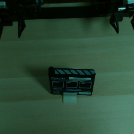 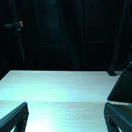 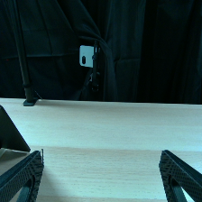

</details>

**Turn 1**

Starting from the folded home pose. I'm raising the right arm's shoulder and opening its elbow a bit to lift it off the table and learn how it appears in the top camera (which views the scene from the opposite side).

`move_joints`
````json
{
  "targets": {
    "right_j1": 1.2,
    "right_j2": 1.0
  }
}
````

*executing move_joints over 20 steps (2.0s)*

<details open>
<summary>Observation 2</summary>

````text
Current observation.
Instruction: Lift the clapper stick, then let go so it snaps shut with a clap. Note that the context (top) cam is on the opposite sides of the arms.
state[joint_pos]: left_j0=0.0059 left_j1=0.0082 left_j2=0.0067 left_j3=-0.0414 left_j4=-0.0078 left_j5=-0.0086 left_gripper=0.9987 right_j0=0.0017 right_j1=1.2079 right_j2=0.9695 right_j3=-0.0498 right_j4=-0.0235 right_j5=-0.0124 right_gripper=0.9994

camera 'top_cam' (step 20):

[image omitted: streamed camera frame]

camera 'left_cam' (step 20):

[image omitted: streamed camera frame]

camera 'right_cam' (step 20):

[image omitted: streamed camera frame]
````

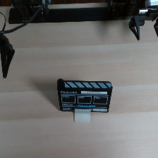 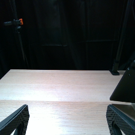 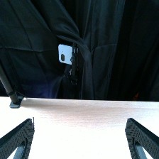

</details>

**Turn 2**

The right wrist camera was looking at the far curtain, so the gripper was pointing horizontally forward. I'm extending the right arm forward and angling the wrist down so it hovers over the table, and to confirm which gripper in the top view is the right arm.

`move_joints`
````json
{
  "targets": {
    "right_j1": 2.0,
    "right_j2": 1.6,
    "right_j3": -0.8
  }
}
````

*executing move_joints over 13 steps (1.3s)*

<details open>
<summary>Observation 3</summary>

````text
Current observation.
Instruction: Lift the clapper stick, then let go so it snaps shut with a clap. Note that the context (top) cam is on the opposite sides of the arms.
state[joint_pos]: left_j0=0.0059 left_j1=0.0082 left_j2=0.0067 left_j3=-0.0486 left_j4=-0.0082 left_j5=-0.0086 left_gripper=0.9986 right_j0=0.0025 right_j1=1.9915 right_j2=1.5764 right_j3=-0.7723 right_j4=-0.0235 right_j5=-0.0124 right_gripper=0.9994

camera 'top_cam' (step 33):

[image omitted: streamed camera frame]

camera 'left_cam' (step 33):

[image omitted: streamed camera frame]

camera 'right_cam' (step 33):

[image omitted: streamed camera frame]
````

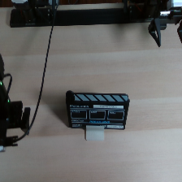 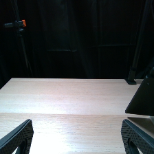 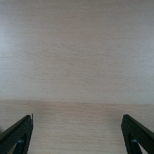

</details>

**Turn 3**

The right wrist camera now sees bare tabletop and the right arm shows up at the left edge of the top view, so the top image is mirrored. I'm yawing the right base joint to see which way that maps in the top image before steering toward the clapperboard.

`move_joints`
````json
{
  "targets": {
    "right_j0": 0.4
  }
}
````

*executing move_joints over 7 steps (0.7s)*

<details open>
<summary>Observation 4</summary>

````text
Current observation.
Instruction: Lift the clapper stick, then let go so it snaps shut with a clap. Note that the context (top) cam is on the opposite sides of the arms.
state[joint_pos]: left_j0=0.0059 left_j1=0.0082 left_j2=0.0067 left_j3=-0.049 left_j4=-0.0082 left_j5=-0.0086 left_gripper=0.9983 right_j0=0.3561 right_j1=1.9991 right_j2=1.5784 right_j3=-0.783 right_j4=0.0143 right_j5=-0.0193 right_gripper=0.9991

camera 'top_cam' (step 40):

[image omitted: streamed camera frame]

camera 'left_cam' (step 40):

[image omitted: streamed camera frame]

camera 'right_cam' (step 40):

[image omitted: streamed camera frame]
````

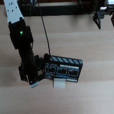 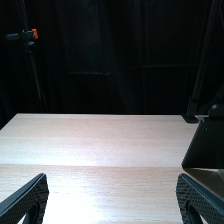 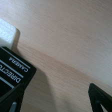

</details>

**Turn 4**

Positive right_j0 swings the arm toward the clapperboard: the wrist camera now catches the slate ("CAMERA"/"DIRECTOR" text) in its lower-left. I'm yawing a bit further to center the slate under the right gripper.

`move_joints`
````json
{
  "targets": {
    "right_j0": 0.55
  }
}
````

*executing move_joints over 4 steps (0.4s)*

<details open>
<summary>Observation 5</summary>

````text
Current observation.
Instruction: Lift the clapper stick, then let go so it snaps shut with a clap. Note that the context (top) cam is on the opposite sides of the arms.
state[joint_pos]: left_j0=0.0059 left_j1=0.0082 left_j2=0.0067 left_j3=-0.0486 left_j4=-0.0082 left_j5=-0.0086 left_gripper=0.9982 right_j0=0.5217 right_j1=1.9881 right_j2=1.5787 right_j3=-0.8051 right_j4=0.0418 right_j5=-0.0345 right_gripper=0.9988

camera 'top_cam' (step 44):

[image omitted: streamed camera frame]

camera 'left_cam' (step 44):

[image omitted: streamed camera frame]

camera 'right_cam' (step 44):

[image omitted: streamed camera frame]
````

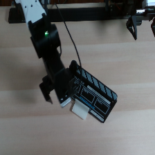 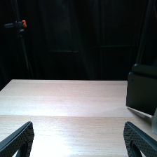 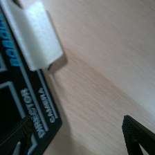

</details>

**Turn 5**

The wrist camera is too close and only sees the left end of the slate. I'm raising the wrist and pitching the gripper to look straight down so I can see the whole clapperboard and locate the hinged stick.

`move_joints`
````json
{
  "targets": {
    "right_j2": 1.95,
    "right_j3": -1.5
  }
}
````

*executing move_joints over 12 steps (1.2s)*

<details open>
<summary>Observation 6</summary>

````text
Current observation.
Instruction: Lift the clapper stick, then let go so it snaps shut with a clap. Note that the context (top) cam is on the opposite sides of the arms.
state[joint_pos]: left_j0=0.0059 left_j1=0.0082 left_j2=0.0067 left_j3=-0.049 left_j4=-0.0082 left_j5=-0.0086 left_gripper=0.9982 right_j0=0.5217 right_j1=1.993 right_j2=1.9301 right_j3=-1.4708 right_j4=0.0299 right_j5=-0.0376 right_gripper=0.9988

camera 'top_cam' (step 56):

[image omitted: streamed camera frame]

camera 'left_cam' (step 56):

[image omitted: streamed camera frame]

camera 'right_cam' (step 56):

[image omitted: streamed camera frame]
````

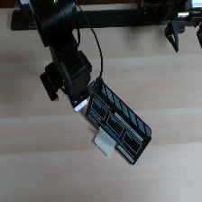  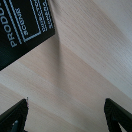

</details>

**Turn 6**

From the top view the right gripper sits to the left of the slate, and the slate is on the +y side of the right arm. I'm yawing further so the gripper lines up over the middle of the clapper stick.

`move_joints`
````json
{
  "targets": {
    "right_j0": 0.85
  }
}
````

*executing move_joints over 6 steps (0.6s)*

<details open>
<summary>Observation 7</summary>

````text
Current observation.
Instruction: Lift the clapper stick, then let go so it snaps shut with a clap. Note that the context (top) cam is on the opposite sides of the arms.
state[joint_pos]: left_j0=0.0059 left_j1=0.0082 left_j2=0.0067 left_j3=-0.049 left_j4=-0.0082 left_j5=-0.0086 left_gripper=0.9982 right_j0=0.8314 right_j1=1.993 right_j2=1.9305 right_j3=-1.4818 right_j4=0.0288 right_j5=-0.0376 right_gripper=0.9988

camera 'top_cam' (step 62):

[image omitted: streamed camera frame]

camera 'left_cam' (step 62):

[image omitted: streamed camera frame]

camera 'right_cam' (step 62):

[image omitted: streamed camera frame]
````

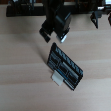 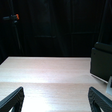 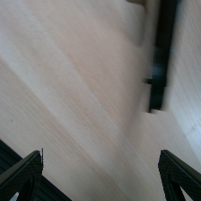

</details>

**Turn 7**

Top view shows the gripper now laterally aligned with the slate but sitting short of it (too close to the robot). I'm pitching the shoulder and elbow together to extend the arm forward while keeping the gripper pointing down.

`move_joints`
````json
{
  "targets": {
    "right_j1": 2.45,
    "right_j2": 2.39
  }
}
````

*executing move_joints over 8 steps (0.8s)*

<details open>
<summary>Observation 8</summary>

````text
Current observation.
Instruction: Lift the clapper stick, then let go so it snaps shut with a clap. Note that the context (top) cam is on the opposite sides of the arms.
state[joint_pos]: left_j0=0.0059 left_j1=0.0082 left_j2=0.0067 left_j3=-0.049 left_j4=-0.0082 left_j5=-0.0086 left_gripper=0.9982 right_j0=0.8349 right_j1=2.4302 right_j2=2.373 right_j3=-1.5181 right_j4=0.0292 right_j5=-0.0383 right_gripper=0.9988

camera 'top_cam' (step 70):

[image omitted: streamed camera frame]

camera 'left_cam' (step 70):

[image omitted: streamed camera frame]

camera 'right_cam' (step 70):

[image omitted: streamed camera frame]
````

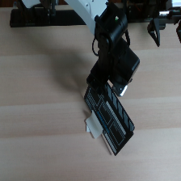 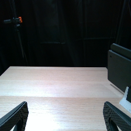 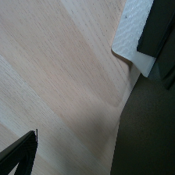

</details>

**Turn 8**

The gripper is now hovering just over the near edge of the slate where the clapper stick is. I'm lowering the wrist a few centimetres to get a close look at the stick in the wrist camera before committing to a grasp.

`move_joints`
````json
{
  "targets": {
    "right_j2": 2.28,
    "right_j3": -1.42
  }
}
````

*executing move_joints over 2 steps (0.2s)*

<details open>
<summary>Observation 9</summary>

````text
Current observation.
Instruction: Lift the clapper stick, then let go so it snaps shut with a clap. Note that the context (top) cam is on the opposite sides of the arms.
state[joint_pos]: left_j0=0.0059 left_j1=0.0082 left_j2=0.0067 left_j3=-0.0494 left_j4=-0.0082 left_j5=-0.0086 left_gripper=0.9982 right_j0=0.8406 right_j1=2.4084 right_j2=2.3051 right_j3=-1.4971 right_j4=0.0292 right_j5=-0.038 right_gripper=0.9988

camera 'top_cam' (step 72):

[image omitted: streamed camera frame]

camera 'left_cam' (step 72):

[image omitted: streamed camera frame]

camera 'right_cam' (step 72):

[image omitted: streamed camera frame]
````

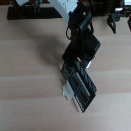 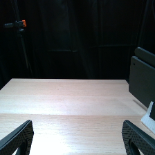 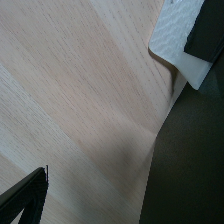

</details>

**Turn 9**

The wrist view is ambiguous about where the slate is relative to the gripper, so I'm lifting the gripper well above the table while keeping it pointed straight down to get a clear overhead view of the whole clapperboard.

`move_joints`
````json
{
  "targets": {
    "right_j1": 2.2,
    "right_j2": 2.6,
    "right_j3": -1.97
  }
}
````

*executing move_joints over 8 steps (0.8s)*

<details open>
<summary>Observation 10</summary>

````text
Current observation.
Instruction: Lift the clapper stick, then let go so it snaps shut with a clap. Note that the context (top) cam is on the opposite sides of the arms.
state[joint_pos]: left_j0=0.0059 left_j1=0.0082 left_j2=0.0067 left_j3=-0.0494 left_j4=-0.0082 left_j5=-0.0086 left_gripper=0.9982 right_j0=0.8413 right_j1=2.2326 right_j2=2.5782 right_j3=-1.6962 right_j4=0.0284 right_j5=-0.0387 right_gripper=0.9988

camera 'top_cam' (step 80):

[image omitted: streamed camera frame]

camera 'left_cam' (step 80):

[image omitted: streamed camera frame]

camera 'right_cam' (step 80):

[image omitted: streamed camera frame]
````

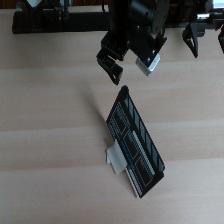 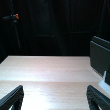 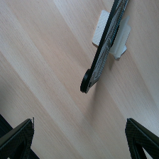

</details>

**Turn 10**

I can now see the slate as a dark bar in the wrist camera. I'm changing only the base yaw by a known amount so I can calibrate which way the wrist-camera image maps to arm motion before attempting the grasp.

`move_joints`
````json
{
  "targets": {
    "right_j0": 0.6
  }
}
````

*executing move_joints over 4 steps (0.4s)*

<details open>
<summary>Observation 11</summary>

````text
Current observation.
Instruction: Lift the clapper stick, then let go so it snaps shut with a clap. Note that the context (top) cam is on the opposite sides of the arms.
state[joint_pos]: left_j0=0.0059 left_j1=0.0082 left_j2=0.0067 left_j3=-0.049 left_j4=-0.0082 left_j5=-0.0086 left_gripper=0.9982 right_j0=0.6216 right_j1=2.2345 right_j2=2.5793 right_j3=-1.6958 right_j4=0.0254 right_j5=-0.0456 right_gripper=0.9988

camera 'top_cam' (step 84):

[image omitted: streamed camera frame]

camera 'left_cam' (step 84):

[image omitted: streamed camera frame]

camera 'right_cam' (step 84):

[image omitted: streamed camera frame]
````

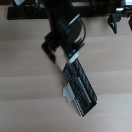 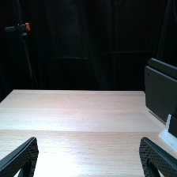 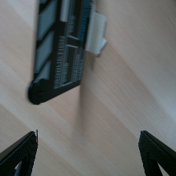

</details>

**Turn 11**

Calibrated the wrist camera: image-up is forward and image-left is the arm's left. The slate sits up and to the left in that view, so I'm reaching ~6 cm forward, a bit left, and slightly down to hover directly over it.

`move_joints`
````json
{
  "targets": {
    "right_j0": 0.72,
    "right_j1": 2.42,
    "right_j2": 2.65,
    "right_j3": -1.5
  }
}
````

*executing move_joints over 4 steps (0.4s)*

<details open>
<summary>Observation 12</summary>

````text
Current observation.
Instruction: Lift the clapper stick, then let go so it snaps shut with a clap. Note that the context (top) cam is on the opposite sides of the arms.
state[joint_pos]: left_j0=0.0059 left_j1=0.0082 left_j2=0.0067 left_j3=-0.049 left_j4=-0.0082 left_j5=-0.0086 left_gripper=0.9982 right_j0=0.7193 right_j1=2.4157 right_j2=2.6335 right_j3=-1.5291 right_j4=0.025 right_j5=-0.046 right_gripper=0.9988

camera 'top_cam' (step 88):

[image omitted: streamed camera frame]

camera 'left_cam' (step 88):

[image omitted: streamed camera frame]

camera 'right_cam' (step 88):

[image omitted: streamed camera frame]
````

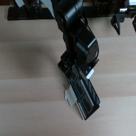 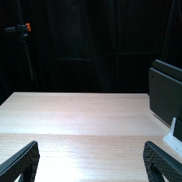 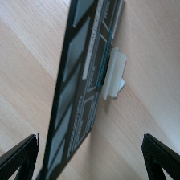

</details>

**Turn 12**

The slate now fills the left half of the wrist view, too close to judge its geometry. I'm backing the gripper up ~5 cm and shifting left to frame the whole clapper stick and find its hinge and free end.

`move_joints`
````json
{
  "targets": {
    "right_j0": 0.8,
    "right_j2": 2.85,
    "right_j3": -1.75
  }
}
````

*executing move_joints over 4 steps (0.4s)*

<details open>
<summary>Observation 13</summary>

````text
Current observation.
Instruction: Lift the clapper stick, then let go so it snaps shut with a clap. Note that the context (top) cam is on the opposite sides of the arms.
state[joint_pos]: left_j0=0.0059 left_j1=0.0082 left_j2=0.0067 left_j3=-0.049 left_j4=-0.0082 left_j5=-0.0086 left_gripper=0.9982 right_j0=0.8021 right_j1=2.4237 right_j2=2.8349 right_j3=-1.6962 right_j4=0.0254 right_j5=-0.046 right_gripper=0.9988

camera 'top_cam' (step 92):

[image omitted: streamed camera frame]

camera 'left_cam' (step 92):

[image omitted: streamed camera frame]

camera 'right_cam' (step 92):

[image omitted: streamed camera frame]
````

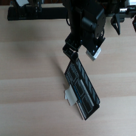  

</details>

**Turn 13**

The wrist view shows the striped clapper stick as a diagonal bar sitting slightly right of centre; a small yaw back toward -y centres it under the gripper.

`move_joints`
````json
{
  "targets": {
    "right_j0": 0.765
  }
}
````

*executing move_joints over 1 steps (0.1s)*

<details open>
<summary>Observation 14</summary>

````text
Current observation.
Instruction: Lift the clapper stick, then let go so it snaps shut with a clap. Note that the context (top) cam is on the opposite sides of the arms.
state[joint_pos]: left_j0=0.0059 left_j1=0.0082 left_j2=0.0067 left_j3=-0.0494 left_j4=-0.0082 left_j5=-0.0086 left_gripper=0.9982 right_j0=0.7948 right_j1=2.4237 right_j2=2.8349 right_j3=-1.6958 right_j4=0.0246 right_j5=-0.046 right_gripper=0.9988

camera 'top_cam' (step 93):

[image omitted: streamed camera frame]

camera 'left_cam' (step 93):

[image omitted: streamed camera frame]

camera 'right_cam' (step 93):

[image omitted: streamed camera frame]
````

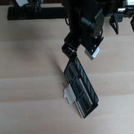  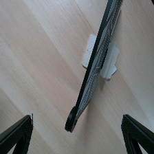

</details>

**Turn 14**

The stick is roughly centred in the wrist view; I'm lowering the gripper about 5 cm toward it to see the bar and its hinge in detail before grasping.

`move_joints`
````json
{
  "targets": {
    "right_j2": 2.63
  }
}
````

*executing move_joints over 4 steps (0.4s)*

<details open>
<summary>Observation 15</summary>

````text
Current observation.
Instruction: Lift the clapper stick, then let go so it snaps shut with a clap. Note that the context (top) cam is on the opposite sides of the arms.
state[joint_pos]: left_j0=0.0059 left_j1=0.0082 left_j2=0.0067 left_j3=-0.049 left_j4=-0.0082 left_j5=-0.0086 left_gripper=0.9982 right_j0=0.7986 right_j1=2.4256 right_j2=2.6453 right_j3=-1.6958 right_j4=0.0246 right_j5=-0.0456 right_gripper=0.9988

camera 'top_cam' (step 97):

[image omitted: streamed camera frame]

camera 'left_cam' (step 97):

[image omitted: streamed camera frame]

camera 'right_cam' (step 97):

[image omitted: streamed camera frame]
````

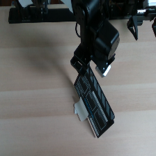 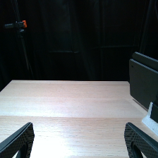 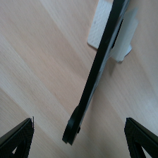

</details>

**Turn 15**

The wrist view now shows the black clapper bar running vertically between the open jaws, which are at the bottom corners of the frame. I'm descending a few more centimetres so the jaws straddle the bar.

`move_joints`
````json
{
  "targets": {
    "right_j1": 2.55,
    "right_j2": 2.55
  }
}
````

*executing move_joints over 2 steps (0.2s)*

<details open>
<summary>Observation 16</summary>

````text
Current observation.
Instruction: Lift the clapper stick, then let go so it snaps shut with a clap. Note that the context (top) cam is on the opposite sides of the arms.
state[joint_pos]: left_j0=0.0059 left_j1=0.0101 left_j2=0.0067 left_j3=-0.0555 left_j4=-0.0082 left_j5=-0.0082 left_gripper=0.9982 right_j0=0.8078 right_j1=2.5217 right_j2=2.5603 right_j3=-1.6691 right_j4=0.0219 right_j5=-0.0532 right_gripper=0.9988

camera 'top_cam' (step 99):

[image omitted: streamed camera frame]

camera 'left_cam' (step 99):

[image omitted: streamed camera frame]

camera 'right_cam' (step 99):

[image omitted: streamed camera frame]
````

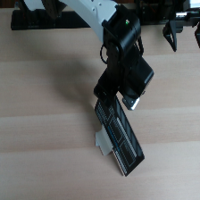 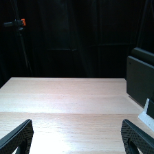 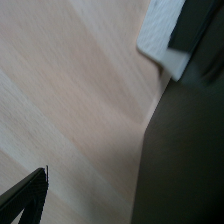

</details>

**Turn 16**

Getting close, the dark clapper bar has drifted to the right edge of the wrist view, so the gripper is ~3 cm too far to its left. I'm yawing back toward -y to put the bar between the jaws.

`move_joints`
````json
{
  "targets": {
    "right_j0": 0.74
  }
}
````

*executing move_joints over 2 steps (0.2s)*

<details open>
<summary>Observation 17</summary>

````text
Current observation.
Instruction: Lift the clapper stick, then let go so it snaps shut with a clap. Note that the context (top) cam is on the opposite sides of the arms.
state[joint_pos]: left_j0=0.0059 left_j1=0.0097 left_j2=0.0067 left_j3=-0.065 left_j4=-0.0082 left_j5=-0.0086 left_gripper=0.9982 right_j0=0.7685 right_j1=2.532 right_j2=2.5549 right_j3=-1.6966 right_j4=0.0036 right_j5=-0.065 right_gripper=0.9988

camera 'top_cam' (step 101):

[image omitted: streamed camera frame]

camera 'left_cam' (step 101):

[image omitted: streamed camera frame]

camera 'right_cam' (step 101):

[image omitted: streamed camera frame]
````

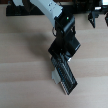 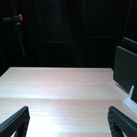 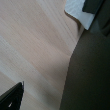

</details>

**Turn 17**

My two camera mappings disagree about which side the bar is on, so I'm making a deliberate 0.12 rad yaw test and watching both the top and wrist views to settle which direction closes the gap.

`move_joints`
````json
{
  "targets": {
    "right_j0": 0.65
  }
}
````

*executing move_joints over 2 steps (0.2s)*

<details open>
<summary>Observation 18</summary>

````text
Current observation.
Instruction: Lift the clapper stick, then let go so it snaps shut with a clap. Note that the context (top) cam is on the opposite sides of the arms.
state[joint_pos]: left_j0=0.0059 left_j1=0.0097 left_j2=0.0067 left_j3=-0.0715 left_j4=-0.0086 left_j5=-0.0086 left_gripper=0.9982 right_j0=0.7303 right_j1=2.5244 right_j2=2.5549 right_j3=-1.697 right_j4=-0.038 right_j5=-0.1001 right_gripper=0.9988

camera 'top_cam' (step 103):

[image omitted: streamed camera frame]

camera 'left_cam' (step 103):

[image omitted: streamed camera frame]

camera 'right_cam' (step 103):

[image omitted: streamed camera frame]
````

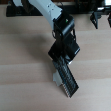 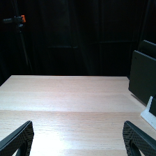 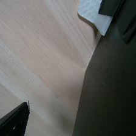

</details>

**Turn 18**

The last two yaw commands were cut short and the wrist joints drifted on their own, which suggests the gripper is bumping into the clapperboard. I'm lifting the hand ~7 cm to break contact and get a clear look again.

`move_joints`
````json
{
  "targets": {
    "right_j1": 2.42,
    "right_j2": 2.65
  }
}
````

*executing move_joints over 2 steps (0.2s)*

<details open>
<summary>Observation 19</summary>

````text
Current observation.
Instruction: Lift the clapper stick, then let go so it snaps shut with a clap. Note that the context (top) cam is on the opposite sides of the arms.
state[joint_pos]: left_j0=0.0059 left_j1=0.0101 left_j2=0.0067 left_j3=-0.0723 left_j4=-0.0082 left_j5=-0.0086 left_gripper=0.9982 right_j0=0.7021 right_j1=2.5088 right_j2=2.5977 right_j3=-1.6917 right_j4=-0.0238 right_j5=-0.1131 right_gripper=0.9988

camera 'top_cam' (step 105):

[image omitted: streamed camera frame]

camera 'left_cam' (step 105):

[image omitted: streamed camera frame]

camera 'right_cam' (step 105):

[image omitted: streamed camera frame]
````

  

</details>

**Turn 19**

The top view shows the clapperboard has tipped up against the gripper — I'm clearly pressing on it. I'm raising the hand ~9 cm to clear the board and reassess from above.

`move_joints`
````json
{
  "targets": {
    "right_j1": 2.2,
    "right_j2": 2.6
  }
}
````

*executing move_joints over 5 steps (0.5s)*

<details open>
<summary>Observation 20</summary>

````text
Current observation.
Instruction: Lift the clapper stick, then let go so it snaps shut with a clap. Note that the context (top) cam is on the opposite sides of the arms.
state[joint_pos]: left_j0=0.0059 left_j1=0.0097 left_j2=0.0067 left_j3=-0.075 left_j4=-0.0082 left_j5=-0.0086 left_gripper=0.9982 right_j0=0.7029 right_j1=2.286 right_j2=2.5866 right_j3=-1.6962 right_j4=-0.0269 right_j5=-0.1173 right_gripper=0.9988

camera 'top_cam' (step 110):

[image omitted: streamed camera frame]

camera 'left_cam' (step 110):

[image omitted: streamed camera frame]

camera 'right_cam' (step 110):

[image omitted: streamed camera frame]
````

  

</details>

**Turn 20**

Now I can see the clapper clearly: a striped stick lying on the table running diagonally across the wrist view, with a white hinge block on one side. I'm rolling the wrist so the jaws line up across the stick rather than along it.

`move_joints`
````json
{
  "targets": {
    "right_j5": 0.6
  }
}
````

*executing move_joints over 12 steps (1.2s)*

<details open>
<summary>Observation 21</summary>

````text
Current observation.
Instruction: Lift the clapper stick, then let go so it snaps shut with a clap. Note that the context (top) cam is on the opposite sides of the arms.
state[joint_pos]: left_j0=0.0059 left_j1=0.0097 left_j2=0.0067 left_j3=-0.0753 left_j4=-0.0082 left_j5=-0.0086 left_gripper=0.9982 right_j0=0.7048 right_j1=2.3039 right_j2=2.579 right_j3=-1.6962 right_j4=-0.0277 right_j5=0.5133 right_gripper=0.9988

camera 'top_cam' (step 122):

[image omitted: streamed camera frame]

camera 'left_cam' (step 122):

[image omitted: streamed camera frame]

camera 'right_cam' (step 122):

[image omitted: streamed camera frame]
````

  

</details>

**Turn 21**

The roll worked: the clapper stick now runs vertically in the wrist view, square to the jaws, and its rounded near end sits between them. I'm lowering about 5 cm toward the stick.

`move_joints`
````json
{
  "targets": {
    "right_j1": 2.38,
    "right_j2": 2.52
  }
}
````

*executing move_joints over 2 steps (0.2s)*

<details open>
<summary>Observation 22</summary>

````text
Current observation.
Instruction: Lift the clapper stick, then let go so it snaps shut with a clap. Note that the context (top) cam is on the opposite sides of the arms.
state[joint_pos]: left_j0=0.0059 left_j1=0.0097 left_j2=0.0067 left_j3=-0.0753 left_j4=-0.0082 left_j5=-0.0086 left_gripper=0.9982 right_j0=0.7048 right_j1=2.3192 right_j2=2.55 right_j3=-1.6962 right_j4=-0.0277 right_j5=0.5499 right_gripper=0.9988

camera 'top_cam' (step 124):

[image omitted: streamed camera frame]

camera 'left_cam' (step 124):

[image omitted: streamed camera frame]

camera 'right_cam' (step 124):

[image omitted: streamed camera frame]
````

  

</details>

**Turn 22**

Only a small amount of the last descent was executed, so I'm commanding a larger downward step to bring the jaws down around the near end of the clapper stick.

`move_joints`
````json
{
  "targets": {
    "right_j1": 2.42,
    "right_j2": 2.46
  }
}
````

*executing move_joints over 2 steps (0.2s)*

<details open>
<summary>Observation 23</summary>

````text
Current observation.
Instruction: Lift the clapper stick, then let go so it snaps shut with a clap. Note that the context (top) cam is on the opposite sides of the arms.
state[joint_pos]: left_j0=0.0059 left_j1=0.0097 left_j2=0.0067 left_j3=-0.0753 left_j4=-0.0082 left_j5=-0.0086 left_gripper=0.9982 right_j0=0.7048 right_j1=2.4008 right_j2=2.4809 right_j3=-1.6951 right_j4=-0.028 right_j5=0.5259 right_gripper=0.9988

camera 'top_cam' (step 126):

[image omitted: streamed camera frame]

camera 'left_cam' (step 126):

[image omitted: streamed camera frame]

camera 'right_cam' (step 126):

[image omitted: streamed camera frame]
````

  

</details>

**Turn 23**

Close-up wrist view shows the stick drifting toward the left finger rather than sitting between the jaws. I'm nudging the base yaw so the stick lines up with the midline between the fingers.

`move_joints`
````json
{
  "targets": {
    "right_j0": 0.76
  }
}
````

*executing move_joints over 1 steps (0.1s)*

<details open>
<summary>Observation 24</summary>

````text
Current observation.
Instruction: Lift the clapper stick, then let go so it snaps shut with a clap. Note that the context (top) cam is on the opposite sides of the arms.
state[joint_pos]: left_j0=0.0059 left_j1=0.0097 left_j2=0.0067 left_j3=-0.0753 left_j4=-0.0082 left_j5=-0.0086 left_gripper=0.9982 right_j0=0.7048 right_j1=2.421 right_j2=2.4592 right_j3=-1.6955 right_j4=-0.0277 right_j5=0.5346 right_gripper=0.9988

camera 'top_cam' (step 127):

[image omitted: streamed camera frame]

camera 'left_cam' (step 127):

[image omitted: streamed camera frame]

camera 'right_cam' (step 127):

[image omitted: streamed camera frame]
````

  

</details>

**Turn 24**

Now I can see the white slate face at the left of the wrist view with the dark striped clapper stick along its edge; the jaws are just outboard of it over bare table. I'm yawing toward the board so the stick sits between the fingers.

`move_joints`
````json
{
  "targets": {
    "right_j0": 0.79
  }
}
````

*executing move_joints over 2 steps (0.2s)*

<details open>
<summary>Observation 25</summary>

````text
Current observation.
Instruction: Lift the clapper stick, then let go so it snaps shut with a clap. Note that the context (top) cam is on the opposite sides of the arms.
state[joint_pos]: left_j0=0.0059 left_j1=0.0101 left_j2=0.0067 left_j3=-0.0753 left_j4=-0.0082 left_j5=-0.0086 left_gripper=0.9982 right_j0=0.7746 right_j1=2.421 right_j2=2.4596 right_j3=-1.6958 right_j4=-0.0311 right_j5=0.5312 right_gripper=0.9988

camera 'top_cam' (step 129):

[image omitted: streamed camera frame]

camera 'left_cam' (step 129):

[image omitted: streamed camera frame]

camera 'right_cam' (step 129):

[image omitted: streamed camera frame]
````

  

</details>

**Turn 25**

The board edge with the striped stick is just inboard of the jaws. I'm lowering another ~2.5 cm so the fingers reach down beside the stick before I close them.

`move_joints`
````json
{
  "targets": {
    "right_j1": 2.46,
    "right_j2": 2.42
  }
}
````

*executing move_joints over 1 steps (0.1s)*

<details open>
<summary>Observation 26</summary>

````text
Current observation.
Instruction: Lift the clapper stick, then let go so it snaps shut with a clap. Note that the context (top) cam is on the opposite sides of the arms.
state[joint_pos]: left_j0=0.0059 left_j1=0.0097 left_j2=0.0067 left_j3=-0.0753 left_j4=-0.0082 left_j5=-0.0086 left_gripper=0.9982 right_j0=0.7902 right_j1=2.421 right_j2=2.4596 right_j3=-1.6958 right_j4=-0.0311 right_j5=0.5308 right_gripper=0.9988

camera 'top_cam' (step 130):

[image omitted: streamed camera frame]

camera 'left_cam' (step 130):

[image omitted: streamed camera frame]

camera 'right_cam' (step 130):

[image omitted: streamed camera frame]
````

  

</details>

**Turn 26**

Top view shows the striped stick just forward of the fingers, and the wrist view shows the board edge between the jaws. I'm dropping the wrist while pushing slightly forward so the jaws come down onto the stick.

`move_joints`
````json
{
  "targets": {
    "right_j1": 2.54,
    "right_j2": 2.58
  }
}
````

*executing move_joints over 2 steps (0.2s)*

<details open>
<summary>Observation 27</summary>

````text
Current observation.
Instruction: Lift the clapper stick, then let go so it snaps shut with a clap. Note that the context (top) cam is on the opposite sides of the arms.
state[joint_pos]: left_j0=0.0059 left_j1=0.0101 left_j2=0.0067 left_j3=-0.0753 left_j4=-0.0082 left_j5=-0.0086 left_gripper=0.9982 right_j0=0.7876 right_j1=2.4912 right_j2=2.5416 right_j3=-1.6802 right_j4=-0.0303 right_j5=0.5236 right_gripper=0.9988

camera 'top_cam' (step 132):

[image omitted: streamed camera frame]

camera 'left_cam' (step 132):

[image omitted: streamed camera frame]

camera 'right_cam' (step 132):

[image omitted: streamed camera frame]
````

  

</details>

**Turn 27**

The wrist camera is right down on the striped clapper stick with it lying between the fingers. I'm closing the gripper to grab the stick.

`move_joints`
````json
{
  "targets": {
    "right_gripper": 0.08
  }
}
````

*executing move_joints over 10 steps (1.0s)*

<details open>
<summary>Observation 28</summary>

````text
Current observation.
Instruction: Lift the clapper stick, then let go so it snaps shut with a clap. Note that the context (top) cam is on the opposite sides of the arms.
state[joint_pos]: left_j0=0.0059 left_j1=0.0101 left_j2=0.0067 left_j3=-0.075 left_j4=-0.0086 left_j5=-0.0086 left_gripper=0.9982 right_j0=0.7788 right_j1=2.4981 right_j2=2.5538 right_j3=-1.6966 right_j4=0.0448 right_j5=0.5232 right_gripper=0.1742

camera 'top_cam' (step 142):

[image omitted: streamed camera frame]

camera 'left_cam' (step 142):

[image omitted: streamed camera frame]

camera 'right_cam' (step 142):

[image omitted: streamed camera frame]
````

  

</details>

**Turn 28**

The gripper closed onto something about 1.7 cm thick — the clapper stick. I'm now raising the hand about 8 cm to swing the stick up about its hinge.

`move_joints`
````json
{
  "targets": {
    "right_j1": 2.3,
    "right_j2": 2.53
  }
}
````

*executing move_joints over 4 steps (0.4s)*

<details open>
<summary>Observation 29</summary>

````text
Current observation.
Instruction: Lift the clapper stick, then let go so it snaps shut with a clap. Note that the context (top) cam is on the opposite sides of the arms.
state[joint_pos]: left_j0=0.0059 left_j1=0.0101 left_j2=0.0067 left_j3=-0.0753 left_j4=-0.0082 left_j5=-0.0086 left_gripper=0.9982 right_j0=0.7769 right_j1=2.3955 right_j2=2.5244 right_j3=-1.6947 right_j4=0.0525 right_j5=0.5198 right_gripper=0.1743

camera 'top_cam' (step 146):

[image omitted: streamed camera frame]

camera 'left_cam' (step 146):

[image omitted: streamed camera frame]

camera 'right_cam' (step 146):

[image omitted: streamed camera frame]
````

  

</details>

**Turn 29**

The stick is coming up with the gripper — the top view shows it tilted off the table. I'm lifting further to swing the clapper stick well open before releasing it.

`move_joints`
````json
{
  "targets": {
    "right_j1": 2.15,
    "right_j2": 2.5
  }
}
````

*executing move_joints over 4 steps (0.4s)*

<details open>
<summary>Observation 30</summary>

````text
Current observation.
Instruction: Lift the clapper stick, then let go so it snaps shut with a clap. Note that the context (top) cam is on the opposite sides of the arms.
state[joint_pos]: left_j0=0.0059 left_j1=0.0101 left_j2=0.0067 left_j3=-0.0753 left_j4=-0.0082 left_j5=-0.0086 left_gripper=0.9982 right_j0=0.77 right_j1=2.3226 right_j2=2.4748 right_j3=-1.636 right_j4=0.0681 right_j5=0.5148 right_gripper=0.175

camera 'top_cam' (step 150):

[image omitted: streamed camera frame]

camera 'left_cam' (step 150):

[image omitted: streamed camera frame]

camera 'right_cam' (step 150):

[image omitted: streamed camera frame]
````

  

</details>

**Turn 30**

The clapper is now tilted well up off the table. I'm raising a bit more to see clearly, in the top view, whether I have only the hinged stick or the whole board.

`move_joints`
````json
{
  "targets": {
    "right_j1": 2.0,
    "right_j2": 2.45
  }
}
````

*executing move_joints over 6 steps (0.6s)*

<details open>
<summary>Observation 31</summary>

````text
Current observation.
Instruction: Lift the clapper stick, then let go so it snaps shut with a clap. Note that the context (top) cam is on the opposite sides of the arms.
state[joint_pos]: left_j0=0.0059 left_j1=0.0097 left_j2=0.0067 left_j3=-0.0753 left_j4=-0.0082 left_j5=-0.0086 left_gripper=0.9982 right_j0=0.7658 right_j1=2.1128 right_j2=2.4279 right_j3=-1.6344 right_j4=0.0742 right_j5=0.5117 right_gripper=0.1757

camera 'top_cam' (step 156):

[image omitted: streamed camera frame]

camera 'left_cam' (step 156):

[image omitted: streamed camera frame]

camera 'right_cam' (step 156):

[image omitted: streamed camera frame]
````

  

</details>

**Turn 31**

The last top-view frame was motion-blurred; I'm making a tiny move so I get a sharp image to judge whether I'm holding just the hinged stick or the entire board.

`move_joints`
````json
{
  "targets": {
    "right_j1": 1.98
  }
}
````

*executing move_joints over 3 steps (0.3s)*

<details open>
<summary>Observation 32</summary>

````text
Current observation.
Instruction: Lift the clapper stick, then let go so it snaps shut with a clap. Note that the context (top) cam is on the opposite sides of the arms.
state[joint_pos]: left_j0=0.0059 left_j1=0.0097 left_j2=0.0067 left_j3=-0.0753 left_j4=-0.0082 left_j5=-0.0086 left_gripper=0.9982 right_j0=0.7685 right_j1=2.0117 right_j2=2.4229 right_j3=-1.6657 right_j4=0.0669 right_j5=0.5117 right_gripper=0.1757

camera 'top_cam' (step 159):

[image omitted: streamed camera frame]

camera 'left_cam' (step 159):

[image omitted: streamed camera frame]

camera 'right_cam' (step 159):

[image omitted: streamed camera frame]
````

  

</details>

**Turn 32**

Now it's clear: the striped clapper stick is raised almost vertical, still hinged to the small white base sitting on the table. I'm opening the gripper to let it drop and snap shut with a clap.

`move_joints`
````json
{
  "targets": {
    "right_gripper": 1.0
  }
}
````

*executing move_joints over 9 steps (0.9s)*

<details open>
<summary>Observation 33</summary>

````text
Current observation.
Instruction: Lift the clapper stick, then let go so it snaps shut with a clap. Note that the context (top) cam is on the opposite sides of the arms.
state[joint_pos]: left_j0=0.0059 left_j1=0.0101 left_j2=0.0067 left_j3=-0.0753 left_j4=-0.0082 left_j5=-0.0086 left_gripper=0.9982 right_j0=0.7692 right_j1=2.0117 right_j2=2.4229 right_j3=-1.6737 right_j4=0.0666 right_j5=0.506 right_gripper=0.9962

camera 'top_cam' (step 168):

[image omitted: streamed camera frame]

camera 'left_cam' (step 168):

[image omitted: streamed camera frame]

camera 'right_cam' (step 168):

[image omitted: streamed camera frame]
````

  

</details>

**Turn 33**

The gripper is open and the stick has dropped back down. I'm retracting the arm up and out of the way to confirm from the top camera that the clapper has snapped shut on its base.

`move_joints`
````json
{
  "targets": {
    "right_j1": 1.7,
    "right_j2": 2.0
  }
}
````

*executing move_joints over 7 steps (0.7s)*

<details open>
<summary>Observation 34</summary>

````text
Current observation.
Instruction: Lift the clapper stick, then let go so it snaps shut with a clap. Note that the context (top) cam is on the opposite sides of the arms.
state[joint_pos]: left_j0=0.0059 left_j1=0.0101 left_j2=0.0067 left_j3=-0.0753 left_j4=-0.0082 left_j5=-0.0086 left_gripper=0.9982 right_j0=0.7692 right_j1=1.7287 right_j2=2.0151 right_j3=-1.681 right_j4=0.0666 right_j5=0.5045 right_gripper=0.9972

camera 'top_cam' (step 175):

[image omitted: streamed camera frame]

camera 'left_cam' (step 175):

[image omitted: streamed camera frame]

camera 'right_cam' (step 175):

[image omitted: streamed camera frame]
````

  

</details>

**Turn 34**

The clapper stick appears to be standing open, possibly leaning on the open gripper. I'm withdrawing the arm clear of it so it can fall freely and clap.

`move_joints`
````json
{
  "targets": {
    "right_j1": 1.5,
    "right_j2": 1.7,
    "right_j3": -1.0
  }
}
````

*executing move_joints over 11 steps (1.1s)*

<details open>
<summary>Observation 35</summary>

````text
Current observation.
Instruction: Lift the clapper stick, then let go so it snaps shut with a clap. Note that the context (top) cam is on the opposite sides of the arms.
state[joint_pos]: left_j0=0.0059 left_j1=0.0101 left_j2=0.0067 left_j3=-0.0753 left_j4=-0.0086 left_j5=-0.0086 left_gripper=0.9982 right_j0=0.7692 right_j1=1.5364 right_j2=1.7046 right_j3=-1.1057 right_j4=0.0666 right_j5=0.5041 right_gripper=0.9973

camera 'top_cam' (step 186):

[image omitted: streamed camera frame]

camera 'left_cam' (step 186):

[image omitted: streamed camera frame]

camera 'right_cam' (step 186):

[image omitted: streamed camera frame]
````

  

</details>

**Turn 35**

The clapper stick is standing wide open and did not fall by itself. I'm closing the jaws into a paddle and bringing the hand back over the board so I can tip the stick past balance and let it slam shut.

`move_joints`
````json
{
  "targets": {
    "right_gripper": 0.0,
    "right_j1": 2.2,
    "right_j2": 2.5,
    "right_j3": -1.5
  }
}
````

*executing move_joints over 13 steps (1.3s)*

<details open>
<summary>Observation 36</summary>

````text
Current observation.
Instruction: Lift the clapper stick, then let go so it snaps shut with a clap. Note that the context (top) cam is on the opposite sides of the arms.
state[joint_pos]: left_j0=0.0063 left_j1=0.012 left_j2=0.0067 left_j3=-0.0753 left_j4=-0.0086 left_j5=-0.0086 left_gripper=0.9982 right_j0=0.7704 right_j1=2.1822 right_j2=2.463 right_j3=-1.4754 right_j4=0.0662 right_j5=0.4965 right_gripper=0.0107

camera 'top_cam' (step 199):

[image omitted: streamed camera frame]

camera 'left_cam' (step 199):

[image omitted: streamed camera frame]

camera 'right_cam' (step 199):

[image omitted: streamed camera frame]
````

  

</details>

**Turn 36**

The board has ended up standing on edge near the robot, out of the wrist camera's view to the left. I'm yawing the arm toward it so I can see it and tip it back down flat.

`move_joints`
````json
{
  "targets": {
    "right_j0": 0.55
  }
}
````

*executing move_joints over 4 steps (0.4s)*

<details open>
<summary>Observation 37</summary>

````text
Current observation.
Instruction: Lift the clapper stick, then let go so it snaps shut with a clap. Note that the context (top) cam is on the opposite sides of the arms.
state[joint_pos]: left_j0=0.0059 left_j1=0.012 left_j2=0.0067 left_j3=-0.0753 left_j4=-0.0086 left_j5=-0.0086 left_gripper=0.9982 right_j0=0.5694 right_j1=2.2028 right_j2=2.4615 right_j3=-1.5047 right_j4=0.0521 right_j5=0.4889 right_gripper=0.011

camera 'top_cam' (step 203):

[image omitted: streamed camera frame]

camera 'left_cam' (step 203):

[image omitted: streamed camera frame]

camera 'right_cam' (step 203):

[image omitted: streamed camera frame]
````

  

</details>

**Turn 37**

The striped board has disappeared from the top view, probably hidden behind the arm. I'm lifting the arm well clear so I can see the table and find the clapper again.

`move_joints`
````json
{
  "targets": {
    "right_j1": 1.6,
    "right_j2": 1.6,
    "right_j3": -1.0
  }
}
````

*executing move_joints over 14 steps (1.4s)*

<details open>
<summary>Observation 38</summary>

````text
Current observation.
Instruction: Lift the clapper stick, then let go so it snaps shut with a clap. Note that the context (top) cam is on the opposite sides of the arms.
state[joint_pos]: left_j0=0.0059 left_j1=0.0135 left_j2=0.0067 left_j3=-0.0753 left_j4=-0.0082 left_j5=-0.0086 left_gripper=0.9982 right_j0=0.5713 right_j1=1.636 right_j2=1.6165 right_j3=-1.0626 right_j4=0.0483 right_j5=0.4862 right_gripper=0.0139

camera 'top_cam' (step 217):

[image omitted: streamed camera frame]

camera 'left_cam' (step 217):

[image omitted: streamed camera frame]

camera 'right_cam' (step 217):

[image omitted: streamed camera frame]
````

  

</details>

**Turn 38**

I can now see the whole clapperboard is hooked on the closed gripper and lifted off the table, with only a small white block left on the table. I'm lowering it back toward the table before releasing it.

`move_joints`
````json
{
  "targets": {
    "right_j1": 1.8,
    "right_j2": 1.5,
    "right_j3": -1.0
  }
}
````

*executing move_joints over 3 steps (0.3s)*

[Back to index](README.md)
