# Run opus-5: 20260731_030913_998e7330

> Lift the clapper stick, then let go so it snaps shut with a clap. Note that the context (top) cam is on the opposite sides of the arms.

| | |
|---|---|
| Created (UTC) | 2026-07-31 03:09:13 |
| Model | claude-opus-5 |
| Effort | high |
| Embodiment | yam_arms |
| Status | success |
| Outcome | fail |
| Termination | operator_end |
| Operator judgement | n |
| Duration | 07:50 |
| Steps | 233 |
| LLM turns | 26 |
| Seed | 0 |
| inspect-robots | 0.34.0 |
| Git commit | n/a |

Files: [raw EvalLog](../adhoc_c5a86c6b.json) · [top video](../videos/20260731_030913_998e7330/scene-0-e0_top_cam.mp4) · [left video](../videos/20260731_030913_998e7330/scene-0-e0_left_cam.mp4) · [right video](../videos/20260731_030913_998e7330/scene-0-e0_right_cam.mp4) · [transcript jsonl](../transcripts/20260731_030913_998e7330) · [wire capture](../wire/20260731_030913_998e7330)

## Transcript

<details>
<summary>System prompt</summary>

````text
You are controlling a real robot embodiment named 'yam_arms' through tool calls. Each observation message gives you the current proprioceptive state and camera images. Work toward the user's goal in small, deliberate motions; re-check the observation after every motion. Every move tool call must include a `note`: in one or two sentences, say what you observe in the current observation and why you chose this motion. The user is watching these notes to see what you see and what you decide, so write them for a human reader. Safety approvers clamp out-of-bounds and too-fast actions below you. Respond with exactly one tool call per turn. When the goal is achieved call done; if it cannot be achieved call give_up. You have a budget of 200 LLM calls for the whole trial.

Embodiment notes:
Two identical 6-DoF arms, prefixed left_ and right_, each with a parallel-jaw
gripper. Each arm has its own base frame: +x points forward out of the base
(the direction the folded gripper points at all-zero joints), +y left, +z up;
how the two bases are mounted relative to each other depends on the rig.
Joint guide (positive direction, identical for both arms):
- left_j0 / right_j0: base yaw about the vertical axis; positive swings the
  arm counterclockwise seen from above (a forward-pointing gripper moves
  toward +y).
- left_j1 / right_j1: shoulder pitch; 0 points the upper arm horizontally
  backward and is the lower hard stop (it cannot go negative), positive
  raises it (about 1.57 is straight up, about 3.14 is horizontal forward).
- left_j2 / right_j2: elbow; 0 is fully folded with the forearm doubled back
  against the upper arm and is the lower hard stop, positive opens it.
- left_j3 / right_j3: wrist pitch, axis parallel to the elbow; positive tilts
  the gripper up.
- left_j4 / right_j4: wrist yaw; positive swings the gripper toward the arm's
  right seen from above (opposite sign sense of j0).
- left_j5 / right_j5: wrist roll about the gripper's pointing axis; positive
  turns clockwise when viewed from behind the gripper looking out along the
  fingers.
- left_gripper / right_gripper: 0 is fully closed, 1 is fully open (about
  9.5 cm between the jaws).
Proportions: upper arm 0.26 m, forearm 0.25 m, wrist to grasp point 0.25 m
when straight; reach from the shoulder about 0.76 m.
At all-zero joints the arm rests folded low with the gripper pointing
forward. While the arm is folded, a single joint's effect on the gripper
position can be counterintuitive; move deliberately and re-check the
observation after each motion. The joint values above are positions as shown
in the observation; when actions are per-step changes (delta mode), the same
sign conventions apply to each change.
````

</details>

> Goal: Lift the clapper stick, then let go so it snaps shut with a clap. Note that the context (top) cam is on the opposite sides of the arms.

<details open>
<summary>Observation 1</summary>

````text
Current observation.
Instruction: Lift the clapper stick, then let go so it snaps shut with a clap. Note that the context (top) cam is on the opposite sides of the arms.
state[joint_pos]: left_j0=0.0059 left_j1=0.0063 left_j2=0.0063 left_j3=-0.025 left_j4=-0.0078 left_j5=-0.0158 left_gripper=0.9969 right_j0=-0.0002 right_j1=0.0025 right_j2=0.0063 right_j3=-0.0406 right_j4=-0.0051 right_j5=-0.0048 right_gripper=0.9995

camera 'top_cam' (step 0):

[image omitted: streamed camera frame]

camera 'left_cam' (step 0):

[image omitted: streamed camera frame]

camera 'right_cam' (step 0):

[image omitted: streamed camera frame]
````

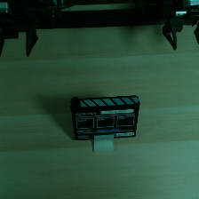 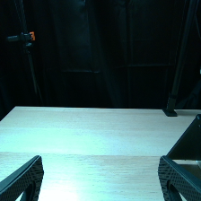 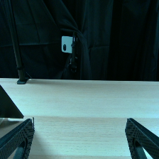

</details>

**Turn 1**

The clapperboard sits mid-table with its striped clapper stick visible; both arms are folded flat. I'm raising the right arm (shoulder up, elbow half-open) as a calibration move to learn which way the elbow bends and which gripper in the top view is the right arm.

`move_joints`
````json
{
  "targets": {
    "right_j1": 1.57,
    "right_j2": 1.57,
    "right_j3": 0.0
  }
}
````

*executing move_joints over 25 steps (2.5s)*

<details open>
<summary>Observation 2</summary>

````text
Current observation.
Instruction: Lift the clapper stick, then let go so it snaps shut with a clap. Note that the context (top) cam is on the opposite sides of the arms.
state[joint_pos]: left_j0=0.0059 left_j1=0.0082 left_j2=0.0067 left_j3=-0.041 left_j4=-0.0086 left_j5=-0.0166 left_gripper=0.9968 right_j0=-0.0002 right_j1=1.5627 right_j2=1.5402 right_j3=-0.0227 right_j4=-0.0132 right_j5=-0.012 right_gripper=0.9995

camera 'top_cam' (step 25):

[image omitted: streamed camera frame]

camera 'left_cam' (step 25):

[image omitted: streamed camera frame]

camera 'right_cam' (step 25):

[image omitted: streamed camera frame]
````

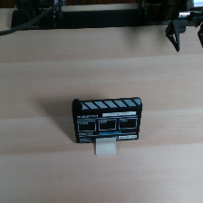 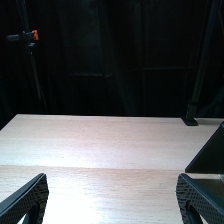 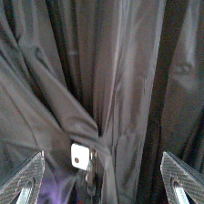

</details>

**Turn 2**

The right wrist camera now looks forward at the curtain, confirming the elbow opens with the forearm pointing forward. I'm pitching the wrist down ~69° so the wrist camera looks at the table and I can locate the clapperboard relative to the right arm.

`move_joints`
````json
{
  "targets": {
    "right_j3": -1.2
  }
}
````

*executing move_joints over 19 steps (1.9s)*

<details open>
<summary>Observation 3</summary>

````text
Current observation.
Instruction: Lift the clapper stick, then let go so it snaps shut with a clap. Note that the context (top) cam is on the opposite sides of the arms.
state[joint_pos]: left_j0=0.0059 left_j1=0.0082 left_j2=0.0067 left_j3=-0.0486 left_j4=-0.0086 left_j5=-0.0166 left_gripper=0.9967 right_j0=-0.0006 right_j1=1.5688 right_j2=1.5414 right_j3=-1.1709 right_j4=-0.0158 right_j5=-0.012 right_gripper=0.9995

camera 'top_cam' (step 44):

[image omitted: streamed camera frame]

camera 'left_cam' (step 44):

[image omitted: streamed camera frame]

camera 'right_cam' (step 44):

[image omitted: streamed camera frame]
````

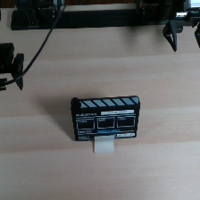 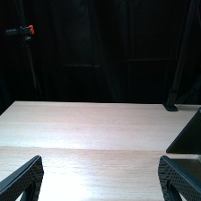 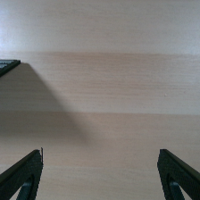

</details>

**Turn 3**

The right wrist camera sees only bare table, so the clapperboard is not directly ahead of the right arm. I'm raising the wrist pitch to widen the view further out across the table before deciding which way to yaw.

`move_joints`
````json
{
  "targets": {
    "right_j3": -0.65
  }
}
````

*executing move_joints over 9 steps (0.9s)*

<details open>
<summary>Observation 4</summary>

````text
Current observation.
Instruction: Lift the clapper stick, then let go so it snaps shut with a clap. Note that the context (top) cam is on the opposite sides of the arms.
state[joint_pos]: left_j0=0.0059 left_j1=0.0082 left_j2=0.0067 left_j3=-0.049 left_j4=-0.0086 left_j5=-0.0166 left_gripper=0.9967 right_j0=-0.0002 right_j1=1.5688 right_j2=1.5414 right_j3=-0.6987 right_j4=-0.0162 right_j5=-0.0124 right_gripper=0.9994

camera 'top_cam' (step 53):

[image omitted: streamed camera frame]

camera 'left_cam' (step 53):

[image omitted: streamed camera frame]

camera 'right_cam' (step 53):

[image omitted: streamed camera frame]
````

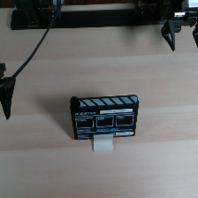 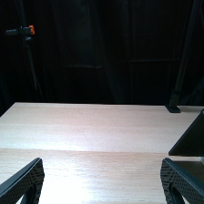 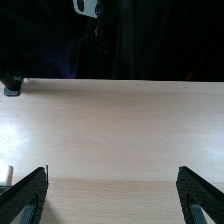

</details>

**Turn 4**

Pitched up too far — the right wrist camera now looks past the far edge of the table and still no clapperboard, so the board must be closer to the arms. I'm pitching the wrist nearly straight down to inspect the near table region.

`move_joints`
````json
{
  "targets": {
    "right_j3": -1.5
  }
}
````

*executing move_joints over 13 steps (1.3s)*

<details open>
<summary>Observation 5</summary>

````text
Current observation.
Instruction: Lift the clapper stick, then let go so it snaps shut with a clap. Note that the context (top) cam is on the opposite sides of the arms.
state[joint_pos]: left_j0=0.0059 left_j1=0.0082 left_j2=0.0067 left_j3=-0.0494 left_j4=-0.0086 left_j5=-0.0166 left_gripper=0.9967 right_j0=-0.0002 right_j1=1.5692 right_j2=1.5414 right_j3=-1.47 right_j4=-0.0158 right_j5=-0.012 right_gripper=0.9995

camera 'top_cam' (step 66):

[image omitted: streamed camera frame]

camera 'left_cam' (step 66):

[image omitted: streamed camera frame]

camera 'right_cam' (step 66):

[image omitted: streamed camera frame]
````

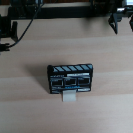 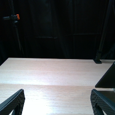 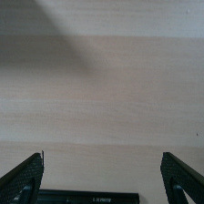

</details>

**Turn 5**

The right arm's camera sees only empty table in front of it, so the clapperboard must sit toward the other side. I'm raising the left arm into the same look-down pose to survey the table in front of it.

`move_joints`
````json
{
  "targets": {
    "left_j1": 1.57,
    "left_j2": 1.57,
    "left_j3": -1.2
  }
}
````

*executing move_joints over 25 steps (2.5s)*

<details open>
<summary>Observation 6</summary>

````text
Current observation.
Instruction: Lift the clapper stick, then let go so it snaps shut with a clap. Note that the context (top) cam is on the opposite sides of the arms.
state[joint_pos]: left_j0=0.0063 left_j1=1.5677 left_j2=1.541 left_j3=-1.1717 left_j4=-0.0082 left_j5=-0.0208 left_gripper=0.9966 right_j0=-0.0002 right_j1=1.5692 right_j2=1.5414 right_j3=-1.4826 right_j4=-0.0158 right_j5=-0.012 right_gripper=0.9995

camera 'top_cam' (step 91):

[image omitted: streamed camera frame]

camera 'left_cam' (step 91):

[image omitted: streamed camera frame]

camera 'right_cam' (step 91):

[image omitted: streamed camera frame]
````

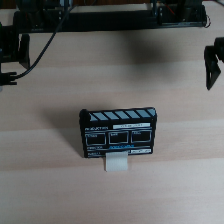 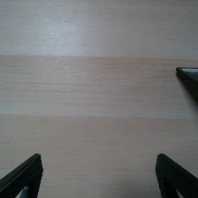 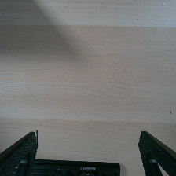

</details>

**Turn 6**

Neither wrist camera sees the clapperboard, so it is probably in the gap between the two arms. I'm yawing the right arm toward the robot's left (toward the midline) to look into that gap.

`move_joints`
````json
{
  "targets": {
    "right_j0": 0.55,
    "right_j3": -1.3
  }
}
````

*executing move_joints over 9 steps (0.9s)*

<details open>
<summary>Observation 7</summary>

````text
Current observation.
Instruction: Lift the clapper stick, then let go so it snaps shut with a clap. Note that the context (top) cam is on the opposite sides of the arms.
state[joint_pos]: left_j0=0.0059 left_j1=1.573 left_j2=1.5425 left_j3=-1.1919 left_j4=-0.0082 left_j5=-0.0204 left_gripper=0.9966 right_j0=0.5373 right_j1=1.5692 right_j2=1.5414 right_j3=-1.3273 right_j4=-0.0166 right_j5=-0.012 right_gripper=0.9995

camera 'top_cam' (step 100):

[image omitted: streamed camera frame]

camera 'left_cam' (step 100):

[image omitted: streamed camera frame]

camera 'right_cam' (step 100):

[image omitted: streamed camera frame]
````

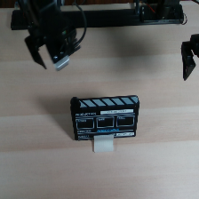 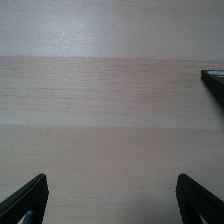 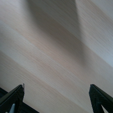

</details>

**Turn 7**

In the top view the right arm's gripper is at upper-left and the clapperboard lies further out and toward the robot's left, so I'm extending the right arm forward (shoulder and elbow pitched over) while keeping a modest inward yaw to bring the board into the wrist camera.

`move_joints`
````json
{
  "targets": {
    "right_j0": 0.45,
    "right_j1": 2.0,
    "right_j2": 2.0,
    "right_j3": -1.3
  }
}
````

*executing move_joints over 8 steps (0.8s)*

<details open>
<summary>Observation 8</summary>

````text
Current observation.
Instruction: Lift the clapper stick, then let go so it snaps shut with a clap. Note that the context (top) cam is on the opposite sides of the arms.
state[joint_pos]: left_j0=0.0059 left_j1=1.573 left_j2=1.5425 left_j3=-1.1938 left_j4=-0.0078 left_j5=-0.0208 left_gripper=0.9964 right_j0=0.4545 right_j1=1.9961 right_j2=1.9713 right_j3=-1.3201 right_j4=-0.02 right_j5=-0.012 right_gripper=0.9995

camera 'top_cam' (step 108):

[image omitted: streamed camera frame]

camera 'left_cam' (step 108):

[image omitted: streamed camera frame]

camera 'right_cam' (step 108):

[image omitted: streamed camera frame]
````

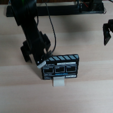 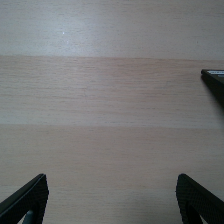 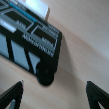

</details>

**Turn 8**

The right wrist camera now sees the clapperboard, but it sits to the upper-left of the view (i.e. to the arm's left and slightly closer in). I'm yawing the right arm further left to bring the striped clapper stick toward the center of the wrist view.

`move_joints`
````json
{
  "targets": {
    "right_j0": 0.78
  }
}
````

*executing move_joints over 6 steps (0.6s)*

<details open>
<summary>Observation 9</summary>

````text
Current observation.
Instruction: Lift the clapper stick, then let go so it snaps shut with a clap. Note that the context (top) cam is on the opposite sides of the arms.
state[joint_pos]: left_j0=0.0059 left_j1=1.573 left_j2=1.5425 left_j3=-1.1938 left_j4=-0.0078 left_j5=-0.0208 left_gripper=0.9963 right_j0=0.7631 right_j1=2.0041 right_j2=1.9709 right_j3=-1.3212 right_j4=-0.0166 right_j5=-0.012 right_gripper=0.9995

camera 'top_cam' (step 114):

[image omitted: streamed camera frame]

camera 'left_cam' (step 114):

[image omitted: streamed camera frame]

camera 'right_cam' (step 114):

[image omitted: streamed camera frame]
````

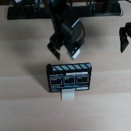  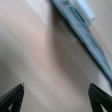

</details>

**Turn 9**

From the top view the right gripper (the black finger protruding at image top-center) is still short of the clapperboard, which lies further out; the wrist camera lost the board when I yawed. I'm extending the right arm further forward at the same yaw so the gripper approaches the striped clapper stick along the board's near edge.

`move_joints`
````json
{
  "targets": {
    "right_j1": 2.384,
    "right_j2": 2.557,
    "right_j3": -1.482
  }
}
````

*executing move_joints over 10 steps (1.0s)*

<details open>
<summary>Observation 10</summary>

````text
Current observation.
Instruction: Lift the clapper stick, then let go so it snaps shut with a clap. Note that the context (top) cam is on the opposite sides of the arms.
state[joint_pos]: left_j0=0.0063 left_j1=1.573 left_j2=1.5425 left_j3=-1.1969 left_j4=-0.0082 left_j5=-0.0208 left_gripper=0.9963 right_j0=0.7639 right_j1=2.3718 right_j2=2.5271 right_j3=-1.4868 right_j4=-0.0231 right_j5=-0.012 right_gripper=0.9995

camera 'top_cam' (step 124):

[image omitted: streamed camera frame]

camera 'left_cam' (step 124):

[image omitted: streamed camera frame]

camera 'right_cam' (step 124):

[image omitted: streamed camera frame]
````

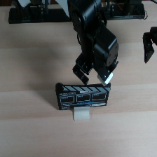 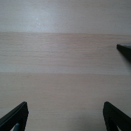 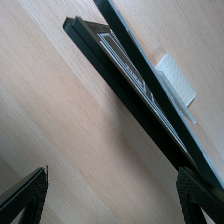

</details>

**Turn 10**

The wrist camera now shows the dark edge of the clapperboard right in front of the fingers, and the top view shows the gripper hovering just short of the striped clapper stick. I'm reaching a few cm further out and rolling the wrist ~47° so the jaws will straddle across the stick rather than along it.

`move_joints`
````json
{
  "targets": {
    "right_j0": 0.784,
    "right_j1": 2.37,
    "right_j2": 2.492,
    "right_j3": -1.344,
    "right_j5": -0.82
  }
}
````

*executing move_joints over 13 steps (1.3s)*

<details open>
<summary>Observation 11</summary>

````text
Current observation.
Instruction: Lift the clapper stick, then let go so it snaps shut with a clap. Note that the context (top) cam is on the opposite sides of the arms.
state[joint_pos]: left_j0=0.0059 left_j1=1.573 left_j2=1.5425 left_j3=-1.1976 left_j4=-0.0078 left_j5=-0.0208 left_gripper=0.9963 right_j0=0.7822 right_j1=2.3737 right_j2=2.4962 right_j3=-1.3674 right_j4=-0.0231 right_j5=-0.7921 right_gripper=0.9994

camera 'top_cam' (step 137):

[image omitted: streamed camera frame]

camera 'left_cam' (step 137):

[image omitted: streamed camera frame]

camera 'right_cam' (step 137):

[image omitted: streamed camera frame]
````

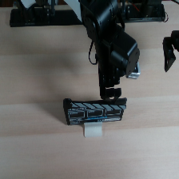 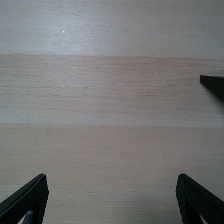 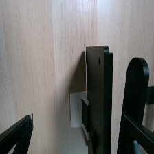

</details>

**Turn 11**

Top view shows the open gripper hovering right over the near (striped) edge of the clapperboard. I'm lowering the tool about 4 cm straight down to bring the jaws around the clapper stick.

`move_joints`
````json
{
  "targets": {
    "right_j1": 2.361,
    "right_j2": 2.328,
    "right_j3": -1.189
  }
}
````

*executing move_joints over 3 steps (0.3s)*

<details open>
<summary>Observation 12</summary>

````text
Current observation.
Instruction: Lift the clapper stick, then let go so it snaps shut with a clap. Note that the context (top) cam is on the opposite sides of the arms.
state[joint_pos]: left_j0=0.0059 left_j1=1.573 left_j2=1.5425 left_j3=-1.2007 left_j4=-0.0082 left_j5=-0.0204 left_gripper=0.9963 right_j0=0.7834 right_j1=2.3684 right_j2=2.3367 right_j3=-1.2186 right_j4=-0.0196 right_j5=-0.8043 right_gripper=0.9994

camera 'top_cam' (step 140):

[image omitted: streamed camera frame]

camera 'left_cam' (step 140):

[image omitted: streamed camera frame]

camera 'right_cam' (step 140):

[image omitted: streamed camera frame]
````

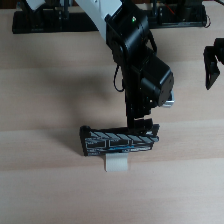 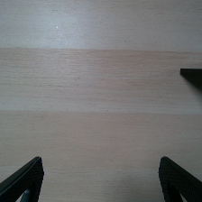 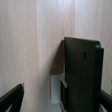

</details>

**Turn 12**

The gripper is directly over the striped clapper stick but still above it; the wrist camera shows the dark board bulk beside the fingers. I'm descending another ~3.5 cm to bring the open jaws down around the stick.

`move_joints`
````json
{
  "targets": {
    "right_j1": 2.378,
    "right_j2": 2.217,
    "right_j3": -1.061
  }
}
````

*executing move_joints over 3 steps (0.3s)*

<details open>
<summary>Observation 13</summary>

````text
Current observation.
Instruction: Lift the clapper stick, then let go so it snaps shut with a clap. Note that the context (top) cam is on the opposite sides of the arms.
state[joint_pos]: left_j0=0.0059 left_j1=1.573 left_j2=1.5425 left_j3=-1.2011 left_j4=-0.0082 left_j5=-0.0208 left_gripper=0.9963 right_j0=0.7837 right_j1=2.3657 right_j2=2.2436 right_j3=-1.0874 right_j4=-0.012 right_j5=-0.8051 right_gripper=0.9994

camera 'top_cam' (step 143):

[image omitted: streamed camera frame]

camera 'left_cam' (step 143):

[image omitted: streamed camera frame]

camera 'right_cam' (step 143):

[image omitted: streamed camera frame]
````

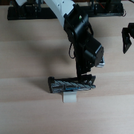 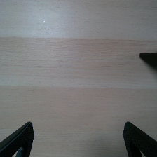 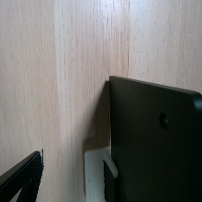

</details>

**Turn 13**

Still hovering above the board — no contact visible yet. Continuing a careful ~3 cm descent toward the clapper stick.

`move_joints`
````json
{
  "targets": {
    "right_j1": 2.393,
    "right_j2": 2.158,
    "right_j3": -0.975
  }
}
````

*executing move_joints over 2 steps (0.2s)*

<details open>
<summary>Observation 14</summary>

````text
Current observation.
Instruction: Lift the clapper stick, then let go so it snaps shut with a clap. Note that the context (top) cam is on the opposite sides of the arms.
state[joint_pos]: left_j0=0.0059 left_j1=1.573 left_j2=1.5425 left_j3=-1.2015 left_j4=-0.0082 left_j5=-0.0208 left_gripper=0.9963 right_j0=0.7834 right_j1=2.3657 right_j2=2.1845 right_j3=-0.9977 right_j4=-0.0032 right_j5=-0.8127 right_gripper=0.9994

camera 'top_cam' (step 145):

[image omitted: streamed camera frame]

camera 'left_cam' (step 145):

[image omitted: streamed camera frame]

camera 'right_cam' (step 145):

[image omitted: streamed camera frame]
````

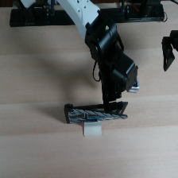  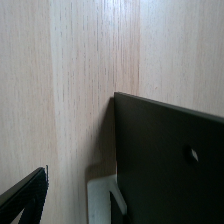

</details>

**Turn 14**

The fingers are now reaching down alongside the board's near edge; still no contact. Lowering another ~2.5 cm so the open jaws bracket the clapper stick at table level.

`move_joints`
````json
{
  "targets": {
    "right_j1": 2.423,
    "right_j2": 2.11,
    "right_j3": -0.896
  }
}
````

*executing move_joints over 2 steps (0.2s)*

<details open>
<summary>Observation 15</summary>

````text
Current observation.
Instruction: Lift the clapper stick, then let go so it snaps shut with a clap. Note that the context (top) cam is on the opposite sides of the arms.
state[joint_pos]: left_j0=0.0059 left_j1=1.573 left_j2=1.5425 left_j3=-1.2015 left_j4=-0.0082 left_j5=-0.0204 left_gripper=0.9963 right_j0=0.7902 right_j1=2.368 right_j2=2.1357 right_j3=-0.8898 right_j4=0.0219 right_j5=-0.8238 right_gripper=0.9994

camera 'top_cam' (step 147):

[image omitted: streamed camera frame]

camera 'left_cam' (step 147):

[image omitted: streamed camera frame]

camera 'right_cam' (step 147):

[image omitted: streamed camera frame]
````

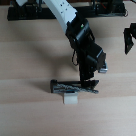 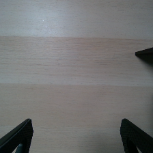 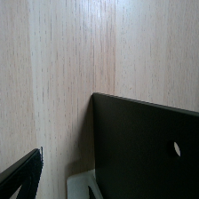

</details>

**Turn 15**

Top view shows the jaws right at the far end of the striped clapper stick, possibly just past it. I'm shifting ~3 cm back along the stick (toward the robot's right) and dropping another 1.5 cm so the jaws sit around the stick rather than off its end.

`move_joints`
````json
{
  "targets": {
    "right_j0": 0.735,
    "right_j1": 2.445,
    "right_j2": 2.086,
    "right_j3": -0.851
  }
}
````

*executing move_joints over 2 steps (0.2s)*

<details open>
<summary>Observation 16</summary>

````text
Current observation.
Instruction: Lift the clapper stick, then let go so it snaps shut with a clap. Note that the context (top) cam is on the opposite sides of the arms.
state[joint_pos]: left_j0=0.0059 left_j1=1.573 left_j2=1.5425 left_j3=-1.2015 left_j4=-0.0082 left_j5=-0.0204 left_gripper=0.9963 right_j0=0.7609 right_j1=2.3772 right_j2=2.1208 right_j3=-0.8036 right_j4=0.033 right_j5=-0.8501 right_gripper=0.9994

camera 'top_cam' (step 149):

[image omitted: streamed camera frame]

camera 'left_cam' (step 149):

[image omitted: streamed camera frame]

camera 'right_cam' (step 149):

[image omitted: streamed camera frame]
````

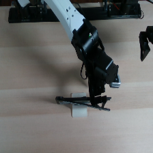 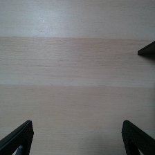 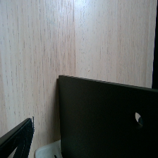

</details>

**Turn 16**

The arm stopped slightly short of the commanded pose, which suggests the fingers are in contact with the board/stick. Closing the jaws to see whether the clapper stick is captured between them.

`move_joints`
````json
{
  "targets": {
    "right_gripper": 0.12
  }
}
````

*executing move_joints over 9 steps (0.9s)*

<details open>
<summary>Observation 17</summary>

````text
Current observation.
Instruction: Lift the clapper stick, then let go so it snaps shut with a clap. Note that the context (top) cam is on the opposite sides of the arms.
state[joint_pos]: left_j0=0.0059 left_j1=1.573 left_j2=1.5425 left_j3=-1.2079 left_j4=-0.0082 left_j5=-0.0204 left_gripper=0.9963 right_j0=0.7742 right_j1=2.3589 right_j2=2.1342 right_j3=-0.8257 right_j4=0.0071 right_j5=-0.8307 right_gripper=0.1274

camera 'top_cam' (step 158):

[image omitted: streamed camera frame]

camera 'left_cam' (step 158):

[image omitted: streamed camera frame]

camera 'right_cam' (step 158):

[image omitted: streamed camera frame]
````

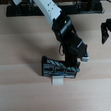 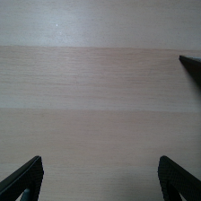 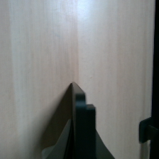

</details>

**Turn 17**

Jaws are now closed at the board's near edge. Lifting the wrist ~6 cm to see whether the clapper stick has been captured and rises with the gripper.

`move_joints`
````json
{
  "targets": {
    "right_j1": 2.323,
    "right_j2": 2.315,
    "right_j3": -1.042
  }
}
````

*executing move_joints over 4 steps (0.4s)*

<details open>
<summary>Observation 18</summary>

````text
Current observation.
Instruction: Lift the clapper stick, then let go so it snaps shut with a clap. Note that the context (top) cam is on the opposite sides of the arms.
state[joint_pos]: left_j0=0.0059 left_j1=1.573 left_j2=1.5425 left_j3=-1.2091 left_j4=-0.0082 left_j5=-0.0204 left_gripper=0.9963 right_j0=0.7742 right_j1=2.3589 right_j2=2.2543 right_j3=-1.0241 right_j4=0.0067 right_j5=-0.831 right_gripper=0.1277

camera 'top_cam' (step 162):

[image omitted: streamed camera frame]

camera 'left_cam' (step 162):

[image omitted: streamed camera frame]

camera 'right_cam' (step 162):

[image omitted: streamed camera frame]
````

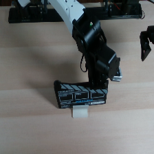  

</details>

**Turn 18**

The lift grabbed nothing — the board is untouched. I'm backing the gripper up and away (wrist roll reset to zero so the camera image is upright) to get a clean overhead look at the clapperboard and judge its true height and the stick's position.

`move_joints`
````json
{
  "targets": {
    "right_j1": 2.273,
    "right_j2": 2.426,
    "right_j3": -1.2,
    "right_j5": 0.0,
    "right_gripper": 1.0
  }
}
````

*executing move_joints over 14 steps (1.4s)*

<details open>
<summary>Observation 19</summary>

````text
Current observation.
Instruction: Lift the clapper stick, then let go so it snaps shut with a clap. Note that the context (top) cam is on the opposite sides of the arms.
state[joint_pos]: left_j0=0.0059 left_j1=1.573 left_j2=1.5425 left_j3=-1.2091 left_j4=-0.0082 left_j5=-0.0208 left_gripper=0.9963 right_j0=0.7769 right_j1=2.3295 right_j2=2.3928 right_j3=-1.2003 right_j4=0.0025 right_j5=-0.094 right_gripper=0.997

camera 'top_cam' (step 176):

[image omitted: streamed camera frame]

camera 'left_cam' (step 176):

[image omitted: streamed camera frame]

camera 'right_cam' (step 176):

[image omitted: streamed camera frame]
````

  

</details>

**Turn 19**

The wrist camera now clearly shows both open fingers and a white object lying between/below them. I'm making a deliberate 0.15 rad yaw to the arm's left as a calibration move, to see exactly which way the scene shifts in the wrist image.

`move_joints`
````json
{
  "targets": {
    "right_j0": 0.93
  }
}
````

*executing move_joints over 3 steps (0.3s)*

<details open>
<summary>Observation 20</summary>

````text
Current observation.
Instruction: Lift the clapper stick, then let go so it snaps shut with a clap. Note that the context (top) cam is on the opposite sides of the arms.
state[joint_pos]: left_j0=0.0059 left_j1=1.573 left_j2=1.5425 left_j3=-1.2095 left_j4=-0.0082 left_j5=-0.0208 left_gripper=0.9963 right_j0=0.8822 right_j1=2.3199 right_j2=2.3959 right_j3=-1.2144 right_j4=0.0128 right_j5=-0.0715 right_gripper=0.9974

camera 'top_cam' (step 179):

[image omitted: streamed camera frame]

camera 'left_cam' (step 179):

[image omitted: streamed camera frame]

camera 'right_cam' (step 179):

[image omitted: streamed camera frame]
````

  

</details>

**Turn 20**

The calibration move let me scale the top view: the gripper is currently about 11 cm to the robot's left of the striped clapper stick. I'm shifting the gripper back to the right and over the middle of the stick, holding a safe height, with the wrist rolled so the jaws close across the stick.

`move_joints`
````json
{
  "targets": {
    "right_j0": 0.704,
    "right_j1": 2.261,
    "right_j2": 2.244,
    "right_j3": -1.379,
    "right_j5": -0.868
  }
}
````

*executing move_joints over 13 steps (1.3s)*

<details open>
<summary>Observation 21</summary>

````text
Current observation.
Instruction: Lift the clapper stick, then let go so it snaps shut with a clap. Note that the context (top) cam is on the opposite sides of the arms.
state[joint_pos]: left_j0=0.0059 left_j1=1.573 left_j2=1.5425 left_j3=-1.2095 left_j4=-0.0082 left_j5=-0.0208 left_gripper=0.9963 right_j0=0.7155 right_j1=2.3074 right_j2=2.2513 right_j3=-1.3689 right_j4=0.0063 right_j5=-0.7933 right_gripper=0.9974

camera 'top_cam' (step 192):

[image omitted: streamed camera frame]

camera 'left_cam' (step 192):

[image omitted: streamed camera frame]

camera 'right_cam' (step 192):

[image omitted: streamed camera frame]
````

  

</details>

**Turn 21**

Top view shows the open jaws now lined up directly over the striped clapper stick, just a few cm above it. Descending ~3 cm to bring the stick between the fingers.

`move_joints`
````json
{
  "targets": {
    "right_j1": 2.324,
    "right_j2": 2.154,
    "right_j3": -1.255
  }
}
````

*executing move_joints over 2 steps (0.2s)*

<details open>
<summary>Observation 22</summary>

````text
Current observation.
Instruction: Lift the clapper stick, then let go so it snaps shut with a clap. Note that the context (top) cam is on the opposite sides of the arms.
state[joint_pos]: left_j0=0.0059 left_j1=1.573 left_j2=1.5425 left_j3=-1.2102 left_j4=-0.0082 left_j5=-0.0208 left_gripper=0.9963 right_j0=0.7116 right_j1=2.3028 right_j2=2.1891 right_j3=-1.3258 right_j4=0.0051 right_j5=-0.8307 right_gripper=0.9974

camera 'top_cam' (step 194):

[image omitted: streamed camera frame]

camera 'left_cam' (step 194):

[image omitted: streamed camera frame]

camera 'right_cam' (step 194):

[image omitted: streamed camera frame]
````

  

</details>

**Turn 22**

The arm is tracking a bit behind my commands, so it has only dropped ~1.5 cm. Commanding a further ~5 cm descent so the jaws come down around the striped clapper stick.

`move_joints`
````json
{
  "targets": {
    "right_j1": 2.369,
    "right_j2": 2.111,
    "right_j3": -1.182
  }
}
````

*executing move_joints over 3 steps (0.3s)*

<details open>
<summary>Observation 23</summary>

````text
Current observation.
Instruction: Lift the clapper stick, then let go so it snaps shut with a clap. Note that the context (top) cam is on the opposite sides of the arms.
state[joint_pos]: left_j0=0.0059 left_j1=1.573 left_j2=1.5425 left_j3=-1.2102 left_j4=-0.0082 left_j5=-0.0208 left_gripper=0.9963 right_j0=0.7208 right_j1=2.3367 right_j2=2.1296 right_j3=-1.2377 right_j4=0.0025 right_j5=-0.8234 right_gripper=0.9974

camera 'top_cam' (step 197):

[image omitted: streamed camera frame]

camera 'left_cam' (step 197):

[image omitted: streamed camera frame]

camera 'right_cam' (step 197):

[image omitted: streamed camera frame]
````

  

</details>

**Turn 23**

I can't tell the gripper fingers from the object in the cluttered top view, so I'm pulling the right arm up and off to the side for one clean, unobstructed look at the clapperboard.

`move_joints`
````json
{
  "targets": {
    "right_j0": 0.2,
    "right_j1": 1.6,
    "right_j2": 1.6,
    "right_j3": -1.0
  }
}
````

*executing move_joints over 12 steps (1.2s)*

<details open>
<summary>Observation 24</summary>

````text
Current observation.
Instruction: Lift the clapper stick, then let go so it snaps shut with a clap. Note that the context (top) cam is on the opposite sides of the arms.
state[joint_pos]: left_j0=0.0059 left_j1=1.573 left_j2=1.5425 left_j3=-1.2152 left_j4=-0.0082 left_j5=-0.0208 left_gripper=0.9963 right_j0=0.2703 right_j1=1.7084 right_j2=1.586 right_j3=-1.0443 right_j4=-0.115 right_j5=-0.8597 right_gripper=0.9974

camera 'top_cam' (step 209):

[image omitted: streamed camera frame]

camera 'left_cam' (step 209):

[image omitted: streamed camera frame]

camera 'right_cam' (step 209):

[image omitted: streamed camera frame]
````

  

</details>

**Turn 24**

Clean top view confirms a small clapperboard lying flat, dark bar toward the arms and a white tab on the far side. I'm posing the right wrist camera straight down about 35 cm above it for a high-resolution close-up before attempting the grasp.

`move_joints`
````json
{
  "targets": {
    "right_j0": 0.709,
    "right_j1": 2.564,
    "right_j2": 2.8,
    "right_j3": -1.806,
    "right_j5": 0.0
  }
}
````

*executing move_joints over 20 steps (2.0s)*

<details open>
<summary>Observation 25</summary>

````text
Current observation.
Instruction: Lift the clapper stick, then let go so it snaps shut with a clap. Note that the context (top) cam is on the opposite sides of the arms.
state[joint_pos]: left_j0=0.0059 left_j1=1.5764 left_j2=1.5421 left_j3=-1.2266 left_j4=-0.0078 left_j5=-0.0208 left_gripper=0.9963 right_j0=0.7002 right_j1=2.5462 right_j2=2.7686 right_j3=-1.6928 right_j4=-0.1066 right_j5=-0.0654 right_gripper=0.9974

camera 'top_cam' (step 229):

[image omitted: streamed camera frame]

camera 'left_cam' (step 229):

[image omitted: streamed camera frame]

camera 'right_cam' (step 229):

[image omitted: streamed camera frame]
````

  

</details>

**Turn 25**

The wrist camera is now right above the clapperboard and I can see the slate's white label boxes and a striped white element (the clapper stick) toward the top-right of the frame. Making a known 0.15 rad yaw so I can read off exactly how image directions map to arm motion.

`move_joints`
````json
{
  "targets": {
    "right_j0": 0.85
  }
}
````

*executing move_joints over 3 steps (0.3s)*

<details open>
<summary>Observation 26</summary>

````text
Current observation.
Instruction: Lift the clapper stick, then let go so it snaps shut with a clap. Note that the context (top) cam is on the opposite sides of the arms.
state[joint_pos]: left_j0=0.0059 left_j1=1.5764 left_j2=1.5417 left_j3=-1.2278 left_j4=-0.0082 left_j5=-0.0208 left_gripper=0.9963 right_j0=0.7921 right_j1=2.5622 right_j2=2.7754 right_j3=-1.6768 right_j4=-0.0555 right_j5=-0.0608 right_gripper=0.9974

camera 'top_cam' (step 232):

[image omitted: streamed camera frame]

camera 'left_cam' (step 232):

[image omitted: streamed camera frame]

camera 'right_cam' (step 232):

[image omitted: streamed camera frame]
````

  

</details>

**Turn 26**

Image directions are still ambiguous, so I'm lowering the whole hand ~4 cm to bring the gripper's own fingers into the wrist camera frame alongside the clapperboard — then alignment can be judged directly.

`move_joints`
````json
{
  "targets": {
    "right_j1": 2.525,
    "right_j2": 2.558,
    "right_j3": -1.497
  }
}
````

*executing move_joints over 4 steps (0.4s)*

[Back to index](README.md)
