# Run opus-early: 20260731_005105_0cef4e6e

> Lift the clapper stick, then let go so it snaps shut with a clap. Note that the context (top) cam is on the opposite sides of the arms.

| | |
|---|---|
| Created (UTC) | 2026-07-31 00:51:05 |
| Model | claude-opus-5 |
| Effort | high |
| Embodiment | yam_arms |
| Status | success |
| Outcome | pass |
| Termination | operator_end |
| Operator judgement | y |
| Duration | 17:21 |
| Steps | 559 |
| LLM turns | 65 |
| Seed | 0 |
| inspect-robots | 0.32.0 |
| Git commit | n/a |

Files: [raw EvalLog](../adhoc_00efecfc.json) · [top video](../videos/20260731_005105_0cef4e6e/scene-0-e0_top_cam.mp4) · [left video](../videos/20260731_005105_0cef4e6e/scene-0-e0_left_cam.mp4) · [right video](../videos/20260731_005105_0cef4e6e/scene-0-e0_right_cam.mp4) · [transcript jsonl](../transcripts/20260731_005105_0cef4e6e) · [wire capture](../wire/20260731_005105_0cef4e6e)

## Transcript

<details>
<summary>System prompt</summary>

````text
You are controlling a real robot embodiment named 'yam_arms' through tool calls. Each observation message gives you the current proprioceptive state and camera images. Work toward the user's goal in small, deliberate motions; re-check the observation after every motion. Every move tool call must include a `note`: in one or two sentences, say what you observe in the current observation and why you chose this motion. The user is watching these notes to see what you see and what you decide, so write them for a human reader. Safety approvers clamp out-of-bounds and too-fast actions below you. Respond with exactly one tool call per turn. When the goal is achieved call done; if it cannot be achieved call give_up. You have a budget of 200 LLM calls for the whole trial.

Embodiment notes:
Two identical 6-DoF arms, prefixed left_ and right_, each with a parallel-jaw
gripper. Each arm has its own base frame: +x points forward out of the base
(the direction the folded gripper points at all-zero joints), +y left, +z up;
how the two bases are mounted relative to each other depends on the rig.
Joint guide (positive direction, identical for both arms):
- left_j0 / right_j0: base yaw about the vertical axis; positive swings the
  arm counterclockwise seen from above (a forward-pointing gripper moves
  toward +y).
- left_j1 / right_j1: shoulder pitch; 0 points the upper arm horizontally
  backward and is the lower hard stop (it cannot go negative), positive
  raises it (about 1.57 is straight up, about 3.14 is horizontal forward).
- left_j2 / right_j2: elbow; 0 is fully folded with the forearm doubled back
  against the upper arm and is the lower hard stop, positive opens it.
- left_j3 / right_j3: wrist pitch, axis parallel to the elbow; positive tilts
  the gripper up.
- left_j4 / right_j4: wrist yaw; positive swings the gripper toward the arm's
  right seen from above (opposite sign sense of j0).
- left_j5 / right_j5: wrist roll about the gripper's pointing axis; positive
  turns clockwise when viewed from behind the gripper looking out along the
  fingers.
- left_gripper / right_gripper: 0 is fully closed, 1 is fully open (about
  9.5 cm between the jaws).
Proportions: upper arm 0.26 m, forearm 0.25 m, wrist to grasp point 0.25 m
when straight; reach from the shoulder about 0.76 m.
At all-zero joints the arm rests folded low with the gripper pointing
forward. While the arm is folded, a single joint's effect on the gripper
position can be counterintuitive; move deliberately and re-check the
observation after each motion. The joint values above are positions as shown
in the observation; when actions are per-step changes (delta mode), the same
sign conventions apply to each change.
````

</details>

> Goal: Lift the clapper stick, then let go so it snaps shut with a clap. Note that the context (top) cam is on the opposite sides of the arms.

<details open>
<summary>Observation 1</summary>

````text
Current observation.
Instruction: Lift the clapper stick, then let go so it snaps shut with a clap. Note that the context (top) cam is on the opposite sides of the arms.
state[joint_pos]: left_j0=-0.0059 left_j1=0.0051 left_j2=0.0067 left_j3=-0.0227 left_j4=-0.0067 left_j5=0.0025 left_gripper=0.9988 right_j0=-0.0021 right_j1=0.0025 right_j2=0.0063 right_j3=-0.0292 right_j4=-0.0006 right_j5=-0.0154 right_gripper=0.9994

camera 'top_cam' (step 0):

[image omitted: streamed camera frame]

camera 'left_cam' (step 0):

[image omitted: streamed camera frame]

camera 'right_cam' (step 0):

[image omitted: streamed camera frame]
````

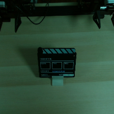 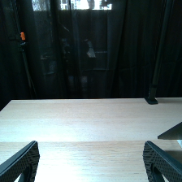 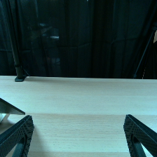

</details>

**Turn 1**

The clapperboard lies flat mid-table with its striped clapper stick on the edge nearest the arms. I'm raising the right arm into an approach pose ~20 cm above the table, gripper pointing forward-down at 45° and wrist rolled 90° so the jaws straddle the stick front-to-back.

`move_joints`
````json
{
  "targets": {
    "right_j0": 0,
    "right_j1": 1.78,
    "right_j2": 2.29,
    "right_j3": -1.3,
    "right_j4": 0,
    "right_j5": 1.57,
    "right_gripper": 1
  }
}
````

*executing move_joints over 37 steps (3.7s)*

<details open>
<summary>Observation 2</summary>

````text
Current observation.
Instruction: Lift the clapper stick, then let go so it snaps shut with a clap. Note that the context (top) cam is on the opposite sides of the arms.
state[joint_pos]: left_j0=-0.0067 left_j1=0.0071 left_j2=0.0067 left_j3=-0.0257 left_j4=-0.0074 left_j5=0.0002 left_gripper=0.9987 right_j0=-0.0021 right_j1=1.7805 right_j2=2.2658 right_j3=-1.3212 right_j4=-0.0013 right_j5=1.5417 right_gripper=0.9994

camera 'top_cam' (step 37):

[image omitted: streamed camera frame]

camera 'left_cam' (step 37):

[image omitted: streamed camera frame]

camera 'right_cam' (step 37):

[image omitted: streamed camera frame]
````

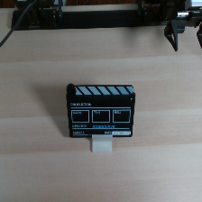  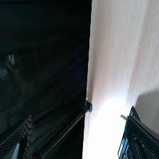

</details>

**Turn 2**

The right wrist camera (rolled 90° by j5) shows mostly the far table edge and dark background, so the gripper is aimed too high to see the clapperboard. I'm pitching the wrist down further to bring the board into view.

`move_joints`
````json
{
  "targets": {
    "right_j3": -2.1
  }
}
````

*executing move_joints over 13 steps (1.3s)*

<details open>
<summary>Observation 3</summary>

````text
Current observation.
Instruction: Lift the clapper stick, then let go so it snaps shut with a clap. Note that the context (top) cam is on the opposite sides of the arms.
state[joint_pos]: left_j0=-0.0067 left_j1=0.0071 left_j2=0.0067 left_j3=-0.0257 left_j4=-0.0071 left_j5=0.0002 left_gripper=0.9986 right_j0=-0.0021 right_j1=1.7805 right_j2=2.2654 right_j3=-1.6958 right_j4=-0.0013 right_j5=1.5455 right_gripper=0.9994

camera 'top_cam' (step 50):

[image omitted: streamed camera frame]

camera 'left_cam' (step 50):

[image omitted: streamed camera frame]

camera 'right_cam' (step 50):

[image omitted: streamed camera frame]
````

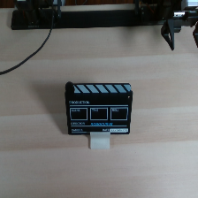  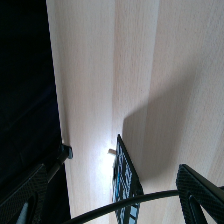

</details>

**Turn 3**

In the top view the raised right arm sits just to the left of the clapperboard (image is mirrored, so I need +j0 to swing toward it); the wrist cam still looks past the board. Pitching the wrist down more and yawing the base 0.2 rad toward the board.

`move_joints`
````json
{
  "targets": {
    "right_j3": -2.1,
    "right_j0": 0.2
  }
}
````

*executing move_joints over 7 steps (0.7s)*

<details open>
<summary>Observation 4</summary>

````text
Current observation.
Instruction: Lift the clapper stick, then let go so it snaps shut with a clap. Note that the context (top) cam is on the opposite sides of the arms.
state[joint_pos]: left_j0=-0.0071 left_j1=0.0071 left_j2=0.0067 left_j3=-0.0257 left_j4=-0.0071 left_j5=-0.0002 left_gripper=0.9983 right_j0=0.2001 right_j1=1.7805 right_j2=2.2654 right_j3=-1.6958 right_j4=-0.0048 right_j5=1.5452 right_gripper=0.9994

camera 'top_cam' (step 57):

[image omitted: streamed camera frame]

camera 'left_cam' (step 57):

[image omitted: streamed camera frame]

camera 'right_cam' (step 57):

[image omitted: streamed camera frame]
````

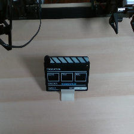  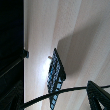

</details>

**Turn 4**

j3 seems to bottom out near -1.70, so instead I'm reshaping the arm (shoulder/elbow) to reach out ~50 cm and hover about 12 cm above the table with the gripper aimed steeply downward, which should put the clapperboard in the wrist camera.

`move_joints`
````json
{
  "targets": {
    "right_j1": 2.32,
    "right_j2": 2.96,
    "right_j3": -1.7
  }
}
````

*executing move_joints over 12 steps (1.2s)*

<details open>
<summary>Observation 5</summary>

````text
Current observation.
Instruction: Lift the clapper stick, then let go so it snaps shut with a clap. Note that the context (top) cam is on the opposite sides of the arms.
state[joint_pos]: left_j0=-0.0067 left_j1=0.0071 left_j2=0.0067 left_j3=-0.0265 left_j4=-0.0071 left_j5=-0.0006 left_gripper=0.9983 right_j0=0.2001 right_j1=2.315 right_j2=2.9311 right_j3=-1.6955 right_j4=-0.0051 right_j5=1.5448 right_gripper=0.9994

camera 'top_cam' (step 69):

[image omitted: streamed camera frame]

camera 'left_cam' (step 69):

[image omitted: streamed camera frame]

camera 'right_cam' (step 69):

[image omitted: streamed camera frame]
````

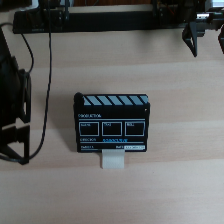  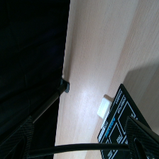

</details>

**Turn 5**

The wrist camera now catches the clapperboard in its lower-right corner and the top view shows the gripper still to the left of the board, so I'm yawing the base further (+j0) to swing the gripper over the board; this also calibrates how many pixels per radian the gripper moves.

`move_joints`
````json
{
  "targets": {
    "right_j0": 0.45
  }
}
````

*executing move_joints over 4 steps (0.4s)*

<details open>
<summary>Observation 6</summary>

````text
Current observation.
Instruction: Lift the clapper stick, then let go so it snaps shut with a clap. Note that the context (top) cam is on the opposite sides of the arms.
state[joint_pos]: left_j0=-0.0071 left_j1=0.0071 left_j2=0.0067 left_j3=-0.0261 left_j4=-0.0071 left_j5=-0.001 left_gripper=0.9982 right_j0=0.4324 right_j1=2.3257 right_j2=2.933 right_j3=-1.6955 right_j4=-0.0055 right_j5=1.5452 right_gripper=0.9994

camera 'top_cam' (step 73):

[image omitted: streamed camera frame]

camera 'left_cam' (step 73):

[image omitted: streamed camera frame]

camera 'right_cam' (step 73):

[image omitted: streamed camera frame]
````

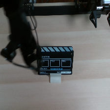  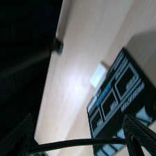

</details>

**Turn 6**

Comparing the two top views, increasing j0 moved the gripper toward the board (image right), and the board grew in the wrist view; continuing to swing right to bring the jaws over the striped clapper stick.

`move_joints`
````json
{
  "targets": {
    "right_j0": 0.62
  }
}
````

*executing move_joints over 3 steps (0.3s)*

<details open>
<summary>Observation 7</summary>

````text
Current observation.
Instruction: Lift the clapper stick, then let go so it snaps shut with a clap. Note that the context (top) cam is on the opposite sides of the arms.
state[joint_pos]: left_j0=-0.0071 left_j1=0.0071 left_j2=0.0067 left_j3=-0.0261 left_j4=-0.0071 left_j5=-0.0002 left_gripper=0.9982 right_j0=0.598 right_j1=2.3257 right_j2=2.933 right_j3=-1.6955 right_j4=-0.0093 right_j5=1.5452 right_gripper=0.9994

camera 'top_cam' (step 76):

[image omitted: streamed camera frame]

camera 'left_cam' (step 76):

[image omitted: streamed camera frame]

camera 'right_cam' (step 76):

[image omitted: streamed camera frame]
````

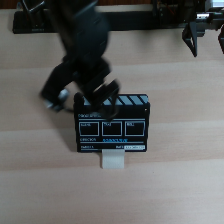  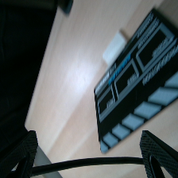

</details>

**Turn 7**

Top view shows the gripper hovering just above/behind the striped clapper stick and the wrist view has the board centred laterally, so lateral alignment looks good; I'm lowering the tool about 6 cm to close in on the stick.

`move_joints`
````json
{
  "targets": {
    "right_j1": 2.41,
    "right_j2": 2.91
  }
}
````

*executing move_joints over 2 steps (0.2s)*

<details open>
<summary>Observation 8</summary>

````text
Current observation.
Instruction: Lift the clapper stick, then let go so it snaps shut with a clap. Note that the context (top) cam is on the opposite sides of the arms.
state[joint_pos]: left_j0=-0.0071 left_j1=0.0071 left_j2=0.0067 left_j3=-0.0261 left_j4=-0.0071 left_j5=0.0002 left_gripper=0.9982 right_j0=0.5987 right_j1=2.3829 right_j2=2.9189 right_j3=-1.6955 right_j4=-0.0154 right_j5=1.5452 right_gripper=0.9994

camera 'top_cam' (step 78):

[image omitted: streamed camera frame]

camera 'left_cam' (step 78):

[image omitted: streamed camera frame]

camera 'right_cam' (step 78):

[image omitted: streamed camera frame]
````

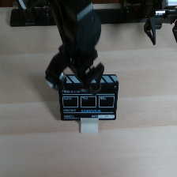  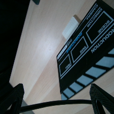

</details>

**Turn 8**

The wrist view shows the striped clapper stick at the near-left edge of the frame, meaning the gripper is a few cm beyond it and slightly to its right; retracting ~4 cm and yawing a touch further left to sit directly over the stick.

`move_joints`
````json
{
  "targets": {
    "right_j1": 2.25,
    "right_j2": 2.65,
    "right_j0": 0.66
  }
}
````

*executing move_joints over 5 steps (0.5s)*

<details open>
<summary>Observation 9</summary>

````text
Current observation.
Instruction: Lift the clapper stick, then let go so it snaps shut with a clap. Note that the context (top) cam is on the opposite sides of the arms.
state[joint_pos]: left_j0=-0.0071 left_j1=0.0071 left_j2=0.0067 left_j3=-0.0257 left_j4=-0.0071 left_j5=-0.0006 left_gripper=0.9982 right_j0=0.6582 right_j1=2.2925 right_j2=2.6537 right_j3=-1.6917 right_j4=-0.0162 right_j5=1.5455 right_gripper=0.9994

camera 'top_cam' (step 83):

[image omitted: streamed camera frame]

camera 'left_cam' (step 83):

[image omitted: streamed camera frame]

camera 'right_cam' (step 83):

[image omitted: streamed camera frame]
````

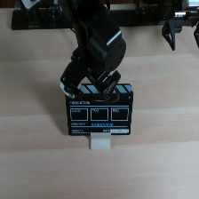  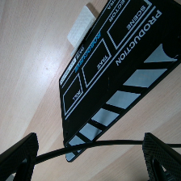

</details>

**Turn 9**

The wrist view shows the striped clapper stick running diagonally, but the jaws always close along the image-horizontal axis, so I'm rolling the wrist by the base-yaw amount (j5 1.57→2.23) to make the stick run vertically in the image, i.e. perpendicular to the jaws.

`move_joints`
````json
{
  "targets": {
    "right_j5": 2.23
  }
}
````

*executing move_joints over 11 steps (1.1s)*

<details open>
<summary>Observation 10</summary>

````text
Current observation.
Instruction: Lift the clapper stick, then let go so it snaps shut with a clap. Note that the context (top) cam is on the opposite sides of the arms.
state[joint_pos]: left_j0=-0.0071 left_j1=0.0071 left_j2=0.0067 left_j3=-0.0261 left_j4=-0.0071 left_j5=0.0002 left_gripper=0.9982 right_j0=0.6582 right_j1=2.2925 right_j2=2.6537 right_j3=-1.6913 right_j4=-0.0166 right_j5=2.1265 right_gripper=0.9994

camera 'top_cam' (step 94):

[image omitted: streamed camera frame]

camera 'left_cam' (step 94):

[image omitted: streamed camera frame]

camera 'right_cam' (step 94):

[image omitted: streamed camera frame]
````

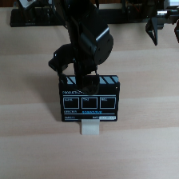  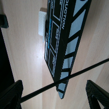

</details>

**Turn 10**

The stick now runs nearly vertically in the wrist image (good jaw alignment), but my top-view and wrist-view readings disagree on which way to shift laterally, so I'm making a deliberate +0.15 rad yaw test move to see unambiguously which way the gripper travels in each camera.

`move_joints`
````json
{
  "targets": {
    "right_j0": 0.81
  }
}
````

*executing move_joints over 3 steps (0.3s)*

<details open>
<summary>Observation 11</summary>

````text
Current observation.
Instruction: Lift the clapper stick, then let go so it snaps shut with a clap. Note that the context (top) cam is on the opposite sides of the arms.
state[joint_pos]: left_j0=-0.0067 left_j1=0.0071 left_j2=0.0067 left_j3=-0.0257 left_j4=-0.0071 left_j5=0.0006 left_gripper=0.9982 right_j0=0.7731 right_j1=2.2925 right_j2=2.6537 right_j3=-1.6905 right_j4=-0.0147 right_j5=2.125 right_gripper=0.9994

camera 'top_cam' (step 97):

[image omitted: streamed camera frame]

camera 'left_cam' (step 97):

[image omitted: streamed camera frame]

camera 'right_cam' (step 97):

[image omitted: streamed camera frame]
````

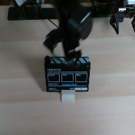  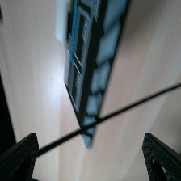

</details>

**Turn 11**

The test move confirmed the mapping: +j0 pushed the board up-left out of the wrist view, so I need the opposite. Moving back right by ~3.5 cm and retracting ~3.5 cm to bring the clapper stick into the gap between the jaws at the bottom of the wrist image.

`move_joints`
````json
{
  "targets": {
    "right_j0": 0.586,
    "right_j1": 2.18,
    "right_j2": 2.49,
    "right_j5": 2.05
  }
}
````

*executing move_joints over 3 steps (0.3s)*

<details open>
<summary>Observation 12</summary>

````text
Current observation.
Instruction: Lift the clapper stick, then let go so it snaps shut with a clap. Note that the context (top) cam is on the opposite sides of the arms.
state[joint_pos]: left_j0=-0.0071 left_j1=0.0071 left_j2=0.0067 left_j3=-0.0257 left_j4=-0.0071 left_j5=0.0002 left_gripper=0.9982 right_j0=0.6285 right_j1=2.2353 right_j2=2.5031 right_j3=-1.6798 right_j4=-0.0303 right_j5=2.0781 right_gripper=0.9994

camera 'top_cam' (step 100):

[image omitted: streamed camera frame]

camera 'left_cam' (step 100):

[image omitted: streamed camera frame]

camera 'right_cam' (step 100):

[image omitted: streamed camera frame]
````

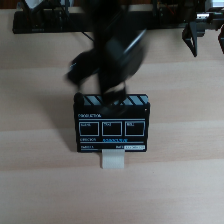  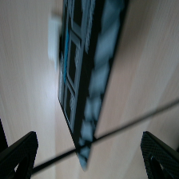

</details>

**Turn 12**

The previous command only partially executed (the arm stopped short of the targets), so I'm re-issuing the same pose to finish the retract-and-shift toward the clapper stick.

`move_joints`
````json
{
  "targets": {
    "right_j0": 0.586,
    "right_j1": 2.18,
    "right_j2": 2.49,
    "right_j5": 2.05
  }
}
````

*executing move_joints over 1 steps (0.1s)*

<details open>
<summary>Observation 13</summary>

````text
Current observation.
Instruction: Lift the clapper stick, then let go so it snaps shut with a clap. Note that the context (top) cam is on the opposite sides of the arms.
state[joint_pos]: left_j0=-0.0071 left_j1=0.0071 left_j2=0.0067 left_j3=-0.0257 left_j4=-0.0071 left_j5=-0.0002 left_gripper=0.9982 right_j0=0.5861 right_j1=2.223 right_j2=2.4912 right_j3=-1.6806 right_j4=-0.02 right_j5=2.0563 right_gripper=0.9994

camera 'top_cam' (step 101):

[image omitted: streamed camera frame]

camera 'left_cam' (step 101):

[image omitted: streamed camera frame]

camera 'right_cam' (step 101):

[image omitted: streamed camera frame]
````

  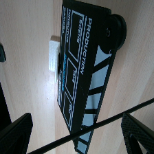

</details>

**Turn 13**

The wrist camera is now filled by the clapperboard and the top view shows the open jaws hovering just over the striped stick at the board's near edge; descending a cautious ~1.5 cm to see how close the fingers get.

`move_joints`
````json
{
  "targets": {
    "right_j1": 2.258,
    "right_j2": 2.496
  }
}
````

*executing move_joints over 1 steps (0.1s)*

<details open>
<summary>Observation 14</summary>

````text
Current observation.
Instruction: Lift the clapper stick, then let go so it snaps shut with a clap. Note that the context (top) cam is on the opposite sides of the arms.
state[joint_pos]: left_j0=-0.0071 left_j1=0.0071 left_j2=0.0067 left_j3=-0.0261 left_j4=-0.0071 left_j5=-0.0002 left_gripper=0.9982 right_j0=0.5861 right_j1=2.223 right_j2=2.4912 right_j3=-1.6798 right_j4=-0.0238 right_j5=2.0567 right_gripper=0.9994

camera 'top_cam' (step 102):

[image omitted: streamed camera frame]

camera 'left_cam' (step 102):

[image omitted: streamed camera frame]

camera 'right_cam' (step 102):

[image omitted: streamed camera frame]
````

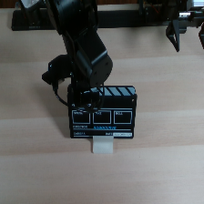  

</details>

**Turn 14**

I still can't tell for sure whether the wrist image is mirrored, which decides which side of the board the clapper stick is on; rolling the wrist +0.4 rad is a harmless test that tells me which way the image rotates.

`move_joints`
````json
{
  "targets": {
    "right_j5": 2.46
  }
}
````

*executing move_joints over 7 steps (0.7s)*

<details open>
<summary>Observation 15</summary>

````text
Current observation.
Instruction: Lift the clapper stick, then let go so it snaps shut with a clap. Note that the context (top) cam is on the opposite sides of the arms.
state[joint_pos]: left_j0=-0.0071 left_j1=0.0071 left_j2=0.0067 left_j3=-0.0257 left_j4=-0.0071 left_j5=0.0002 left_gripper=0.9982 right_j0=0.5861 right_j1=2.252 right_j2=2.4912 right_j3=-1.6798 right_j4=-0.0235 right_j5=2.1265 right_gripper=0.9994

camera 'top_cam' (step 109):

[image omitted: streamed camera frame]

camera 'left_cam' (step 109):

[image omitted: streamed camera frame]

camera 'right_cam' (step 109):

[image omitted: streamed camera frame]
````

  

</details>

**Turn 15**

In the wrist view the striped stick runs diagonally at roughly 50° to the jaw axis; rolling the wrist further (+0.65 rad) should bring the stick perpendicular to the jaws — I'll check the image and reverse if it gets worse.

`move_joints`
````json
{
  "targets": {
    "right_j5": 2.78
  }
}
````

*executing move_joints over 11 steps (1.1s)*

<details open>
<summary>Observation 16</summary>

````text
Current observation.
Instruction: Lift the clapper stick, then let go so it snaps shut with a clap. Note that the context (top) cam is on the opposite sides of the arms.
state[joint_pos]: left_j0=-0.0071 left_j1=0.0071 left_j2=0.0067 left_j3=-0.0257 left_j4=-0.0071 left_j5=-0.0002 left_gripper=0.9982 right_j0=0.5861 right_j1=2.2517 right_j2=2.4912 right_j3=-1.6798 right_j4=-0.0235 right_j5=2.1269 right_gripper=0.9994

camera 'top_cam' (step 120):

[image omitted: streamed camera frame]

camera 'left_cam' (step 120):

[image omitted: streamed camera frame]

camera 'right_cam' (step 120):

[image omitted: streamed camera frame]
````

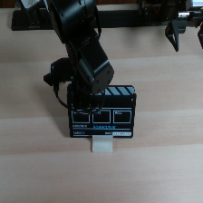  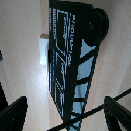

</details>

**Turn 16**

The wrist roll appears to have hit a limit around 2.13, so I'll accept the current jaw angle; now descending ~2 cm so the open jaws come down onto the clapper stick.

`move_joints`
````json
{
  "targets": {
    "right_j1": 2.304,
    "right_j2": 2.506
  }
}
````

*executing move_joints over 1 steps (0.1s)*

<details open>
<summary>Observation 17</summary>

````text
Current observation.
Instruction: Lift the clapper stick, then let go so it snaps shut with a clap. Note that the context (top) cam is on the opposite sides of the arms.
state[joint_pos]: left_j0=-0.0071 left_j1=0.0071 left_j2=0.0067 left_j3=-0.0257 left_j4=-0.0071 left_j5=0.0002 left_gripper=0.9982 right_j0=0.5861 right_j1=2.2517 right_j2=2.4912 right_j3=-1.6798 right_j4=-0.0235 right_j5=2.1269 right_gripper=0.9994

camera 'top_cam' (step 121):

[image omitted: streamed camera frame]

camera 'left_cam' (step 121):

[image omitted: streamed camera frame]

camera 'right_cam' (step 121):

[image omitted: streamed camera frame]
````

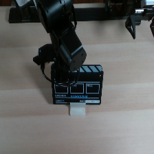  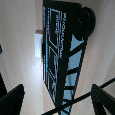

</details>

**Turn 17**

The arm seems to have stopped descending (possibly already in light contact) and the wrist view shows the jaws straddling the near edge of the clapperboard where the striped stick is; closing the gripper to see whether it catches the stick.

`move_joints`
````json
{
  "targets": {
    "right_gripper": 0.1
  }
}
````

*executing move_joints over 9 steps (0.9s)*

<details open>
<summary>Observation 18</summary>

````text
Current observation.
Instruction: Lift the clapper stick, then let go so it snaps shut with a clap. Note that the context (top) cam is on the opposite sides of the arms.
state[joint_pos]: left_j0=-0.0067 left_j1=0.0071 left_j2=0.0067 left_j3=-0.0257 left_j4=-0.0071 left_j5=0.0002 left_gripper=0.9982 right_j0=0.5861 right_j1=2.2963 right_j2=2.495 right_j3=-1.6764 right_j4=-0.0231 right_j5=2.1208 right_gripper=0.1041

camera 'top_cam' (step 130):

[image omitted: streamed camera frame]

camera 'left_cam' (step 130):

[image omitted: streamed camera frame]

camera 'right_cam' (step 130):

[image omitted: streamed camera frame]
````

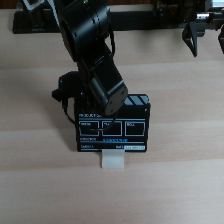  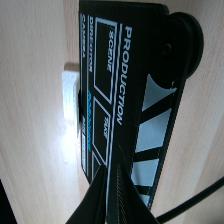

</details>

**Turn 18**

The gripper is now closed on something at the board's near edge; lifting the tool ~6 cm to see whether the clapper stick comes up with it (and whether the whole board lifts, which would mean I grabbed the wrong part).

`move_joints`
````json
{
  "targets": {
    "right_j1": 2.178,
    "right_j2": 2.527
  }
}
````

*executing move_joints over 2 steps (0.2s)*

<details open>
<summary>Observation 19</summary>

````text
Current observation.
Instruction: Lift the clapper stick, then let go so it snaps shut with a clap. Note that the context (top) cam is on the opposite sides of the arms.
state[joint_pos]: left_j0=-0.0071 left_j1=0.0071 left_j2=0.0067 left_j3=-0.0257 left_j4=-0.0071 left_j5=-0.0002 left_gripper=0.9982 right_j0=0.5861 right_j1=2.2776 right_j2=2.495 right_j3=-1.6749 right_j4=-0.0235 right_j5=2.1212 right_gripper=0.1038

camera 'top_cam' (step 132):

[image omitted: streamed camera frame]

camera 'left_cam' (step 132):

[image omitted: streamed camera frame]

camera 'right_cam' (step 132):

[image omitted: streamed camera frame]
````

  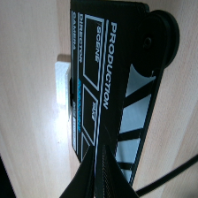

</details>

**Turn 19**

Now the wrist view is clear: the striped stick runs nearly vertically along the right edge of the frame while my jaws are centred ~3.5 cm to its left, on the slate face. Reopening the gripper and shifting back/left to put the stick between the jaws.

`move_joints`
````json
{
  "targets": {
    "right_gripper": 1,
    "right_j0": 0.631,
    "right_j1": 2.14,
    "right_j2": 2.38
  }
}
````

*executing move_joints over 9 steps (0.9s)*

<details open>
<summary>Observation 20</summary>

````text
Current observation.
Instruction: Lift the clapper stick, then let go so it snaps shut with a clap. Note that the context (top) cam is on the opposite sides of the arms.
state[joint_pos]: left_j0=-0.0071 left_j1=0.0071 left_j2=0.0067 left_j3=-0.0257 left_j4=-0.0071 left_j5=-0.0002 left_gripper=0.9982 right_j0=0.6258 right_j1=2.1998 right_j2=2.3852 right_j3=-1.6688 right_j4=-0.0235 right_j5=2.1132 right_gripper=0.9958

camera 'top_cam' (step 141):

[image omitted: streamed camera frame]

camera 'left_cam' (step 141):

[image omitted: streamed camera frame]

camera 'right_cam' (step 141):

[image omitted: streamed camera frame]
````

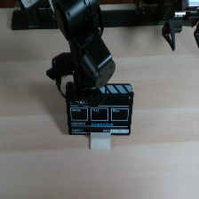  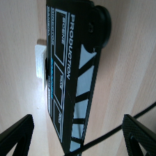

</details>

**Turn 20**

The stick now runs vertically down the middle of the wrist view, lined up with the gap between the jaws; descending ~2.5 cm so the open jaws straddle the stick.

`move_joints`
````json
{
  "targets": {
    "right_j1": 2.273,
    "right_j2": 2.41
  }
}
````

*executing move_joints over 2 steps (0.2s)*

<details open>
<summary>Observation 21</summary>

````text
Current observation.
Instruction: Lift the clapper stick, then let go so it snaps shut with a clap. Note that the context (top) cam is on the opposite sides of the arms.
state[joint_pos]: left_j0=-0.0071 left_j1=0.0071 left_j2=0.0067 left_j3=-0.0257 left_j4=-0.0071 left_j5=-0.0006 left_gripper=0.9982 right_j0=0.6266 right_j1=2.2059 right_j2=2.4092 right_j3=-1.6718 right_j4=-0.0235 right_j5=2.1128 right_gripper=0.9966

camera 'top_cam' (step 143):

[image omitted: streamed camera frame]

camera 'left_cam' (step 143):

[image omitted: streamed camera frame]

camera 'right_cam' (step 143):

[image omitted: streamed camera frame]
````

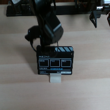  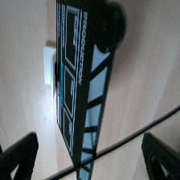

</details>

**Turn 21**

Only part of the descent executed (j1 lagged), so I'm re-issuing the same target to finish lowering the jaws around the stick.

`move_joints`
````json
{
  "targets": {
    "right_j1": 2.273,
    "right_j2": 2.41
  }
}
````

*executing move_joints over 2 steps (0.2s)*

<details open>
<summary>Observation 22</summary>

````text
Current observation.
Instruction: Lift the clapper stick, then let go so it snaps shut with a clap. Note that the context (top) cam is on the opposite sides of the arms.
state[joint_pos]: left_j0=-0.0071 left_j1=0.0071 left_j2=0.0067 left_j3=-0.0257 left_j4=-0.0071 left_j5=0.0002 left_gripper=0.9982 right_j0=0.6262 right_j1=2.2856 right_j2=2.4073 right_j3=-1.665 right_j4=-0.0235 right_j5=2.1101 right_gripper=0.9967

camera 'top_cam' (step 145):

[image omitted: streamed camera frame]

camera 'left_cam' (step 145):

[image omitted: streamed camera frame]

camera 'right_cam' (step 145):

[image omitted: streamed camera frame]
````

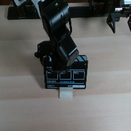  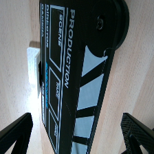

</details>

**Turn 22**

In the wrist view the striped stick still looks diagonal (~55°) to the jaw axis, which disagrees with my kinematic estimate, so I'm rolling the wrist back by ~0.55 rad and will compare the stick's apparent angle to settle which roll direction squares the jaws with the stick.

`move_joints`
````json
{
  "targets": {
    "right_j5": 1.55
  }
}
````

*executing move_joints over 9 steps (0.9s)*

<details open>
<summary>Observation 23</summary>

````text
Current observation.
Instruction: Lift the clapper stick, then let go so it snaps shut with a clap. Note that the context (top) cam is on the opposite sides of the arms.
state[joint_pos]: left_j0=-0.0067 left_j1=0.0071 left_j2=0.0067 left_j3=-0.0257 left_j4=-0.0071 left_j5=-0.0002 left_gripper=0.9982 right_j0=0.6262 right_j1=2.2856 right_j2=2.4073 right_j3=-1.665 right_j4=-0.0235 right_j5=1.6272 right_gripper=0.9967

camera 'top_cam' (step 154):

[image omitted: streamed camera frame]

camera 'left_cam' (step 154):

[image omitted: streamed camera frame]

camera 'right_cam' (step 154):

[image omitted: streamed camera frame]
````

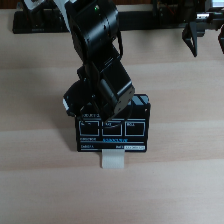 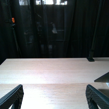 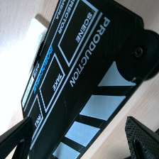

</details>

**Turn 23**

Rolling -0.48 rad made the stick appear more horizontal in the wrist image, confirming that +j5 rotates the view counter-clockwise; so I'm rolling well past the previous value to bring the stick vertical (perpendicular to the jaws).

`move_joints`
````json
{
  "targets": {
    "right_j5": 2.45
  }
}
````

*executing move_joints over 14 steps (1.4s)*

<details open>
<summary>Observation 24</summary>

````text
Current observation.
Instruction: Lift the clapper stick, then let go so it snaps shut with a clap. Note that the context (top) cam is on the opposite sides of the arms.
state[joint_pos]: left_j0=-0.0067 left_j1=0.0071 left_j2=0.0067 left_j3=-0.0257 left_j4=-0.0071 left_j5=-0.001 left_gripper=0.9982 right_j0=0.6266 right_j1=2.2856 right_j2=2.4073 right_j3=-1.665 right_j4=-0.0235 right_j5=2.1265 right_gripper=0.9967

camera 'top_cam' (step 168):

[image omitted: streamed camera frame]

camera 'left_cam' (step 168):

[image omitted: streamed camera frame]

camera 'right_cam' (step 168):

[image omitted: streamed camera frame]
````

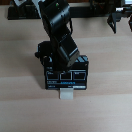  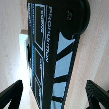

</details>

**Turn 24**

The wrist roll is hard-limited near 2.13 rad, but rolling to -0.54 gives the same jaw line rotated 180° plus the extra 27° I need; lifting ~4 cm first so the fingers don't sweep the board while rolling.

`move_joints`
````json
{
  "targets": {
    "right_j1": 2.2,
    "right_j2": 2.435,
    "right_j5": -0.54
  }
}
````

*executing move_joints over 43 steps (4.3s)*

<details open>
<summary>Observation 25</summary>

````text
Current observation.
Instruction: Lift the clapper stick, then let go so it snaps shut with a clap. Note that the context (top) cam is on the opposite sides of the arms.
state[joint_pos]: left_j0=-0.0067 left_j1=0.0071 left_j2=0.0067 left_j3=-0.0257 left_j4=-0.0071 left_j5=-0.0002 left_gripper=0.9982 right_j0=0.6247 right_j1=2.2456 right_j2=2.4123 right_j3=-1.6684 right_j4=-0.0231 right_j5=-0.4583 right_gripper=0.9967

camera 'top_cam' (step 211):

[image omitted: streamed camera frame]

camera 'left_cam' (step 211):

[image omitted: streamed camera frame]

camera 'right_cam' (step 211):

[image omitted: streamed camera frame]
````

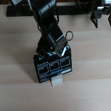  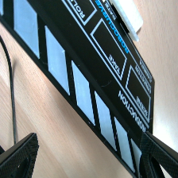

</details>

**Turn 25**

After the 180° roll the striped stick has dropped out of the wrist camera's field, so I'm raising the tool ~10 cm to get the whole clapperboard plus both fingertips in view before making the final alignment.

`move_joints`
````json
{
  "targets": {
    "right_j1": 2.0,
    "right_j2": 2.49
  }
}
````

*executing move_joints over 4 steps (0.4s)*

<details open>
<summary>Observation 26</summary>

````text
Current observation.
Instruction: Lift the clapper stick, then let go so it snaps shut with a clap. Note that the context (top) cam is on the opposite sides of the arms.
state[joint_pos]: left_j0=-0.0071 left_j1=0.0071 left_j2=0.0067 left_j3=-0.0261 left_j4=-0.0071 left_j5=0.0002 left_gripper=0.9982 right_j0=0.6243 right_j1=2.0712 right_j2=2.455 right_j3=-1.6642 right_j4=-0.0231 right_j5=-0.4747 right_gripper=0.9967

camera 'top_cam' (step 215):

[image omitted: streamed camera frame]

camera 'left_cam' (step 215):

[image omitted: streamed camera frame]

camera 'right_cam' (step 215):

[image omitted: streamed camera frame]
````

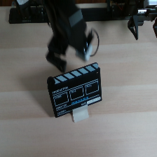  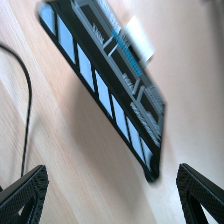

</details>

**Turn 26**

From the raised view I can clearly see the clapper stick's white stripes running diagonally at ~40° to the jaw axis; rolling the wrist -0.87 rad should turn it vertical in the image so the jaws close across the stick.

`move_joints`
````json
{
  "targets": {
    "right_j5": -1.345
  }
}
````

*executing move_joints over 14 steps (1.4s)*

<details open>
<summary>Observation 27</summary>

````text
Current observation.
Instruction: Lift the clapper stick, then let go so it snaps shut with a clap. Note that the context (top) cam is on the opposite sides of the arms.
state[joint_pos]: left_j0=-0.0071 left_j1=0.0071 left_j2=0.0067 left_j3=-0.0261 left_j4=-0.0071 left_j5=-0.001 left_gripper=0.9982 right_j0=0.6247 right_j1=2.0872 right_j2=2.45 right_j3=-1.6646 right_j4=-0.0231 right_j5=-1.2678 right_gripper=0.9967

camera 'top_cam' (step 229):

[image omitted: streamed camera frame]

camera 'left_cam' (step 229):

[image omitted: streamed camera frame]

camera 'right_cam' (step 229):

[image omitted: streamed camera frame]
````

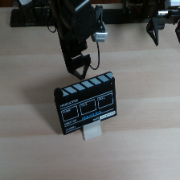  

</details>

**Turn 27**

With the wrist rolled so the jaws should now close across the stick, I'm bringing the tool back down to about 3 cm above the board while pulling the reach in to the stick's line at the board's near edge.

`move_joints`
````json
{
  "targets": {
    "right_j1": 2.14,
    "right_j2": 2.379
  }
}
````

*executing move_joints over 2 steps (0.2s)*

<details open>
<summary>Observation 28</summary>

````text
Current observation.
Instruction: Lift the clapper stick, then let go so it snaps shut with a clap. Note that the context (top) cam is on the opposite sides of the arms.
state[joint_pos]: left_j0=-0.0071 left_j1=0.0071 left_j2=0.0067 left_j3=-0.0257 left_j4=-0.0071 left_j5=-0.0002 left_gripper=0.9982 right_j0=0.6247 right_j1=2.0945 right_j2=2.4104 right_j3=-1.6588 right_j4=-0.0231 right_j5=-1.3087 right_gripper=0.9967

camera 'top_cam' (step 231):

[image omitted: streamed camera frame]

camera 'left_cam' (step 231):

[image omitted: streamed camera frame]

camera 'right_cam' (step 231):

[image omitted: streamed camera frame]
````

  

</details>

**Turn 28**

The wrist view now shows the striped stick running vertically, i.e. square to the jaws, and centred on the gap; continuing the descent toward the stick (moves execute only partially, so this acts as a slow approach).

`move_joints`
````json
{
  "targets": {
    "right_j1": 2.259,
    "right_j2": 2.376
  }
}
````

*executing move_joints over 3 steps (0.3s)*

<details open>
<summary>Observation 29</summary>

````text
Current observation.
Instruction: Lift the clapper stick, then let go so it snaps shut with a clap. Note that the context (top) cam is on the opposite sides of the arms.
state[joint_pos]: left_j0=-0.0071 left_j1=0.0071 left_j2=0.0067 left_j3=-0.0257 left_j4=-0.0071 left_j5=-0.001 left_gripper=0.9982 right_j0=0.6243 right_j1=2.2086 right_j2=2.3791 right_j3=-1.6531 right_j4=-0.0231 right_j5=-1.2945 right_gripper=0.9967

camera 'top_cam' (step 234):

[image omitted: streamed camera frame]

camera 'left_cam' (step 234):

[image omitted: streamed camera frame]

camera 'right_cam' (step 234):

[image omitted: streamed camera frame]
````

  

</details>

**Turn 29**

Top view shows the open jaws right at the board's near edge where the clapper stick is; dropping the last ~1.5 cm so the fingertips straddle the stick before closing.

`move_joints`
````json
{
  "targets": {
    "right_j1": 2.268,
    "right_j2": 2.423
  }
}
````

*executing move_joints over 1 steps (0.1s)*

<details open>
<summary>Observation 30</summary>

````text
Current observation.
Instruction: Lift the clapper stick, then let go so it snaps shut with a clap. Note that the context (top) cam is on the opposite sides of the arms.
state[joint_pos]: left_j0=-0.0067 left_j1=0.0071 left_j2=0.0067 left_j3=-0.0257 left_j4=-0.0071 left_j5=-0.0002 left_gripper=0.9982 right_j0=0.6247 right_j1=2.2742 right_j2=2.3734 right_j3=-1.6463 right_j4=-0.0231 right_j5=-1.3018 right_gripper=0.9967

camera 'top_cam' (step 235):

[image omitted: streamed camera frame]

camera 'left_cam' (step 235):

[image omitted: streamed camera frame]

camera 'right_cam' (step 235):

[image omitted: streamed camera frame]
````

  

</details>

**Turn 30**

The wrist view shows the striped stick right between/near the fingertips and the top view shows the jaws straddling the board's near edge; closing the gripper to try to pinch the clapper stick.

`move_joints`
````json
{
  "targets": {
    "right_gripper": 0.05
  }
}
````

*executing move_joints over 10 steps (1.0s)*

<details open>
<summary>Observation 31</summary>

````text
Current observation.
Instruction: Lift the clapper stick, then let go so it snaps shut with a clap. Note that the context (top) cam is on the opposite sides of the arms.
state[joint_pos]: left_j0=-0.0067 left_j1=0.0071 left_j2=0.0067 left_j3=-0.0257 left_j4=-0.0071 left_j5=-0.0002 left_gripper=0.9982 right_j0=0.622 right_j1=2.2704 right_j2=2.3814 right_j3=-1.6203 right_j4=-0.0147 right_j5=-1.2907 right_gripper=0.0842

camera 'top_cam' (step 245):

[image omitted: streamed camera frame]

camera 'left_cam' (step 245):

[image omitted: streamed camera frame]

camera 'right_cam' (step 245):

[image omitted: streamed camera frame]
````

  

</details>

**Turn 31**

Gripper is now closed at the board's near edge; lifting ~5 cm to see whether the clapper stick has been caught and swings up with the jaws.

`move_joints`
````json
{
  "targets": {
    "right_j1": 2.198,
    "right_j2": 2.469
  }
}
````

*executing move_joints over 2 steps (0.2s)*

<details open>
<summary>Observation 32</summary>

````text
Current observation.
Instruction: Lift the clapper stick, then let go so it snaps shut with a clap. Note that the context (top) cam is on the opposite sides of the arms.
state[joint_pos]: left_j0=-0.0067 left_j1=0.0071 left_j2=0.0067 left_j3=-0.0261 left_j4=-0.0074 left_j5=-0.001 left_gripper=0.9982 right_j0=0.6186 right_j1=2.2608 right_j2=2.4256 right_j3=-1.5902 right_j4=-0.0082 right_j5=-1.2911 right_gripper=0.0843

camera 'top_cam' (step 247):

[image omitted: streamed camera frame]

camera 'left_cam' (step 247):

[image omitted: streamed camera frame]

camera 'right_cam' (step 247):

[image omitted: streamed camera frame]
````

  

</details>

**Turn 32**

Nothing was caught: the wrist view shows bare table on one side of the closed fingers and the striped stick on the other, so the jaws closed just short (north) of the stick. Re-opening and moving ~3 cm forward (and slightly up) to bring the jaws over the stick itself.

`move_joints`
````json
{
  "targets": {
    "right_gripper": 1,
    "right_j1": 2.36,
    "right_j2": 2.724
  }
}
````

*executing move_joints over 10 steps (1.0s)*

<details open>
<summary>Observation 33</summary>

````text
Current observation.
Instruction: Lift the clapper stick, then let go so it snaps shut with a clap. Note that the context (top) cam is on the opposite sides of the arms.
state[joint_pos]: left_j0=-0.0071 left_j1=0.0071 left_j2=0.0067 left_j3=-0.0261 left_j4=-0.0071 left_j5=-0.0002 left_gripper=0.9982 right_j0=0.6189 right_j1=2.347 right_j2=2.6991 right_j3=-1.5917 right_j4=-0.0116 right_j5=-1.2942 right_gripper=0.9959

camera 'top_cam' (step 257):

[image omitted: streamed camera frame]

camera 'left_cam' (step 257):

[image omitted: streamed camera frame]

camera 'right_cam' (step 257):

[image omitted: streamed camera frame]
````

  

</details>

**Turn 33**

My wrist-camera interpretation keeps flip-flopping, so I'm switching to calibrating with the top camera: raising the gripper ~10 cm above the board so it is clearly visible and separated, then I'll make known moves to measure how it maps into the top view.

`move_joints`
````json
{
  "targets": {
    "right_j1": 2.29,
    "right_j2": 2.95
  }
}
````

*executing move_joints over 4 steps (0.4s)*

<details open>
<summary>Observation 34</summary>

````text
Current observation.
Instruction: Lift the clapper stick, then let go so it snaps shut with a clap. Note that the context (top) cam is on the opposite sides of the arms.
state[joint_pos]: left_j0=-0.0071 left_j1=0.0071 left_j2=0.0067 left_j3=-0.0261 left_j4=-0.0071 left_j5=0.0002 left_gripper=0.9982 right_j0=0.6189 right_j1=2.3287 right_j2=2.9223 right_j3=-1.5902 right_j4=-0.012 right_j5=-1.2945 right_gripper=0.9966

camera 'top_cam' (step 261):

[image omitted: streamed camera frame]

camera 'left_cam' (step 261):

[image omitted: streamed camera frame]

camera 'right_cam' (step 261):

[image omitted: streamed camera frame]
````

  

</details>

**Turn 34**

Calibration move: retracting the tool 8 cm straight back at constant height so I can measure exactly how far and in which direction the gripper travels in the top camera image.

`move_joints`
````json
{
  "targets": {
    "right_j1": 2.079,
    "right_j2": 2.589
  }
}
````

*executing move_joints over 6 steps (0.6s)*

<details open>
<summary>Observation 35</summary>

````text
Current observation.
Instruction: Lift the clapper stick, then let go so it snaps shut with a clap. Note that the context (top) cam is on the opposite sides of the arms.
state[joint_pos]: left_j0=-0.0071 left_j1=0.0071 left_j2=0.0067 left_j3=-0.0261 left_j4=-0.0071 left_j5=-0.0002 left_gripper=0.9982 right_j0=0.6189 right_j1=2.1399 right_j2=2.5992 right_j3=-1.5929 right_j4=-0.012 right_j5=-1.2945 right_gripper=0.9966

camera 'top_cam' (step 267):

[image omitted: streamed camera frame]

camera 'left_cam' (step 267):

[image omitted: streamed camera frame]

camera 'right_cam' (step 267):

[image omitted: streamed camera frame]
````

  

</details>

**Turn 35**

I now think the clapperboard is propped up at an angle (its 16 cm depth appears uncompressed in the oblique top view), so I must locate the fingertips precisely; rolling only the wrist ±1.5 rad changes just the gripper, letting me identify which black pixels in the top view are the fingers.

`move_joints`
````json
{
  "targets": {
    "right_j5": -2.85
  }
}
````

*executing move_joints over 25 steps (2.5s)*

<details open>
<summary>Observation 36</summary>

````text
Current observation.
Instruction: Lift the clapper stick, then let go so it snaps shut with a clap. Note that the context (top) cam is on the opposite sides of the arms.
state[joint_pos]: left_j0=-0.0071 left_j1=0.0071 left_j2=0.0067 left_j3=-0.0257 left_j4=-0.0071 left_j5=0.0002 left_gripper=0.9982 right_j0=0.6189 right_j1=2.141 right_j2=2.5931 right_j3=-1.5932 right_j4=-0.0124 right_j5=-2.0731 right_gripper=0.9967

camera 'top_cam' (step 292):

[image omitted: streamed camera frame]

camera 'left_cam' (step 292):

[image omitted: streamed camera frame]

camera 'right_cam' (step 292):

[image omitted: streamed camera frame]
````

  

</details>

**Turn 36**

In the top view I can now make out the two finger prongs just above the board's top edge, and they are currently separated east-west (along the stick) which is wrong; rolling the wrist +1.57 rad should turn the jaw axis north-south so it can straddle the board's top edge.

`move_joints`
````json
{
  "targets": {
    "right_j5": -0.5
  }
}
````

*executing move_joints over 26 steps (2.6s)*

<details open>
<summary>Observation 37</summary>

````text
Current observation.
Instruction: Lift the clapper stick, then let go so it snaps shut with a clap. Note that the context (top) cam is on the opposite sides of the arms.
state[joint_pos]: left_j0=-0.0071 left_j1=0.0071 left_j2=0.0067 left_j3=-0.0261 left_j4=-0.0071 left_j5=0.0002 left_gripper=0.9982 right_j0=0.6189 right_j1=2.141 right_j2=2.5931 right_j3=-1.5944 right_j4=-0.0124 right_j5=-0.5804 right_gripper=0.9967

camera 'top_cam' (step 318):

[image omitted: streamed camera frame]

camera 'left_cam' (step 318):

[image omitted: streamed camera frame]

camera 'right_cam' (step 318):

[image omitted: streamed camera frame]
````

  

</details>

**Turn 37**

Great view now: the board is propped up facing the camera, with the striped clapper stick along its raised top edge, and my open jaws are about 3 cm north of that edge with the jaw axis now across the board's thickness. Moving ~3 cm forward to straddle the top edge.

`move_joints`
````json
{
  "targets": {
    "right_j1": 2.332,
    "right_j2": 2.913
  }
}
````

*executing move_joints over 6 steps (0.6s)*

<details open>
<summary>Observation 38</summary>

````text
Current observation.
Instruction: Lift the clapper stick, then let go so it snaps shut with a clap. Note that the context (top) cam is on the opposite sides of the arms.
state[joint_pos]: left_j0=-0.0071 left_j1=0.0071 left_j2=0.0067 left_j3=-0.0261 left_j4=-0.0071 left_j5=-0.0006 left_gripper=0.9982 right_j0=0.6189 right_j1=2.3173 right_j2=2.8826 right_j3=-1.597 right_j4=-0.0124 right_j5=-0.5697 right_gripper=0.9967

camera 'top_cam' (step 324):

[image omitted: streamed camera frame]

camera 'left_cam' (step 324):

[image omitted: streamed camera frame]

camera 'right_cam' (step 324):

[image omitted: streamed camera frame]
````

  

</details>

**Turn 38**

The jaws are now straddling the raised top edge of the board where the striped clapper stick sits; closing the gripper to pinch the stick.

`move_joints`
````json
{
  "targets": {
    "right_gripper": 0.05
  }
}
````

*executing move_joints over 10 steps (1.0s)*

<details open>
<summary>Observation 39</summary>

````text
Current observation.
Instruction: Lift the clapper stick, then let go so it snaps shut with a clap. Note that the context (top) cam is on the opposite sides of the arms.
state[joint_pos]: left_j0=-0.0071 left_j1=0.0071 left_j2=0.0067 left_j3=-0.0257 left_j4=-0.0071 left_j5=0.0002 left_gripper=0.9982 right_j0=0.6189 right_j1=2.323 right_j2=2.8861 right_j3=-1.5978 right_j4=-0.0124 right_j5=-0.5835 right_gripper=0.0543

camera 'top_cam' (step 334):

[image omitted: streamed camera frame]

camera 'left_cam' (step 334):

[image omitted: streamed camera frame]

camera 'right_cam' (step 334):

[image omitted: streamed camera frame]
````

  

</details>

**Turn 39**

Jaws are now closed on the board's top edge; lifting about 4 cm to see whether the clapper stick swings open (or whether I've caught the whole board, which would show as the board tipping).

`move_joints`
````json
{
  "targets": {
    "right_j1": 2.367,
    "right_j2": 3.11
  }
}
````

*executing move_joints over 4 steps (0.4s)*

<details open>
<summary>Observation 40</summary>

````text
Current observation.
Instruction: Lift the clapper stick, then let go so it snaps shut with a clap. Note that the context (top) cam is on the opposite sides of the arms.
state[joint_pos]: left_j0=-0.0071 left_j1=0.0074 left_j2=0.0067 left_j3=-0.0261 left_j4=-0.0071 left_j5=-0.0002 left_gripper=0.9982 right_j0=0.6189 right_j1=2.3539 right_j2=3.0795 right_j3=-1.6009 right_j4=-0.0124 right_j5=-0.5846 right_gripper=0.0539

camera 'top_cam' (step 338):

[image omitted: streamed camera frame]

camera 'left_cam' (step 338):

[image omitted: streamed camera frame]

camera 'right_cam' (step 338):

[image omitted: streamed camera frame]
````

  

</details>

**Turn 40**

The lift moved nothing, so the closed jaws missed the stick — they were sitting behind/above the board's raised top edge. Reopening and reconfiguring the arm (less extended, gripper aimed ~50° down along the board's tilted face) to come down about 6 cm lower right onto the top edge.

`move_joints`
````json
{
  "targets": {
    "right_gripper": 1,
    "right_j1": 2.09,
    "right_j2": 2.32,
    "right_j3": -1.086
  }
}
````

*executing move_joints over 13 steps (1.3s)*

<details open>
<summary>Observation 41</summary>

````text
Current observation.
Instruction: Lift the clapper stick, then let go so it snaps shut with a clap. Note that the context (top) cam is on the opposite sides of the arms.
state[joint_pos]: left_j0=-0.0071 left_j1=0.0071 left_j2=0.0067 left_j3=-0.0257 left_j4=-0.0071 left_j5=-0.001 left_gripper=0.9982 right_j0=0.6189 right_j1=2.1403 right_j2=2.336 right_j3=-1.1442 right_j4=-0.0124 right_j5=-0.5873 right_gripper=0.9964

camera 'top_cam' (step 351):

[image omitted: streamed camera frame]

camera 'left_cam' (step 351):

[image omitted: streamed camera frame]

camera 'right_cam' (step 351):

[image omitted: streamed camera frame]
````

  

</details>

**Turn 41**

The gripper is now about 9 cm lower, with the board's tilted face filling the lower-left of the wrist view, so the jaws should be straddling the board's plane; closing them as a probe to learn exactly where the board sits relative to my fingers.

`move_joints`
````json
{
  "targets": {
    "right_gripper": 0.05
  }
}
````

*executing move_joints over 10 steps (1.0s)*

<details open>
<summary>Observation 42</summary>

````text
Current observation.
Instruction: Lift the clapper stick, then let go so it snaps shut with a clap. Note that the context (top) cam is on the opposite sides of the arms.
state[joint_pos]: left_j0=-0.0071 left_j1=0.0071 left_j2=0.0067 left_j3=-0.0257 left_j4=-0.0071 left_j5=-0.0006 left_gripper=0.9982 right_j0=0.6189 right_j1=2.1338 right_j2=2.3222 right_j3=-1.1454 right_j4=-0.0124 right_j5=-0.5911 right_gripper=0.0543

camera 'top_cam' (step 361):

[image omitted: streamed camera frame]

camera 'left_cam' (step 361):

[image omitted: streamed camera frame]

camera 'right_cam' (step 361):

[image omitted: streamed camera frame]
````

  

</details>

**Turn 42**

Closing again caught nothing, so I still don't know the board's true pose; raising the tool exactly 5 cm straight up as a test — how far the gripper shifts in the top image will tell me how steep that camera is and therefore whether the board is flat or propped up.

`move_joints`
````json
{
  "targets": {
    "right_j1": 2.236,
    "right_j2": 2.701,
    "right_j3": -1.4225
  }
}
````

*executing move_joints over 7 steps (0.7s)*

<details open>
<summary>Observation 43</summary>

````text
Current observation.
Instruction: Lift the clapper stick, then let go so it snaps shut with a clap. Note that the context (top) cam is on the opposite sides of the arms.
state[joint_pos]: left_j0=-0.0067 left_j1=0.0071 left_j2=0.0067 left_j3=-0.0257 left_j4=-0.0071 left_j5=0.0002 left_gripper=0.9982 right_j0=0.6189 right_j1=2.2173 right_j2=2.6713 right_j3=-1.3762 right_j4=-0.0124 right_j5=-0.5919 right_gripper=0.0539

camera 'top_cam' (step 368):

[image omitted: streamed camera frame]

camera 'left_cam' (step 368):

[image omitted: streamed camera frame]

camera 'right_cam' (step 368):

[image omitted: streamed camera frame]
````

  

</details>

**Turn 43**

The 5 cm test lift barely moved the gripper in the top view, so that camera is nearly overhead and the board is actually lying FLAT — the stick's chevrons are the band at the board's north edge. Repositioning: jaws open, gripper aimed ~78° down, moved ~5 cm back and ~3 cm right to sit above that stick.

`move_joints`
````json
{
  "targets": {
    "right_gripper": 1,
    "right_j0": 0.557,
    "right_j1": 2.318,
    "right_j2": 2.495,
    "right_j3": -1.538,
    "right_j5": -1.0
  }
}
````

*executing move_joints over 10 steps (1.0s)*

<details open>
<summary>Observation 44</summary>

````text
Current observation.
Instruction: Lift the clapper stick, then let go so it snaps shut with a clap. Note that the context (top) cam is on the opposite sides of the arms.
state[joint_pos]: left_j0=-0.0071 left_j1=0.0071 left_j2=0.0067 left_j3=-0.0261 left_j4=-0.0071 left_j5=-0.0002 left_gripper=0.9982 right_j0=0.5606 right_j1=2.2951 right_j2=2.5065 right_j3=-1.5059 right_j4=-0.0124 right_j5=-0.9504 right_gripper=0.9958

camera 'top_cam' (step 378):

[image omitted: streamed camera frame]

camera 'left_cam' (step 378):

[image omitted: streamed camera frame]

camera 'right_cam' (step 378):

[image omitted: streamed camera frame]
````

  

</details>

**Turn 44**

The gripper is now directly over the board's north edge where the striped stick lies (it occludes the stick in the top view); closing the jaws to pinch the stick.

`move_joints`
````json
{
  "targets": {
    "right_gripper": 0.05
  }
}
````

*executing move_joints over 10 steps (1.0s)*

<details open>
<summary>Observation 45</summary>

````text
Current observation.
Instruction: Lift the clapper stick, then let go so it snaps shut with a clap. Note that the context (top) cam is on the opposite sides of the arms.
state[joint_pos]: left_j0=-0.0067 left_j1=0.0071 left_j2=0.0067 left_j3=-0.0257 left_j4=-0.0071 left_j5=0.0002 left_gripper=0.9982 right_j0=0.5591 right_j1=2.3138 right_j2=2.5004 right_j3=-1.5085 right_j4=-0.0124 right_j5=-0.9504 right_gripper=0.0544

camera 'top_cam' (step 388):

[image omitted: streamed camera frame]

camera 'left_cam' (step 388):

[image omitted: streamed camera frame]

camera 'right_cam' (step 388):

[image omitted: streamed camera frame]
````

  

</details>

**Turn 45**

Jaws closed on the board's north edge; lifting ~4 cm to see whether the clapper stick swings up with them.

`move_joints`
````json
{
  "targets": {
    "right_j1": 2.42,
    "right_j2": 2.856,
    "right_j3": -1.7
  }
}
````

*executing move_joints over 6 steps (0.6s)*

<details open>
<summary>Observation 46</summary>

````text
Current observation.
Instruction: Lift the clapper stick, then let go so it snaps shut with a clap. Note that the context (top) cam is on the opposite sides of the arms.
state[joint_pos]: left_j0=-0.0071 left_j1=0.0071 left_j2=0.0067 left_j3=-0.0257 left_j4=-0.0071 left_j5=-0.0002 left_gripper=0.9982 right_j0=0.5591 right_j1=2.3989 right_j2=2.8323 right_j3=-1.6539 right_j4=-0.0124 right_j5=-0.9508 right_gripper=0.0539

camera 'top_cam' (step 394):

[image omitted: streamed camera frame]

camera 'left_cam' (step 394):

[image omitted: streamed camera frame]

camera 'right_cam' (step 394):

[image omitted: streamed camera frame]
````

  

</details>

**Turn 46**

Still nothing lifted, so the jaws are probably closing above the stick; re-opening and dropping the tool ~1.5 cm lower than the last attempt, keeping it over the board's north edge.

`move_joints`
````json
{
  "targets": {
    "right_gripper": 1,
    "right_j1": 2.3124,
    "right_j2": 2.4545,
    "right_j3": -1.464
  }
}
````

*executing move_joints over 10 steps (1.0s)*

<details open>
<summary>Observation 47</summary>

````text
Current observation.
Instruction: Lift the clapper stick, then let go so it snaps shut with a clap. Note that the context (top) cam is on the opposite sides of the arms.
state[joint_pos]: left_j0=-0.0071 left_j1=0.0071 left_j2=0.0067 left_j3=-0.0257 left_j4=-0.0071 left_j5=0.0002 left_gripper=0.9982 right_j0=0.5591 right_j1=2.3615 right_j2=2.4702 right_j3=-1.4754 right_j4=-0.0128 right_j5=-0.9508 right_gripper=0.9956

camera 'top_cam' (step 404):

[image omitted: streamed camera frame]

camera 'left_cam' (step 404):

[image omitted: streamed camera frame]

camera 'right_cam' (step 404):

[image omitted: streamed camera frame]
````

  

</details>

**Turn 47**

Both views now agree that my jaws are sitting about 4 cm too far south, over the slate face instead of the striped stick at the board's north edge; pulling the tool ~5 cm back (north) while lifting slightly.

`move_joints`
````json
{
  "targets": {
    "right_j1": 2.114,
    "right_j2": 2.124,
    "right_j3": -1.376
  }
}
````

*executing move_joints over 6 steps (0.6s)*

<details open>
<summary>Observation 48</summary>

````text
Current observation.
Instruction: Lift the clapper stick, then let go so it snaps shut with a clap. Note that the context (top) cam is on the opposite sides of the arms.
state[joint_pos]: left_j0=-0.0071 left_j1=0.0071 left_j2=0.0067 left_j3=-0.0257 left_j4=-0.0071 left_j5=0.0002 left_gripper=0.9982 right_j0=0.5541 right_j1=2.1559 right_j2=2.1487 right_j3=-1.3464 right_j4=-0.0113 right_j5=-0.9508 right_gripper=0.9966

camera 'top_cam' (step 410):

[image omitted: streamed camera frame]

camera 'left_cam' (step 410):

[image omitted: streamed camera frame]

camera 'right_cam' (step 410):

[image omitted: streamed camera frame]
````

  

</details>

**Turn 48**

After pulling back, the wrist camera now shows the stick's chevron stripes right next to the jaw gap at the bottom of the frame; closing the gripper on the stick.

`move_joints`
````json
{
  "targets": {
    "right_gripper": 0.05
  }
}
````

*executing move_joints over 10 steps (1.0s)*

<details open>
<summary>Observation 49</summary>

````text
Current observation.
Instruction: Lift the clapper stick, then let go so it snaps shut with a clap. Note that the context (top) cam is on the opposite sides of the arms.
state[joint_pos]: left_j0=-0.0071 left_j1=0.0071 left_j2=0.0067 left_j3=-0.0257 left_j4=-0.0071 left_j5=-0.0002 left_gripper=0.9982 right_j0=0.5541 right_j1=2.1403 right_j2=2.1361 right_j3=-1.3426 right_j4=-0.012 right_j5=-0.9504 right_gripper=0.0544

camera 'top_cam' (step 420):

[image omitted: streamed camera frame]

camera 'left_cam' (step 420):

[image omitted: streamed camera frame]

camera 'right_cam' (step 420):

[image omitted: streamed camera frame]
````

  

</details>

**Turn 49**

Jaws are closed right on the dark band at the board's north edge (the clapper stick); lifting ~4 cm to swing the stick open.

`move_joints`
````json
{
  "targets": {
    "right_j1": 2.154,
    "right_j2": 2.319,
    "right_j3": -1.512
  }
}
````

*executing move_joints over 3 steps (0.3s)*

<details open>
<summary>Observation 50</summary>

````text
Current observation.
Instruction: Lift the clapper stick, then let go so it snaps shut with a clap. Note that the context (top) cam is on the opposite sides of the arms.
state[joint_pos]: left_j0=-0.0071 left_j1=0.0071 left_j2=0.0067 left_j3=-0.0261 left_j4=-0.0071 left_j5=-0.0006 left_gripper=0.9982 right_j0=0.5541 right_j1=2.1563 right_j2=2.2833 right_j3=-1.441 right_j4=-0.012 right_j5=-0.9508 right_gripper=0.0539

camera 'top_cam' (step 423):

[image omitted: streamed camera frame]

camera 'left_cam' (step 423):

[image omitted: streamed camera frame]

camera 'right_cam' (step 423):

[image omitted: streamed camera frame]
````

  

</details>

**Turn 50**

Still nothing lifted even though the jaws look centred on the stick from above, so the fingers must be too high; opening and descending another 4 cm — if my height model is off, this will make contact with the board and reveal the true surface level.

`move_joints`
````json
{
  "targets": {
    "right_gripper": 1,
    "right_j1": 2.146,
    "right_j2": 2.106,
    "right_j3": -1.274
  }
}
````

*executing move_joints over 10 steps (1.0s)*

<details open>
<summary>Observation 51</summary>

````text
Current observation.
Instruction: Lift the clapper stick, then let go so it snaps shut with a clap. Note that the context (top) cam is on the opposite sides of the arms.
state[joint_pos]: left_j0=-0.0071 left_j1=0.0071 left_j2=0.0067 left_j3=-0.0261 left_j4=-0.0071 left_j5=-0.001 left_gripper=0.9982 right_j0=0.5541 right_j1=2.1536 right_j2=2.1185 right_j3=-1.285 right_j4=-0.0124 right_j5=-0.9508 right_gripper=0.9958

camera 'top_cam' (step 433):

[image omitted: streamed camera frame]

camera 'left_cam' (step 433):

[image omitted: streamed camera frame]

camera 'right_cam' (step 433):

[image omitted: streamed camera frame]
````

  

</details>

**Turn 51**

No contact yet at this height, so my table-height estimate is too high; lowering another 3 cm over the board's north edge, watching for the fingers to actually reach the stick (or touch the board).

`move_joints`
````json
{
  "targets": {
    "right_j1": 2.163,
    "right_j2": 2.015,
    "right_j3": -1.172
  }
}
````

*executing move_joints over 2 steps (0.2s)*

<details open>
<summary>Observation 52</summary>

````text
Current observation.
Instruction: Lift the clapper stick, then let go so it snaps shut with a clap. Note that the context (top) cam is on the opposite sides of the arms.
state[joint_pos]: left_j0=-0.0071 left_j1=0.0071 left_j2=0.0067 left_j3=-0.0257 left_j4=-0.0071 left_j5=-0.0006 left_gripper=0.9982 right_j0=0.5541 right_j1=2.146 right_j2=2.056 right_j3=-1.2171 right_j4=-0.012 right_j5=-0.9508 right_gripper=0.9966

camera 'top_cam' (step 435):

[image omitted: streamed camera frame]

camera 'left_cam' (step 435):

[image omitted: streamed camera frame]

camera 'right_cam' (step 435):

[image omitted: streamed camera frame]
````

  

</details>

**Turn 52**

Closing the jaws with the arm held still — comparing this top-camera frame with the previous open-jaw frame will show exactly which pixels are the fingertips and which way the jaw axis runs, and it is also another grasp attempt at this lower height.

`move_joints`
````json
{
  "targets": {
    "right_gripper": 0.05
  }
}
````

*executing move_joints over 10 steps (1.0s)*

<details open>
<summary>Observation 53</summary>

````text
Current observation.
Instruction: Lift the clapper stick, then let go so it snaps shut with a clap. Note that the context (top) cam is on the opposite sides of the arms.
state[joint_pos]: left_j0=-0.0071 left_j1=0.0071 left_j2=0.0067 left_j3=-0.0257 left_j4=-0.0071 left_j5=0.0002 left_gripper=0.9982 right_j0=0.5526 right_j1=2.1563 right_j2=2.0388 right_j3=-1.1984 right_j4=-0.0124 right_j5=-0.9508 right_gripper=0.0543

camera 'top_cam' (step 445):

[image omitted: streamed camera frame]

camera 'left_cam' (step 445):

[image omitted: streamed camera frame]

camera 'right_cam' (step 445):

[image omitted: streamed camera frame]
````

  

</details>

**Turn 53**

The close-up wrist view shows the board's face standing like a wall beside my fingers with its white base support right next to them — so the board IS propped up at an angle and I have been probing near its lower edge. Backing off 8 cm north and 12 cm up to get above its raised top edge where the clapper stick is.

`move_joints`
````json
{
  "targets": {
    "right_gripper": 1,
    "right_j0": 0.632,
    "right_j1": 1.498,
    "right_j2": 1.589,
    "right_j3": -1.138
  }
}
````

*executing move_joints over 11 steps (1.1s)*

<details open>
<summary>Observation 54</summary>

````text
Current observation.
Instruction: Lift the clapper stick, then let go so it snaps shut with a clap. Note that the context (top) cam is on the opposite sides of the arms.
state[joint_pos]: left_j0=-0.0067 left_j1=0.0074 left_j2=0.0067 left_j3=-0.0261 left_j4=-0.0071 left_j5=-0.0002 left_gripper=0.9982 right_j0=0.6281 right_j1=1.5352 right_j2=1.6051 right_j3=-1.1423 right_j4=-0.0124 right_j5=-0.9516 right_gripper=0.996

camera 'top_cam' (step 456):

[image omitted: streamed camera frame]

camera 'left_cam' (step 456):

[image omitted: streamed camera frame]

camera 'right_cam' (step 456):

[image omitted: streamed camera frame]
````

  

</details>

**Turn 54**

Now the wrist camera is looking straight at the striped clapper stick along the board's raised top edge, with the two jaws visible on either side of it — closing the gripper to pinch the stick.

`move_joints`
````json
{
  "targets": {
    "right_gripper": 0.05
  }
}
````

*executing move_joints over 10 steps (1.0s)*

<details open>
<summary>Observation 55</summary>

````text
Current observation.
Instruction: Lift the clapper stick, then let go so it snaps shut with a clap. Note that the context (top) cam is on the opposite sides of the arms.
state[joint_pos]: left_j0=-0.0071 left_j1=0.0071 left_j2=0.0067 left_j3=-0.0257 left_j4=-0.0071 left_j5=0.0002 left_gripper=0.9982 right_j0=0.6281 right_j1=1.5352 right_j2=1.5936 right_j3=-1.1446 right_j4=-0.012 right_j5=-0.9508 right_gripper=0.0544

camera 'top_cam' (step 466):

[image omitted: streamed camera frame]

camera 'left_cam' (step 466):

[image omitted: streamed camera frame]

camera 'right_cam' (step 466):

[image omitted: streamed camera frame]
````

  

</details>

**Turn 55**

The jaws closed just short of the stick — in the wrist view the striped bar sits right above the closed fingertips. Reopening and advancing ~4 cm along the tool axis so the stick sits deeper between the jaws.

`move_joints`
````json
{
  "targets": {
    "right_gripper": 1,
    "right_j1": 1.608,
    "right_j2": 1.524,
    "right_j3": -1.003
  }
}
````

*executing move_joints over 10 steps (1.0s)*

<details open>
<summary>Observation 56</summary>

````text
Current observation.
Instruction: Lift the clapper stick, then let go so it snaps shut with a clap. Note that the context (top) cam is on the opposite sides of the arms.
state[joint_pos]: left_j0=-0.0071 left_j1=0.0071 left_j2=0.0067 left_j3=-0.0261 left_j4=-0.0071 left_j5=-0.001 left_gripper=0.9982 right_j0=0.6281 right_j1=1.5982 right_j2=1.5372 right_j3=-1.0233 right_j4=-0.0124 right_j5=-0.9539 right_gripper=0.9957

camera 'top_cam' (step 476):

[image omitted: streamed camera frame]

camera 'left_cam' (step 476):

[image omitted: streamed camera frame]

camera 'right_cam' (step 476):

[image omitted: streamed camera frame]
````

  

</details>

**Turn 56**

The striped clapper stick now runs right between the two open jaws in the wrist view; closing to pinch it.

`move_joints`
````json
{
  "targets": {
    "right_gripper": 0.05
  }
}
````

*executing move_joints over 10 steps (1.0s)*

<details open>
<summary>Observation 57</summary>

````text
Current observation.
Instruction: Lift the clapper stick, then let go so it snaps shut with a clap. Note that the context (top) cam is on the opposite sides of the arms.
state[joint_pos]: left_j0=-0.0071 left_j1=0.0071 left_j2=0.0067 left_j3=-0.0257 left_j4=-0.0074 left_j5=-0.0002 left_gripper=0.9982 right_j0=0.6281 right_j1=1.6028 right_j2=1.5318 right_j3=-1.0142 right_j4=-0.0124 right_j5=-0.9535 right_gripper=0.0543

camera 'top_cam' (step 486):

[image omitted: streamed camera frame]

camera 'left_cam' (step 486):

[image omitted: streamed camera frame]

camera 'right_cam' (step 486):

[image omitted: streamed camera frame]
````

  

</details>

**Turn 57**

Jaws are closed around the striped stick; lifting the tool ~5 cm to swing the clapper stick open about its hinge.

`move_joints`
````json
{
  "targets": {
    "right_j1": 1.609,
    "right_j2": 1.738,
    "right_j3": -1.215
  }
}
````

*executing move_joints over 4 steps (0.4s)*

<details open>
<summary>Observation 58</summary>

````text
Current observation.
Instruction: Lift the clapper stick, then let go so it snaps shut with a clap. Note that the context (top) cam is on the opposite sides of the arms.
state[joint_pos]: left_j0=-0.0071 left_j1=0.0074 left_j2=0.0067 left_j3=-0.0261 left_j4=-0.0074 left_j5=0.0002 left_gripper=0.9982 right_j0=0.6281 right_j1=1.6127 right_j2=1.7073 right_j3=-1.1469 right_j4=-0.012 right_j5=-0.9535 right_gripper=0.0539

camera 'top_cam' (step 490):

[image omitted: streamed camera frame]

camera 'left_cam' (step 490):

[image omitted: streamed camera frame]

camera 'right_cam' (step 490):

[image omitted: streamed camera frame]
````

  

</details>

**Turn 58**

The board did not move, so the jaws are still closing short of the stick (they are above/north of it); reopening and pushing 5 cm further along the tool axis (down and toward the board's top edge).

`move_joints`
````json
{
  "targets": {
    "right_gripper": 1,
    "right_j1": 1.708,
    "right_j2": 1.639,
    "right_j3": -0.984
  }
}
````

*executing move_joints over 10 steps (1.0s)*

<details open>
<summary>Observation 59</summary>

````text
Current observation.
Instruction: Lift the clapper stick, then let go so it snaps shut with a clap. Note that the context (top) cam is on the opposite sides of the arms.
state[joint_pos]: left_j0=-0.0071 left_j1=0.0071 left_j2=0.0067 left_j3=-0.0257 left_j4=-0.0071 left_j5=-0.0006 left_gripper=0.9982 right_j0=0.6281 right_j1=1.6966 right_j2=1.655 right_j3=-1.0073 right_j4=-0.012 right_j5=-0.9539 right_gripper=0.9958

camera 'top_cam' (step 500):

[image omitted: streamed camera frame]

camera 'left_cam' (step 500):

[image omitted: streamed camera frame]

camera 'right_cam' (step 500):

[image omitted: streamed camera frame]
````

  

</details>

**Turn 59**

Wrist view shows the striped stick just left of the jaw centre and the top view shows my fingertip a centimetre or two above/north of the stick; nudging 2 cm sideways and 3 cm further along the tool axis to seat the stick between the jaws.

`move_joints`
````json
{
  "targets": {
    "right_j0": 0.673,
    "right_j1": 1.763,
    "right_j2": 1.629,
    "right_j3": -0.915
  }
}
````

*executing move_joints over 2 steps (0.2s)*

<details open>
<summary>Observation 60</summary>

````text
Current observation.
Instruction: Lift the clapper stick, then let go so it snaps shut with a clap. Note that the context (top) cam is on the opposite sides of the arms.
state[joint_pos]: left_j0=-0.0067 left_j1=0.0071 left_j2=0.0067 left_j3=-0.0261 left_j4=-0.0071 left_j5=-0.0002 left_gripper=0.9982 right_j0=0.6506 right_j1=1.7245 right_j2=1.6436 right_j3=-0.9577 right_j4=-0.0086 right_j5=-0.9539 right_gripper=0.9966

camera 'top_cam' (step 502):

[image omitted: streamed camera frame]

camera 'left_cam' (step 502):

[image omitted: streamed camera frame]

camera 'right_cam' (step 502):

[image omitted: streamed camera frame]
````

  

</details>

**Turn 60**

In the top view my fingertip still sits a bit north of and above the striped stick, so I'm advancing another 4 cm along the tool axis (down and forward) to bring the jaws around it.

`move_joints`
````json
{
  "targets": {
    "right_j1": 1.818,
    "right_j2": 1.618,
    "right_j3": -0.838
  }
}
````

*executing move_joints over 2 steps (0.2s)*

<details open>
<summary>Observation 61</summary>

````text
Current observation.
Instruction: Lift the clapper stick, then let go so it snaps shut with a clap. Note that the context (top) cam is on the opposite sides of the arms.
state[joint_pos]: left_j0=-0.0067 left_j1=0.0071 left_j2=0.0067 left_j3=-0.0257 left_j4=-0.0071 left_j5=-0.0002 left_gripper=0.9982 right_j0=0.6651 right_j1=1.7866 right_j2=1.6299 right_j3=-0.8848 right_j4=-0.0124 right_j5=-0.9539 right_gripper=0.9967

camera 'top_cam' (step 504):

[image omitted: streamed camera frame]

camera 'left_cam' (step 504):

[image omitted: streamed camera frame]

camera 'right_cam' (step 504):

[image omitted: streamed camera frame]
````

  

</details>

**Turn 61**

The stick now fills the middle of the wrist view between the jaws and the fingertip reaches the stick band in the top view; closing the gripper.

`move_joints`
````json
{
  "targets": {
    "right_gripper": 0.05
  }
}
````

*executing move_joints over 10 steps (1.0s)*

<details open>
<summary>Observation 62</summary>

````text
Current observation.
Instruction: Lift the clapper stick, then let go so it snaps shut with a clap. Note that the context (top) cam is on the opposite sides of the arms.
state[joint_pos]: left_j0=-0.0067 left_j1=0.0071 left_j2=0.0067 left_j3=-0.0261 left_j4=-0.0071 left_j5=-0.0002 left_gripper=0.9982 right_j0=0.6655 right_j1=1.8156 right_j2=1.6234 right_j3=-0.8772 right_j4=-0.0116 right_j5=-0.9535 right_gripper=0.0604

camera 'top_cam' (step 514):

[image omitted: streamed camera frame]

camera 'left_cam' (step 514):

[image omitted: streamed camera frame]

camera 'right_cam' (step 514):

[image omitted: streamed camera frame]
````

  

</details>

**Turn 62**

The jaws closed with a slightly wider final opening than before, suggesting something is held; lifting 4 cm to see if the clapper stick swings open.

`move_joints`
````json
{
  "targets": {
    "right_j1": 1.798,
    "right_j2": 1.763,
    "right_j3": -1.034
  }
}
````

*executing move_joints over 3 steps (0.3s)*

<details open>
<summary>Observation 63</summary>

````text
Current observation.
Instruction: Lift the clapper stick, then let go so it snaps shut with a clap. Note that the context (top) cam is on the opposite sides of the arms.
state[joint_pos]: left_j0=-0.0067 left_j1=0.0071 left_j2=0.0067 left_j3=-0.0261 left_j4=-0.0071 left_j5=0.0002 left_gripper=0.9982 right_j0=0.6659 right_j1=1.8172 right_j2=1.7267 right_j3=-0.9623 right_j4=-0.0154 right_j5=-0.9535 right_gripper=0.0614

camera 'top_cam' (step 517):

[image omitted: streamed camera frame]

camera 'left_cam' (step 517):

[image omitted: streamed camera frame]

camera 'right_cam' (step 517):

[image omitted: streamed camera frame]
````

  

</details>

**Turn 63**

Still no movement of the board, so the jaws are pinching air just above the top edge; opening and dropping 2 cm further along the tool axis so the jaws bracket the striped stick itself.

`move_joints`
````json
{
  "targets": {
    "right_gripper": 1,
    "right_j1": 1.864,
    "right_j2": 1.717,
    "right_j3": -0.906
  }
}
````

*executing move_joints over 10 steps (1.0s)*

<details open>
<summary>Observation 64</summary>

````text
Current observation.
Instruction: Lift the clapper stick, then let go so it snaps shut with a clap. Note that the context (top) cam is on the opposite sides of the arms.
state[joint_pos]: left_j0=-0.0071 left_j1=0.0071 left_j2=0.0067 left_j3=-0.0257 left_j4=-0.0071 left_j5=0.0002 left_gripper=0.9982 right_j0=0.6659 right_j1=1.8519 right_j2=1.7264 right_j3=-0.9161 right_j4=-0.0158 right_j5=-0.9543 right_gripper=0.9957

camera 'top_cam' (step 527):

[image omitted: streamed camera frame]

camera 'left_cam' (step 527):

[image omitted: streamed camera frame]

camera 'right_cam' (step 527):

[image omitted: streamed camera frame]
````

  

</details>

**Turn 64**

Computing the jaw axis in world coordinates reveals my error: at j5≈-0.95 the jaws were closing east-west, i.e. ALONG the stick, which is why every attempt caught nothing. Rolling to j5≈+0.97 makes the jaws close north-south, across the board's top edge.

`move_joints`
````json
{
  "targets": {
    "right_j5": 0.974
  }
}
````

*executing move_joints over 31 steps (3.1s)*

<details open>
<summary>Observation 65</summary>

````text
Current observation.
Instruction: Lift the clapper stick, then let go so it snaps shut with a clap. Note that the context (top) cam is on the opposite sides of the arms.
state[joint_pos]: left_j0=-0.0067 left_j1=0.0071 left_j2=0.0067 left_j3=-0.0257 left_j4=-0.0071 left_j5=0.0002 left_gripper=0.9982 right_j0=0.6659 right_j1=1.8584 right_j2=1.7264 right_j3=-0.9173 right_j4=-0.0162 right_j5=0.8944 right_gripper=0.9966

camera 'top_cam' (step 558):

[image omitted: streamed camera frame]

camera 'left_cam' (step 558):

[image omitted: streamed camera frame]

camera 'right_cam' (step 558):

[image omitted: streamed camera frame]
````

  

</details>

**Turn 65**

With the jaws now correctly oriented, the wrist view shows the striped stick at the bottom edge of the frame, about 5 cm north of my tool; shifting the gripper north (and slightly east) to bring the stick between the jaws.

`move_joints`
````json
{
  "targets": {
    "right_j0": 0.752,
    "right_j1": 1.733,
    "right_j2": 1.572,
    "right_j3": -0.888
  }
}
````

*executing move_joints over 3 steps (0.3s)*

[Back to index](README.md)
